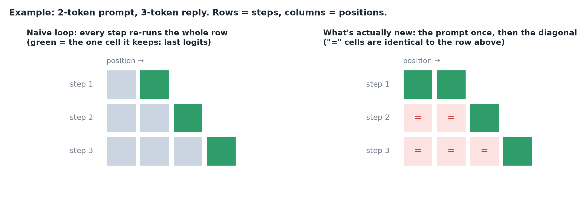

# Revision 14-17 · The KV Cache Story

*Interactive revision of lessons [14](../notes/14-why-autoregressive-generation-recomputes-work.md), [15](../notes/15-understand-measure-prefill-phase.md), [16](../notes/16-understand-measure-decode-phase.md) and [17](../notes/17-build-a-kv-cache.md): each question as asked, the answer, where I slipped, and the one-line takeaway.*

## Q1 · How much work does the naive loop waste? <span class="badge mid">partial</span>

*Covers: 14*

> [!NOTE]
> To generate a reply, the model predicts one token at a time. The naive way re-feeds the **entire sequence so far** on every step. With a 512-token prompt and a 256-token reply: how many tokens does it push through the model in total, how many are actually needed, what's the waste ratio, and why is the rest unnecessary?

**First, a tiny example** (prompt P = 2 tokens, reply N = 3 tokens). Each step re-feeds everything so far and keeps only the last position's prediction:

- Step 1: feed 2 tokens → predict token #3. **Processed 2.**
- Step 2: feed 3 tokens (prompt + 1 generated) → predict #4. **Processed 3.**
- Step 3: feed 4 tokens → predict #5. **Processed 4.**

Total processed = 2 + 3 + 4 = 9, but only 5 tokens exist. The grid shows where the waste is: each step recomputes the whole row, but only the green diagonal cell is new; every "=" cell is identical to the row above.



**Now the real numbers** (P = 512, N = 256). Step k feeds 512 + k tokens, for k = 0 … 255:

1. The **prompt** (512 tokens) is re-fed on all 256 steps: 256 × 512 = **131,072**.
2. The **growing reply** adds 0, then 1, … up to 255: that sum is 255 × 256 ÷ 2 = **32,640**.
3. Total ≈ **163,712** tokens pushed through the model.
4. **Needed:** each of the 768 real tokens (512 + 256) goes through the model **once** to compute its key and value: P + N = **768**.
5. Waste ratio: 163,712 ÷ 768 ≈ **213×** (roughly the reply length).
6. **Why unnecessary:** under the causal mask, token #5's key and value depend only on tokens 1–5, so adding token #6 later can't change them. The naive loop recomputes the same keys/values every step. Fix: compute each token's K and V once and store them (the KV cache); each step then does the work for just the one new token.

> [!WARNING]
> Said "roughly n²", forgetting that the 512-token prompt is re-run every step (N × P dominates here). Said "needed = 1" (that's what each step uses, the last logits); what must be computed is every token once, P + N.

> [!IMPORTANT]
> Naive work = N·P + N(N − 1)/2 vs P + N needed. Causal masking makes old positions constant, so cache their K and V.

> [!TIP]
> Separate "what a step uses" from "what must be computed at least once".

## Q2 · Read prefill throughput off a TTFT sweep <span class="badge miss">missed</span>

*Covers: 15*

> [!NOTE]
> TTFT (one request, max_tokens = 1, medians): 256 tokens → 23 ms; 8,000 tokens → 280 ms. Assuming TTFT = fixed cost + tokens ÷ throughput, what are the prefill throughput and the fixed cost? What is the fixed cost made of?

**How to solve it**

1. **Slope** = extra time ÷ extra tokens = (280 − 23) ms ÷ (8,000 − 256) = 257 ms ÷ 7,744 ≈ **0.033 ms/token**.
2. **Throughput** = 1 ÷ 0.033 ms ≈ **30,000 tokens/s**, matching the napkin "half of H100 peak" (lesson 15).
3. **Fixed cost** = 23 − 256 × 0.033 ≈ 23 − 8.5 ≈ **14.5 ms**.
4. **Made of:** per-request overhead (**networking, tokenization, scheduling**), not prefill (that's the slope) and not decode (max_tokens = 1).

> [!WARNING]
> Got ~11k tokens/s by dividing one point (256 ÷ 23 ms), which folds the fixed cost into throughput. Wasn't sure what the fixed cost contains.

> [!IMPORTANT]
> Fit TTFT vs prompt length as a line: 1 ÷ slope = prefill throughput; intercept = fixed overhead.

> [!TIP]
> With a fixed cost in play, use the difference between two points, never a single point's ratio.

## Q3 · TPOT from timestamps, and a stuttering stream <span class="badge mid">partial</span>

*Covers: 16, 15*

> [!NOTE]
> One request: TTFT 0.3 s, E2E 2.3 s, 401 output tokens. What's TPOT, and why not E2E ÷ 401? Average TPOT looks fine but users say the stream stutters: what do you look at?

**Answer**

- **TPOT = (E2E − TTFT) ÷ (N_out − 1)** = (2.3 − 0.3) ÷ 400 = **5 ms**. E2E ÷ 401 would fold the prefill pause (TTFT) into the per-token pace; and the first token arrived with TTFT, so only 400 gaps remain.
- **Stutter:** look at the **individual inter-token gaps** and their tail (P95/P99), not the average. A common cause: another user's big prefill occupies the GPU and every stream pauses behind it (lesson 15); fix with chunked prefill.

> [!WARNING]
> Divided by 401 instead of 400. Pointed at queue length / KV usage for stutter: those explain slow starts and capacity, not uneven gaps.

> [!IMPORTANT]
> TPOT = (E2E − TTFT) ÷ (N − 1). Stutter lives in the tail of inter-token gaps, which an average hides.

## Q4 · Three KV cache bugs <span class="badge miss">missed</span>

*Covers: 17, 11*

> [!NOTE]
> A preallocated KV cache shows: (1) first token fine, the rest gibberish; (2) outputs subtly worse, buffer preallocated with zeros and attention reads all of it; (3) an answer mentions the previous user's conversation. The bug behind each?

**Answer**

1. **RoPE position:** queries and keys are rotated by their position. The decode token was fed as position 0 instead of the pointer's position (e.g. 512). The first token comes from prefill (positions right), every later step uses the wrong rotation → gibberish.
2. **Reading empty slots:** a zero key scores q · 0 = 0, and e⁰ = 1, so every unfilled slot steals attention weight. Fix: slice or mask to the filled length.
3. **No reset between requests:** the pointer and old K/V weren't cleared, so the new user attends to the previous user's text. Fix: reset per request. A privacy bug, not just quality.

> [!WARNING]
> Guessed "wrong K/V stored, or only one layer's" for bug 1 (that would usually break the first decoded token too). Couldn't identify bugs 2 and 3.

> [!IMPORTANT]
> KV cache checklist: rotate at the true position, read only filled slots, reset per request (and store 8 KV heads, broadcast, don't copy).

> [!TIP]
> Match the symptom's timing: "first token fine, then broken" points at something that differs between prefill and decode.

## Exercise · Toy KV cache vs naive recompute <span class="badge ok">solid</span>

*Covers: 14, 17*

> [!NOTE]
> One attention head on random 8-number vectors. Write the cached loop (preallocated K/V buffers, a position pointer, read only filled slots) and prove it matches the naive loop exactly; then read the empty slots to see bug 2.

```python
def cached_outputs(x, prompt_len, read_all_slots=False):
    K_cache = np.zeros((max_len, d))                 # 1 · preallocated, fixed shape, zeros
    V_cache = np.zeros((max_len, d))
    pos = 0
    K_cache[:prompt_len] = x[:prompt_len] @ Wk       # 2 · prefill: whole prompt in one shot
    V_cache[:prompt_len] = x[:prompt_len] @ Wv
    pos = prompt_len

    def read():                                      # 4 · filled rows only (bug flag: all rows)
        n = max_len if read_all_slots else pos
        return K_cache[:n], V_cache[:n]

    outs = [attend(x[prompt_len - 1] @ Wq, *read())]   # first output comes from prefill
    for t in range(prompt_len, len(x)):              # 3 · decode: one k, v per new token
        K_cache[pos] = x[t] @ Wk
        V_cache[pos] = x[t] @ Wv
        pos += 1
        outs.append(attend(x[t] @ Wq, *read()))      # query used once, never cached
    return np.array(outs)
```

**Result:** `cached == naive: True`; reading the zero-filled slots gives a max error of **~3.97**, because each zero key scores 0 and gets weight e⁰ = 1.

> [!IMPORTANT]
> The cache is exact: same outputs, each k, v computed once. Read only slots 0 … pos − 1.
