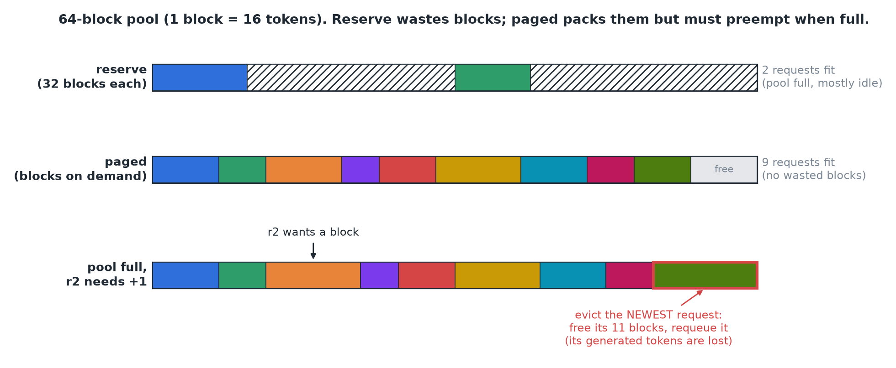

# Revision 18-19 · Capacity Planning

*Interactive revision of [lesson 18](../notes/18-calculate-model-runtime-memory.md) and [lesson 19](../notes/19-kv-memory-context-concurrency-limits.md): each question as asked, the answer, where I slipped, and the one-line takeaway.*

## Q1 · Which startup crash did you hit? <span class="badge mid">partial</span>

*Covers: 18*

> [!NOTE]
> Llama 3 8B on an H100 with vLLM crashes on three days: (1) while loading the model, (2) while sizing the KV cache after setting max_model_len = 1,000,000, (3) during CUDA graph capture. What ran out, and what's the fix for each?

**Answer**

1. **Loading:** the weights don't fit in GPU memory. Fix: more GPUs (tensor parallel) or lower precision. (For 16 GB on 80 GB, suspect another process occupying the GPU.)
2. **Sizing the cache:** one max-length request can't fit in the pool: 1,000,000 × 128 KiB ≈ **122 GiB** vs ~53 GB. Fix: **lower max_model_len** (e.g. 128k), or grow the pool (FP8 KV, higher budget, more GPUs).
3. **Graph capture:** the headroom outside the 90% budget was too small (graphs take 1–5 GB). Fix: **lower gpu_memory_utilization** (0.9 → 0.85), capture fewer graph sizes, or disable graphs at a speed cost.

> [!WARNING]
> Said "reduce KV cache size" for crash 2 (the cache is already everything left; the max length is what's too big). Didn't know crash 3 is about headroom outside the budget.

> [!IMPORTANT]
> The startup stage tells you what ran out: loading → weights; cache sizing → max length vs pool; graph capture → headroom.

## Q2 · Chat vs document Q&A on one GPU <span class="badge mid">partial</span>

*Covers: 19*

> [!NOTE]
> One H100, Llama 3 8B, ~53 GB pool ≈ 400k tokens. Chat: 1,000-token prompts + 500-token replies. Document Q&A: 12,000 tokens of context + 1,000-token replies. How many simultaneous conversations fit, and what does 100 users of each need?

**Answer**

| | Chat | Document Q&A |
|---|---|---|
| Tokens per conversation | 1,000 + 500 = **1,500** | 12,000 + 1,000 = **13,000** |
| Cache per conversation = tokens × 128 KiB | 1,500 × 128 KiB = 192,000 KiB ≈ **0.19 GB** | 13,000 × 128 KiB = 1,664,000 KiB ≈ **1.6 GiB** |
| Fit at once = 400k tokens ÷ tokens per conv | 400,000 ÷ 1,500 ≈ **267** | 400,000 ÷ 13,000 ≈ **31** |
| 100 users need = 100 × cache per conv | 100 × 0.19 ≈ **19 GB** | 100 × 1.6 ≈ **160 GB** |
| GPUs = 100 users ÷ fit per GPU | 19 GB < one 53 GB pool → **1 GPU** | ⌈100 ÷ 31⌉ = **4 GPUs** |

Two ways to get the same GPU count: by **memory** (160 GB ÷ 53 GB per GPU ≈ 4) or by **users** (100 ÷ 31 per GPU ≈ 4). Chat's 19 GB fits inside one GPU's 53 GB pool, so one GPU.

The workload, not the model, sets the hardware bill. Levers: FP8 KV cache (2× tokens → ~2 GPUs for docs), paged allocation.

> [!WARNING]
> Described the right method (tokens × 128 KiB, pool ÷ that) but gave no numbers or GPU count.

> [!IMPORTANT]
> Concurrency = pool ÷ (tokens per conversation × KV per token). Long-context workloads (RAG) need several times the hardware of chat.

## Q3 · Reserve the max length vs allocate as tokens arrive <span class="badge mid">partial</span>

*Covers: 19, 17*

> [!NOTE]
> The engine reserves 8,192 tokens per request up front. With a ~400k-token pool, how many requests fit? If conversations average 1,500 tokens and memory is handed out in blocks as tokens arrive, how many fit? Name the technique and its catch.

**Answer**

1. Reserved: 400k ÷ 8,192 ≈ **49 requests**.
2. Allocated as tokens arrive: 400k ÷ 1,500 ≈ **~270 requests**, ~5.5× more from the same memory.
3. **PagedAttention / paged KV memory** (vLLM): small fixed-size blocks handed out on demand, so there's no fragmentation.
4. **Catch: overcommitment.** The engine bets requests stay short. If many grow long at once, the pool runs out mid-generation and the engine must **preempt** (pause requests, free their blocks, later recompute or swap back): those users see stalls.

> [!WARNING]
> Wrote 192 instead of 8,192 and gave no numbers. Said the catch is "exponential fragmentation": paging removes fragmentation; the real risk is running out mid-generation and preempting.

> [!IMPORTANT]
> Paged KV allocates real usage, not max length (~5.5× more requests here); the price is preemption when too many conversations grow long.

## Exercise · Simulate a paged KV allocator <span class="badge mid">partial</span>

*Covers: 19, 17*

> [!NOTE]
> A fixed KV pool holds 64 **blocks** of 16 tokens each. 20 requests arrive (prompt 100 tokens, reply 50–400), and every running request generates one token per step. Simulate two policies and count how many run at once, how often one gets evicted, and how long all 20 take.
> - **reserve:** on admission a request grabs blocks for the full max length (512 tokens = 32 blocks) and never asks again.
> - **paged:** a request grabs only the blocks it needs now, and one more each time it crosses into a new block. If the pool is empty when it needs one, **preempt** the newest running request.

**The picture.** The pool is a strip of 64 blocks. Reserve gives each request 32 blocks whether it uses them or not, so only 2 fit and most blocks sit idle. Paged hands out blocks on demand, so 9 short requests pack in, but when the pool is full and a running request needs one more, the engine must evict someone.



**The whole program** (the only trick is that everything is counted in blocks, with `need(tokens) = ⌈tokens ÷ 16⌉`):

```python
import math

def simulate(requests, pool_blocks, block=16, policy="paged", max_len=512):
    need = lambda toks: math.ceil(toks / block)      # blocks to hold `toks` tokens: 100 -> 7
    waiting = list(range(len(requests)))             # request ids, first-come-first-served
    running = {}                                     # id -> [tokens_so_far, blocks_held]
    free = pool_blocks                               # blocks nobody owns right now
    peak = preempt = steps = done = 0

    while done < len(requests):
        steps += 1

        # 1 · ADMIT from the front of the queue while the next one fits.
        while waiting:
            rid = waiting[0]
            p, _ = requests[rid]
            want = need(max_len) if policy == "reserve" else need(p)   # reserve grabs max length
            if want > free:
                break                                # doesn't fit: stop (no skipping ahead)
            waiting.pop(0)
            free -= want
            running[rid] = [p, want]                 # starts holding its prompt

        peak = max(peak, len(running))

        # 2 · GROW: every running request makes one token.
        for rid in list(running):                    # list(): we may delete while looping
            if rid not in running:                   # it was evicted earlier this step
                continue
            toks, held = running[rid]
            p, out = requests[rid]
            toks += 1                                # the new token

            # Paged only: did this token spill past the blocks we hold?
            if policy == "paged" and need(toks) > held:
                if free == 0:                        # pool dry -> preempt the newest request
                    victim = max(running)            # largest id = most recently admitted
                    free += running.pop(victim)[1]   # remove it AND return its blocks
                    waiting.insert(0, victim)        # it restarts from its prompt later
                    preempt += 1
                    if victim == rid:                # we evicted ourselves: stop here
                        continue
                free -= 1                            # take one block for the new token
                held += 1

            running[rid] = [toks, held]

            # 3 · FINISH: generated all `out` tokens beyond the prompt -> give blocks back.
            if toks >= p + out:
                free += held
                del running[rid]
                done += 1

    return dict(peak=peak, preemptions=preempt, steps=steps)

reqs = [(100, 50 + (i * 37) % 350) for i in range(20)]
simulate(reqs, 64, policy="reserve")   # {'peak': 2, 'preemptions': 0,  'steps': 2187}
simulate(reqs, 64, policy="paged")     # {'peak': 9, 'preemptions': 50, 'steps': 1265}
```

**Reading the result:**

| Policy | Peak running | Preemptions | Steps to finish all |
|---|---|---|---|
| Reserve 512 up front | 2 | 0 | 2,187 |
| Paged | 9 | 50 | 1,265 |

Paged keeps **4.5× more requests** running at once and finishes **1.7× sooner**, because it isn't wasting blocks on replies that end early. The price is **50 preemptions**: 50 times a request was evicted and had to restart, which a real user would feel as a stall.

> [!WARNING]
> Compared tokens with blocks in `want` (512 vs 64 free blocks → nothing ever admitted → infinite loop; that's why an earlier run hung). Used `toks % 16 == 0` to detect a new block (off by one; compare `need(toks) > held`). Wrote `max(running, key=lambda i: i[0])`, which crashes because the keys are plain ints. Read the victim's blocks without removing it from `running`.

> [!IMPORTANT]
> Keep one unit throughout (blocks, via `need()`). Admit while it fits, grab a block when a token spills over, preempt the newest when the pool is dry, free blocks on finish. Paged trades a little preemption for a lot more concurrency.
