# 01 · What Is Inference & Inference Engineering?

**Source:** [fanout.sh / inference-eng / in-01](https://fanout.sh/inference-eng/curriculum/in-01) · ~9 min

> [!NOTE]
> Inference is running a trained model token by token, every time someone uses it, so across a fleet it usually costs more than training. Decode is limited by memory bandwidth (moving weights), not arithmetic. Latency, throughput and cost pull against each other, and batching is the first lever. The job is a loop: measure, find the bottleneck, change one thing, measure again.

## 1. Why inference matters: the DeepSeek bill

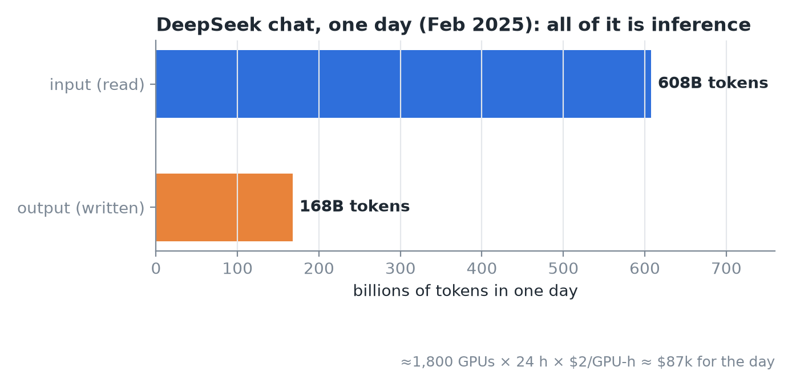
*DeepSeek chat service, 24 h, Feb 2025: ~1,800 GPUs on average, ~$87k for the day at $2/GPU-hour.*

- One day of DeepSeek chat: **608B input tokens** read, **168B output tokens** written.
- Ran on **~1,800 GPUs** on average. At $2/GPU-hour: 1,800 × 24 × $2 ≈ **$87k/day**.
- The model was trained months earlier. Every one of those tokens was inference.

> [!IMPORTANT]
> The gap between serving well and serving badly comes from a small number of engineering decisions. That gap is the job.

## 2. What inference actually is

- A trained model is **just a file of numbers**. Llama 3 8B has about 8B params at 16 bits (2 bytes each), so the file is **about 16 GB**.
- **Inference = running it.** Feed in text, predict the next token, append it, and repeat until done. This is **autoregressive** generation.

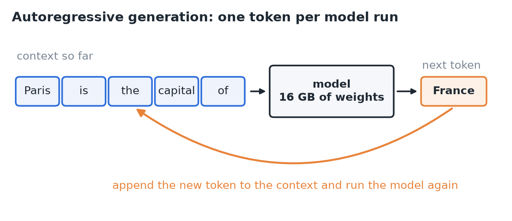
*The autoregressive loop: each generated token is fed back in as input.*

**Training vs inference**

| | Training | Inference |
|---|---|---|
| How often | Once, or a few times | Every request, every chat, every agent step |
| Cost shape | Huge one-off | Ongoing, scales with usage |

- Google fleet-wide, 2019 to 2021: **~3/5 of ML energy went to inference** and ~2/5 to training.
- **"Train once, serve forever."** This lopsided cost is why inference is its own discipline.

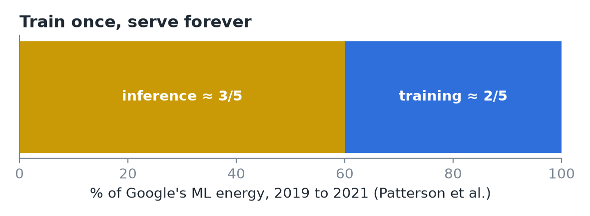
*Google ML energy use, 2019 to 2021 (Patterson et al.).*

## 3. One request: prefill and decode

Running example: a chat app serving **Llama 3 8B on one H100**. The prompt is ~500 tokens and the answer is ~250 tokens.

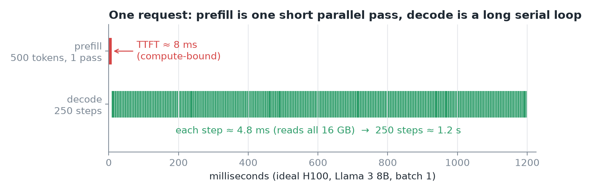
*Ideal timings: prefill handles all 500 prompt tokens in one pass (the red sliver is time to first token), then decode runs 250 serial steps of about 4.8 ms each.*

- **Prefill:** all 500 prompt tokens go through the model in **one parallel pass**. This causes the pause before the first word, called **TTFT (time to first token)**.
- **Decode:** generate one token, append, run again. **250 sequential steps.**
- **The surprise:** every decode step reads **all 16 GB of weights** from GPU memory (HBM) to produce **one token**.

### The bandwidth ceiling (memorize this calculation)

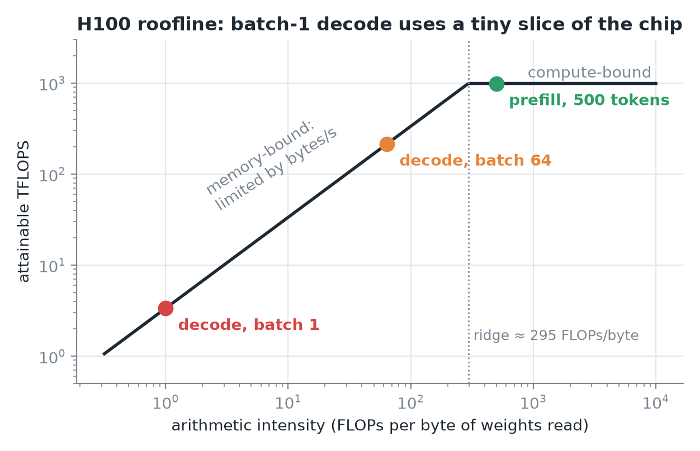
*Batch-1 decode does about 1 FLOP per byte of weights read, far left of the ridge, so memory bandwidth sets its speed. Prefill sits past the ridge and is compute-bound.*

$$t_{\mathrm{step}} = \frac{16\ \mathrm{GB}}{3.35\ \mathrm{TB/s}} \approx 4.8\ \mathrm{ms} \quad\Rightarrow\quad \frac{1}{4.8\ \mathrm{ms}} \approx 200\ \mathrm{tok/s}$$

> [!IMPORTANT]
> This is a hard ceiling for one user, even with perfect code. The chip could do far more math; the limit is **how fast bytes arrive**. Decode at batch 1 is **memory-bandwidth-bound**.

## 4. The three numbers (and one constraint)

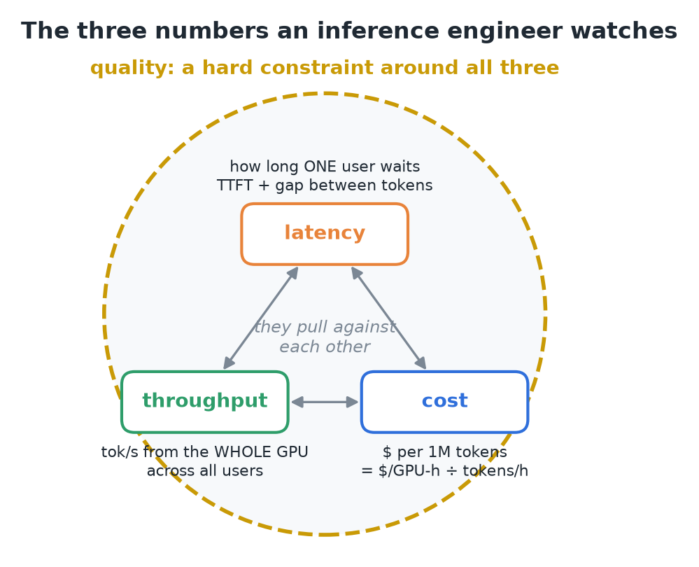
*Quality isn't traded: a faster but worse answer is not a win.*

- The gap between tokens is called **ITL** (inter-token latency) or **TPOT** (time per output token).

### The first trade-off: batching

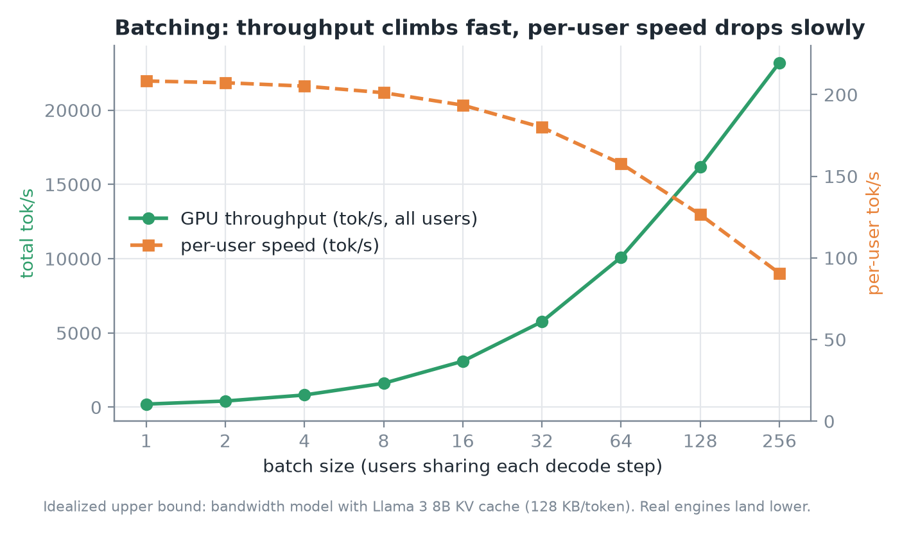
*One read of the weights serves every user in the batch, so total throughput climbs steeply while each user's speed falls only gradually.*

- **Batch 1:** read 16 GB and get 1 token.
- **Batch 64:** read the same 16 GB and get **64 tokens**, one per user. The weight read is **amortized**.
- Throughput jumps. Each step does more work, so **per-user latency goes up a bit**.
- **"The whole game is a better deal on this trade."** Much of the course is about getting more throughput for less added latency.

## 5. Putting money on it

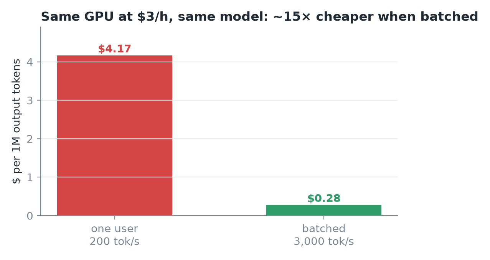
*Illustrative prices, real arithmetic. Cost per 1M tokens = $3 ÷ (tok/s × 3,600) × 10⁶.*

Real-world evidence:
- **vLLM (2023):** up to **24×** the throughput of plain Hugging Face Transformers, with the same GPUs and the same weights.

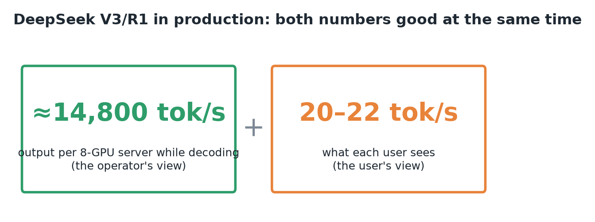

## 6. What an inference engineer does all day

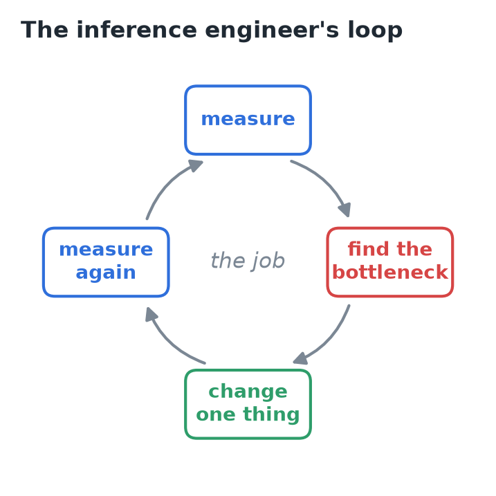

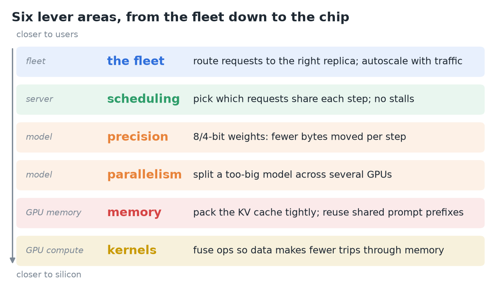
*Each lever area gets its own module later in the course.*

## 7. Three myths

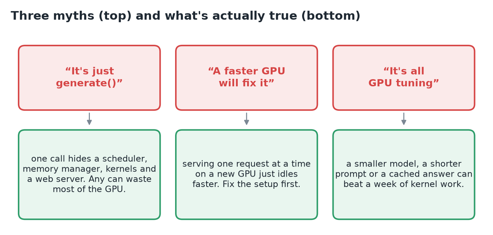

## 8. Recap

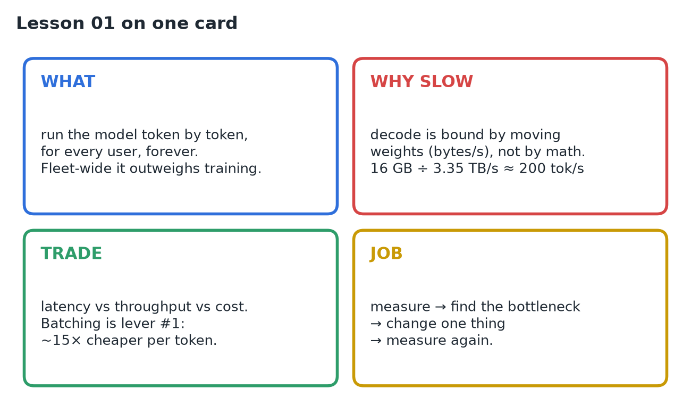
