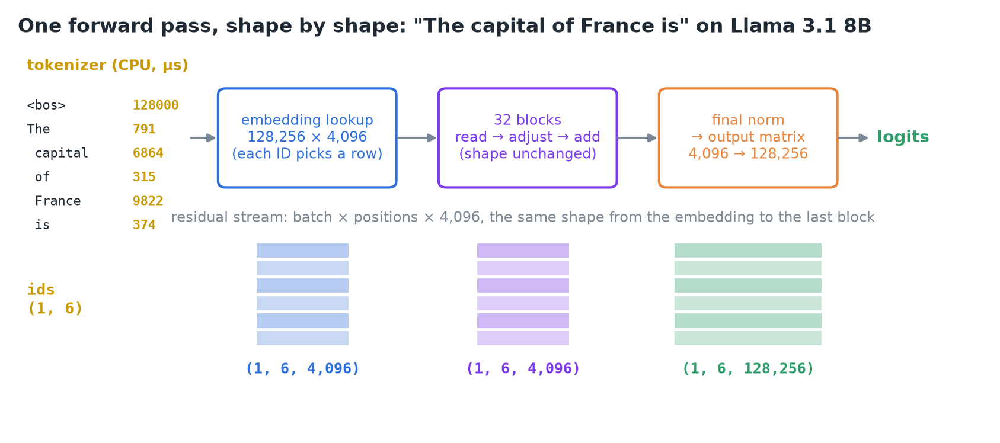
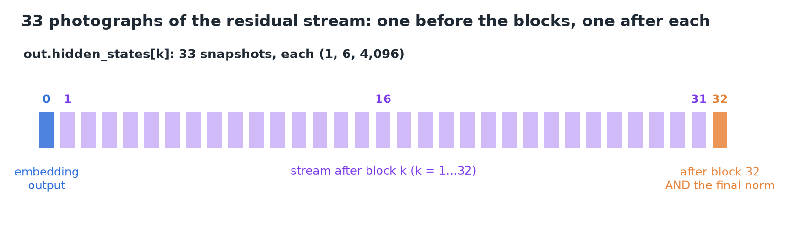
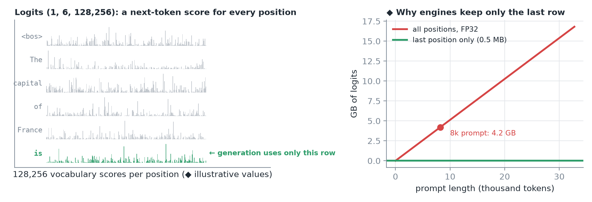
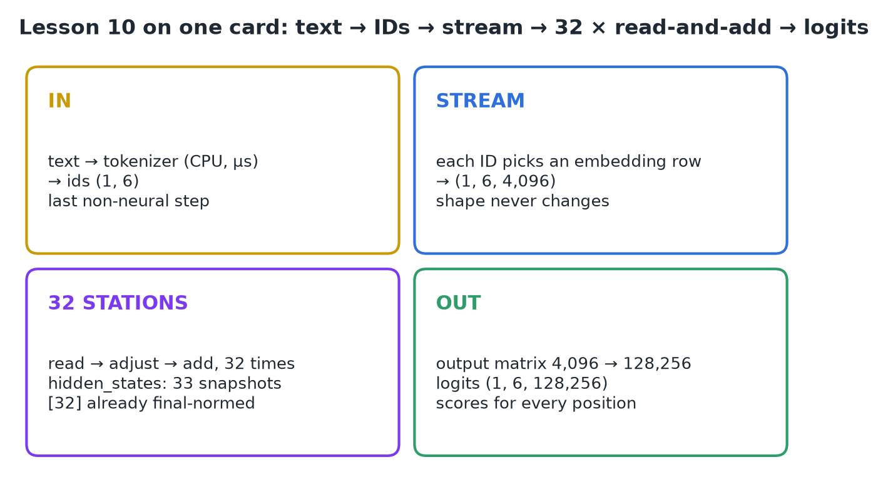

# 10 · Trace the Transformer Forward Pass

**Source:** [fanout.sh / inference-eng / 02-01](https://fanout.sh/inference-eng/curriculum/02-01) · ~5 min

> [!NOTE]
> Every generated token is **one forward pass**: tensors in, tensors out. Trace "The capital of France is" through Llama 3.1 8B and you get three things back: **6 token IDs**, **logits of shape (1, 6, 128,256)**, and **33 hidden states of shape (1, 6, 4,096)**. Text becomes IDs, IDs become one residual stream whose shape never changes, 32 blocks read-and-add to it, and one projection turns it into a score for every vocabulary entry, **at every position**.

## 1. Skip the wrapper, call the model

`model.generate()` is a convenience wrapper; underneath is the forward pass, run once per token. Call the model directly and ask it to keep intermediate results:

```python
enc = tok("The capital of France is", return_tensors="pt")
out = model(**enc, output_hidden_states=True)
enc.input_ids.shape        # (1, 6)
out.logits.shape           # (1, 6, 128256)
len(out.hidden_states)     # 33, each (1, 6, 4096)
```

The whole trace is in those three results.


*From six token IDs to a (1, 6, 4,096) stream to (1, 6, 128,256) logits.*

## 2. In: tokenizer and embedding

- **Tokenizer:** 5 words + a begin-of-text marker → **6 IDs** (128000, 791, 6864, 315, 9822, 374). It's the **last non-neural step**: a lookup table plus merge rules, running on the **CPU in microseconds**. After it, the request is only tensors.
- **Embedding:** each ID **selects its row** of the 128,256 × 4,096 embedding matrix. Six rows stacked = **(1, 6, 4,096)**: batch, positions, numbers per position.

> [!IMPORTANT]
> That tensor is the **residual stream**, and from here to the far end of the model **its shape never changes**.

## 3. Through: 32 read-and-add stations

Each of the **32 blocks** reads the stream, computes an adjustment, and **adds it back**: same shape in, same shape out. Inside each block, attention lets the six positions inform one another under a **backward-only (causal) mask**, and the MLP (where most parameters live) works per position, with normalization around both.


*Index 0 is the embedding output; 1–32 are the stream after each block. The last one has the final norm already applied.*

- `hidden_states[0]` = embedding output (before any block); `hidden_states[k]` = stream after block *k*.
- **Wrinkle:** the library returns the last snapshot **after the final norm** has been applied.
- Compare the last position's first few numbers at index 0 and index 32: same position, same shape, **different numbers**. That difference is the model's reading of the prompt.

## 4. Out: logits for every position

After the last block and the final norm, an **output matrix** (the same size as the embedding) projects each position's 4,096 numbers onto the vocabulary: **128,256 scores, called logits**.


*Left: the model scored a next token at all six positions. Right (◆): keeping every position's logits gets expensive for long prompts.*

> [!IMPORTANT]
> The shape is **(1, 6, 128,256)**: the model scored a next token for **all six positions**, not just the last. Generation uses only the last position's row.

## 5. Recap


