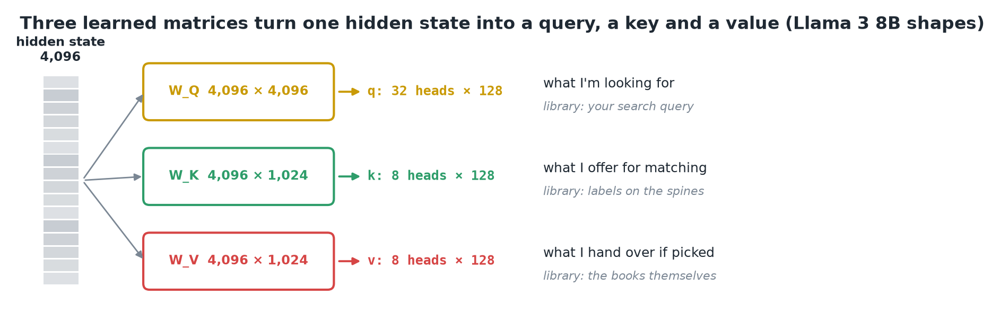
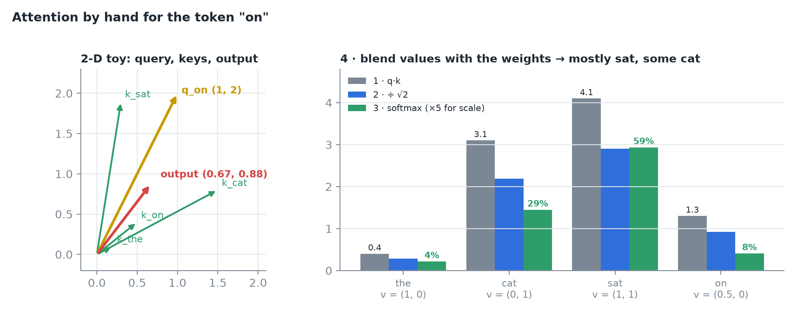
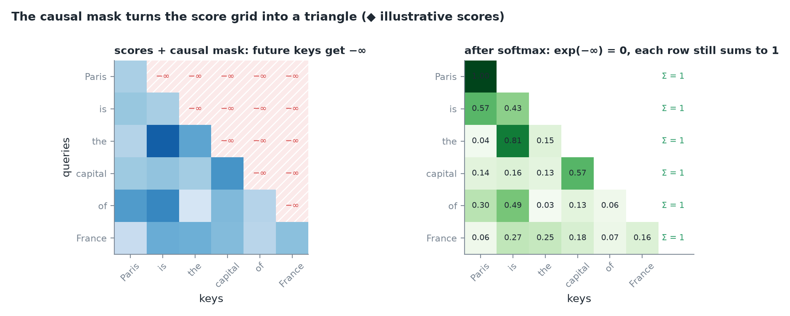
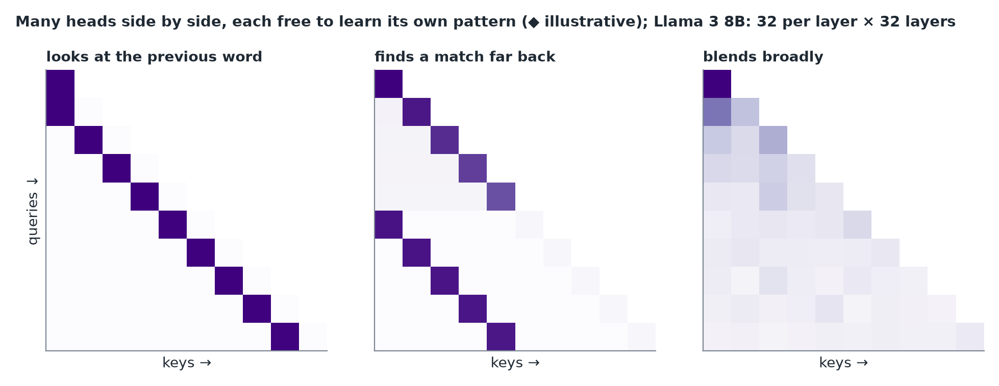
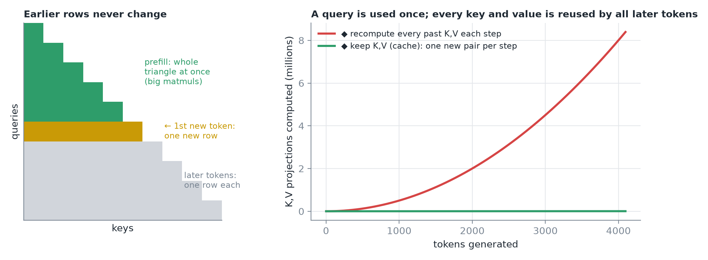
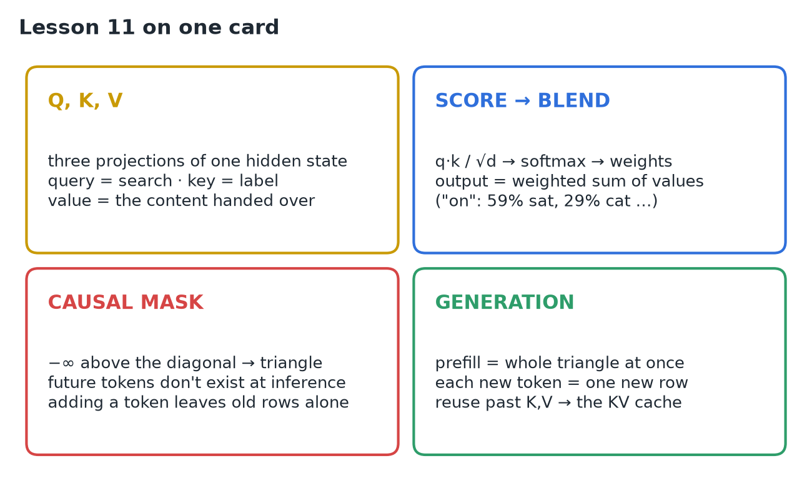

# 11 · Q, K, V & Causal Attention During Inference

**Source:** [fanout.sh / inference-eng / 02-02](https://fanout.sh/inference-eng/curriculum/02-02) · ~7 min

> [!NOTE]
> Attention lets each token **pull in information from earlier tokens**. Every token's hidden state is projected three ways: a **query** (what I'm looking for), a **key** (what I offer for matching) and a **value** (what I hand over). Scores are q·k, scaled and softmaxed into weights, and the output is a **weighted blend of values**. A **causal mask** blocks the future, so the score grid is a **triangle**. During generation, each new token adds **one new row**. Its query is used once, but every past key and value is **read again by every later token**. That is why the KV cache exists, and why decode is memory-bound.

## 1. Why tokens need to look back

In *"the animal didn't cross the street because it was too tired"*, the word **"it"** means nothing on its own. To be understood it has to **look back and find "animal"**. Attention is the mechanism that lets each position gather what it needs from earlier positions.

## 2. Query, key, value

Each token's hidden state (**4,096 numbers**) is multiplied by three **learned matrices**, W_Q, W_K and W_V, giving three new vectors.

*Library analogy: the query is your search, keys are the labels on the spines, values are the books you take home. ◆ W_K and W_V are 4,096 × 1,024 because Llama 3 8B keeps only 8 KV heads × 128.*

> [!TIP]
> Keys decide **who gets attention**; values decide **what gets passed along**. They are separate so a token can be easy to find for one reason and contribute something different.

## 3. Attention by hand

Tokens *the, cat, sat, on*, with 2-D vectors. The current token is **"on"**, query q = (1, 2).

*Scores are divided by √2 (the head size here is 2) before softmax.*

| Token | Key | q·k | Weight | Value |
|---|---|---|---|---|
| the | (0.2, 0.1) | 0.4 | 4% | (1, 0) |
| cat | (1.5, 0.8) | 3.1 | 29% | (0, 1) |
| sat | (0.3, 1.9) | **4.1** | **59%** | (1, 1) |
| on | (0.5, 0.4) | 1.3 | 8% | (0.5, 0) |

Output = 0.04·(1, 0) + 0.29·(0, 1) + 0.59·(1, 1) + 0.08·(0.5, 0) ≈ **(0.67, 0.88)**: mostly **sat**'s value, with some of **cat**'s.

## 4. The score grid and the causal mask

Do this for every token and you get a **grid of scores**: rows are queries, columns are keys. A token must **never see the future**, so every cell above the diagonal gets **−∞** before softmax. Since exp(−∞) = 0, those cells get **exactly zero weight**, and each row still sums to 1.

*The grid becomes a triangle: row i only mixes tokens 1 … i.*

- **In training**, the mask stops the model from cheating by peeking at the answer.
- **At inference**, the future doesn't exist yet anyway.
- **Consequence:** appending a token **never changes earlier rows**. Their masks already excluded it.

## 5. Many heads, many layers

One set of Q/K/V is one **head**. The model runs **many heads side by side**, and each learns its own pattern: one may track the previous word, another may find a matching name far back.

*◆ Illustrative patterns. Each head's outputs are concatenated back to 4,096.*

Llama 3 8B: **32 query heads** of 128, but only **8 KV heads**, each shared by a group of 4 query heads (grouped-query attention, GQA). Stored K/V is **4× smaller**. The whole thing repeats in **32 layers** (GQA details in 05 and 07).

## 6. What happens during generation

- **Prefill:** all prompt tokens are known, so the **whole triangle** is computed at once in big matrix multiplies.
- **Decode:** each new token adds **one row**: 1 query against all keys so far. Earlier rows are untouched (section 4).

*Right (◆): projecting every past K and V again at each step grows like N²/2; keeping them grows like N.*

> [!IMPORTANT]
> A token's **query is used once**, at its own step. Its **key and value are needed by every later token**. So engines store K and V instead of recomputing them: the **KV cache**. At 4,000 tokens × 128 KB ≈ **500 MB of K/V read for every generated token**, so decode is memory-bound.

## 7. Recap

