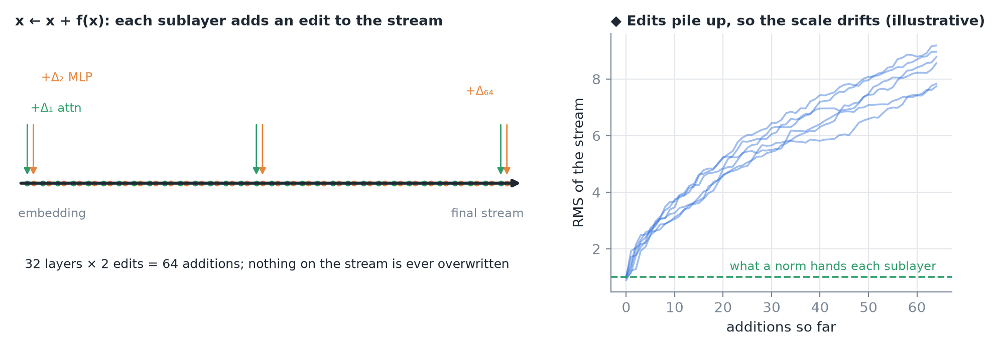
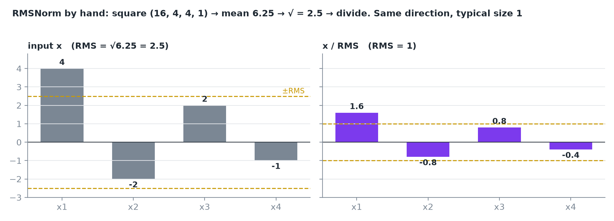
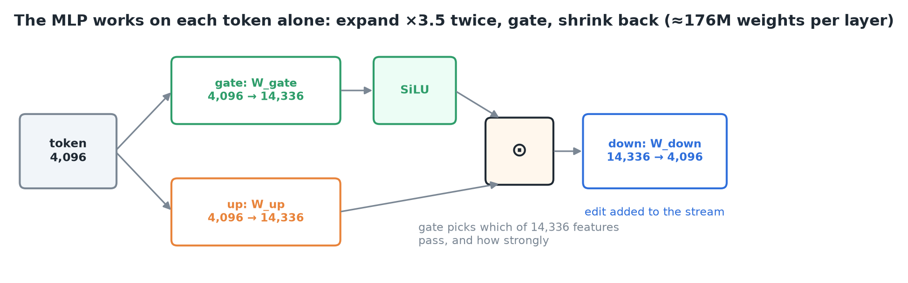
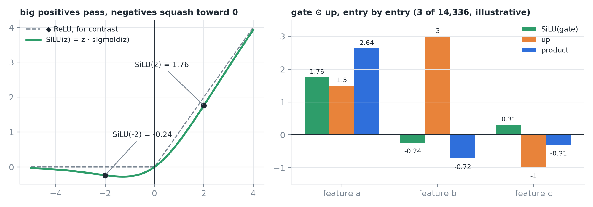
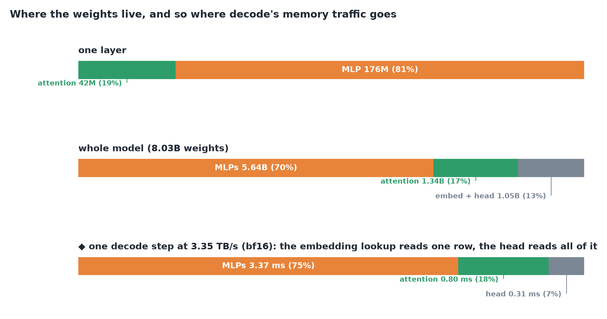
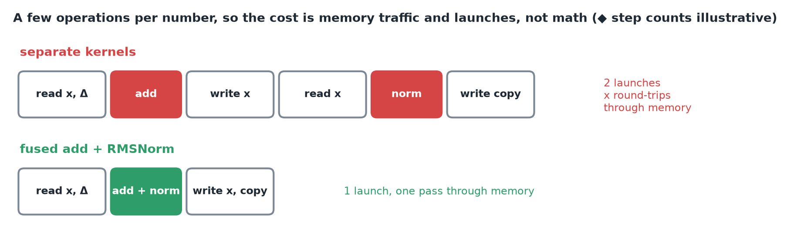
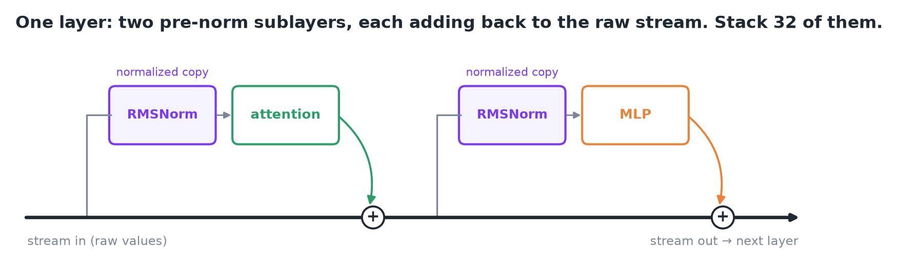
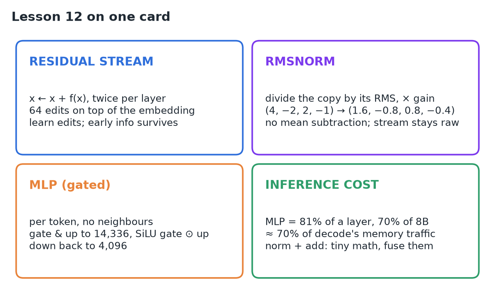

# 12 · MLP, RMSNorm & Residual Connections

**Source:** [fanout.sh / inference-eng / 02-03](https://fanout.sh/inference-eng/curriculum/02-03) · ~7 min

> [!NOTE]
> Besides attention, every layer has a **normalization step**, an **MLP** and **two additions**. The additions form the **residual stream**: each sublayer reads a copy, computes an edit and adds it back (x ← x + f(x)). **RMSNorm** rescales that copy to a predictable size before each sublayer. The **MLP** works on each token alone: expand 4,096 → 14,336 twice (gate and up), gate with SiLU, shrink back. For inference, the MLP is where the weights are: **81% of a layer, ~70% of the 8B model**, so ~70% of every decode step's memory traffic. Norms and adds are tiny math, so engines **fuse** them.

## 1. The residual stream: edits, not rebuilds

Think of each token's hidden state as a vector traveling down a highway through all 32 layers. A layer **doesn't replace** the vector: it reads a copy, computes a change, and **adds** the change back.

*Right (◆): adding edit after edit lets the stream's scale wander, which is why each sublayer gets a normalized copy.*

- Each layer adds **twice** (attention, then MLP), so the final stream = embedding + **64 edits**.
- A layer only has to learn a **useful edit**, not rebuild the whole representation.
- Information from early layers **survives to the end**, because nothing overwrites it.

## 2. RMSNorm: rescale the copy

Sublayers work best on inputs of a **predictable scale**, but the stream's numbers drift. So before attention and again before the MLP, the copy going in is normalized. Llama uses **RMSNorm** (root mean square normalization).

*Then a learned gain, one number per dimension, scales each entry back up or down.*

| | LayerNorm (older transformers) | RMSNorm (Llama) |
|---|---|---|
| Formula | γ · (x − μ) / σ + β | γ · x / RMS(x) |
| Subtracts the mean? | Yes | **No**: skipped, works just as well |
| Learned shift β? | Yes | No |

> [!IMPORTANT]
> **Only the copy is normalized.** The stream itself keeps its raw values.

## 3. The MLP: per-token feature gating

Attention **moves information between tokens**. The MLP (feed-forward network) works on **each token completely on its own** and never looks at its neighbors.

*Llama 3 8B: two 4,096 → 14,336 projections (gate, up), then down 14,336 → 4,096. The result is the edit added to the stream.*

The gate goes through **SiLU**, a smooth curve: big positive inputs pass almost unchanged, negative ones are squashed toward zero. The gated vector then multiplies the up vector **entry by entry**.

*SiLU(gate) ⊙ up = (1.76, −0.24, 0.31) ⊙ (1.5, 3, −1) = (2.64, −0.72, −0.31).*

> [!TIP]
> The gate decides, **per token**, which of the 14,336 features get through and how strongly. Researchers have found that much of what a model knows (facts, patterns) is **stored in these MLP weights**.

## 4. Where the weights are (and the memory traffic)

*Per layer: attention ≈ 42M, MLP ≈ 176M (81%). Whole model: MLPs hold 5.64B of 8.03B (70%).*

Generating one token means **reading every weight from memory**, so roughly **70% of every decode step's memory traffic is the MLP**. ◆ Per token, the embedding lookup reads only one row, so the MLP's share of bytes actually read is closer to 75%. Either way, the MLP is the first place to look when shrinking weights.

**Norms and adds** do only a few operations per number, but each still has to **read the whole hidden state from memory and write it back**. So engines **fuse** them: one kernel does the add and the norm in a single pass.

## 5. The full layer

*Normalized copy → attention → add back. Normalized copy → MLP → add back. Thirty-two of these make the model body, and the stream ends holding a rich vector for the last token.*

## 6. Recap

