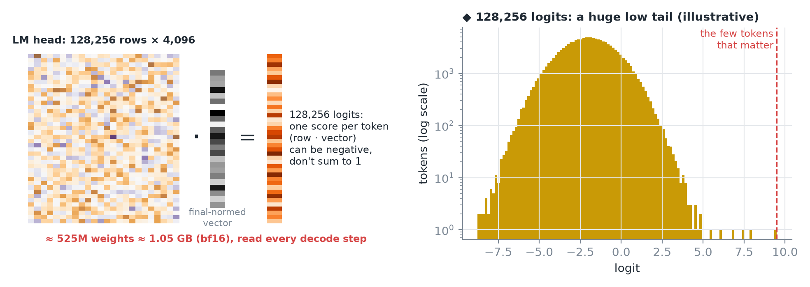
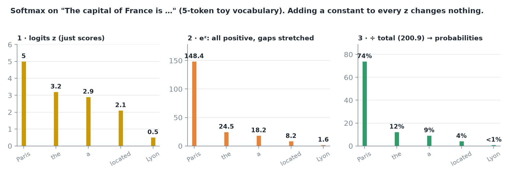
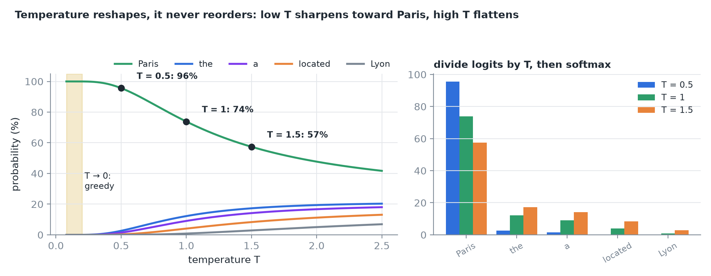
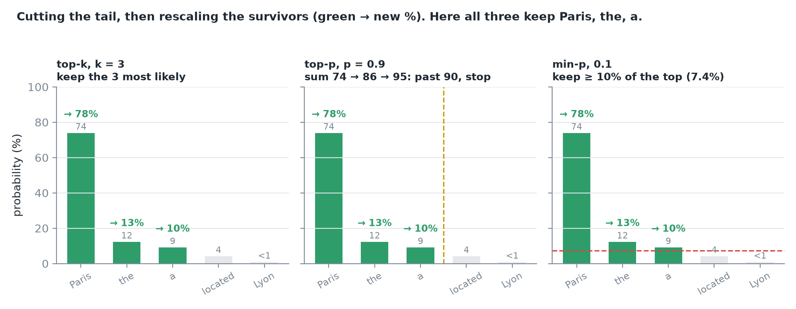
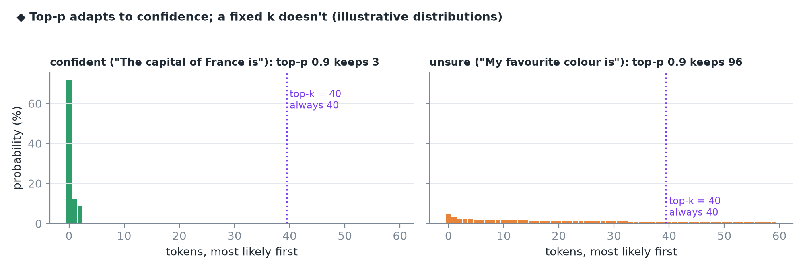
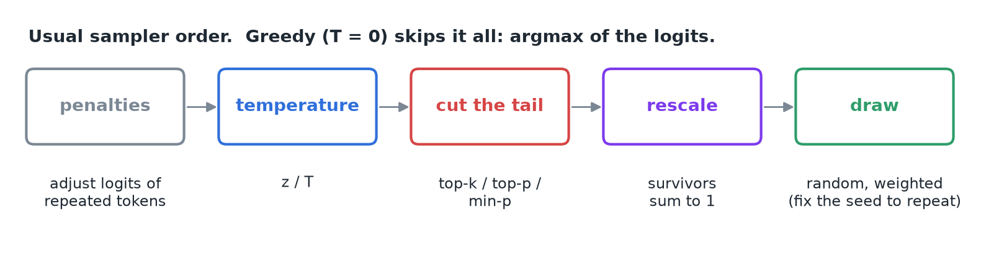
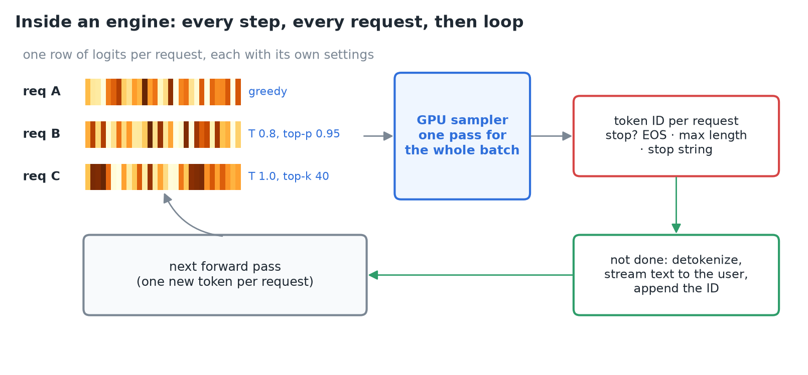
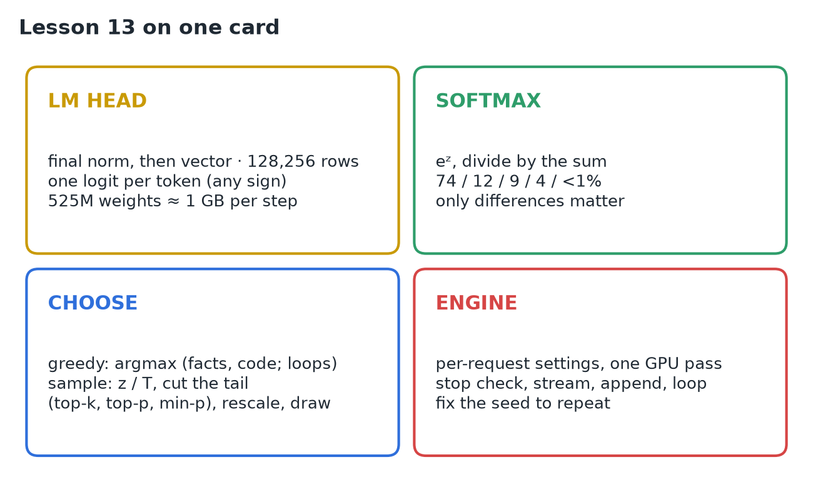

# 13 · Logits, Sampling & the Next Token

**Source:** [fanout.sh / inference-eng / 02-04](https://fanout.sh/inference-eng/curriculum/02-04) · ~7 min

> [!NOTE]
> After 32 layers, the last token's vector becomes text in three steps: **scores** for every vocabulary entry, **probabilities** from the scores, and **one choice**. The **LM head** (after one last RMSNorm) dots the vector with **128,256 rows** to get **logits**. **Softmax** turns them into probabilities, and only their **differences** matter. Then either take the top one (**greedy**) or **sample**, after **temperature** reshapes the distribution and **top-k / top-p / min-p** cut its tail. An engine does this for **every request in the batch, every step**, on the GPU, then checks for a stop, streams, appends and loops.

## 1. The LM head: one score per token

The vector gets **one last RMSNorm**, then is multiplied by the **language model head**: a matrix with **one row per vocabulary token** (128,256 for Llama 3). Each row is a direction in the same 4,096-d space; the **dot product** with the vector is that token's score, its **logit**. Rows pointing the same way as the vector get high logits.

*128,256 × 4,096 ≈ 525M weights ≈ 1 GB in bf16, read on every decode step.*

> [!TIP]
> Only the **last position's** logits pick the next token, so during prefill engines run the head for **one position**, not the whole prompt (sizes in 10).

## 2. Softmax: scores to probabilities

Logits are just scores: they can be **negative** and don't add up to anything. Toy vocabulary, prompt *"The capital of France is"*:

*Raise e to each logit (all positive, gaps stretched), then divide by the total (200.9) so they sum to 1.*

> [!IMPORTANT]
> Adding the same number to every logit **changes nothing**. Only the **differences** between logits matter.

## 3. Choosing: greedy or sample

- **Greedy:** always take the most likely token (here, Paris). **Fast and repeatable**, great for facts and code. In open-ended writing it can **lock into loops** (*"…and the cat sat on the mat and the cat sat on the mat…"*).
- **Sample:** draw at random, **weighted by the probabilities**.

**Temperature** reshapes the probabilities before the draw: divide every logit by **T**, then softmax again.

*T = 1 changes nothing; T = 0.5 stretches the gaps (Paris 96%); T = 1.5 squeezes them (Paris 57%). As T → 0, sampling becomes greedy, which is why APIs treat temperature 0 as greedy.*

## 4. Cutting the tail

Even at a sensible temperature, the ~128,000 unlikely tokens **share a little probability**. Draw enough tokens and one of the weird ones eventually gets picked. So we **cut off the tail** and rescale what's left to sum to 1.

*Top-k keeps a fixed count; top-p keeps the smallest set whose running sum passes p; min-p keeps any token at least a fraction of the top one's probability.*

A **fixed k ignores how confident** the model is. **Top-p adapts**: when the model is confident, the nucleus is tiny; when it's unsure, it grows. **Min-p** is a newer rule with the same spirit.

The usual order:

## 5. Inside an engine

Serving many requests at once, each step produces **one row of logits per request**, and **every request can bring its own settings** (one greedy, another T 0.8 with top-p 0.95). The engine's **sampler applies each request's settings to its own row, all on the GPU, in one pass**.

*Out comes one token ID per request. Stop if it's an end-of-text token, the maximum length, or a stop string. Otherwise turn the ID back into text, stream it, and append it so the next forward pass produces the token after it.*

Need the **same sampled output twice**? Fix the **random seed**.

## 6. Recap

