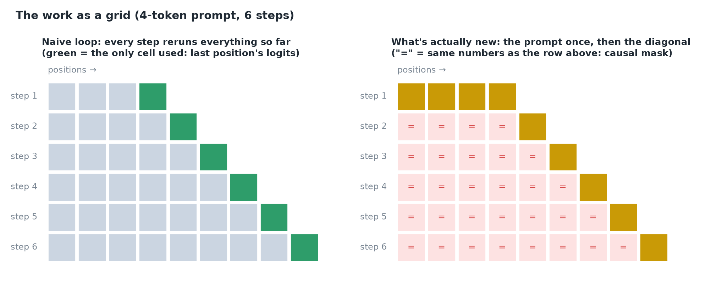
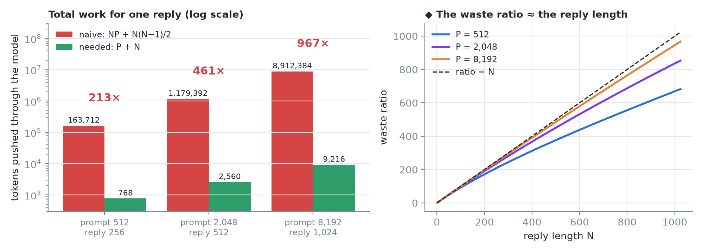
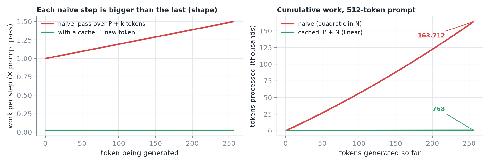
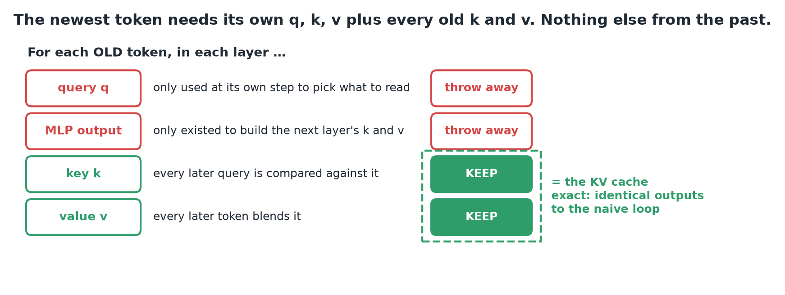
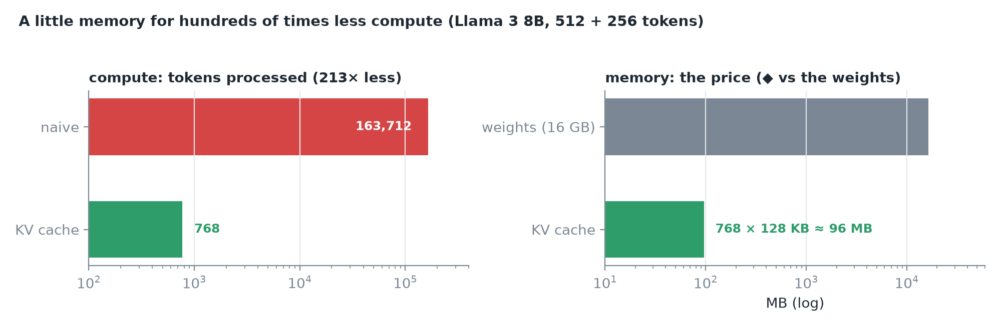
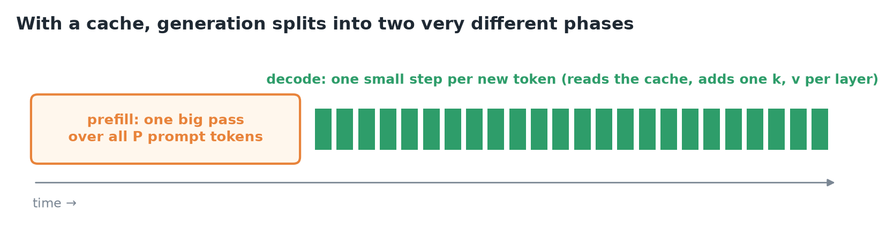
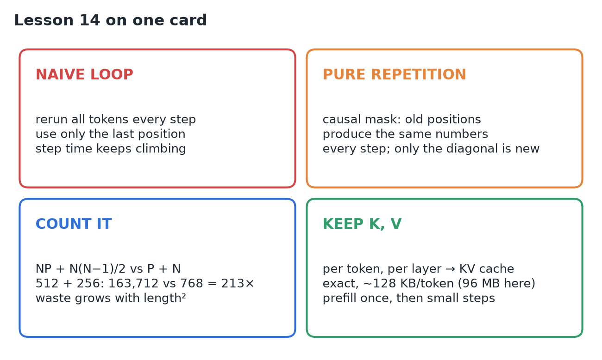

# 14 · Why Autoregressive Generation Recomputes Work

**Source:** [fanout.sh / inference-eng / 03-01](https://fanout.sh/inference-eng/curriculum/03-01) · ~6 min

> [!NOTE]
> A 512-token prompt plus a 256-token reply is **768 tokens of text**, but the obvious generation loop pushes **163,712 tokens** through the model: **213× more**. The loop reruns the whole sequence every step yet uses **only the last position's logits**. Because of the **causal mask**, every old position produces **exactly the same numbers** every step, so the waste is pure repetition, and it grows with the **square** of the length. The newest token only needs **every old token's keys and values, in every layer**. Save those (the **KV cache**) and each token goes through the model once. The cache is **exact**, and costs ~**128 KB per token** (≈ 96 MB here).

## 1. The obvious loop

Run the model on all tokens so far, take the logits at the last position, pick a token, append it, repeat.

```python
while not done:
    logits = model(tokens)          # full pass over everything so far
    nxt = sample(logits[-1])        # only the last position is used
    tokens.append(nxt)
```

Draw the work as a grid: **rows are steps, columns are positions**. Step 1 covers the prompt, step 2 the prompt plus one token, and so on. The rows grow into a **staircase**.


*Left: each step uses only its last cell; the rest is computed and thrown away. Right: only the diagonal is genuinely new.*

## 2. The thrown-away work is the same work

Recall the **causal mask**: a token sees only itself and earlier tokens. So everything the model computes at position 5, in every layer, depends **only on tokens 1–5**. Adding token 6 can't change it.

> [!IMPORTANT]
> Column 5 holds **identical numbers** in step 1, step 2 and every step after, and so does every old column. Only **one cell per row is new**: the diagonal, where the newest token enters. Everything left of it is **recomputation**.

## 3. Count it

With a prompt of **P** tokens and a reply of **N**, the naive loop processes P, then P + 1, then P + 2, … The total is **NP + N(N − 1)/2**. The work actually needed is **P + N**: each token once.


*The video rounds the middle and right cases to "2,000 + 500" and "8,000 + 1,000"; its 461× and "almost 1,000×" come from 2,048 + 512 and 8,192 + 1,024. Right (◆): the ratio sits a bit under N and approaches it as the prompt grows.*

You feel it in **latency** too: each naive step is a bigger pass than the last, so **time per token keeps climbing** as the reply grows.



## 4. What the newest token actually needs

Trace the new token through one layer. It needs its **own query, key and value** (from its own hidden state), then compares its query with **every earlier token's key** and blends their **values**.


*Old queries and old MLP outputs only existed to produce the old tokens' keys and values one layer up.*

Save each old token's **keys and values in every layer**, and the new token has everything it needs. Each token then goes through the model **once**, adds its K and V to the store, and is never recomputed. That store is the **KV cache**.

> [!TIP]
> The cache is **exact**: outputs are identical to the naive loop. The price is memory.


*~128 KB per token for Llama 3 8B (derived in 05). 768 tokens × 128 KB ≈ 96 MB.*

With a cache, generation splits into two very different phases:



## 5. Recap


