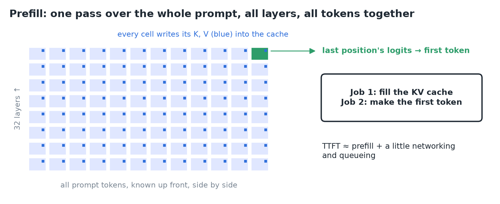
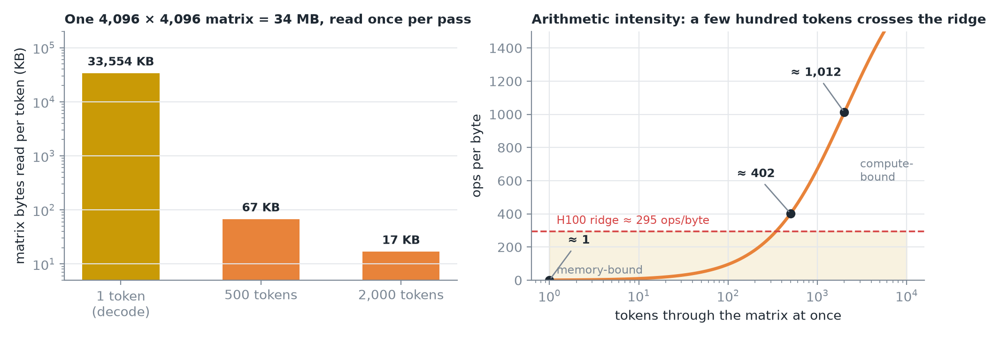
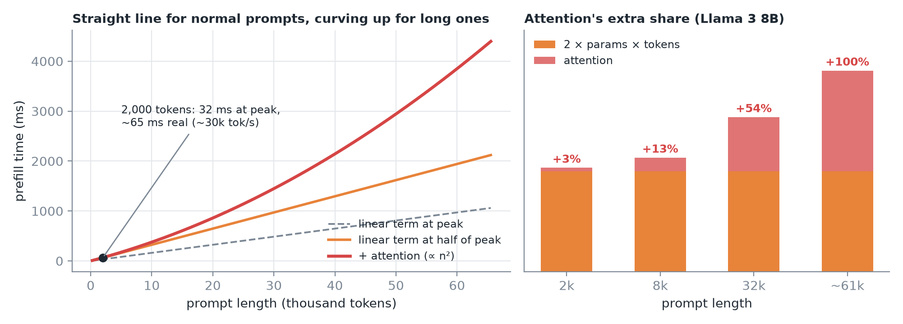
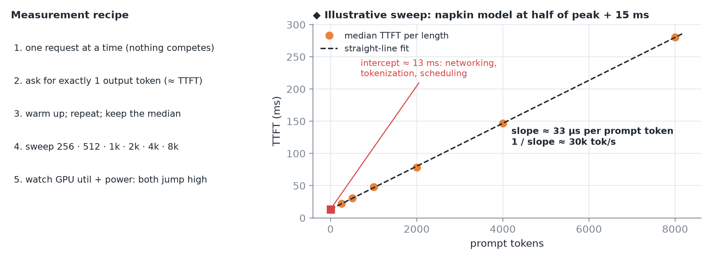
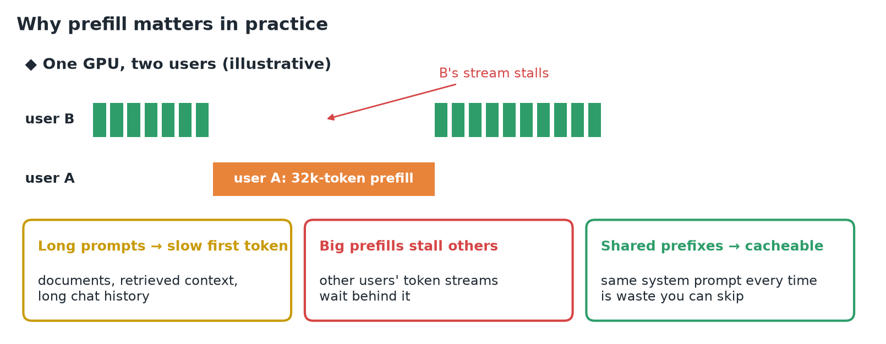
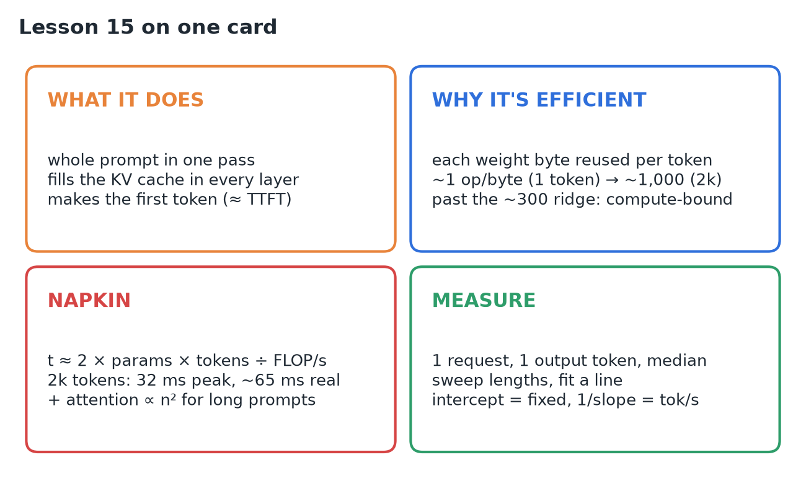

# 15 · Understand & Measure the Prefill Phase

**Source:** [fanout.sh / inference-eng / 03-02](https://fanout.sh/inference-eng/curriculum/03-02) · ~6 min

> [!NOTE]
> Most of the pause before the first word is **prefill**: one pass of the model over **every prompt token at once**, which **fills the KV cache** in every layer and **produces the first token**. So TTFT ≈ prefill + a little networking and queueing. Prefill is efficient because each weight byte read is **reused by every prompt token**: ~1 op/byte for one token, ~400 for 500, ~1,000 for 2,000, past the H100's **~300 ridge**, so it's **compute-bound**. Napkin: **time ≈ 2 × params × tokens ÷ achievable FLOP/s**: 2,000 tokens on Llama 3 8B ≈ 32 ms at peak, **~65 ms** real (~30k tokens/s). Attention adds a term **∝ n²** that only matters for long prompts. Measure it with **one request, one output token, a length sweep and a line fit**.

## 1. What prefill does

With a KV cache, generation has two phases, and prefill is the first. The whole prompt is **known up front**, so no token waits for another: all 2,000 tokens flow through all 32 layers **together**.

*Each layer writes keys and values for every prompt token into the cache. At the end, only the last position's logits are used.*

> [!IMPORTANT]
> Prefill does **two jobs**: fill the cache, and make the first token. That's why **TTFT is mostly prefill**, plus a little networking and queueing.

## 2. Why prefill is so efficient

Take one **4,096 × 4,096** weight matrix: about **34 MB** that the GPU must read from memory to use it.

- **Decode:** one token passes through it. 34 MB read for one small vector of work.
- **Prefill:** 2,000 tokens pass through, and it's read **once**. Every byte is reused 2,000 times.

*Arithmetic intensity = math operations ÷ bytes read. Below ~300 ops/byte an H100 waits on memory; above it, the math units are the limit.*

> [!TIP]
> A prompt of **a few hundred tokens** is already enough to make prefill compute-bound.

## 3. The napkin estimate

A forward pass costs about **2 operations per parameter per token**.

- Llama 3 8B, 2,000-token prompt: 2 × 8B × 2,000 ≈ **32 trillion operations**.
- H100 peak ≈ 1,000 trillion/s (16-bit) → **~32 ms** at peak.
- Real kernels reach **maybe half of peak** → expect **~65 ms**, around **30,000 prompt tokens/s**.

One more term: **attention** compares every token with every earlier one, so its work grows with **the square of the prompt length**.

*≈ +3% at 2k tokens, more than half again at 32k, and equal to everything else around 60k. Prefill time is a straight line for normal prompts, curving upward for very long ones.*

## 4. Measure it for real

*The intercept is the fixed cost (networking, tokenization, scheduling); the slope is time per prompt token, and 1 / slope is your prefill throughput.*

Compare the result with the napkin estimate: **far below half of peak means something's wrong**. Watch the GPU too: during a long prefill, **utilization and power draw jump high**, the signature of compute-bound work.

## 5. Why prefill matters in practice

*The fixes are known as **chunked prefill** and **prefix caching**.*

## 6. Recap

