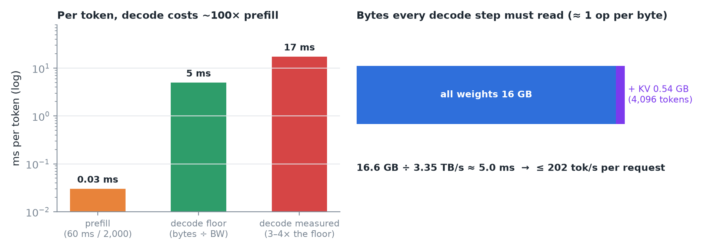
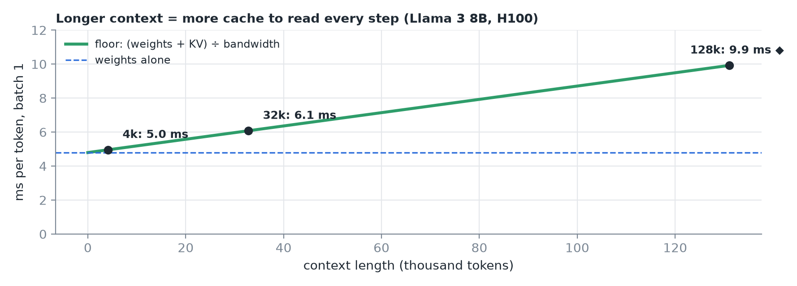
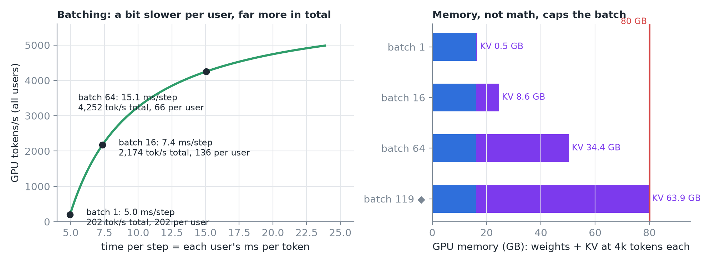
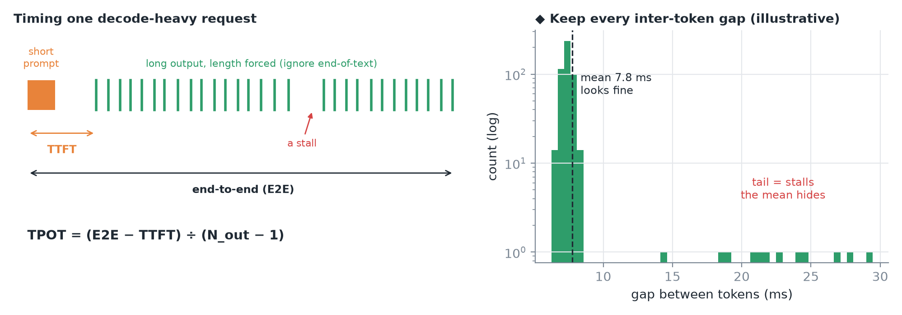
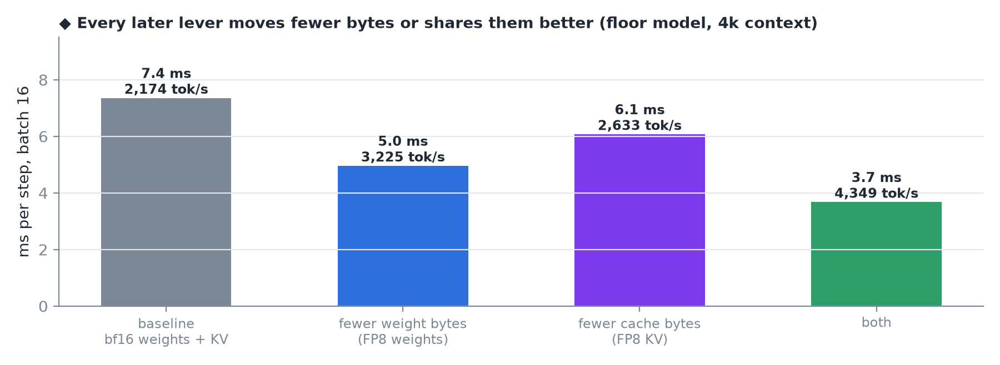
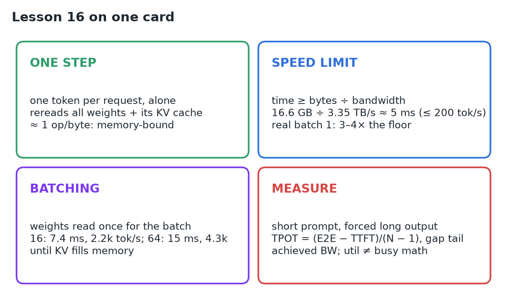

# 16 · Understand & Measure the Decode Phase

**Source:** [fanout.sh / inference-eng / 03-03](https://fanout.sh/inference-eng/curriculum/03-03) · ~6 min

> [!NOTE]
> Prefill handles 2,000 tokens in ~60 ms; decode then spends **several ms on every single token**, so per token it can be **~100× more expensive**. Each decode step pushes the newest token through all 32 layers **alone** (vector × matrix) and must read **all the weights plus this request's whole KV cache**, doing ~1 op per byte: **memory-bound**. So **time per token ≥ bytes ÷ bandwidth**: ~16.6 GB ÷ 3.35 TB/s ≈ **5 ms** (≤ ~200 tokens/s per request), and real batch-1 systems land **3–4× above** that floor. **Batching** shares the weight read: batch 64 is 15 ms per step but **>4,000 tokens/s**, until the **KV cache fills memory**. Measure with a short prompt, a forced long output, TPOT, the inter-token gap tail, and a concurrency sweep.

## 1. One decode step

The newest token goes through all 32 layers **by itself**. In each layer it meets every weight matrix, but as **one vector times a matrix**, not a block of tokens. In attention, its query reads the **keys and values of every earlier token** from the cache. One token comes out, its K and V join the cache, and the next step begins.

*Every step reads two things: all the weights and this request's whole KV cache, with ~1 op per byte against the H100's ~300 ridge.*

> [!IMPORTANT]
> Decode is **memory-bound**: the GPU spends its time waiting for bytes, so its speed limit is **bytes read ÷ memory bandwidth**.

## 2. The speed limit

- Llama 3 8B weights ≈ **16 GB**; a 4,096-token conversation adds ≈ **0.5 GB** of KV cache.
- 16.6 GB ÷ 3.35 TB/s ≈ **5 ms per token**: one request can't beat ~**200 tokens/s** on this GPU.
- Longer context means more cache to read: at **32k tokens** the floor rises to ~**6 ms**.

> [!WARNING]
> Real systems land **above** the floor. One recent study measured batch-1 decode of 7–8B models on H100s at **a quarter to a third** of this ideal: small kernels and launch overheads eat the time. The floor tells you **where the ceiling is, not where you are**.

## 3. Batching: how servers reach thousands of tokens/s

If 16 requests decode together, the **weights are read once for all 16**. Each request still reads its own KV cache, but the big 16 GB read is **shared**.

*Left: each user's stream slows a little; the GPU does far more. Right: every request keeps its KV cache in memory; 64 requests × 4k tokens ≈ 34 GB on top of 16 GB of weights. ◆ At 4k each, ~119 fit in 80 GB (see 02).*

> [!TIP]
> Decode's central trade-off is **latency per user vs total throughput**, and **memory, not math, caps the batch**.

## 4. Measure it honestly

- **Short prompt, long output** (a few hundred tokens), so prefill barely matters.
- **Force the length** (e.g. ignore the end-of-text token) so every run generates the same count.
- Record **TTFT** and **end-to-end** time, then TPOT = (E2E − TTFT) ÷ (N_out − 1).
- Keep the **individual inter-token gaps**: their tail shows stalls an average hides.

Then **sweep concurrency** (1, 2, 4, 8 … 64), plot throughput against time per token, and convert to **achieved bandwidth** = bytes per step ÷ measured step time, e.g. 16.6 GB ÷ 12 ms ≈ 1.4 TB/s ≈ **41% of peak**.

> [!CAUTION]
> GPU utilization can read **~100% during decode while the math units are mostly idle**. It only means *some kernel was running* (see 09).

## 5. Every later lever

Quantization, cache compression and smarter batching all **move fewer bytes or share them better**.

*◆ Floor-model arithmetic at batch 16, 4k context: halving weight bytes helps most here; halving cache bytes matters more as batch or context grows.*

## 6. Recap

