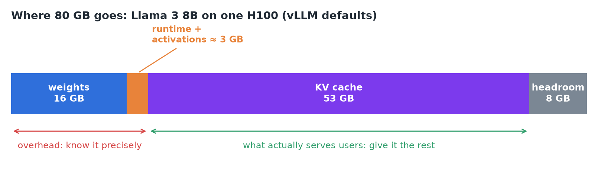
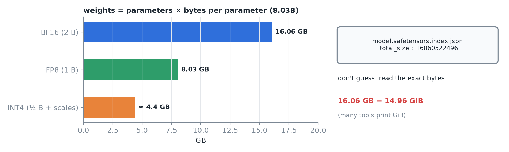
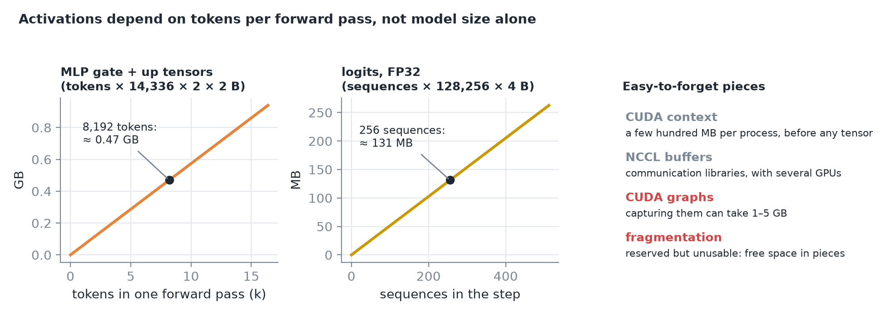
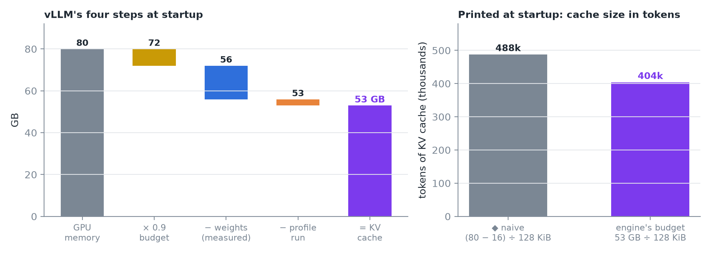
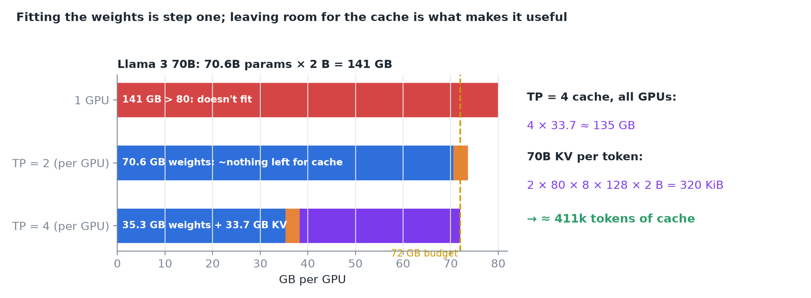
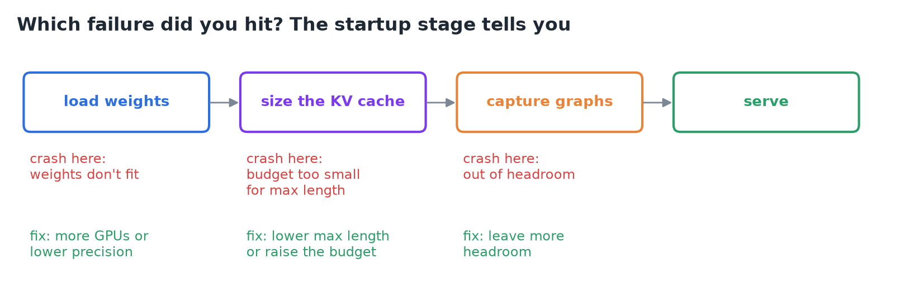
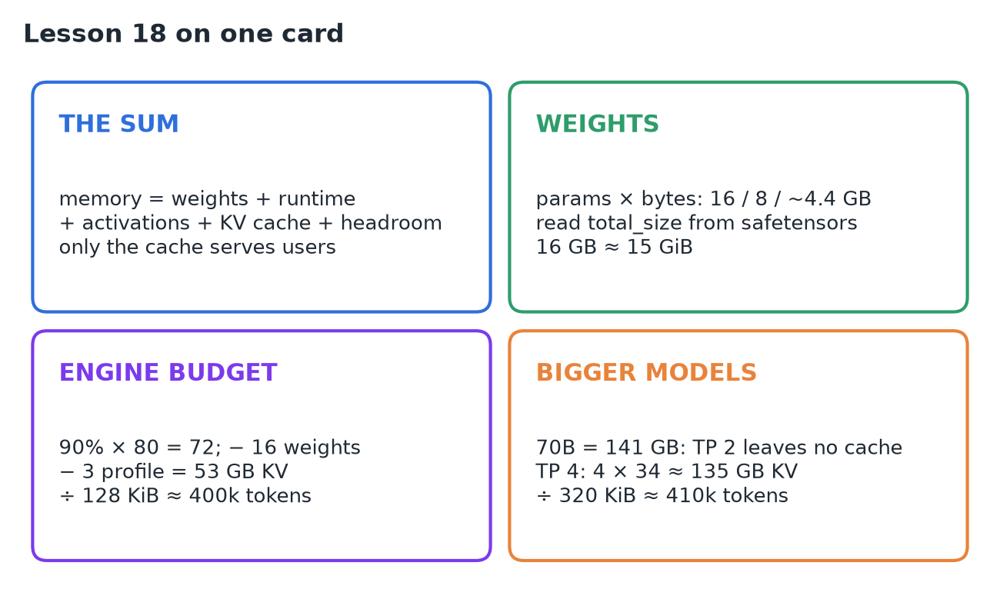

# 18 · Calculate Model & Runtime Memory

**Source:** [fanout.sh / inference-eng / 03-05](https://fanout.sh/inference-eng/curriculum/03-05) · ~7 min

> [!NOTE]
> 16 GB of Llama 3 8B weights on an 80 GB H100 does **not** leave 64 GB spare. GPU memory = **weights + runtime overhead + activations + KV cache + headroom**, and only the **KV cache** actually serves users, so the game is: **know the overhead precisely and give the rest to the cache**. vLLM does this at startup: take a **90% budget** (72 GB), subtract the **measured weights** (16) and a **profile run's peak** (≈ 3), and the rest, **≈ 53 GB ≈ 400k tokens**, becomes KV cache. Llama 3 70B (141 GB) doesn't fit on one GPU, leaves no cache on two, and on **four** gets ≈ 135 GB of cache ≈ 410k tokens.

## 1. Where GPU memory goes

*Weights (the biggest fixed piece), a runtime slice (CUDA context, communication buffers, kernel workspaces), activations (temporary tensors of a forward pass), the KV cache (every active request's keys and values), and headroom you never plan to use (CUDA graphs, fragmentation, safety margin).*

> [!IMPORTANT]
> Everything except the KV cache is **overhead**. The KV cache is what lets you **serve users**.

## 2. Weights: the easy part

*Four-bit formats come to a little over 4 GB because the scaling factors add extra.*

- **Don't guess** the parameter count: the model's `model.safetensors.index.json` lists the exact `total_size` in bytes.
- **Watch the units:** 16 GB ≈ 15 GiB, the unit many tools actually print (unit table in 04).

## 3. The runtime's share (easy to forget)

1. **CUDA context:** just initializing the GPU in a process takes a few hundred MB, before any tensor exists. With several GPUs, **NCCL** adds its own buffers.
2. **Activations:** depend on **how many tokens one forward pass handles**, not on model size alone. 8,192 tokens in one step: the MLP's gate and up tensors alone take ~0.5 GB, for an instant. Logits for 256 sequences in FP32: ~131 MB.
3. **CUDA graphs:** capturing them to cut launch overhead can take **1–5 GB**.
4. **Fragmentation:** the allocator may reserve memory it can't hand out, because free space is split into pieces too small to use.

## 4. How a real engine sizes the cache

*Step 1: budget = 90% of the GPU (72 GB). Step 2: load and measure the weights (16 GB). Step 3: one fake forward pass at the largest allowed batch records peak activation and non-torch memory (say 3 GB). Step 4: the rest is KV cache, ~53 GB ≈ 400k tokens at 128 KiB each. ◆ The naive "(80 − 16) ÷ 128 KiB" from 02 overstates it by ~20%.*

The engine **prints this at startup**: KV cache size in tokens, and how many full-length requests fit. The last 10%, outside the budget, is left for **CUDA graphs and surprises**.

## 5. A bigger model: Llama 3 70B

*70.6B × 2 B ≈ 141 GB. Tensor parallelism splits it: 2 GPUs hold 70.6 GB each, leaving almost nothing of the 72 GB budget; 4 GPUs hold ~35 GB each and leave ~34 GB each for cache.*

> [!TIP]
> **Fitting the weights is only step one.** Leaving room for the cache is what makes the deployment useful.

## 6. Which failure did you hit?

## 7. Recap

