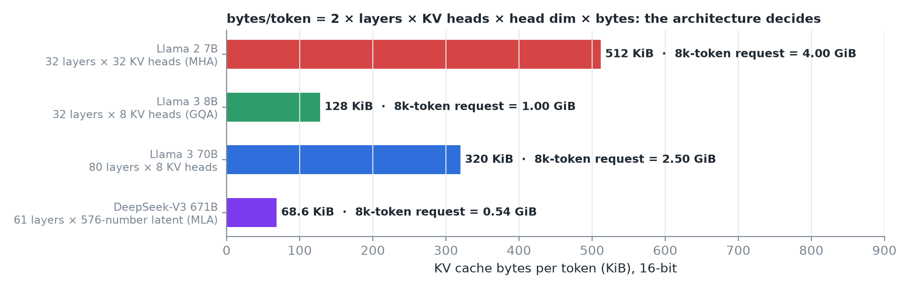
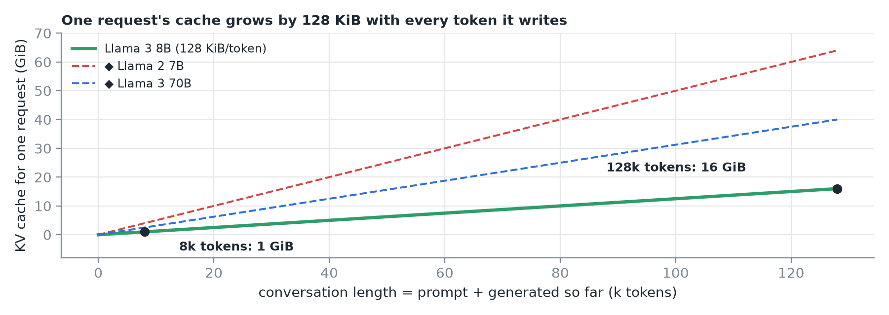
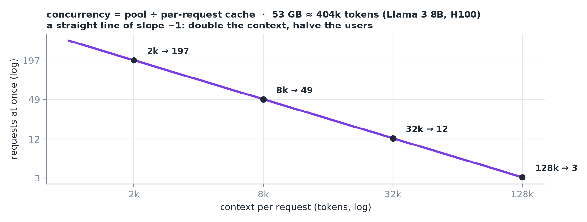
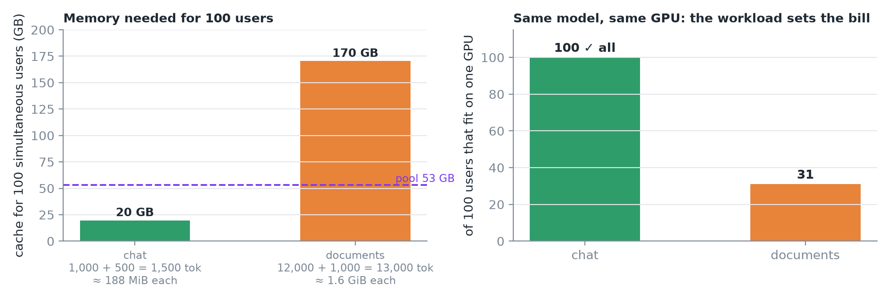
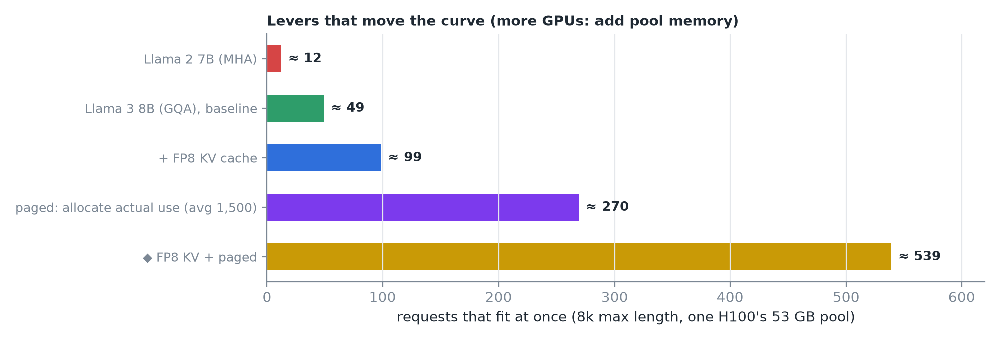
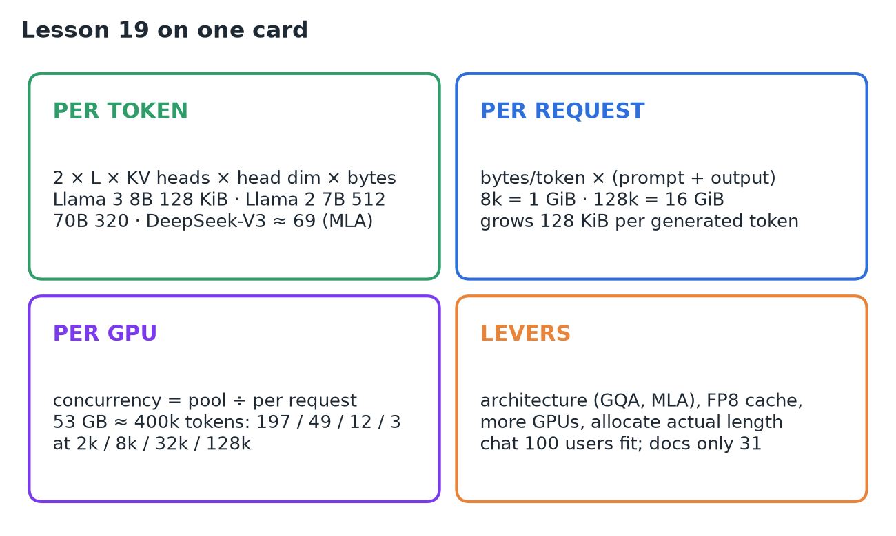

# 19 · Calculate KV Memory, Context & Concurrency Limits

**Source:** [fanout.sh / inference-eng / 03-06](https://fanout.sh/inference-eng/curriculum/03-06) · ~6 min

> [!NOTE]
> Two questions decide what a deployment can promise: **how long can one conversation be**, and **how many can run at once**? Both come from the same KV pool and one division. **Per token:** 2 × layers × KV heads × head dim × bytes (Llama 3 8B: 128 KiB). **Per request:** that × (prompt + output) (8k = 1 GiB, 128k = 16 GiB). **Per GPU:** pool ÷ per-request: ~53 GB ≈ 400k tokens fits **197 requests at 2k, 49 at 8k, 12 at 32k, 3 at 128k**. Context and concurrency trade **one for one**. The same model serves 100 chat users but only **31 document users** on one H100: the **workload sets the bill**. Levers: architecture (GQA, MLA), FP8 cache, more GPUs, and allocating actual rather than maximum length.

## 1. Per token: the architecture decides

For every layer, the cache stores one key and one value vector for every KV head, so bytes per token = **2 × layers × KV heads × head dim × bytes per number**.

*Llama 2 7B gives every head its own K/V (32 heads). Llama 3 8B shares 8 KV heads across 32 query heads: a quarter as much. 70B has 80 layers. DeepSeek-V3 compresses K/V into a small latent vector per layer: ~69 KiB/token for a 671B model.*

## 2. Per request: everything it has seen

A request's cache holds the **whole prompt plus every token generated so far**, so per-request memory = bytes per token × total length.

*Llama 3 8B: an 8k conversation holds 1 GiB; a 128k one holds 16 GiB, all for one user.*

## 3. Per GPU: one division

The engine found ~53 GB of cache on an H100 (lesson 18), about **400k tokens**. Divide the pool by each request's length:

> [!IMPORTANT]
> Context length and concurrency **trade off directly**: double one and you halve the other. A huge context window is expensive because every user who fills it **takes the seat of many others**.

## 4. Plan two real services on one H100

*Chat: 1,500 tokens ≈ 190 MB each; 100 users ≈ 20 GB fits easily. Documents (retrieval QA): 13,000 tokens ≈ 1.6 GiB each; 100 users would need ≈ 170 GB, and the pool holds ~31.*

> [!TIP]
> Same model, same GPU: **the workload, not the model, sets the hardware bill**.

## 5. What moves the curve

1. **The model:** at 8k each, Llama 2 7B fits ~12 requests; Llama 3 8B fits 49, mostly thanks to **grouped-query attention**.
2. **Cache precision:** store K/V in **8-bit** instead of 16 and the pool doubles to ~800k tokens, at a small risk to quality.
3. **More GPUs:** more memory for the pool.
4. **Allocation:** stop reserving the maximum length for every request. Real conversations rarely hit the limit: at an average of 1,500 tokens, handing out memory **as tokens actually arrive** fits ~270 requests. That's the idea behind **paged KV memory**.

Engines like vLLM print this at startup as the **maximum concurrency for a given request length**; now you can check it by hand.

## 6. Recap

