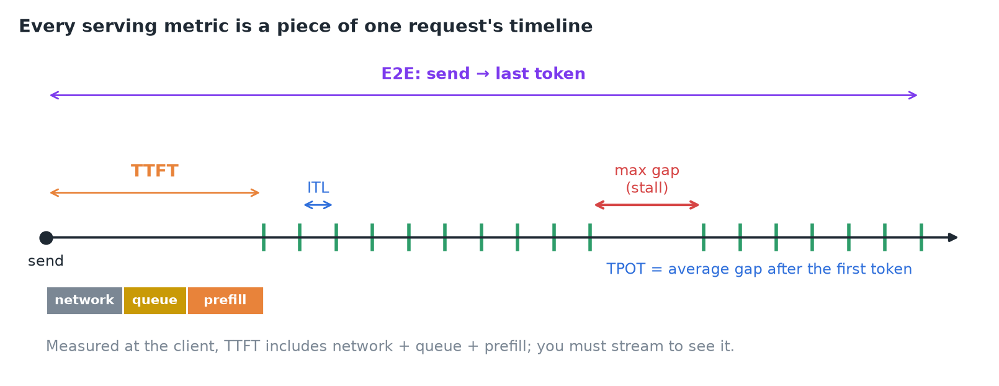
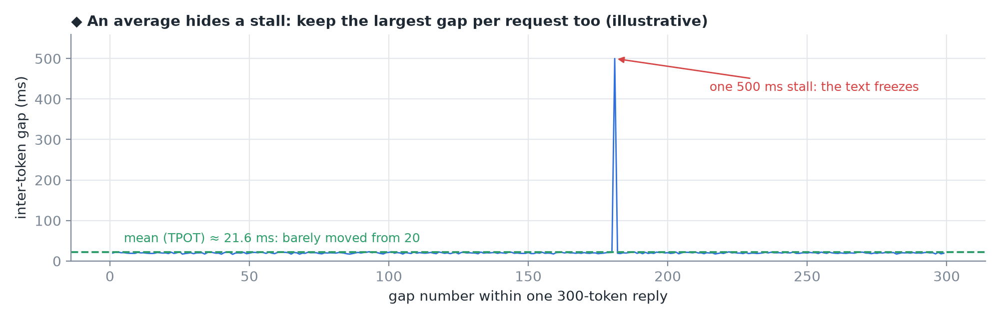
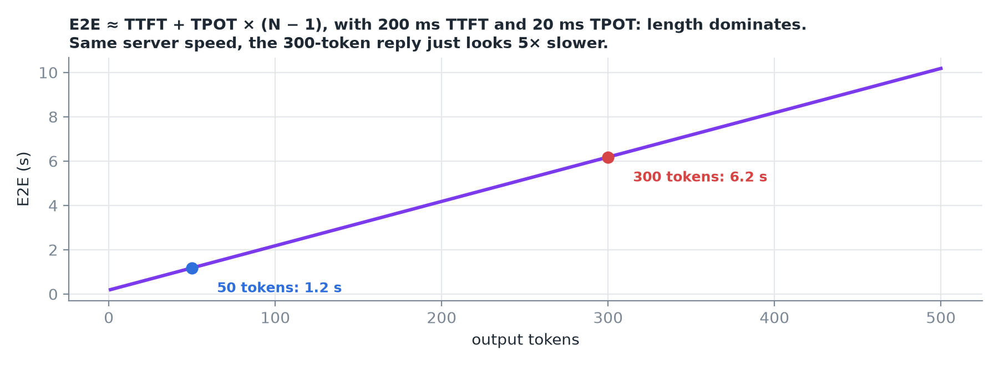
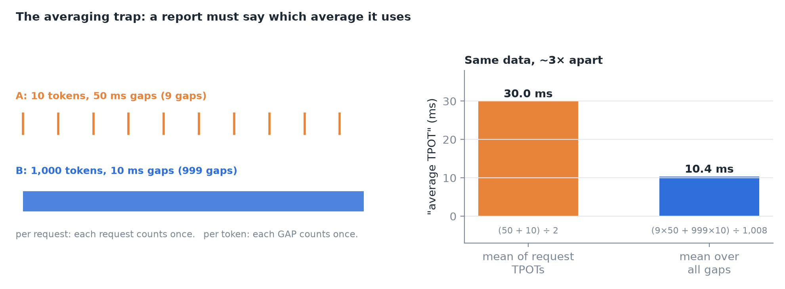
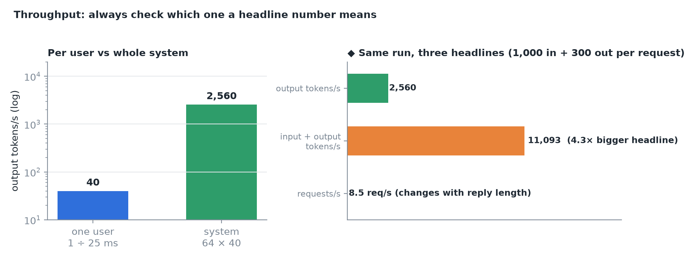
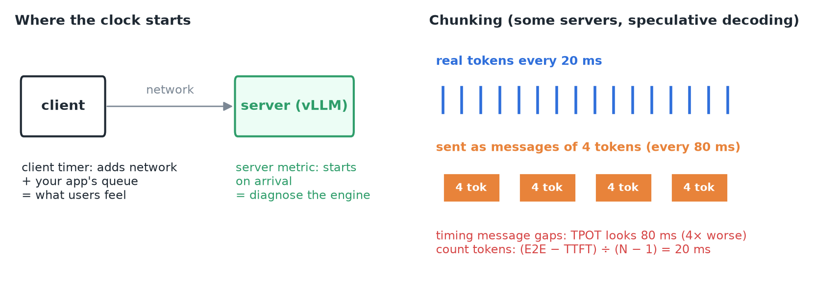
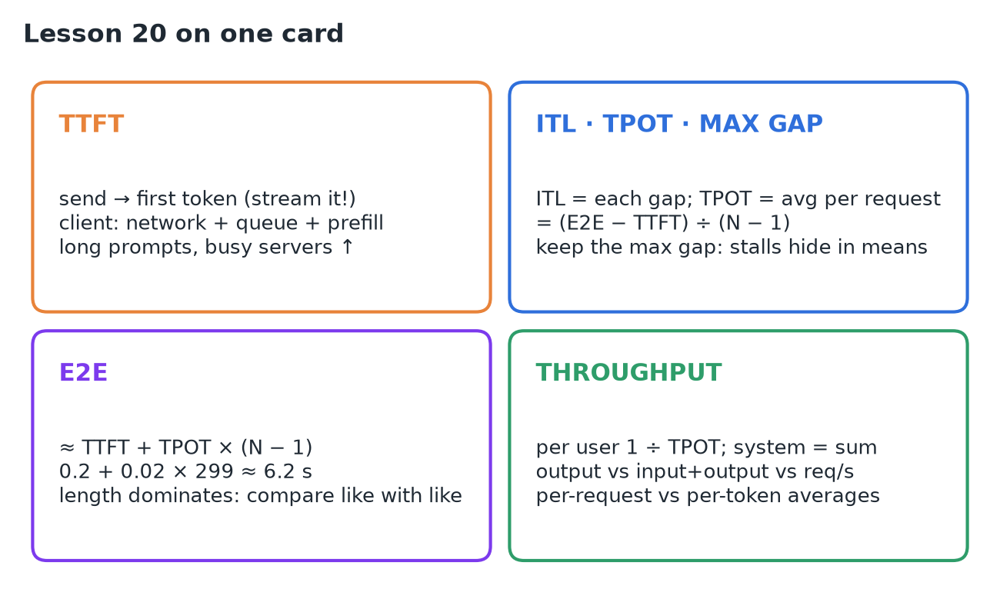

# 20 · TTFT, TPOT, ITL, E2E & Throughput

**Source:** [fanout.sh / inference-eng / 04-01](https://fanout.sh/inference-eng/curriculum/04-01) · ~6 min

> [!NOTE]
> Every serving number measures a piece of **one request's timeline**. **TTFT:** send → first token (network + queue + prefill); you must stream to see it. **ITL:** each gap between tokens. **TPOT:** one request's average gap = (E2E − TTFT) ÷ (N − 1); 20 ms = 50 tok/s. Keep the **largest gap** too, because a 500 ms stall barely moves the mean. **E2E** ≈ TTFT + TPOT × (N − 1): 0.2 + 0.02 × 299 ≈ **6.2 s**, dominated by **output length**. **Averaging trap:** per request 30 ms vs per token 10.4 ms on the same data. **Throughput:** per user 1 ÷ TPOT (40 tok/s); system = sum (64 × 40 = **2,560 output tok/s**). Check what a headline counts, where the clock starts, and whether you're timing tokens or messages.

## 1. One request, one timeline

The user presses send, waits, sees the first word, then reads words as they stream in until the answer is done.

*TTFT covers the wait. After it, each gap is an inter-token latency (ITL); their average for the request is TPOT; the largest one is the stall. E2E spans the whole thing.*

## 2. TTFT: the wait

**Time to first token** runs from sending the request to the first token arriving. Measured at the client it includes **network time, time in the server's queue, and prefill of the whole prompt**. It decides whether an app feels responsive.

- You **must stream** to measure it: without streaming, the first token arrives together with the last.
- **Long prompts** (more prefill) and **busy servers** (longer queue) both push it up.

## 3. ITL and TPOT: the pace

Each individual gap between tokens is an **inter-token latency**. Average them for one request and you get its **time per output token**:

$$\mathrm{TPOT} = \frac{\mathrm{E2E} - \mathrm{TTFT}}{N_{\mathrm{out}} - 1}$$

The first token is left out because its wait is already in TTFT. TPOT sets reading speed: **20 ms per token = 50 tokens/s**, faster than anyone reads.

*◆ 298 gaps of 20 ms plus one of 500 ms: the mean moves only to (298 × 20 + 500) ÷ 299 ≈ 21.6 ms, yet the user watched the text freeze for half a second.*

> [!IMPORTANT]
> An average hides stalls. **Also keep the largest gap for each request.**

## 4. E2E: the whole request

$$\mathrm{E2E} \approx \mathrm{TTFT} + \mathrm{TPOT} \times (N_{\mathrm{out}} - 1) = 0.2 + 0.02 \times 299 \approx 6.2\ \mathrm{s}$$

*The 200 ms wait is a rounding error next to 299 gaps: answer length dominates.*

> [!CAUTION]
> E2E alone misleads: a "slower" request may just have written a longer reply. Compare E2E only between requests of **similar length**, or compare TTFT and TPOT instead.

## 5. The averaging trap

Request A writes **10 tokens at 50 ms gaps**; request B writes **1,000 tokens at 10 ms gaps**.

*Per request: (50 + 10) ÷ 2 = 30 ms. Per token: B's 999 fast gaps swamp A's 9, giving ≈ 10.4 ms.*

Neither is wrong. The first treats **every request** equally, the second **every token**. A report must say which one it uses, or two tools will disagree on the same run.

## 6. Throughput: work per second

- **One user:** the inverse of TPOT. 25 ms per token → **40 tokens/s**.
- **The system:** add every stream. 64 users × 40 = **2,560 output tokens/s**.

*Right: ◆ illustrative 1,000-token prompts. Counting input tokens inflates the headline (prefill chews through prompts very fast); requests/s depends on reply length.*

> [!TIP]
> Always check which throughput a headline means. And the decode trade-off still holds: more concurrent users raise system throughput but make each user's TPOT a little worse.

## 7. Where the clock starts, and chunking

- **Client timer:** includes the network and any queue inside your own app. Use it to describe **what users feel**.
- **Server metric** (e.g. those vLLM exports): starts when the request reaches the server. Use it to **diagnose the engine**.
- **Chunking:** some servers, and speculative decoding, send **several tokens per network message**. Time the message gaps and TPOT looks several times worse (4 tokens per message → 4×). The safe formula counts tokens, not messages: (E2E − TTFT) ÷ (N − 1).

## 8. Recap

