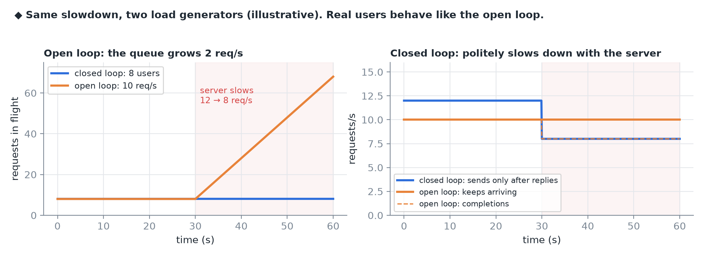
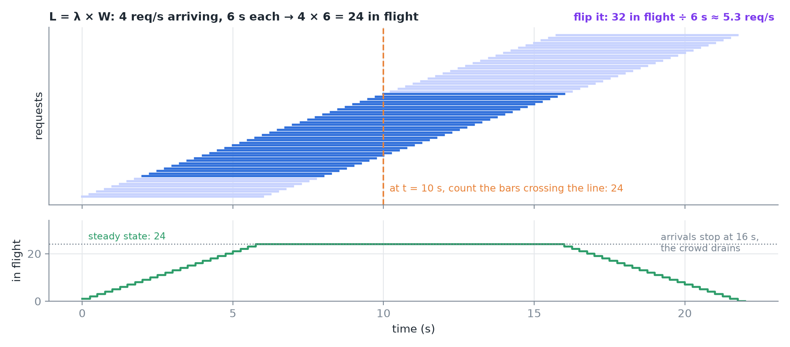
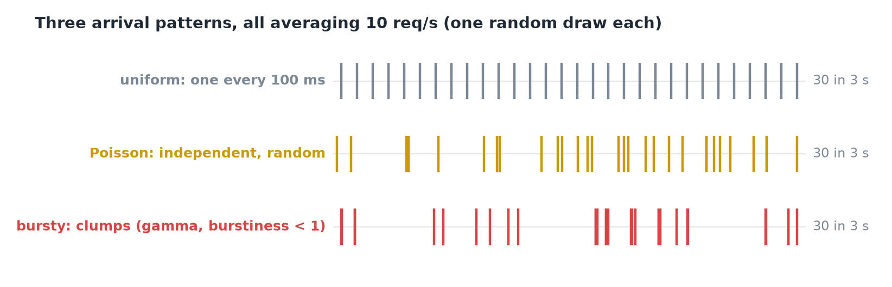
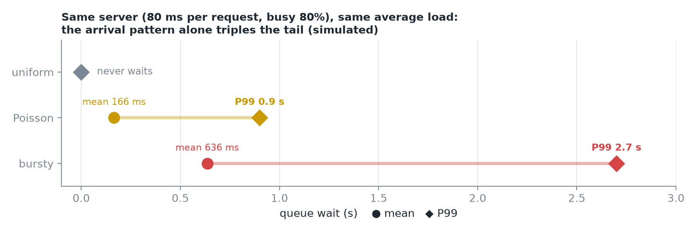
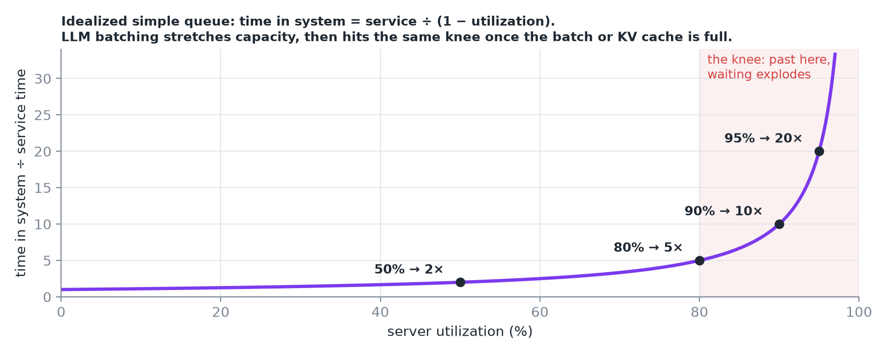
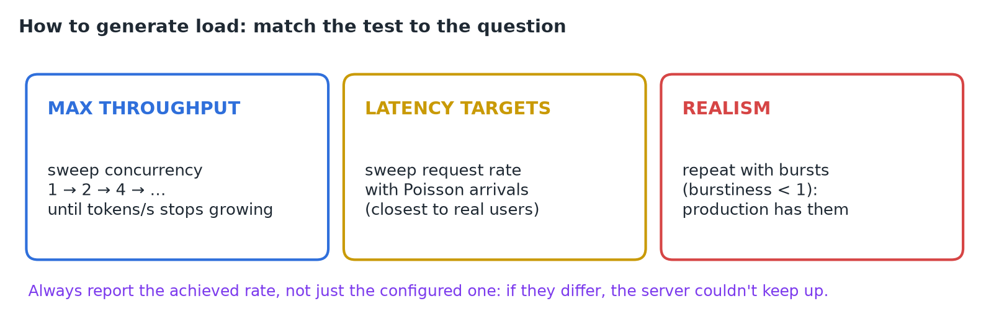
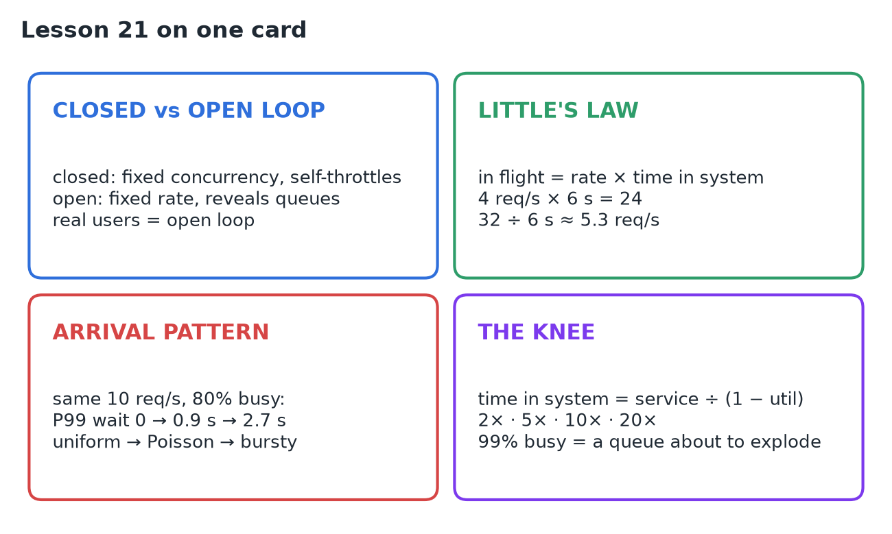

# 21 · Concurrency, Request Rate & Arrival Patterns

**Source:** [fanout.sh / inference-eng / 04-02](https://fanout.sh/inference-eng/curriculum/04-02) · ~6 min

> [!NOTE]
> How you generate load (how many at once, how many per second, and exactly when they arrive) **changes every number you measure**, so two teams can report great TTFT and terrible tails on the same server. A **closed loop** (fixed concurrency) slows down with the server; an **open loop** (fixed rate) keeps arriving and reveals the queue real users feel. **Little's law** links them: in flight = rate × time in system (4 req/s × 6 s = **24**). At the same 10 req/s on a server 80% busy, P99 wait goes **0 → 0.9 s → 2.7 s** from uniform to Poisson to bursty arrivals. Time in system grows as 1 ÷ (1 − utilization): **2×, 5×, 10×, 20×** at 50, 80, 90, 95%. That's the knee.

## 1. Closed loop vs open loop

- **Fixed concurrency (closed loop):** e.g. **8 virtual users**, each sends, waits for the answer, then immediately sends again. Always exactly 8 in flight.
- **Request rate (open loop):** requests arrive on a schedule, e.g. **10 per second**, whether or not earlier ones finished.


*When the server slows, the closed loop sends less (its users are waiting), so nothing piles up. The open loop keeps arriving and the queue grows.*

> [!IMPORTANT]
> Real internet users behave like the **open loop**. A closed-loop test can hide exactly the queueing your users will feel.

## 2. Little's law

$$L = \lambda \times W \qquad \mathrm{in\ flight} = \mathrm{arrival\ rate} \times \mathrm{time\ in\ system}$$


*4 requests arrive per second and each takes 6 s end to end, so 24 are in flight on average. Flip it: 32 in flight at 6 s each means ≈ 5.3 req/s served.*

- It **translates between** a concurrency test and a rate test.
- It warns you: if requests **arrive faster than they finish**, time in system keeps growing, and so does the crowd.

## 3. Arrival patterns


*Same average, different timing.*

| Pattern | Looks like | Models |
|---|---|---|
| **Uniform** | One every 100 ms, a metronome | Almost no real traffic |
| **Poisson** | Independent, random: pairs and gaps | Many independent users |
| **Bursty** | Clumps | Batch jobs, a feature going viral; benchmark tools use a **gamma distribution with burstiness < 1** |

Feed all three into the same simulated server: **80 ms per request at 10 req/s, so busy 80%** of the time.


*Uniform never waits. Poisson: mean 166 ms, P99 0.9 s. Bursty: mean 636 ms, P99 2.7 s.*

> [!IMPORTANT]
> Same average load: **the pattern alone changed the tail by 3×**.

## 4. The knee

In a simple queue, time in system relative to the bare service time grows as 1 ÷ (1 − utilization).


*Gentle at half load, vertical near full load.*

- **LLM servers batch**, so capacity stretches as load grows, but they hit the **same knee** once the batch or the **KV cache is full**.

> [!CAUTION]
> A GPU at 99% busy isn't efficient: it's a queue waiting to explode.

## 5. How to generate load



vLLM's benchmark exposes exactly these knobs:

```bash
vllm bench serve \
  --request-rate 10 \
  --burstiness 0.5 \
  --max-concurrency 64
```

## 6. Recap


