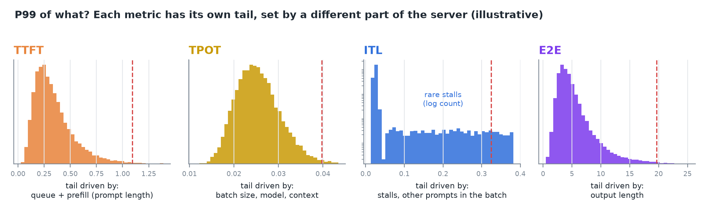
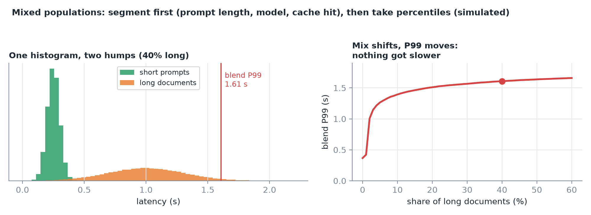
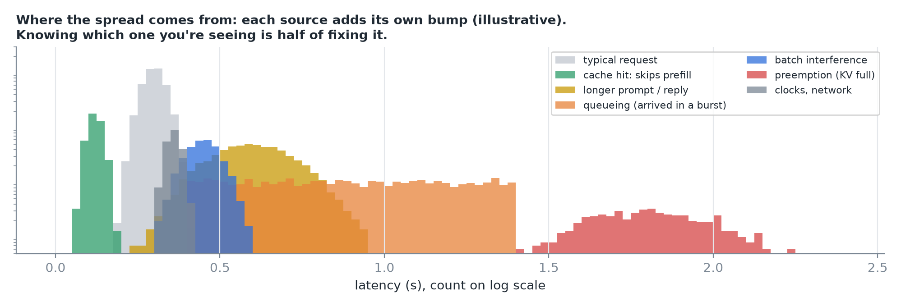
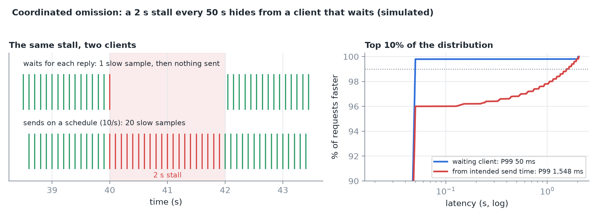
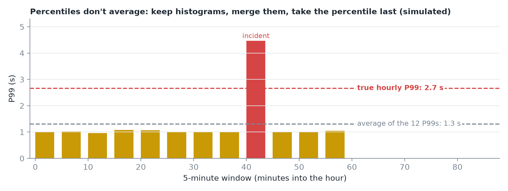
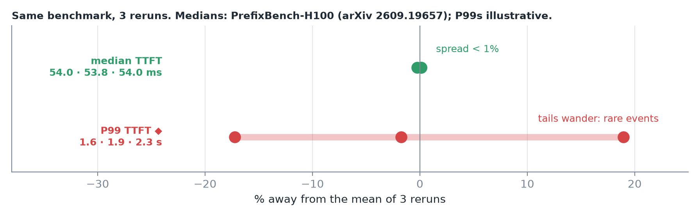
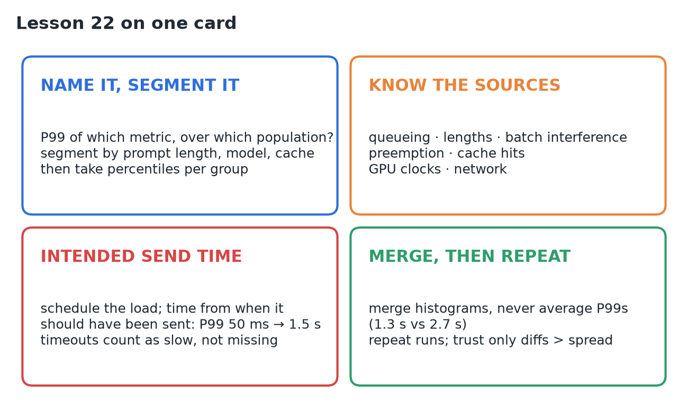

# 22 · P50, P95, P99 & Variance

**Source:** [fanout.sh / inference-eng / 04-05](https://fanout.sh/inference-eng/curriculum/04-05) · ~6 min

> [!NOTE]
> Knowing what a percentile is is easy; using one on an LLM server without fooling yourself is not. First ask **P99 of what**: which metric, and which population (per request or per token, one traffic mix or a blend). The spread comes from **queueing, lengths, batch interference, preemption, cache hits, and the hardware**. A client that waits for each reply suffers **coordinated omission**: it reported P99 = **50 ms** where the truth was **≈ 1.5 s**. Percentiles **don't average** (1.3 s vs a true 2.7 s): merge histograms. Medians barely move between runs (**54.0, 53.8, 54.0 ms**) but tails wander, so repeat and report the spread.

## 1. P99 of what?

*TTFT, TPOT, inter-token gaps and E2E each have their own tail, driven by different parts of the server.*

- **Population matters.** P99 of TPOT across requests counts **each request once**. P99 of inter-token gaps across all tokens is **dominated by long replies**, and catches stalls a per-request average smooths away.
- **Don't mix populations.** Short prompts and long documents in one histogram make **two humps**.

*The blend's P99 (1.61 s at 40% long documents) moves whenever the traffic mix changes, even if nothing got slower.*

> [!IMPORTANT]
> **Segment first** (by prompt length, by model, by whether the prompt was cached), then take percentiles inside each group.

## 2. Where the spread comes from

| Source | What happens |
|---|---|
| **Queueing** | A request arriving during a burst waits behind others |
| **Lengths** | Longer prompt → longer prefill; longer reply → longer request |
| **Batch interference** | Someone else's long prompt occupies a step; your next token waits |
| **Preemption** | KV cache runs out: the engine pauses or even **recomputes** a request |
| **Cache hits** | A cached prompt prefix skips most of its prefill |
| **The machine** | GPU clocks under heat or power limits; the network |

Knowing which one you're seeing is half of fixing it.

## 3. Coordinated omission

A load generator **waits for each response** before sending the next. The server stalls for 2 s. The generator records **one** slow request, and never sends the **20 requests** it should have sent during the stall: exactly the ones that would have been slow.

*A 2 s stall every 50 s: the waiting client measured P99 = 50 ms; timing from when each request should have been sent, the true P99 is ≈ 1.5 s.*

> [!IMPORTANT]
> Generate load **on a schedule** and measure latency **from the intended send time**. Count **timeouts as slow results**, not missing data.

## 4. Percentiles don't average

A dashboard stores a P99 every 5 minutes. Eleven windows look fine; one, during an incident, is terrible.

*Average of the 12 P99s: 1.3 s. True P99 of the hour: 2.7 s.*

> [!IMPORTANT]
> Percentiles don't add or average. Keep the **full distribution as a histogram**, merge histograms across windows and machines, and take the percentile **last**.

## 5. Run-to-run variance

*A published H100 study (PrefixBench-H100, arXiv 2609.19657) measured median TTFT of 54.0, 53.8 and 54.0 ms over three runs: under 1% spread. Tails depend on a handful of rare events, so they wander much more.*

- **Repeat** every configuration a few times.
- Report the **median of runs with its spread**.
- Trust a tail difference only if it's **larger than that spread**.

## 6. Recap

## Interview cheat sheet

*Revise from these pages alone. ◆ = my addition beyond the video; everything else is from the lesson. Percentile basics, sample counts and the noise band are in 06; per-request vs per-token TPOT averages in 20; queueing and bursts in 21.*

### Say it in 30 seconds

> Before quoting a P99 I'd say which metric and which population: TTFT, TPOT, gaps and E2E have different tails, per-token gap percentiles are dominated by long replies, and a blend of short and long prompts moves its P99 whenever the mix shifts, so segment first. Spread comes from queueing, lengths, batch interference, preemption, cache hits and the hardware. Measure from the intended send time on a scheduled load, or coordinated omission hides stalls: 50 ms measured vs 1.5 s true. Never average percentiles; merge histograms. And repeat runs: medians move under 1%, tails much more.

### Only numbers worth memorizing

- **Coordinated omission:** P99 **50 ms** measured vs **≈ 1.5 s** true (2 s stall every 50 s). **Averaged P99s:** 1.3 s vs true **2.7 s**.

### Derive, don't memorize

#### 1. Coordinated omission: count what should have been sent ◆

At 10 req/s, a 2 s stall should hold 20 requests. Per 50 s that's 500 requests: 20 slow (4%) on schedule, but only 1 slow (0.2%) for a waiting client.

$$\frac{20}{500} = 4\% > 1\% \Rightarrow \mathrm{P99\ in\ the\ stall} \qquad \frac{1}{500} = 0.2\% < 1\% \Rightarrow \mathrm{P99} = 50\ \mathrm{ms}$$

> [!TIP]
> ◆ The 20 slow ones waited 0–2 s, evenly spread. The slowest 1% of all = the slowest quarter of them: ≥ 1.5 s.

#### 2. Why P99s don't average ◆

The hourly P99 is the slowest 1% of **all** samples. If the incident window holds 1/12 of them and nearly all the slow ones:

$$\mathrm{hourly\ P99} \approx \mathrm{P}(100 - 12 \times 1) = \mathrm{P88\ of\ the\ incident\ window} \qquad \mathrm{average} = \frac{11 \times 1.0 + 4.6}{12} \approx 1.3\ \mathrm{s}$$

> [!TIP]
> The average dilutes one terrible window with eleven fine ones; the true percentile is decided by it.

#### 3. A blend's P99 lives in the slow group ◆

If short prompts never get that slow, the blend's slowest 1% all come from the long share *s*:

$$\mathrm{P99_{blend}} = \mathrm{P}(100 - \frac{1}{s})\ \mathrm{of\ the\ long\ group}: \quad s = 0.4 \Rightarrow \mathrm{P97.5\ of\ long\ documents}$$

### Sources of variance → what to check

| Source | Shows up in | Check |
|---|---|---|
| Queueing | TTFT tail | Arrival bursts, load vs capacity (21) |
| Lengths | TTFT (prompt), E2E (reply) | Segment by length |
| Batch interference | Inter-token gap tail | Long prefills sharing steps with decode |
| Preemption | Huge gaps, E2E outliers | KV cache usage near full |
| Cache hits | Fast TTFT hump | Segment by cached vs not |
| Clocks, network | Everything, drifting | GPU temperature and power; client vs server timing |

### Symptom → diagnosis

| Symptom | Diagnosis |
|---|---|
| Tail looks great, users report freezes | Coordinated omission: client waited during stalls |
| P99 jumped but no component got slower | Traffic mix shifted: segment first |
| Dashboard P99 calm during a known incident | Averaging per-window percentiles |
| Two humps in the latency histogram | Two populations (short vs long, cached vs not) |
| Timeouts vanish from results | Counted as missing, not as slow |

### Rapid-fire Q&A

| Question | Crisp answer |
|---|---|
| First question about any P99? | Of which metric, over which population? |
| How to avoid coordinated omission? | Scheduled load, time from intended send (derivation 1). |
| How to get P99 across machines? | Merge histograms, then take the percentile. |
| Medians vs tails across reruns? | Medians under 1%; tails wander, so report spread. |

> [!WARNING]
>
> - Measuring latency with a client that waits for each reply.
> - Averaging per-window or per-machine percentiles.
> - Comparing P99s across different traffic mixes.
