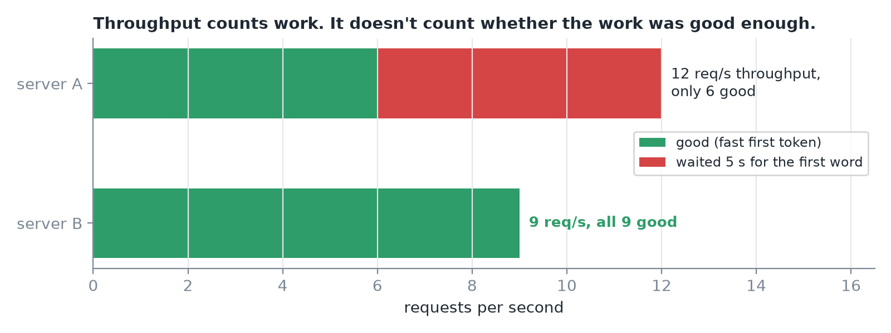
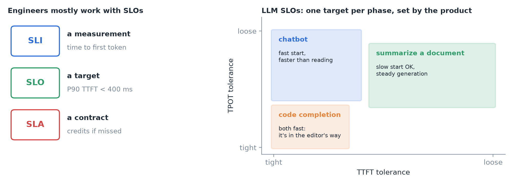
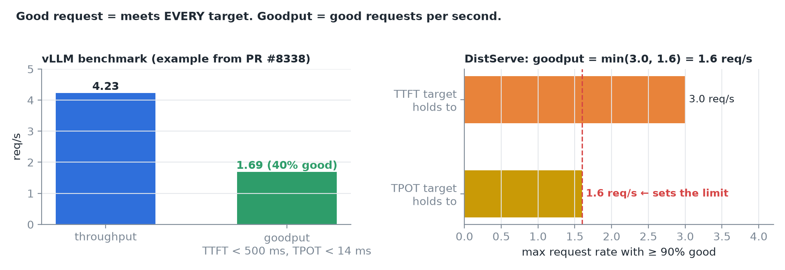
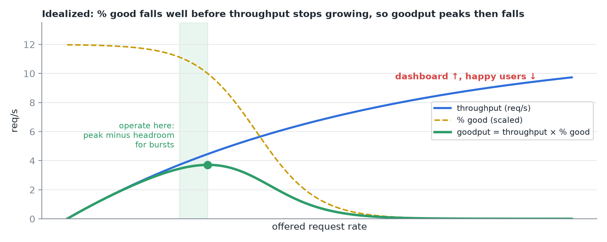
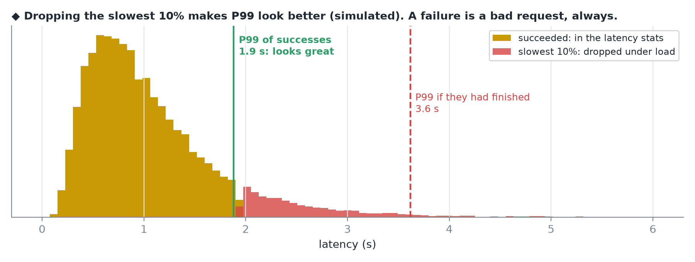
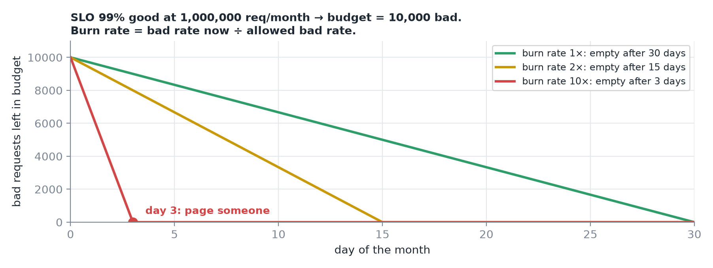
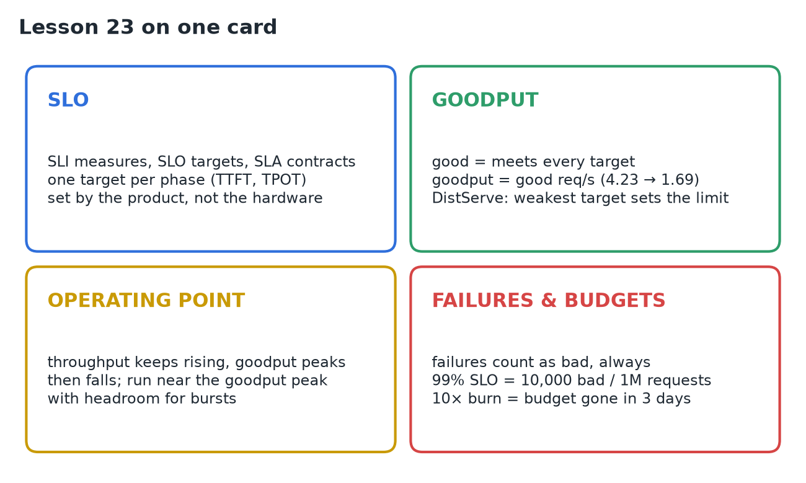

# 23 · Goodput, SLOs & Failure Rates

**Source:** [fanout.sh / inference-eng / 04-06](https://fanout.sh/inference-eng/curriculum/04-06) · ~6 min

> [!NOTE]
> Throughput counts work, not whether the work was good enough. An **SLO** turns a measurement into a target set by the **product** (e.g. P90 TTFT < 400 ms), usually one per phase. A request is **good** if it meets **every** target; **goodput** = good requests per second (vLLM example: **4.23** req/s throughput, **1.69** goodput). Sweep load and throughput keeps rising while goodput **peaks and falls**: operate near the goodput peak with headroom. **Failures count as bad**, always, or dropping the slowest requests makes P99 look great. An **error budget** (99% SLO → 10,000 bad per million) and its **burn rate** (10× → gone in **3 days**) turn this into operations.

## 1. Throughput isn't the goal


*Server A completes 12 req/s but half its users waited 5 s for the first word. Server B completes 9, all fast. B serves more happy users.*

## 2. SLI, SLO, SLA


*Left: the three terms from site reliability engineering. Right: targets per product (after the DistServe paper's workload table).*

- A useful LLM SLO combines targets for **both phases** (TTFT and TPOT).
- **Chatbot:** fast first token, token rate faster than people read. **Code completion:** both fast, it's in the editor's way. **Summarizing a long document:** slow start is fine, generation must be steady.

> [!IMPORTANT]
> The targets come from the **product**, not from the hardware.

## 3. Goodput

A request is **good** if TTFT < its limit **and** TPOT < its limit. **Goodput** = good requests completed per second.


*Left: vLLM's benchmark reports goodput when you pass targets; in the pull request that added it, 4.23 req/s throughput was only 1.69 req/s goodput. Right: DistServe's stricter version is the highest request rate at which ≥ 90% of requests are still good; the weakest target sets it.*

```bash
vllm bench serve ... --goodput ttft:500 tpot:14
```

## 4. Throughput vs goodput


*As the request rate rises, throughput climbs then flattens as the GPU fills. The share of good requests starts falling much earlier, as queues and batching slow everyone down. Their product, goodput, peaks and then falls.*

> [!CAUTION]
> Past the goodput peak, more load makes the dashboard go up while the number of happy users goes down. Operate **near the goodput peak with headroom for bursts**, not at the throughput maximum.

## 5. Failures

Some requests don't just run slowly, they fail: **server errors (5xx), timeouts, rejections when overloaded (429 / load shedding), out-of-memory crashes, replies cut off at a length limit**.


*Latency stats are usually computed over successes only. A server that drops its slowest 10% under load suddenly shows a great P99, because the worst requests left the data.*

> [!IMPORTANT]
> A failure counts as a **bad request, every time**. Report the **failure rate next to latency** and include failures in goodput.

## 6. Error budgets


*An SLO of 99% good allows 1% bad: at a million requests a month, 10,000 bad requests.*

- **Spend slowly:** you can ship risky changes. **Burn fast:** freeze and fix.
- **Alert on the burn rate** (bad rate now ÷ allowed bad rate). Burning **10× too fast** empties a month's budget in about **3 days**: page someone.

## 7. Recap


