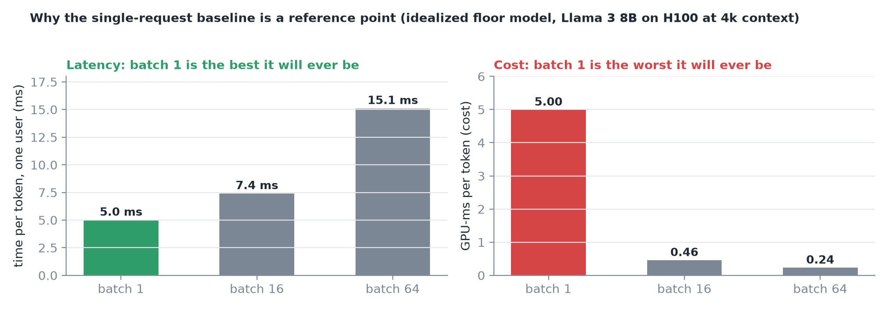
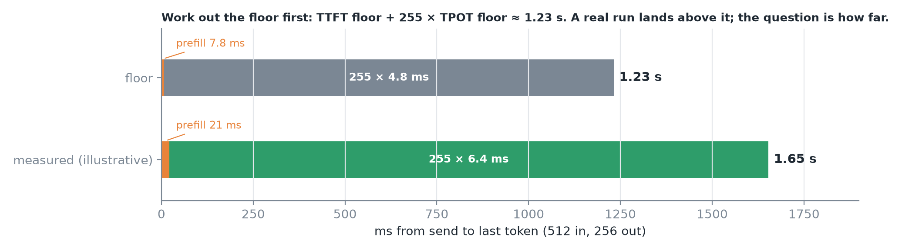
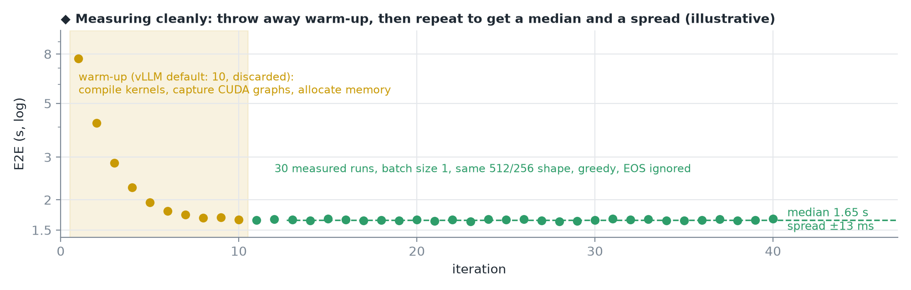
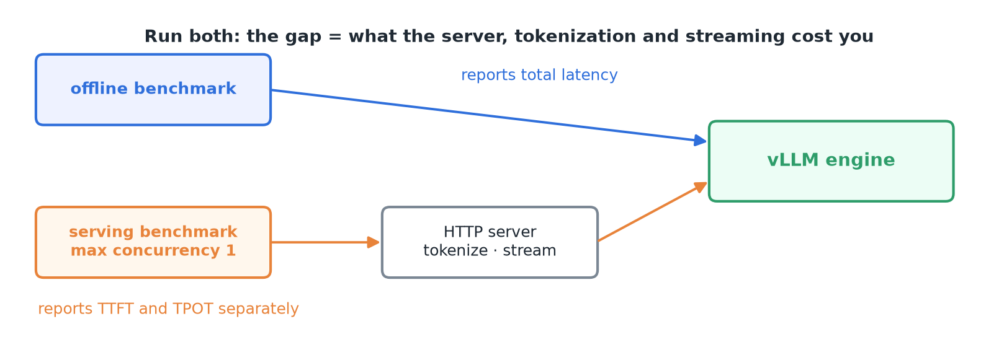
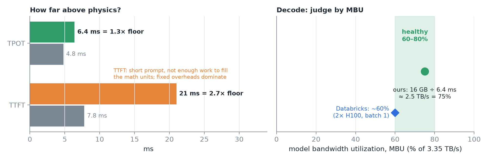
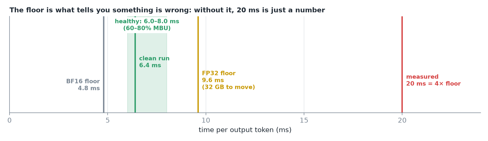
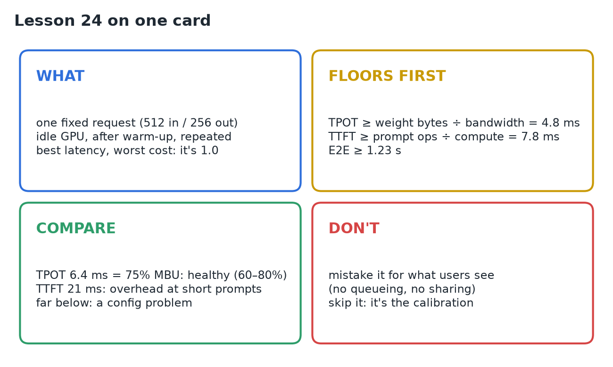

# 24 · Establish the Single-Request Baseline

**Source:** [fanout.sh / inference-eng / 05-01](https://fanout.sh/inference-eng/curriculum/05-01) · ~9 min

> [!NOTE]
> Every later speedup is a ratio against a starting number, so get that number right: **one fixed request on an idle GPU** (Llama 3 8B, 16-bit, one H100, vLLM; **512 in, 256 out**). It's the best latency users will ever get and the worst cost per token. Work out the **floors first**: TPOT ≥ 16 GB ÷ 3.35 TB/s ≈ **4.8 ms**, TTFT ≥ 7.7 TFLOP ÷ 989 TFLOPS ≈ **7.8 ms**, E2E ≥ **1.23 s**. Measure cleanly (pinned setup, fixed shape, greedy, warm-up, ~30 repeats, batch 1). A clean run (illustrative) gives TTFT 21 ms, TPOT 6.4 ms, E2E 1.65 s: **75% of memory bandwidth**, healthy in the 60–80% range. Far worse means a configuration problem, and the floor is what tells you.

## 1. Why a baseline, and the default trap

vLLM's latency benchmark (`vllm bench latency`) sends a **batch of 8 requests at once by default**. That number measures eight requests sharing the GPU and says very little about one. If the starting number is wrong, every ratio after it is wrong too.

The single-request baseline answers one question: **when the GPU has nothing else to do, how fast does one request go?** Record TTFT, TPOT and E2E.

*It's the best latency this setup will ever give a user (nobody competes for the GPU) and the worst cost per token (the GPU does the least useful work it can). Both make it a reference point.*

## 2. Work out the floors first

- **Decode:** each step reads all ~16 GB of weights; 16 GB ÷ 3.35 TB/s ≈ **4.8 ms per token**. No implementation goes below it: the bytes can't arrive faster.
- **Prefill:** 512 tokens × ~15 GFLOP each ≈ 7.7 TFLOP; ÷ 989 TFLOPS (16-bit) ≈ **7.8 ms** to the first token.
- **End to end:** 7.8 ms + 255 × 4.8 ms ≈ **1.23 s**.

*The floor and an illustrative clean run on the same axis. 255, not 256: the first token's time is TTFT.*

## 3. Measure cleanly

Remove everything that isn't the thing you're measuring.

| Rule | Why |
|---|---|
| **Pin the setup:** model revision, dtype, engine version, GPU, driver | Someone else can reproduce it |
| **Fix the shape:** exactly 512 in, force 256 out (**ignore EOS**) | Otherwise one run stops at 40 tokens and another at 200 |
| **Greedy decoding** | Same output every run |
| **Warm up** (vLLM: 10 iterations, discarded) | First requests pay one-time costs: kernel compiles, CUDA graph capture, memory allocation |
| **Repeat ~30 times** | One run says almost nothing; 30 give a median and spread |
| **Batch size 1** | The whole point |

Run it two ways:

*The offline benchmark talks to the engine directly and reports total latency. The serving benchmark goes through the real HTTP server at max concurrency 1 and reports TTFT and TPOT separately.*

## 4. Compare against the floors

A clean run (illustrative numbers, in the expected range): **TTFT 21 ms, TPOT 6.4 ms, E2E ≈ 1.65 s**.

*Decode: 16 GB every 6.4 ms ≈ 2.5 TB/s, 75% of peak. Databricks calls this model bandwidth utilization (MBU) and reported about 60% at batch 1 on two H100s.*

- **Decode at 60–80% MBU** means the engine is doing its job.
- **Prefill** sits further from its floor (21 vs 7.8 ms). Normal for a short prompt: 500 tokens isn't enough work to keep every math unit busy, and fixed overheads matter more.

## 5. When it looks off

*Say TPOT is 20 ms, about 4× the floor. That's a symptom.*

| Suspect | What happens |
|---|---|
| **Eager mode** (`--enforce-eager`) | No CUDA graphs or compilation: the CPU launches every small GPU op one by one, every step |
| **FP32 weights** | 32 GB to move: the floor itself doubles to 9.6 ms |
| **A noisy GPU** | Another process, a leftover notebook, or clocks throttled by power or heat |
| **TTFT is the odd one out** | Skipped warm-up, or the client also times network and tokenization |
| **Wide spread between runs** | Trust none of the numbers until you know why |

## 6. Write it down

| Field | Example |
|---|---|
| Setup | Model revision, dtype, engine, driver |
| Shape | 512 in / 256 out, greedy, ignore EOS |
| Metrics (median and spread) | TTFT 21 ms · TPOT 6.4 ms · E2E 1.65 s |
| Versus floors | TPOT 1.3× floor · MBU 75% |
| Conclusion | "Decode runs at 75% of memory bandwidth; prefill is overhead-bound at this prompt length." |

From now on this is **1.0**: every later sweep (more users, longer prompts, longer outputs) is a change from here.

> [!CAUTION]
> Two misunderstandings. The baseline **isn't what users see**: it's the best case; production adds queueing, sharing and batching. And **don't skip it**: it's the calibration, and the only measurement you can check against physics.

## 7. Recap

## Interview cheat sheet

*Revise from these pages alone. ◆ = my addition beyond the video; everything else is from the lesson. The decode and prefill floors are derived in 01 (derivations 1 and 2); MBU/MFU in 09; force-length and gap-tail measurement rules in 16; warm-up and medians for TTFT in 15.*

### Say it in 30 seconds

> Before any optimization I'd record a single-request baseline: one fixed 512-in, 256-out request on an idle GPU, pinned versions, greedy, EOS ignored, warmed up, about 30 repeats, batch 1, and note that vLLM's latency benchmark defaults to batch 8. First the floors: 16 GB over 3.35 TB/s is 4.8 ms per token, 7.7 TFLOP over 989 is 7.8 ms to first token, so 1.23 s end to end. A clean run at 6.4 ms per token is 75% of bandwidth, healthy in the 60 to 80% band; 20 ms would point at eager mode, FP32 weights or a noisy GPU. I'd run both the offline and serving benchmarks, since the gap is server cost, and call the result 1.0.

### Only numbers worth memorizing

- **Llama 3 8B, H100, 512/256:** floor **1.23 s**; healthy TPOT **6.0–8.0 ms** (60–80% MBU).

### Derive, don't memorize

#### 1. End-to-end floor vs measured

$$\mathrm{floor} = 7.8 + 255 \times 4.8 \approx 1232\ \mathrm{ms} \qquad \mathrm{measured} = 21 + 255 \times 6.4 \approx 1653\ \mathrm{ms} \quad (1.34\times)$$

> [!TIP]
> Decode is 99% of both: E2E tracks TPOT, so judge it by MBU.

#### 2. Healthy TPOT band = floor ÷ MBU ◆

$$\mathrm{TPOT} = \frac{4.8\ \mathrm{ms}}{\mathrm{MBU}}: \quad \frac{4.8}{0.8} = 6.0 \quad \frac{4.8}{0.6} = 8.0\ \mathrm{ms} \qquad \frac{4.8}{6.4} = 75\%$$

#### 3. A wrong dtype moves the floor itself

$$\mathrm{FP32}: \frac{32\ \mathrm{GB}}{3.35\ \mathrm{TB/s}} \approx 9.6\ \mathrm{ms} \qquad \frac{20}{4.8} \approx 4\times\ \mathrm{floor} \Rightarrow \mathrm{investigate}$$

#### 4. Prefill efficiency at a short prompt ◆

$$\mathrm{MFU} = \frac{7.7\ \mathrm{TFLOP} / 21\ \mathrm{ms}}{989\ \mathrm{TFLOPS}} \approx \frac{367}{989} \approx 37\%$$

> [!TIP]
> ◆ Fine for 512 tokens: fixed overheads dominate. Longer prompts should climb toward the ~50% assumed in 15.

### Offline vs serving benchmark

| | Offline | Serving (max concurrency 1) |
|---|---|---|
| Talks to | The engine directly | The real HTTP server |
| Reports | Total latency | TTFT and TPOT separately |
| Includes | Engine only | Server, tokenization, streaming |

### Symptom → suspects

| Symptom | Suspects |
|---|---|
| TPOT ~4× floor | `--enforce-eager` (no CUDA graphs), FP32 weights, another process, throttled clocks |
| Only TTFT is off | Skipped warm-up; client timing network and tokenization |
| "Latency" looks like a loaded server | `vllm bench latency` default batch size 8 |
| Runs disagree widely | Unexplained noise: trust nothing yet |
| Offline fast, serving slow | Server, tokenization or streaming overhead |

### Rapid-fire Q&A

| Question | Crisp answer |
|---|---|
| Why a single-request baseline? | Every speedup is a ratio against it; it's the one number checkable against physics. |
| Is it what users see? | No: the best case; production adds queueing and sharing. |
| Why ignore EOS? | So every run does the same 256 tokens of work. |
| Why warm up? | First runs pay compiles, CUDA graph capture and allocation. |
| Healthy decode at batch 1? | 60–80% MBU (derivation 2). |

> [!WARNING]
>
> - Quoting `vllm bench latency` without `--batch-size 1`.
> - Measuring without first computing the floor.
> - Treating the baseline as a production latency promise.
