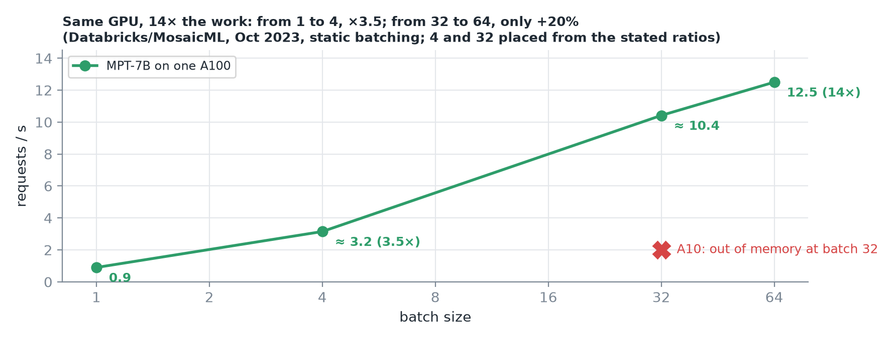
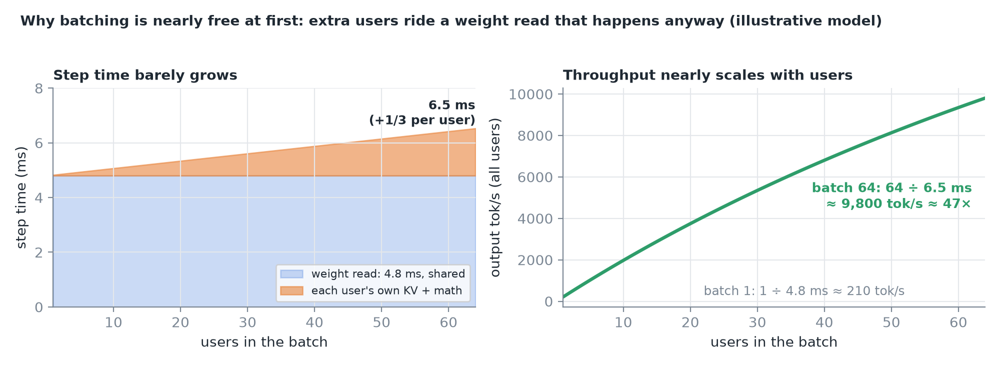
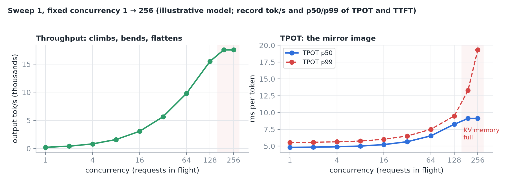
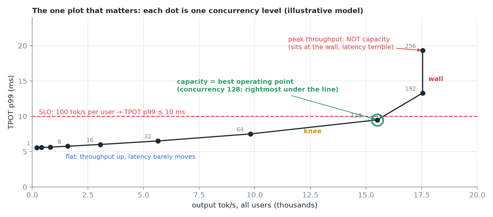
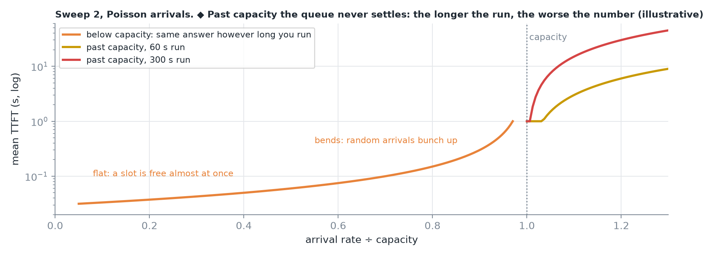
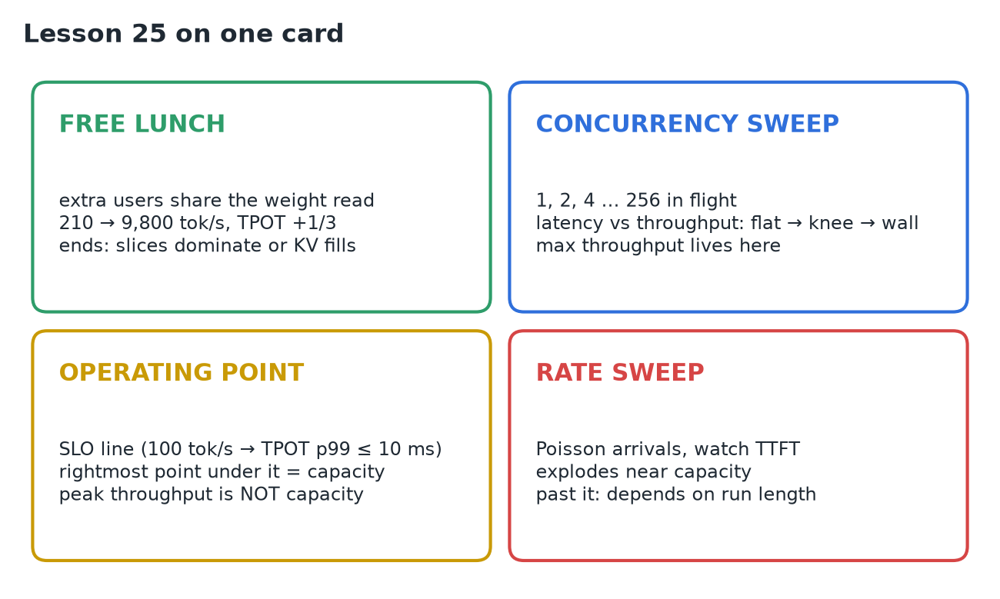

# 25 · Sweep Concurrency & Request Rate

**Source:** [fanout.sh / inference-eng / 05-02](https://fanout.sh/inference-eng/curriculum/05-02) · ~9 min

> [!NOTE]
> Batching is nearly free at first: extra users ride a weight read that happens anyway (illustrative: 1 user at 4.8 ms/step → 64 users at 6.5 ms gives **~47× throughput for +1/3 TPOT**; Databricks measured **14×** on one A100). It ends when per-user costs dominate or the **KV cache fills**. A **concurrency sweep** (1, 2, 4 … 256 in flight) draws the latency-throughput curve: **flat → knee → wall**, and your SLO line picks the operating point (the rightmost dot under it). A **request-rate sweep** with random arrivals shows TTFT exploding near capacity and, past it, **growing for as long as you run**. Peak throughput is not capacity: capacity is the most load that still meets the targets.

## 1. The free lunch


*In 2023 MosaicML at Databricks served MPT-7B on one A100: 0.9 req/s one at a time, 12.5 req/s at batch 64. On a smaller A10 the climb stopped at batch 32: out of memory.*

Start from the single-request baseline: one user on the H100, each decode step ≈ **4.8 ms**, almost all of it reading weights. Add a second user: the step still reads the weights **once**, and that one read now makes two tokens. The extra user only adds their own keys and values to read, plus a little arithmetic.


*Illustrative model: 4.8 ms plus a small slice per user. At 64 users a step takes ~6.5 ms: each user's TPOT rises by a third, but the GPU makes 64 tokens per step instead of one.*

It ends in two ways: the **per-user slices add up** until they dominate the step, or the **KV cache fills** GPU memory and new users have to wait.

## 2. Sweep 1: fixed concurrency

Keep exactly N requests in flight; when one finishes, the next starts. Run N = 1, 2, 4, 8 … doubling up to 256 or until something breaks. At each level record **total output throughput** and the **median and P99 of TPOT and TTFT**.


*Throughput climbs steeply, bends, flattens; TPOT is the mirror image. Databricks saw the same shape: 1 → 4 users gave 3.5× the throughput, 32 → 64 only about 20% more.*

## 3. The one plot that matters

Put throughput on the x-axis and TPOT on the y-axis, one dot per concurrency level, and read left to right.



| Region | What happens |
|---|---|
| **Flat** | Throughput grows a lot, latency barely moves. You should almost always be at least this far along |
| **Knee** | Each extra user still adds throughput, but costs every other user a noticeable slowdown |
| **Wall** | Throughput stops growing; latency keeps climbing as requests wait for memory or a slot |

> [!IMPORTANT]
> Your latency target picks the spot. If every user must see ≥ **100 tokens/s**, that's **TPOT ≤ 10 ms at P99**: draw the line, and the best operating point is the **rightmost dot still under it**.

## 4. Sweep 2: fixed request rate

The concurrency sweep only sends a new request when an old one finishes, so it slows down when the server does. Real users arrive whenever they like. So the second sweep fixes the **arrival rate** (random arrivals averaging, say, 10/s) and raises it, watching **TTFT**.


*At low rates TTFT is flat: a slot is free almost at once. Near capacity it bends sharply as random arrivals bunch up. Past capacity the queue grows without limit.*

> [!TIP]
> If your result **depends on how long you ran the benchmark**, you're past capacity.

## 5. Running both with vLLM

```bash
vllm bench serve \
  --max-concurrency 32 \
  --request-rate 10 --burstiness 1 \
  --dataset-name random --random-input-len 512 \
  --random-output-len 256 --ignore-eos \
  --percentile-metrics ttft,tpot,e2el \
  --metric-percentiles 50,90,99 \
  --goodput ttft:500 tpot:10
```

- `--max-concurrency N` for sweep 1; `--request-rate` with `--burstiness 1` (Poisson-style) for sweep 2.
- Fixed shape: random 512-token prompts, 256 output tokens, ignore EOS. `--goodput` counts requests that met your targets.
- `vllm bench sweep` runs a whole grid; **GuideLLM** has a sweep mode that finds the range automatically.

> [!CAUTION]
> If you don't set a request rate it's **infinite**: every request is sent at time zero. That's one burst, not a steady rate.

## 6. How sweeps quietly go wrong

| Pitfall | Effect |
|---|---|
| **Too few requests** | At high rates a short run never reaches steady state: you measure the ramp-up |
| **A weak client** | The sender can't keep up: you benchmark the client. Compare achieved vs requested rate |
| **Unrealistic prompts** | Random prompts never share a prefix, so prefix caching never helps; real chat often does |
| **Averages** | The median looks fine while P99 has blown through the target |

> [!CAUTION]
> The highest throughput on the curve **is not your capacity**: it sits at the wall, where latency is terrible. Capacity is the highest load that still meets the latency targets (goodput), always left of the peak.

## 7. Recap


