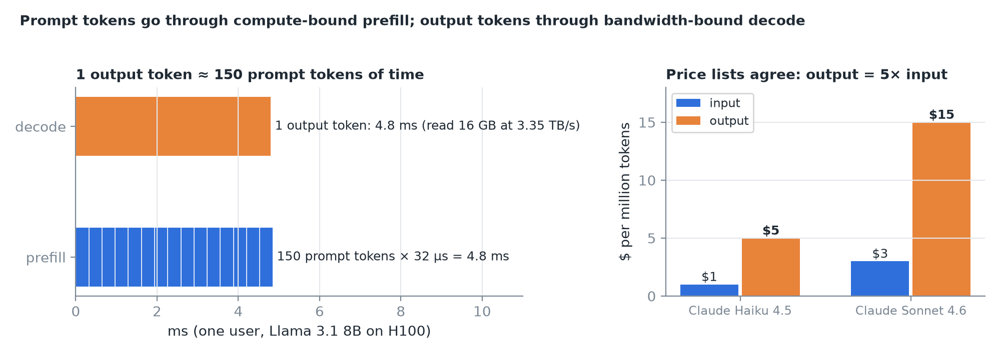
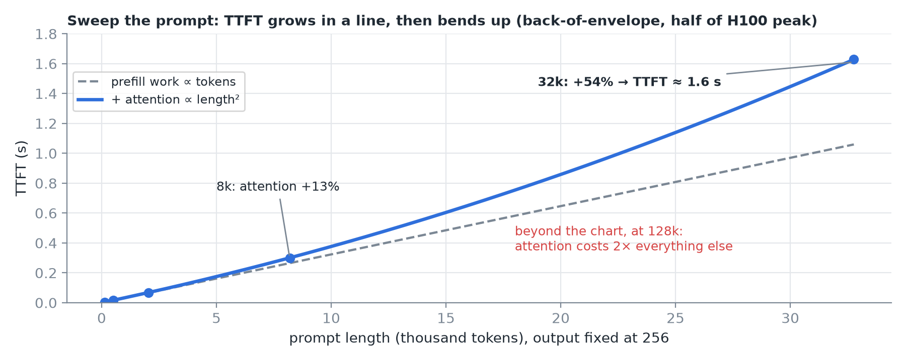
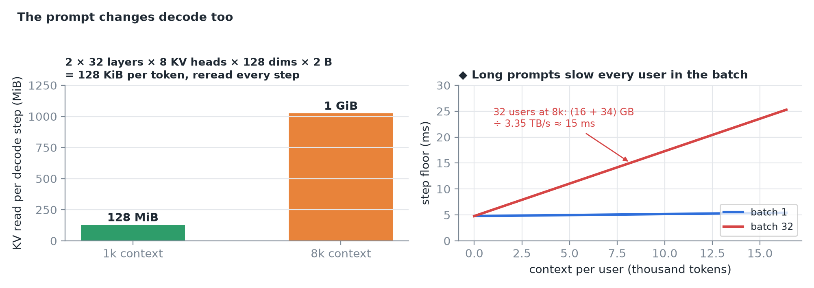
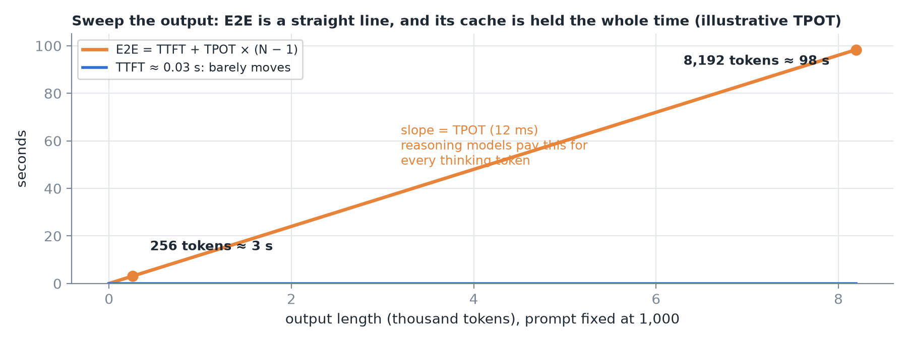
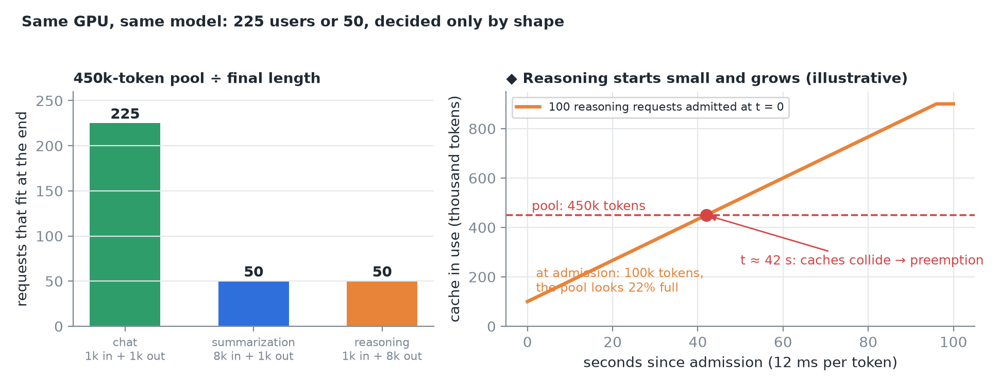
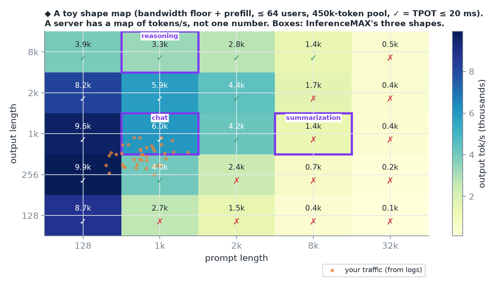
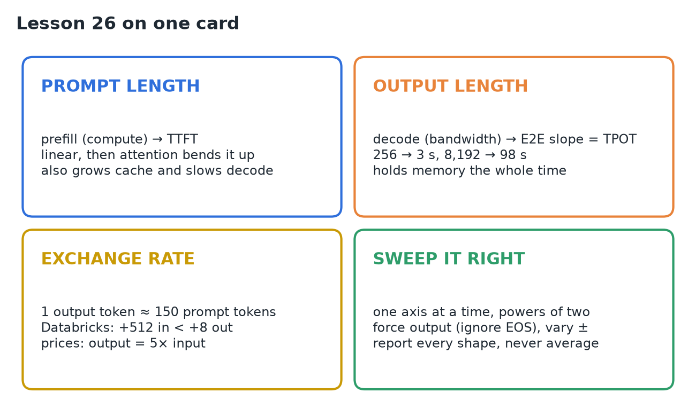

# 26 · Sweep Prompt & Output Length

**Source:** [fanout.sh / inference-eng / 05-04](https://fanout.sh/inference-eng/curriculum/05-04) · ~9 min

> [!NOTE]
> A request's **shape** (prompt length, output length) decides every number, so two teams can get very different tokens/s from the same model and GPU. **Prompt length** drives compute-bound prefill (TTFT), grows the KV cache, and slows decode for everyone sharing the batch. **Output length** drives the bandwidth-bound decode loop and how long memory is held. One output token costs about as much time as **~150 prompt tokens**; price lists charge **5×**. The same H100 fits **225 chat** users but only **50 summarization** users. Sweep one axis at a time, force the output length, and report every shape separately: a server has a **map** of tokens/s, not one number.

## 1. Two lengths, two machines

The prompt goes through **prefill**: all its tokens in one parallel pass, limited by **compute**, deciding **time to first token**. The output comes from **decode**: one token per step, each step reading the whole model, limited by **memory bandwidth**, deciding how long the rest of the answer takes.


*A prompt token: 2 × 8B = 16 GFLOP at half of ~990 TFLOPS ≈ 32 µs (a 1,000-token prompt ≈ 32 ms). An output token with one user: 16 GB ÷ 3.35 TB/s ≈ 4.8 ms. Databricks measured the same: adding 512 prompt tokens raised latency less than adding 8 output tokens. Anthropic charges 5× more per output token on every current Claude model.*

## 2. Sweep the prompt (output fixed at 256)

Prompt lengths 128, 512, 2k, 8k, 32k:


*TTFT first grows in a straight line (prefill work ∝ tokens), then bends up: attention compares every token with every earlier one, which grows with length². Attention adds ~13% at 8k, ~54% at 32k, and at 128k costs twice everything else combined.*

**The prompt changes decode too.** Every decode step reads the cache of every earlier token:


*128 KiB per token for this model: a 1k context is 128 MiB, an 8k context a whole GiB, reread on every step. Long prompts slow TPOT too, for everyone sharing the batch.*

## 3. Sweep the output (prompt fixed at 1,000)


*TTFT barely moves; prefill didn't change. E2E = TTFT + TPOT × (N − 1) is a straight line with slope TPOT: at 12 ms per token, 256 tokens ≈ 3 s and 8,192 ≈ 98 s.*

- That's where **reasoning models** live: their thinking tokens are output tokens, and each pays the decode price.
- **Long outputs hold memory longer:** a request decoding for 90 s keeps its cache for 90 s, so **requests finished per second drops** even when output tokens/s looks healthy.

## 4. Shape decides how many fit

After weights and overheads, the H100 has about **450,000 tokens** of cache.


*Chat (1k in, 1k out) ends at 2,000 tokens: ~225 fit. Summarization (8k in, 1k out) ends at 9,000: ~50 fit. Reasoning (1k in, 8k out) also ends at 9,000 but starts small, so the scheduler happily admits many, and later their caches grow into each other: preemption.*

## 5. Running the sweep

```bash
vllm bench serve \
  --dataset-name random \
  --random-input-len 8192 \
  --random-output-len 1024 \
  --random-range-ratio 0.1 \
  --ignore-eos \
  --max-concurrency 32
```

- `--random-range-ratio` makes each request vary a little instead of all being identical. SemiAnalysis's public benchmarks draw each prompt between **80% and 100%** of the target.
- `--ignore-eos` is the flag people forget: without it the model stops when it decides it's done, and "8,000 output tokens" quietly becomes ~300.
- Change **one axis at a time, in powers of two**, and repeat each shape at a few concurrency levels.
- Record per point: **TTFT and TPOT (median and tail), input and output tokens/s, cache usage, preemptions**.
- **Don't average different shapes** into one number: the long requests hide inside the mean.

## 6. The shape map


*Prompt on one axis, output on the other; each cell holds what the server does at that shape and whether it meets the latency target. Public benchmarks (InferenceMAX) pick three cells: 1k/1k chat, 1k/8k reasoning, 8k/1k summarization. Then pull real lengths from your logs and tune for where your traffic sits: a config that wins at chat can lose at summarization.*

> [!CAUTION]
> Three beliefs to drop. **"Prompt tokens are free"**: cheaper, but they cost TTFT, compute and cache. **"A server has one tokens/s number"**: it has a map. **"max_tokens is the output length"**: it's only a ceiling unless you force the model to keep going.

## 7. Recap



## Interview cheat sheet

*Revise from these pages alone. ◆ = my addition beyond the video; everything else is from the lesson. Prefill time and the attention share are derived in 15 (derivations 2 and 3); KV bytes per token in 05; pool ÷ length concurrency in 19; E2E = TTFT + TPOT(N − 1) in 08.*

### Say it in 30 seconds

> Shape is prompt and output length, and they hit different parts of the machine. The prompt goes through compute-bound prefill, so it sets TTFT, which grows linearly then bends up with attention; it also grows the cache, and every decode step rereads it, slowing everyone in the batch. The output runs bandwidth-bound decode, so E2E grows by TPOT per token and memory is held the whole time. One output token costs about 150 prompt tokens of time, which is why APIs charge 5× for output. Shape also sets capacity: 225 chat users or 50 summarization users on one H100. So I sweep one axis at a time with EOS ignored and report a shape map, never one averaged number.

### Only numbers worth memorizing

- **1 output token ≈ 150 prompt tokens** of time (one user, 8B, H100). **H100 pool ≈ 450k tokens:** chat 1k/1k → 225, 8k/1k → 50.

### Derive, don't memorize

#### 1. The exchange rate: decode token vs prefill token

$$\frac{t_{\mathrm{out}}}{t_{\mathrm{in}}} = \frac{16\ \mathrm{GB} / 3.35\ \mathrm{TB/s}}{16\ \mathrm{GFLOP} / (0.5 \times 990\ \mathrm{TFLOPS})} = \frac{4.8\ \mathrm{ms}}{32\ \mu\mathrm{s}} \approx 150$$

> [!TIP]
> At batch 1. ◆ Batching shares decode's weight read, so the ratio shrinks under load; that's why prices sit near 5×, not 150×.

#### 2. Output length is a slope

$$\mathrm{E2E}(N) = 0.03 + 0.012\,(N - 1): \quad 256 \Rightarrow 3.1\ \mathrm{s} \qquad 8192 \Rightarrow 98\ \mathrm{s}$$

#### 3. Fit by final length, not starting length

$$\frac{450\mathrm{k}}{1\mathrm{k} + 1\mathrm{k}} = 225 \qquad \frac{450\mathrm{k}}{8\mathrm{k} + 1\mathrm{k}} = 50 \qquad \mathrm{reasoning}: \frac{450\mathrm{k}}{1\mathrm{k}}\ \mathrm{at\ admission\ vs}\ \frac{450\mathrm{k}}{9\mathrm{k}} = 50\ \mathrm{at\ the\ end}$$

> [!TIP]
> ◆ 100 reasoning requests start at 100k tokens (22% full) and, at 12 ms per token, fill the pool in (4,500 − 1,000) × 12 ms ≈ 42 s: preemption.

#### 4. Long prompts tax every user's decode ◆

$$t_{\mathrm{step}} \geq \frac{16\ \mathrm{GB} + B \cdot C \cdot 128\ \mathrm{KiB}}{3.35\ \mathrm{TB/s}}: \quad B = 32,\ C = 8\mathrm{k} \Rightarrow \frac{16 + 34\ \mathrm{GB}}{3.35\ \mathrm{TB/s}} \approx 15\ \mathrm{ms}\ (\mathrm{vs}\ 4.8)$$

### What each length drives

| | Prompt length | Output length |
|---|---|---|
| Phase | Prefill (compute-bound) | Decode (bandwidth-bound) |
| Moves | TTFT (linear, then attention²) | E2E slope = TPOT × N |
| Memory | Cache size from the start | Cache grows and is held longer |
| Side effect | Slows every user's decode step | Fewer requests finished per second |
| Public shape | Summarization 8k/1k | Reasoning 1k/8k |

### Symptom → diagnosis

| Symptom | Diagnosis |
|---|---|
| Two teams, same server, very different tok/s | Different request shapes |
| "8k output" run finished suspiciously fast | `--ignore-eos` missing: the model stopped at ~300 |
| Preemptions minutes into a reasoning load test | Caches grew past the pool after admission |
| TPOT rose when only prompts got longer | Every step rereads longer caches |
| Output tok/s fine, requests/s falling | Long outputs hold slots and memory longer |
| One averaged tok/s hides bad requests | Shapes mixed: report each separately |

### Rapid-fire Q&A

| Question | Crisp answer |
|---|---|
| Why is output 5× the price of input? | Decode is bandwidth-bound, one token per weight read (derivation 1). |
| Does a long prompt affect TPOT? | Yes: its cache is reread every step, for the whole batch. |
| Why do reasoning models cost so much? | Thinking tokens are output tokens: full decode price, long-held cache. |
| Is max_tokens the output length? | No: a ceiling, unless you ignore EOS. |
| Which shapes do public benchmarks use? | 1k/1k chat, 1k/8k reasoning, 8k/1k summarization. |

> [!WARNING]
>
> - Treating prompt tokens as free.
> - Quoting one tokens/s number for a server.
> - Averaging different shapes into one result.
