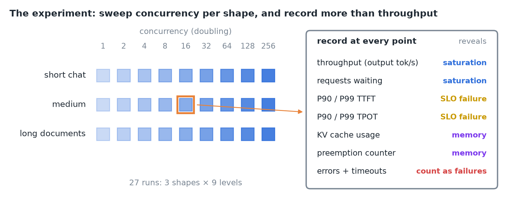
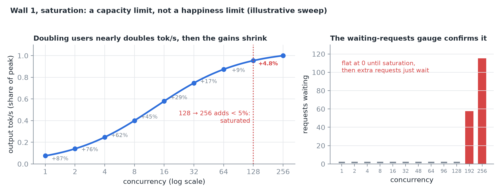
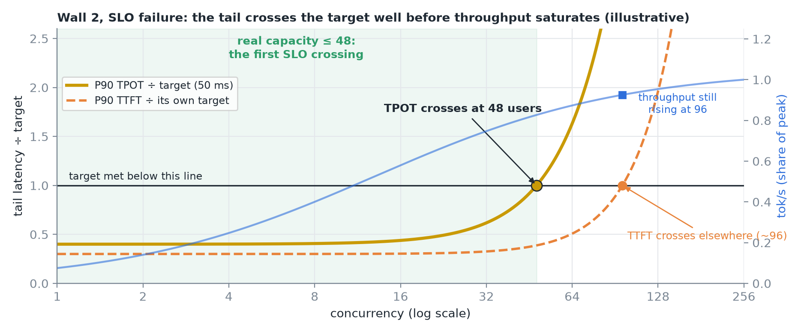
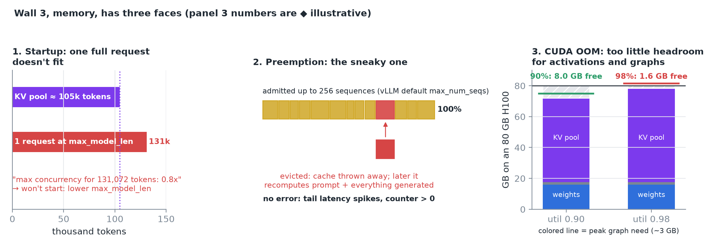
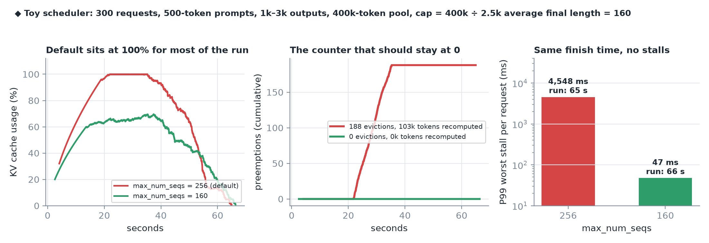
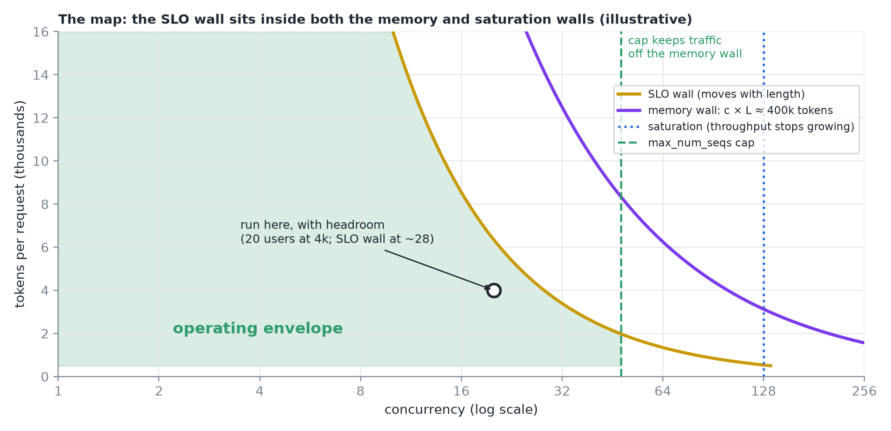
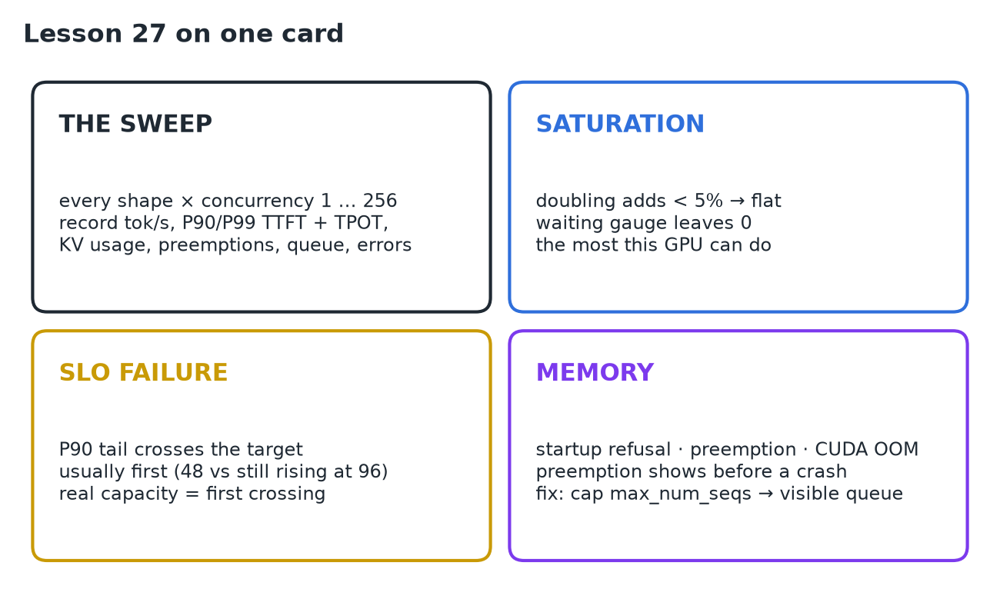

# 27 · Find Saturation, SLO Failure & OOM Boundaries

**Source:** [fanout.sh / inference-eng / 05-05](https://fanout.sh/inference-eng/curriculum/05-05) · ~6 min

> [!NOTE]
> Every GPU serving a model has an **operating envelope**: the region where it's fast, correct and stable. Outside it, it breaks against three different walls: **saturation** (throughput stops growing), **SLO failure** (the tail crosses the target) and **memory** (startup refusal, preemption, CUDA OOM). The SLO wall usually comes first, so **real capacity is the first SLO crossing**, not the throughput plateau. The memory wall shows up as **preemption before it shows up as a crash**; cap `max_num_seqs` so extra requests wait in a visible queue.

## 1. The experiment

*Pick a few shapes that match your traffic (short chat, medium, long documents) and sweep concurrency 1, 2, 4, … up to a few hundred for each. At every point record throughput, P90 and P99 of TTFT and TPOT, three engine signals (KV cache usage, the preemption counter, requests waiting), and errors and timeouts counted as failures. Those columns are enough to find every wall.*

## 2. Wall 1: saturation

*At first, doubling users nearly doubles tokens/s; then the gains shrink and the curve flattens.*

- Rule: once **doubling concurrency adds less than ~5%**, you've saturated.
- Past that, extra requests aren't served faster, they **wait**: the **waiting-requests gauge**, flat at 0, starts to climb.
- Saturation is a **capacity limit**: the most this GPU can do, not whether users are happy.

## 3. Wall 2: SLO failure

*P90 TPOT rises slowly, bends up and crosses its 50 ms target at about 48 users. TTFT may cross somewhere else. Throughput is still climbing at 96.*

> [!IMPORTANT]
> The SLO usually breaks **well before** throughput saturates. Your real capacity is the smaller of the two: the **first SLO crossing**, not the plateau.

## 4. Wall 3: memory, three faces

*Startup: if weights plus one full-length request don't fit, the engine refuses to start or reports that less than one request fits. Preemption: the engine admits many requests because their caches start small; when the cache hits 100% it evicts one. CUDA OOM: a real crash, usually from leaving too little headroom for activations and graphs.*

- **Preemption is the sneaky one.** vLLM admits up to **256 sequences** by default (`max_num_seqs`). As replies grow the cache fills; at **100%** it evicts a running request, by default **throwing its cache away** and later **recomputing prompt plus everything generated so far**.
- That request stalls, and the recompute steals time from everyone. **No error**: just tail-latency spikes and a **preemption counter** that should have stayed at 0.
- **Fix:** cap `max_num_seqs` at what the cache really sustains, so extra requests wait in a **visible queue** instead of thrashing.

*◆ A toy scheduler: with the default cap the cache sits at 100%, 188 evictions recompute 103k tokens and the P99 worst stall is 4.5 s. Capping at 160 finishes in the same time with no evictions and a 47 ms worst stall.*

## 5. The operating envelope

*Concurrency across, tokens per request up. The memory wall is a curve: concurrency × length can't exceed the cache, ~400k tokens here. Saturation is where throughput stops growing. The SLO wall moves with length and sits inside both. Run inside the green region with headroom for bursts, and set the concurrency cap so traffic can't wander past the memory wall.*

| Wall | Signal that gives it away | What it means |
|---|---|---|
| Saturation | Doubling adds < 5%; waiting gauge leaves 0 | The most this GPU can do |
| SLO failure | P90/P99 TTFT or TPOT crosses the target | Real capacity (usually first) |
| Memory | Startup refusal; preemption counter > 0; CUDA OOM | Cache or headroom too small |

## 6. Recap

## Interview cheat sheet

*Revise from these pages alone. ◆ = my addition beyond the video; everything else is from the lesson. The concurrency sweep itself and picking a point under the SLO are in 25; pool ÷ length concurrency in 19 (derivation 1); the memory budget and headroom in 18; prefill cost per token in 26 (derivation 1).*

### Say it in 30 seconds

> A serving GPU has an envelope bounded by three walls, and I find them with one sweep: concurrency 1 to a few hundred per traffic shape, recording throughput, P90 and P99 TTFT and TPOT, KV usage, preemptions, the waiting queue and errors. Saturation is where doubling users adds under 5% and the queue starts growing. SLO failure is where the tail crosses the target, and it usually comes first: 48 users while throughput still climbs at 96, so capacity is the first crossing. Memory fails three ways: refusing to start, silent preemption that recomputes evicted requests and spikes the tail, and CUDA OOM from too little headroom. I cap max_num_seqs at what the cache sustains so overload becomes a visible queue.

### Only numbers worth memorizing

- **Saturated** when doubling concurrency adds **< 5%**. vLLM's default **`max_num_seqs` = 256**.

### Derive, don't memorize

Let *c* = concurrency, *L* = final tokens per request.

#### 1. Capacity is the lowest wall

Each wall gives a max concurrency for the shape; the one you hit first is the limit.

$$c^{*} = \min(c_{\mathrm{TPOT}},\ c_{\mathrm{TTFT}},\ c_{\mathrm{sat}},\ \frac{\mathrm{pool}}{L}) = \min(48,\ 96,\ 128,\ \frac{400\mathrm{k}}{2\mathrm{k}} = 200) = 48$$

> [!TIP]
> Run below *c\** with headroom for bursts (the map runs 20 users at 4k where the SLO wall is ~28). Every shape has its own *c\**, so repeat per shape.

#### 2. The startup "0.8x" ◆

The engine checks whether one request at `max_model_len` fits the cache.

$$\frac{\mathrm{pool}}{\mathrm{max\_model\_len}} = 0.8 \Rightarrow \mathrm{pool} \approx 0.8 \times 131072 \approx 105\mathrm{k\ tokens} \approx 12.8\ \mathrm{GiB\ at}\ 128\ \mathrm{KiB}$$

> [!TIP]
> ◆ Lower `max_model_len` below ~105k (65,536 gives 1.6x), or free memory for the cache.

#### 3. A preemption costs a whole re-prefill ◆

$$(\mathrm{prompt} + \mathrm{generated}) \times 32\ \mu\mathrm{s} = (500 + 2000) \times 32\ \mu\mathrm{s} \approx 80\ \mathrm{ms\ of\ GPU\ per\ eviction}$$

#### 4. The cap: what the cache sustains ◆

$$\mathrm{max\_num\_seqs} \approx \frac{\mathrm{pool}}{\mathrm{average\ final}\ L} = \frac{400\mathrm{k}}{2.5\mathrm{k}} = 160$$

> [!TIP]
> ◆ Toy run: 256 → 188 evictions, P99 worst stall 4.5 s; 160 → 0 evictions, 47 ms, same finish time. Then lower it further to *c\** if the SLO wall is tighter.

### The three memory failures

| | Startup | Preemption | CUDA OOM |
|---|---|---|---|
| When | Engine launch | Under load, as replies grow | Under load or graph capture |
| Looks like | Refuses, or "< 1x" concurrency | No error: tail spikes, counter > 0 | Crash |
| Cause | Weights + one max-length request don't fit | Admitted caches outgrow the pool | Too little headroom |
| Fix | Lower `max_model_len` | Cap `max_num_seqs` | Leave headroom |

### Symptom → diagnosis

| Symptom | Diagnosis |
|---|---|
| Tok/s flat, waiting gauge climbing | Saturated: extra users only wait |
| P99 spikes, no errors, KV at 100% | Preemption: evicted requests recomputing |
| Throughput still rising but users complain | Past the SLO wall, before saturation |
| Envelope fine for chat, broken for documents | SLO and memory walls move with length |

### Rapid-fire Q&A

| Question | Crisp answer |
|---|---|
| Which wall comes first? | Usually the SLO (derivation 1). |
| How do you spot saturation? | Doubling adds < 5%; requests start waiting. |
| Why is preemption worse than a crash? | It's silent: only tails and a counter show it. |
| What happens to an evicted request? | Cache discarded; prompt + output recomputed later. |
| Why cap max_num_seqs below 256? | Overload becomes a visible queue, not thrash. |

> [!WARNING]
>
> - Recording only throughput: you can't see the SLO or memory walls.
> - Waiting for a crash to find the memory wall: preemption came first.
> - Leaving `max_num_seqs` at 256 for long requests.
