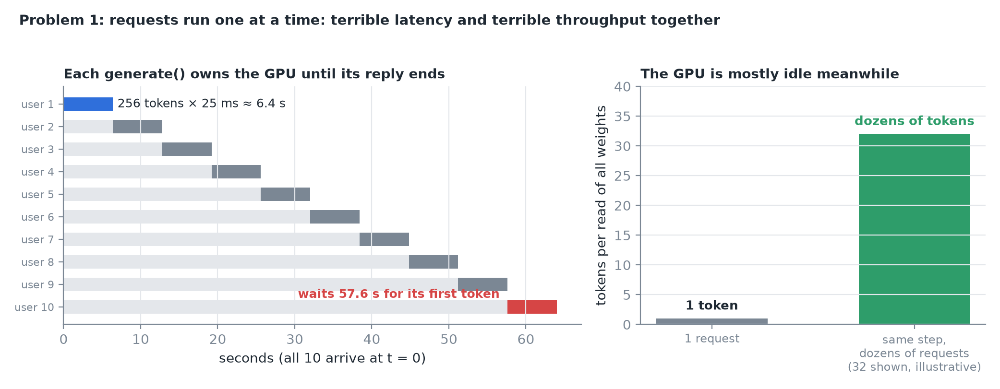
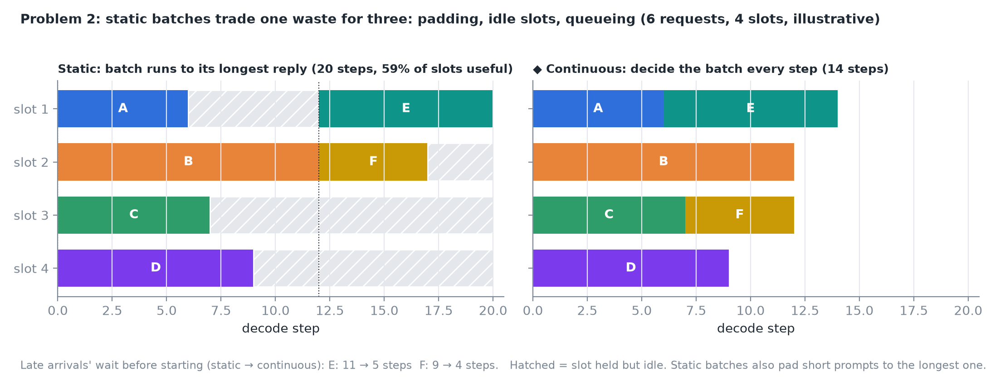
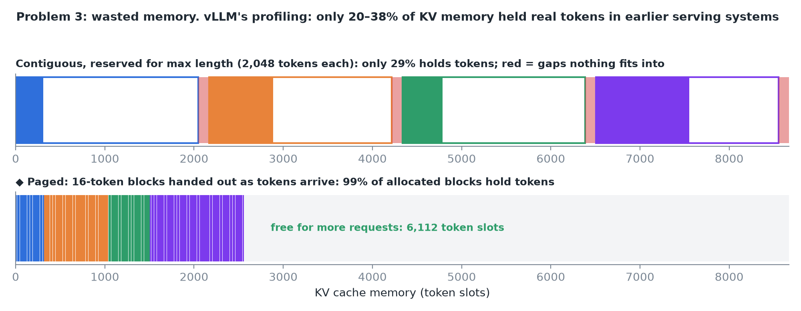
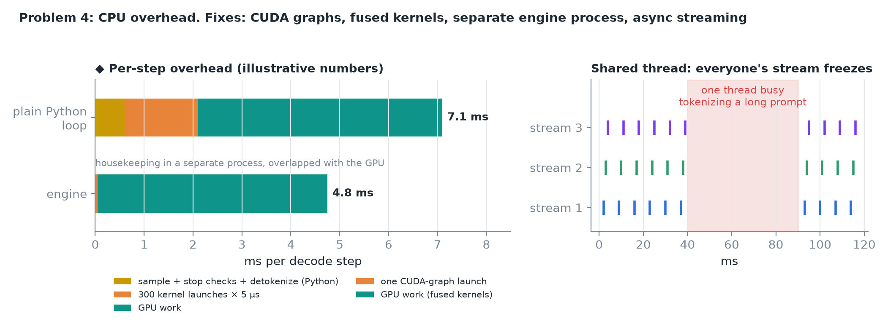
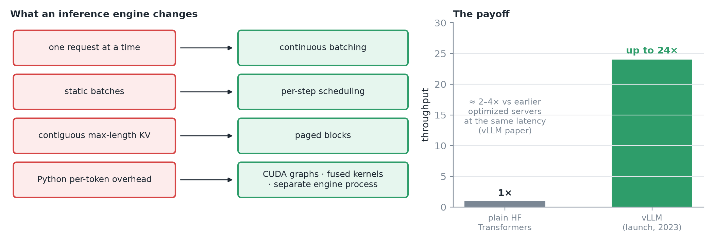
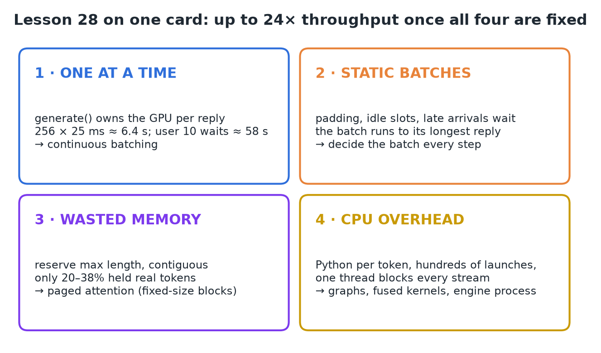

# 28 · Why Plain PyTorch Serving Breaks Down

**Source:** [fanout.sh / inference-eng / 06-01](https://fanout.sh/inference-eng/curriculum/06-01) · ~6 min

> [!NOTE]
> A ten-line server that calls `model.generate()` works for one user and falls apart at fifty, for four reasons. **Requests run one at a time**, so latency and throughput are both terrible. **Static batches** pad, idle and make late arrivals wait. **Contiguous max-length KV reservations** waste most memory (only **20–38%** held real tokens in earlier systems). **Python per-token overhead** eats into every step. An inference engine replaces each with a better idea (continuous batching, per-step scheduling, paged blocks, graphs and a separate engine process), worth **up to 24×** the throughput of plain Hugging Face Transformers.

## 1. The simplest possible LLM server

```python
from fastapi import FastAPI
from transformers import AutoModelForCausalLM, AutoTokenizer

app = FastAPI()
tok = AutoTokenizer.from_pretrained(MODEL)
model = AutoModelForCausalLM.from_pretrained(MODEL, device_map="cuda")

@app.post("/generate")
def generate(prompt: str) -> str:
    ids = tok(prompt, return_tensors="pt").to("cuda")
    out = model.generate(**ids, max_new_tokens=256)
    return tok.decode(out[0], skip_special_tokens=True)
```

Ten lines. With one user it works perfectly; with fifty it falls apart.

## 2. Problem 1: requests run one at a time


*Each call to generate owns the GPU until its reply is finished, and every decode step reads all the weights to make a single token.*

$$256\ \mathrm{tokens} \times 25\ \mathrm{ms} = 6.4\ \mathrm{s\ per\ request} \qquad \mathrm{user\ 10\ waits}\ 9 \times 6.4 \approx 58\ \mathrm{s}$$

- The second user waits **6.4 s** before their first token; the tenth waits **almost a minute**.
- Meanwhile the GPU is mostly idle: the same step could have served **dozens of requests** for nearly the same cost.
- So the naive server gives **terrible latency and terrible throughput at the same time**.

## 3. Problem 2: static batches

The obvious fix is batching: collect a few requests and run them together. But plain batching is **static**: the batch is formed once and runs until every request in it is done.


*◆ The same six requests on four slots: the static batch holds finished slots idle until its longest reply ends, and requests E and F wait for the whole batch.*

| Waste | Why |
|---|---|
| **Padding** | Prompts differ in length, so short ones are padded to the longest; that padding is computed and thrown away |
| **Idle slots** | A request that finishes early keeps its slot, doing nothing, until the longest reply ends |
| **Queueing** | A request arriving one second after the batch started waits for the entire batch |

> [!IMPORTANT]
> The engine decides the batch at **every step**: finished requests leave immediately and new ones join at the next step. That's **continuous batching**.

## 4. Problem 3: wasted memory

A plain implementation stores each request's KV cache as **one contiguous tensor**, and since the final length is unknown, it **reserves room for the maximum length** up front.


*Most replies end long before the maximum, so most of the reservation is never used, and variable-sized reservations leave gaps nothing can fit into. ◆ Paged blocks waste at most part of one block per request.*

- When the vLLM team profiled earlier serving systems, only **20–38%** of KV cache memory held token data (vLLM paper, SOSP 2023).
- Wasted cache → fewer requests fit → smaller batches → lower throughput.
- The engine stores the cache in **small fixed-size blocks**, handed out only as tokens arrive. That's **paged attention**.

## 5. Problem 4: CPU overhead

A decode step on the GPU might take only a few milliseconds. In a plain Python loop, every step also runs **sampling, stop checks and detokenization in Python**, and launches **hundreds of small GPU kernels one at a time**.


*Each launch costs a few microseconds of CPU time; across hundreds of kernels that becomes a real slice of every step. If tokenization, HTTP handling and generation share one thread, tokenizing a long prompt blocks everyone's stream.*

Engines attack it from several sides:

- **CUDA graphs:** capture a whole step and replay it with one launch.
- **Fused kernels:** fewer, bigger kernels.
- **A separate engine process:** the scheduler and GPU work run apart from HTTP and tokenization.
- **Async streaming:** tokens go out without blocking the loop.

## 6. What an engine changes


*When vLLM launched (2023), its authors reported up to 24× the throughput of plain Hugging Face Transformers serving, and about 2–4× versus earlier optimized servers at the same latency.*

## 7. Recap


