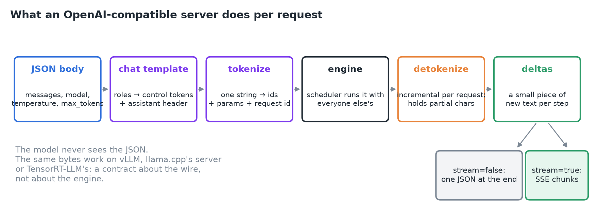
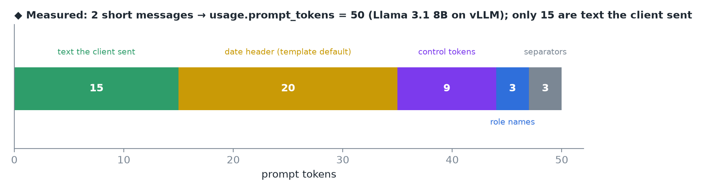
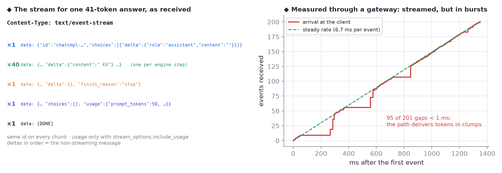
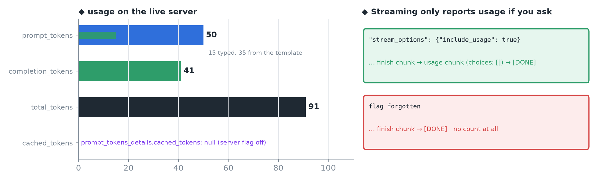
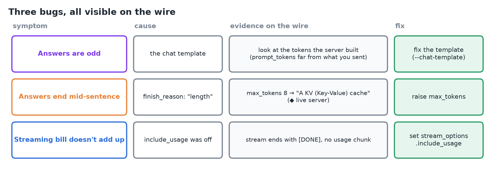
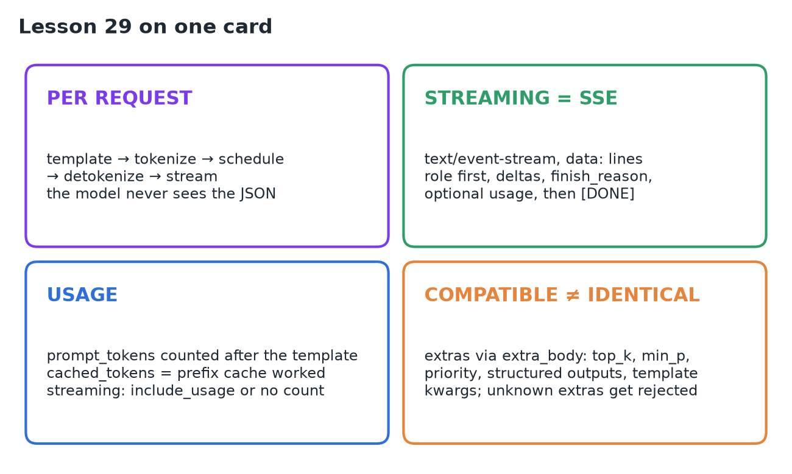

# 29 · OpenAI-Compatible APIs & Streaming

**Source:** [fanout.sh / inference-eng / 06-03](https://fanout.sh/inference-eng/curriculum/06-03) · ~8 min

> [!NOTE]
> "OpenAI-compatible" is a **contract about the wire, not the engine**: the same `/v1/chat/completions` bytes get the same-shaped answer from vLLM, llama.cpp's server or TensorRT-LLM's. Per request the server runs **template → tokenize → schedule → detokenize → stream**; the model never sees the JSON. Streaming is **Server-Sent Events**: role first, deltas, a finish reason, optionally usage, then `[DONE]`. **Usage is counted after the chat template**, and `cached_tokens` shows the prefix cache working. Most "weird answer" bugs live in the template step.

## 1. The contract

A request is a URL ending in `/v1/chat/completions`, a JSON body with a list of messages, and `stream: true`. Send it to vLLM and you get an answer; send the exact same bytes to llama.cpp's server or TensorRT-LLM's and you get an answer of the same shape.


*What a compatible server does for every request to keep the contract.*

## 2. From JSON to tokens: the chat template

- The body holds **messages** (roles and contents), the **model** name, and sampling knobs: temperature, top-p, a token budget.
- The server runs the message list through the model's **chat template**, stored in `tokenizer_config.json`. Roles become **control tokens**. For Llama 3.1: a begin-of-text marker, then per message a header with the role, the content, and an end-of-turn marker.
- `add_generation_prompt` is on by default, so one more header follows: **assistant**, the cue to reply.
- The resulting string is tokenized into ids; those ids, the sampling parameters and a fresh request id go to the engine.
- vLLM requires the model to include a chat template in its tokenizer config; if it lacks one, supply it with **`--chat-template`**.


*◆ Measured on my vLLM server: "You are a support assistant." plus "Explain the KV cache in one sentence." become 50 prompt tokens. Llama 3.1's template also injects a "Cutting Knowledge Date / Today Date" header into the system message by default.*

> [!WARNING]
> Most "it answers strangely" bugs live in this step. Wrong template, wrong tokens, and the model is politely continuing a conversation you didn't intend.

## 3. Into the engine and back

- The server hands the request to the **scheduler**, which decides when it runs alongside everyone else's.
- Every step returns **one new token id** for this request.
- The server keeps an **incremental detokenizer per request**: it turns ids into text as they arrive and holds back bytes that don't yet form a whole character.
- So each step the server has a small piece of new text: the **delta**.

## 4. Without streaming: one JSON

The server collects deltas until the request finishes, then sends one object:

```json
{
  "id": "chatcmpl-…", "object": "chat.completion",
  "choices": [{"index": 0,
               "message": {"role": "assistant", "content": "A KV (Key-Value) cache is …"},
               "finish_reason": "stop"}],
  "usage": {"prompt_tokens": 50, "completion_tokens": 41, "total_tokens": 91}
}
```

| `finish_reason` | Meaning |
|---|---|
| `stop` | An end token or a stop string |
| `length` | Hit the token budget (`max_tokens`) |
| `tool_calls` | The model asked to call a function |

One JSON, one round trip: fine for short answers, but for a long one the user stares at nothing for ten seconds.

## 5. Streaming: Server-Sent Events

Streaming changes the **wire, not the loop**. The server answers with `Content-Type: text/event-stream`: the connection stays open and the server pushes lines, each `data: <json chunk>` followed by a blank line.


*Left: the events for one answer as received (◆ from my server). Right: ◆ through a gateway, 200 tokens arrived in clumps (about half the gaps under 1 ms) even though the server generates at a steady pace.*

1. The **first chunk** carries the role, `assistant`, with empty content.
2. Each engine step yields a chunk whose `delta.content` is the new text. **Every chunk shares the same id**. Empty deltas from chunked prefill are skipped, so the client only sees real text.
3. The **last content chunk** carries the `finish_reason`.
4. If you asked for usage, one more chunk arrives with **`choices` empty** and the usage object filled.
5. Finally the literal line `data: [DONE]`, and the client closes.

Reassemble the deltas in order and you get exactly the message the non-streaming call would have sent.

## 6. Usage accounting

Usage is how you get billed and how you notice a cache.

- **`prompt_tokens`** is counted **after the template**: it includes the system prompt and all the control tokens, not just what the user typed.
- **`completion_tokens`** is what the model produced.
- vLLM adds **`prompt_tokens_details.cached_tokens`**: how many prompt tokens were served from the prefix cache instead of recomputed.
- In streaming you only get usage if you ask: **`stream_options: {"include_usage": true}`**. The OpenAI spec says the usage chunk is streamed right before `[DONE]`, with an empty `choices` array.


*◆ On my server `cached_tokens` comes back `null`: vLLM only fills `prompt_tokens_details` when started with `--enable-prompt-tokens-details` (off by default). Without `include_usage`, the stream ended with no count at all.*

## 7. Compatible doesn't mean identical

Engines add knobs the OpenAI API never had. From vLLM's request schema:

| vLLM extra | What it does |
|---|---|
| `top_k`, `min_p`, `repetition_penalty` | Sampling beyond the OpenAI set |
| `priority` | Lower runs earlier, if the server uses priority scheduling |
| `structured_outputs` | Constrain output: JSON schema, regex, grammar, or a fixed set of choices |
| `chat_template_kwargs` | Template switches (e.g. thinking on/off) |
| `continue_final_message` | Prefill the start of the reply |

A client sends them through `extra_body`, alongside the standard fields:

```python
client.chat.completions.create(
    model="llama-8b", messages=messages, stream=True,
    extra_body={"top_k": 40, "priority": 1},
)
```

A server that doesn't know them **rejects** them, so extras are the one place engines differ on the wire. Two server flags shape the contract from the other side: **`--max-model-len`** caps prompt plus output, and **`--chat-template`** overrides the model's own.

## 8. Three bugs, all visible on the wire


*Odd answers: inspect the tokens the server actually built. Mid-sentence endings: `finish_reason` says `length`. A streaming bill that doesn't add up: `include_usage` was off.*

## 9. Recap


