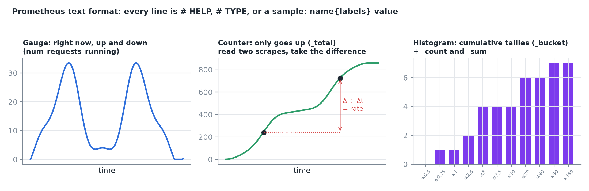
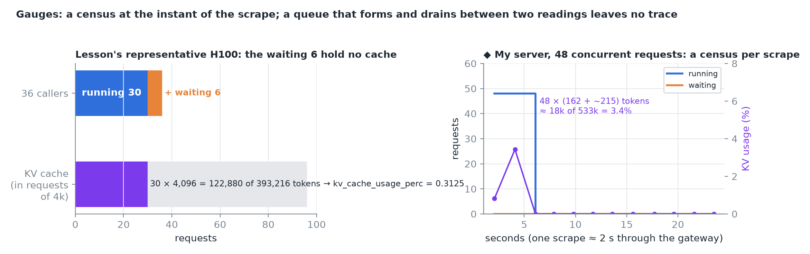
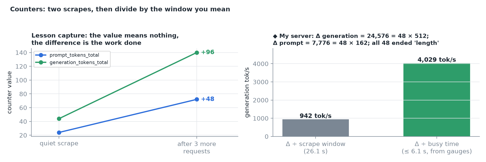
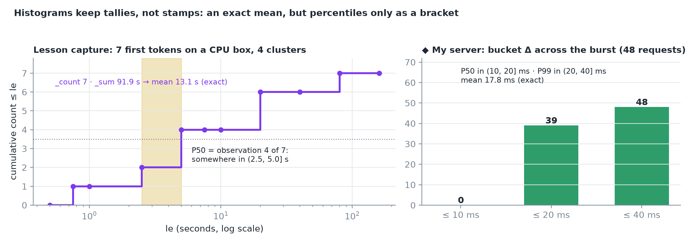
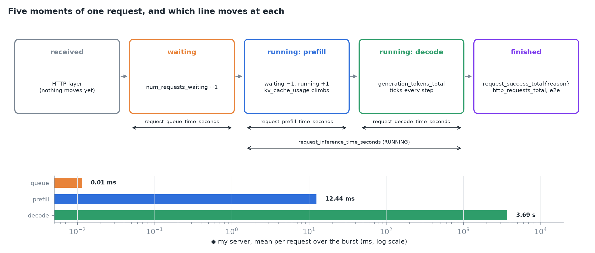
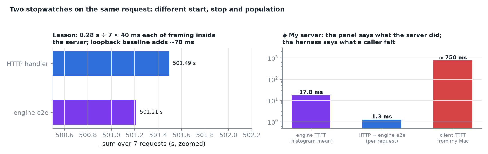
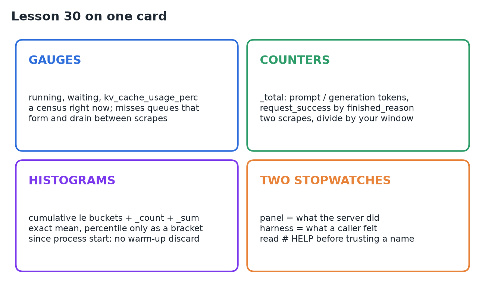

# 30 · Read Engine Metrics & Request State

**Source:** [fanout.sh / inference-eng / 06-04](https://fanout.sh/inference-eng/curriculum/06-04) · text lesson (no video), ~8 min

> [!NOTE]
> While the engine answers requests, it keeps its own account of them on **`/metrics`**, in the **Prometheus text format**. Three kinds of number: **gauges** (running, waiting, KV cache fill: a census right now), **counters** (`_total`: tokens and finished requests, meaningful only as a **difference between two scrapes**) and **histograms** (cumulative buckets plus `_count` and `_sum`: an **exact mean, but percentiles only as a bracket**). The panel says **what the server did**; a client harness says **what a caller felt**. Keep both: one request has more than one true duration.

## 1. The panel and its format

`curl http://<server>/metrics` returns plain text. Every line is a comment or a sample:

```text
# HELP vllm:num_requests_running Number of requests in model execution batches.
# TYPE vllm:num_requests_running gauge
vllm:num_requests_running{engine="0",model_name="NousResearch/Meta-Llama-3.1-8B"} 0.0
```

- `# HELP` carries a sentence of documentation; `# TYPE` declares the kind of number; a **sample** is a name, labels in braces, and a value.
- Two labels ride on every engine series, **`engine`** and **`model_name`**, so one process serving two models keeps its numbers apart. The **`vllm:`** prefix separates the engine's families from the Python runtime's and the web framework's, which publish on the same endpoint.
- The lesson's snapshot ran to **526 lines** under **60** `# TYPE` declarations. ◆ My vLLM 0.29 server: 623 lines, 86 declarations, 66 of them `vllm:`.


*A gauge moves both ways and is read as "right now"; a counter only grows and is read as a difference; a histogram keeps cumulative tallies per threshold.*

## 2. Gauges: running, waiting, cache fill

| Gauge | Documentation |
|---|---|
| `vllm:num_requests_running` | "Number of requests in model execution batches" |
| `vllm:num_requests_waiting` | "Number of requests waiting to be processed" |
| `vllm:kv_cache_usage_perc` | "KV-cache usage. 1 means 100 percent usage" (a **fraction**, not a percent) |

- Under load (representative, an 80 GB card): 36 callers → **running 30, waiting 6**. The server reports the queue directly instead of you inferring it from first tokens arriving later and later. A running count above one means several requests share one model execution.
- KV usage is a fill level **against the reservation the engine made at startup**, not free device memory. The configuration itself appears as labels on an info gauge whose value is always 1.0 (that's how this format publishes facts that aren't numbers).
- With `--gpu-memory-utilization` at its 0.9 default, the representative H100 reserves **393,216 tokens**:

$$\frac{30 \times 4096}{393216} = \frac{122880}{393216} = 0.3125$$

The six queued callers add nothing: a request that hasn't run has no cache. (On a small CPU box the lesson's server reserved 16,384 tokens: 2 GiB at 131,072 bytes per token.)


*◆ Right: my server with 48 concurrent requests. 48 × (162 prompt + ~215 generated) ≈ 18k tokens of a 533k-token reservation reads 3.4%, matching the gauge.*

> [!WARNING]
> A gauge is a census at the instant of the scrape. A queue that forms and drains between two readings leaves no trace, so a gauge reading 0 is not evidence that nobody waited.

## 3. Counters and their denominators

Counters only grow for the life of the process (`_total` suffix), so the **difference between two readings** is what matters.

| Counter | Counts |
|---|---|
| `vllm:prompt_tokens_total` | Tokens read during prefill |
| `vllm:generation_tokens_total` | Tokens produced during decode |
| `vllm:request_success_total{finished_reason=…}` | Finished requests, one series per `stop`, `length`, `abort` |

- The server keeps **both denominators** of a throughput claim, prompt and generated, without being asked.
- `finished_reason` is something no caller-side measurement can see: in the lesson's capture all four requests ended `length` (hit `max_tokens`). It's the server-side half of failure accounting.
- Lesson capture, three more requests between scrapes: prompt **24 → 72** (+48), generation **44 → 140** (+96). Divide by the seconds between scrapes and you get the throughput lines a benchmark prints.


*◆ Right: on my server the deltas check exactly (24,576 = 48 × 512 generated; 7,776 = 48 × 162 prompt). The same delta gives 942 tok/s over the 26 s scrape window but over 4,000 tok/s over the 6 s the engine was busy: the window you divide by is part of the claim.*

## 4. Histograms: tallies instead of stamps

```text
vllm:time_to_first_token_seconds_bucket{le="0.75"} 1.0
vllm:time_to_first_token_seconds_bucket{le="2.5"}  2.0
vllm:time_to_first_token_seconds_bucket{le="5.0"}  4.0
vllm:time_to_first_token_seconds_bucket{le="20.0"} 6.0
vllm:time_to_first_token_seconds_bucket{le="80.0"} 7.0
vllm:time_to_first_token_seconds_bucket{le="+Inf"} 7.0
vllm:time_to_first_token_seconds_count 7.0
vllm:time_to_first_token_seconds_sum   91.898
```

- Each `_bucket` counts observations **at or under** its `le`; counts are **cumulative**, so `+Inf` holds them all.
- `_sum ÷ _count` is the **mean**, exactly: 91.9 ÷ 7 = **13.1 s** to first token on a CPU box streaming 16 GB of weights from ordinary memory every step.
- The shape survives without a single stamp: one request under 0.75 s, three between 1 and 5 s, two between 10 and 20 s, one between 40 and 80 s.
- A **percentile only comes back as a bracket**: the median of 7 is observation 4, which sits in **(2.5, 5.0] s** for first token. For end-to-end latency the lesson's buckets put it in (60, 120] s, while `_sum ÷ _count` = 501.2 ÷ 7 = **71.6 s** is the one exact summary.
- The thresholds are fixed in the engine's source (0.001, 0.005, 0.01 … 2560). Throwing stamps away is the trade that lets a server publish latency forever at fixed cost.


*◆ Right: subtracting my server's buckets before and after a 48-request burst recovers the window's own distribution: P50 in (10, 20] ms, P99 in (20, 40] ms, mean 17.8 ms.*

> [!CAUTION]
> Histograms are cumulative **since process start**, like counters. There is no warm-up discard: the first request of the day sits in `_sum` and every bucket forever. Two scrapes are the way back: subtract one snapshot's buckets from another's and the **windowed distribution** returns.

## 5. One request, seen from outside

The engine also narrates on a ten-second timer:

```text
INFO … Engine 000: Avg prompt throughput: 0.6 tokens/s,
  Avg generation throughput: 0.1 tokens/s, Running: 1 reqs,
  Waiting: 0 reqs, GPU KV cache usage: 0.1%,
  Prefix cache hit rate: 0.0%
```

- Those heartbeats are the gauges in prose; they drop to DEBUG when every throughput field is zero, so an idle engine stays quiet.
- In one request's trail the prompt-throughput field is nonzero **exactly once** (the prefill pass, as a rate); then minutes of `Running: 1 reqs` while the reply streams back; then `EngineCore waiting for work` and the web framework's access-log line.


*Received, waiting, running (prefill), running (decode), finished. The gauges are a census of the middle states; the phase histograms record what each state cost once the request ends. ◆ Bottom: my server's means over the burst: queue ≈ 0, prefill 12 ms, decode 3.7 s.*

Nothing on the panel follows **one** request through the strip; the log does. And the panel names states without saying **where** they live: the transitions belong to something the log only names, `EngineCore`.

## 6. Two stopwatches on the same request

| | Client harness | Engine panel |
|---|---|---|
| Clock starts | Before the connection opens | When the request reaches the engine |
| Clock stops | When a chunk reaches your code | When the token leaves the engine core |
| Includes | Connection setup, transit both ways, client event loop | Engine time only |
| Population | The window you declared, requests you sent | Every request since start, from anyone; misses requests refused before the engine |

- The web framework keeps its own duration histogram: over the lesson's seven completions `http_request_duration_seconds_sum` = 501.495 vs the engine's 501.214, so **0.28 s ÷ 7 ≈ 40 ms each** of framing and delivery inside the server process. A loopback baseline measured the rest of the path at about 78 ms per request.
- The quiet snapshot held 5 POSTs at the HTTP layer against 4 engine successes: a request refused before the engine is invisible to every `vllm:` line.


*◆ Right: on my server the engine reports an 18 ms first token and 1.3 ms of HTTP framing per request, while a client on my Mac sees about 750 ms. Neither is wrong; they answer different questions.*

> [!TIP]
> Read `# HELP` before trusting a name (versions rename and deprecate metrics), and take two scrapes before quoting a rate.

## 7. What each line answers

| What you want to know | Line to read | Kind |
|---|---|---|
| Is anything queued right now? | `vllm:num_requests_waiting` | gauge |
| How many requests share the current execution? | `vllm:num_requests_running` | gauge |
| How much of the cache is spoken for? | `vllm:kv_cache_usage_perc` | gauge |
| How much work has gone through? | `vllm:prompt_tokens_total`, `vllm:generation_tokens_total` | counters |
| How did requests end, and how many? | `vllm:request_success_total` by `finished_reason` | counter |
| How long did callers wait for a first token? | `vllm:time_to_first_token_seconds` | histogram |
| Where did a request's time go? | `vllm:request_queue_time_seconds`, `…_prefill_…`, `…_decode_…` | histograms |

## 8. Recap


