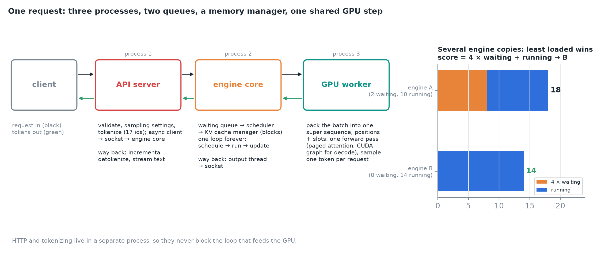
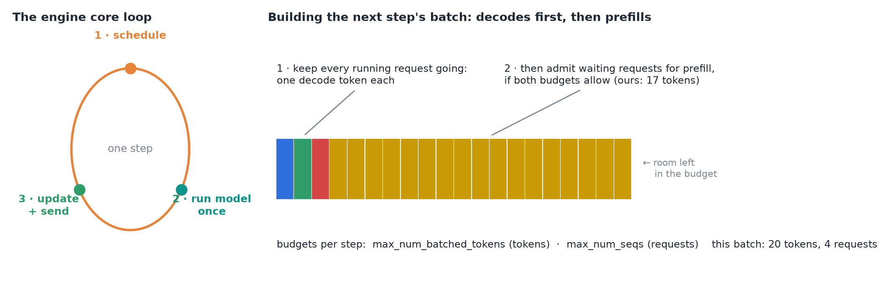
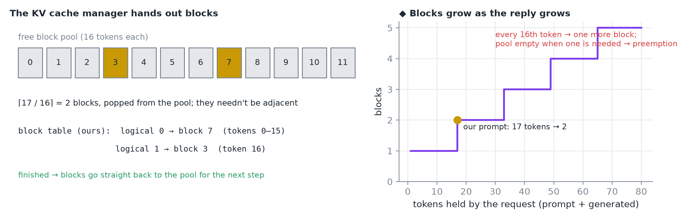
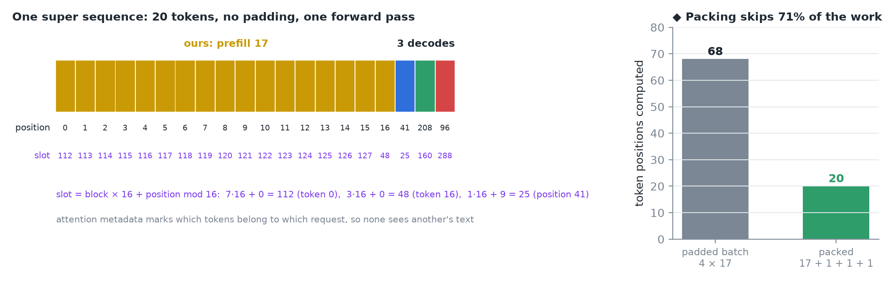
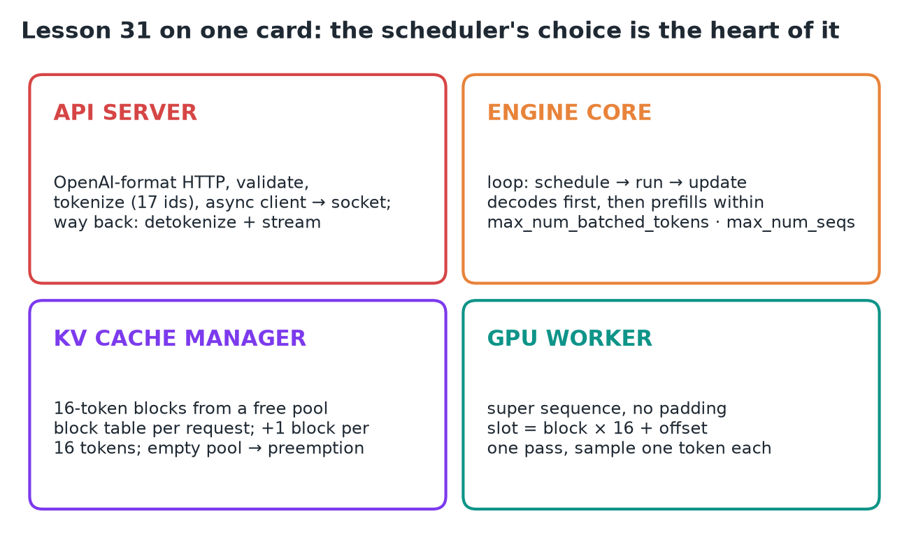

# 31 · Follow a Request Through vLLM

**Source:** [fanout.sh / inference-eng / 06-05](https://fanout.sh/inference-eng/curriculum/06-05) · ~5.5 min

> [!NOTE]
> One request ("Explain the KV cache in one sentence") crosses **three processes, two queues, a memory manager, and one GPU step shared with other requests**. The **API server** handles HTTP and tokenization in its own process so it never blocks the GPU loop. The **engine core** loops forever (**schedule → run → update**): decodes first, then prefills within two budgets. The **KV cache manager** hands out **16-token blocks** tracked in a block table. The **GPU worker** packs every request into **one super sequence with no padding** and runs a single forward pass. The heart of it all is the scheduler's choice of what runs each step.

## 1. The whole path

*Request in (black arrows), tokens out (green). With several engine copies, the async client picks the least loaded: waiting requests count four times as heavily as running ones.*

$$\mathrm{score} = 4 \times \mathrm{waiting} + \mathrm{running}: \quad A = 4 \cdot 2 + 10 = 18 \qquad B = 4 \cdot 0 + 14 = 14 \Rightarrow B$$

## 2. Stop one: the API server

- A Python web server speaking the **OpenAI HTTP format**. It validates the request, reads the sampling settings and runs the tokenizer: our prompt becomes **17 token IDs**.
- It hands the request to an **async client**, which forwards it over a socket to a **separate process**, the engine core.
- Why separate: the **CPU-overhead problem**. HTTP handling and tokenization must not block the loop that feeds the GPU.

## 3. Stop two: the engine core

*Each turn of the loop is one step: schedule, run the model once, then update and send out results.*

- Our request lands in the **waiting queue**.
- The scheduler builds the next step's batch: first it **keeps every running request going** (one decode token each), then, if there's room, it **admits waiting requests for prefill**.
- Room means two budgets: a max number of **tokens per step** (`max_num_batched_tokens`) and a max number of **sequences** (`max_num_seqs`). Our 17-token prompt fits, so it joins this step.

## 4. The KV cache manager

*vLLM stores the cache in blocks of 16 tokens; the manager pops free blocks from its pool and records them in the request's block table.*

$$\frac{17}{16} = 1.06 \Rightarrow 2\ \mathrm{blocks\ (round\ up)}$$

- The two blocks needn't be adjacent: here **block 7** (tokens 0–15) and **block 3** (token 16).
- As the reply grows, **every 16th token triggers one more block**.
- If the pool is empty when a **running** request needs a block, that's when **preemption** happens.
- ◆ My server's `/metrics` shows `block_size="16"` and `num_gpu_blocks="33298"`: 33,298 × 16 = 532,768 tokens, exactly its reported cache size.

## 5. Stop three: the GPU worker

*This step's batch: our 17 prompt tokens plus one decode token from each of three other requests, packed into one 20-token super sequence with no padding. ◆ The video's decode slots 171 and 300 don't match positions 208 and 96 (a slot's offset within its block must equal position mod 16), so the figure uses consistent ones.*

- For each token the runner computes a **position** and a **slot**: exactly where that token's key and value will be written.

$$\mathrm{slot} = \mathrm{block} \times 16 + (\mathrm{position\ mod\ 16}): \quad 7 \cdot 16 + 0 = 112 \qquad 3 \cdot 16 + 0 = 48$$

- **Attention metadata** tells the kernel which tokens belong to which request, so no request sees another's text.
- One forward pass runs over the whole super sequence using **paged attention** kernels. For decode steps, a **pre-captured CUDA graph** replays instead of launching kernels one by one.
- The runner takes the **last position of each request**, computes logits, and samples **one token each**.

## 6. Stop four: the way back

- The sampled token IDs go to the engine core's **output thread**, then over a socket back to the API server.
- An **output handler** detokenizes them incrementally and streams each new piece of text to the client. Our first token has arrived: that was its **TTFT**.
- Next step it's a **running** request, so it gets one decode token per loop until it produces an end token or hits its limit.
- When it finishes, its **blocks go straight back to the free pool**, ready for another request on the very next step.

## 7. Recap

