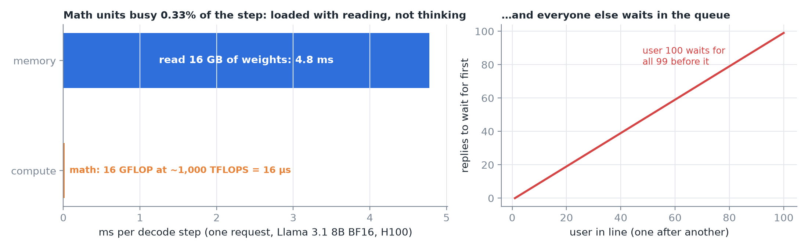
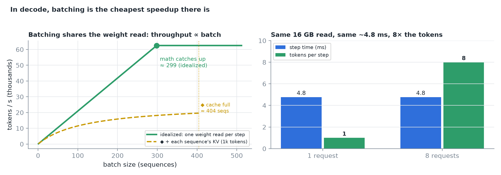
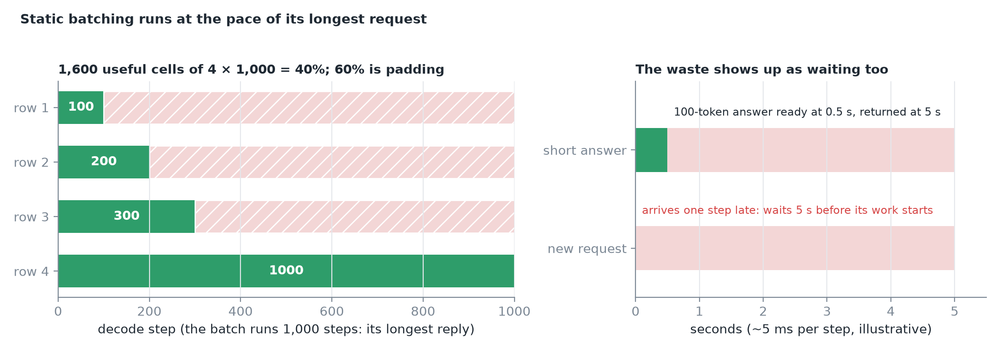
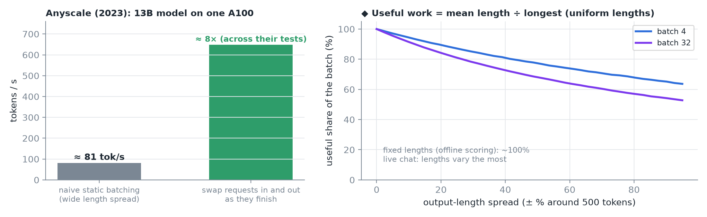
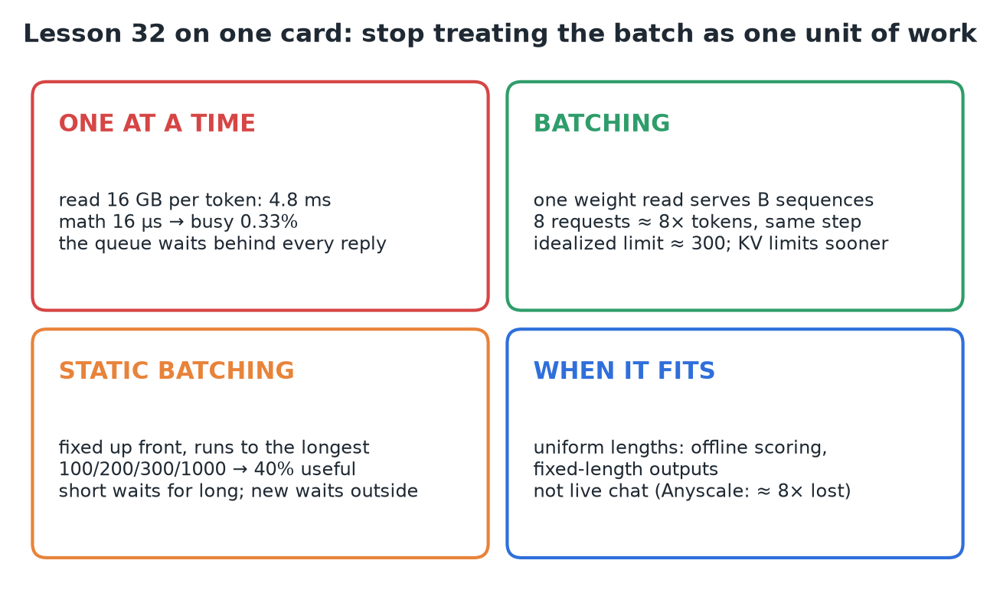

# 32 · One-by-One Serving vs Static Batching

**Source:** [fanout.sh / inference-eng / 07-01](https://fanout.sh/inference-eng/curriculum/07-01) · ~6.5 min

> [!NOTE]
> Serving **one request at a time** leaves an H100 reading weights with its math units **busy about 0.33% of each step**, while everyone else queues. **Batching** shares each weight read across many sequences, so throughput rises almost for free: 8 requests make 8 tokens in the same ~4.8 ms step. **Static batching** fixes the batch up front and runs it at the pace of its **longest request**: with replies of 100, 200, 300 and 1,000 tokens, only **40%** of the batch does useful work, short answers wait for long ones, and new requests wait at the door. The fix is to stop treating the batch as one unit of work.

## 1. One request at a time

Llama 3.1 8B in BF16 is ~16 GB of weights, and producing one token uses every weight once.

$$t_{\mathrm{read}} = \frac{16\ \mathrm{GB}}{3.35\ \mathrm{TB/s}} \approx 4.8\ \mathrm{ms} \qquad t_{\mathrm{math}} = \frac{2 \times 8 \times 10^{9}}{10^{15}\ \mathrm{FLOP/s}} = 16\ \mu\mathrm{s} \qquad \frac{16\ \mu\mathrm{s}}{4.8\ \mathrm{ms}} \approx 0.33\%$$

*The GPU looks fully loaded, but it's loaded with reading, not thinking. Serve 100 users one after another and the last waits for all 99 before it.*

## 2. Batching: the cheapest speedup in decode

- Once a weight is on the chip, **using it again is almost free**. Put 8 requests side by side and push them through the same weight read: the step still streams 16 GB and still takes ~4.8 ms, but makes **8 tokens instead of one**. Throughput goes up ~8× and nobody's step got noticeably slower.
- Grow the batch and the math per byte read grows with it. In the idealized picture the math only catches up with the reading at **a few hundred sequences** (≈ 4.8 ms ÷ 16 µs ≈ 300).
- In practice each sequence also reads its **own KV cache**, and that cache has to **fit in memory**, so the real limit comes sooner.

*◆ The dashed curve adds each sequence's KV reads at 1,000 tokens of context (128 KiB per token) and stops where a ~53 GB cache is full.*

## 3. Static batching

Wait until you have, say, four requests; run them together one step at a time **until every one has finished**; return the results; start the next batch.

*Replies of 100, 200, 300 and 1,000 tokens: the batch runs 1,000 steps for its longest row, and finished rows keep riding along doing nothing.*

$$\frac{100 + 200 + 300 + 1000}{4 \times 1000} = \frac{1600}{4000} = 40\%\ \mathrm{useful} \qquad 60\%\ \mathrm{padding}$$

| Waste | What happens |
|---|---|
| **Padding** | Finished rows keep their slots until the longest reply ends; short prompts are padded to the longest one at the start |
| **Short answers wait** | At ~5 ms per step the 100-token answer is ready after **0.5 s** but handed back with the others after **5 s** |
| **New requests wait** | A request arriving one step after the batch starts can't join; it waits the full **5 s** before its own work begins |

## 4. Measured, and when static batching still fits

*Anyscale measured a 13B model on one A100: as the spread of output lengths grew, naive static batching fell to about 81 tokens/s, and across their tests engines that swapped requests in and out as they finished reached about 8× the throughput. ◆ Right: with uniform random lengths, the useful share is roughly mean ÷ longest, which falls as the spread grows and as the batch gets bigger.*

- Static batching still has a place when every job produces **about the same length**: offline scoring, fixed-length outputs. The padding almost disappears.
- **Live chat traffic** is exactly where lengths vary the most.

> [!IMPORTANT]
> The fix is to decide **who's in the batch after every single step**: iteration-level scheduling.

## 5. Recap

