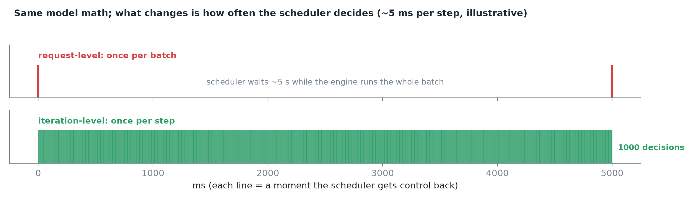
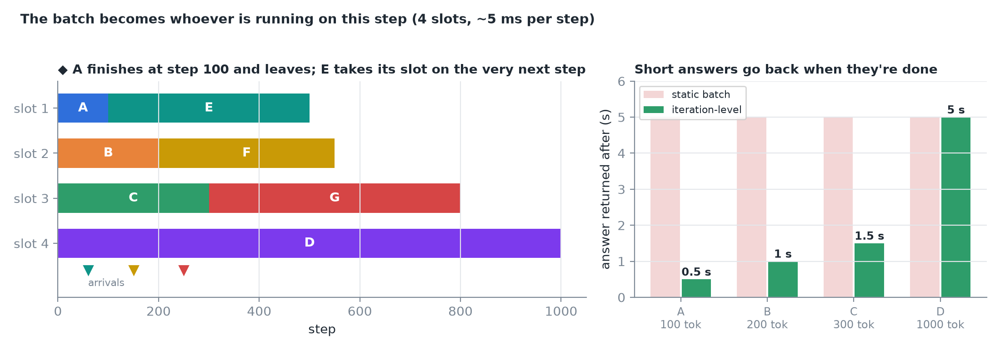
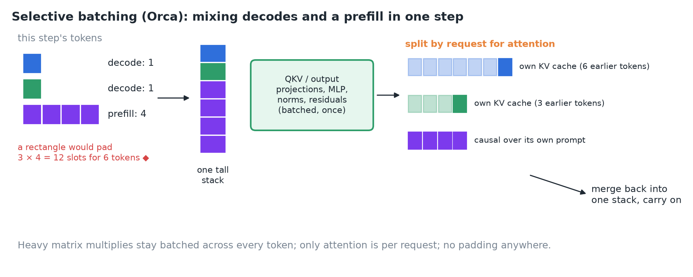
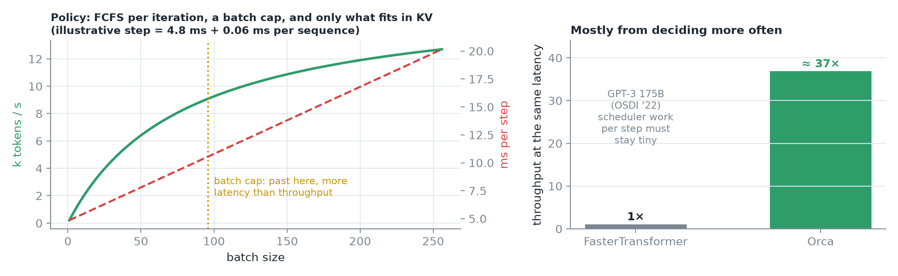
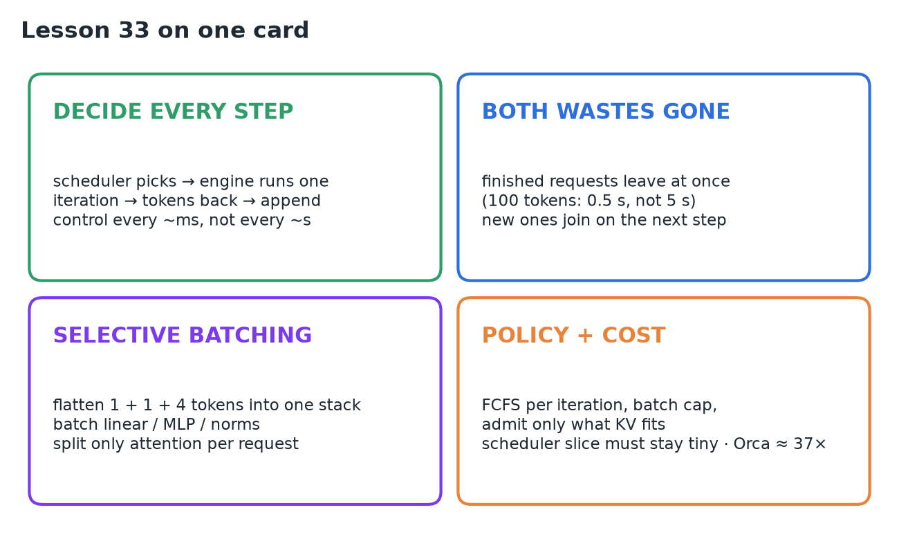

# 33 · Iteration-Level Scheduling

**Source:** [fanout.sh / inference-eng / 07-02](https://fanout.sh/inference-eng/curriculum/07-02) · ~5.5 min

> [!NOTE]
> The waste in static batching comes from **who decides what's in the batch, and how often**: once per batch. **Iteration-level scheduling** (Orca, 2022) makes it **once per step**: the scheduler picks requests, the engine runs **one iteration** (one new token each), hands the tokens back, and the loop turns again. Finished requests leave at once and new ones join on the next step. **Selective batching** mixes decodes and prefills without padding by batching every layer except attention, which runs per request. A policy (FCFS per iteration, a batch cap, only what fits in KV) decides who runs. Orca reported **~37×** the throughput of FasterTransformer on GPT-3 175B at the same latency.

## 1. Who decides, and how often

Split the server into a **scheduler** (picks the work) and an **engine** (runs the model on the GPU).

| | Request-level (old) | Iteration-level (Orca) |
|---|---|---|
| Scheduler hands over | A batch: "run until everyone is done" | "Run **one** iteration for A, B, C" |
| Engine hands back | All answers, when the last request finishes | One new token per chosen request |
| Scheduler gets control | Every few **seconds** | Every few **milliseconds** |

*The model's math is exactly the same; what changed is that the scheduler gets control back after every step.*

## 2. That one change fixes both problems

Same four requests needing 100, 200, 300 and 1,000 tokens:

- On step 100 the first request emits its last token; the scheduler sees it **right away** and sends the answer back: at ~5 ms per step that's **0.5 s, not 5 s**.
- Its slot is free, so a request that arrived a moment ago **starts on the very next step** instead of waiting for the whole batch to drain.
- The batch stops being a fixed group: it's **whoever happens to be running on this step**.

*◆ Left: an illustrative run with three later arrivals (E, F, G) filling slots as A, B and C finish. Right: each answer goes back when it's done.*

## 3. The catch: steps aren't rectangles anymore

On one step two requests might be **decoding** (one token each) while a new one **processes its whole prompt** (say four tokens). Normal batching wants every request to have the same number of tokens; 1, 1 and 4 don't make a rectangle.

*Orca's selective batching: flatten all six tokens into one stack for the token-wise layers; split by request only for attention; merge back.*

- Most layers don't care which request a token belongs to: the **linear layers, MLP, norms and residual adds** treat every token the same. Flatten the six tokens into one tall stack and run those layers **once, on all of them**.
- **Attention is the exception**: each token may only look at earlier tokens **from its own request**, in that request's KV cache. So split the stack just before attention, run attention per request against its own history, then merge back.
- The heavy matrix multiplies stay batched, and **nobody needs padding**.

## 4. Who gets picked, and what it costs

*Left: illustrative step-time model; past some batch size, extra requests add more latency than throughput, so operators cap it. Right: Orca vs FasterTransformer on GPT-3 175B (OSDI '22).*

- **First come, first served, per iteration**: a request that arrived earlier has always run at least as many steps as one that arrived later.
- A **cap on batch size**: past a point, a bigger batch adds more latency than throughput, so operators tune that knob.
- **KV memory**: every running request needs room for its cache, so the scheduler can only admit what fits.
- The scheduler now runs **every step**, so its own work must take a **tiny slice** of those few milliseconds.

> [!IMPORTANT]
> Orca's ~37× came largely from simply **deciding more often**.

## 5. Recap

