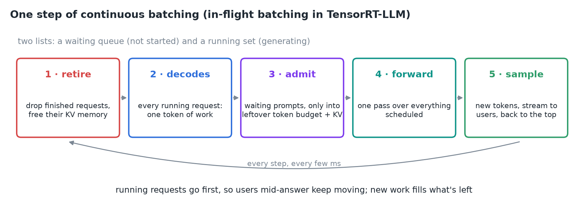
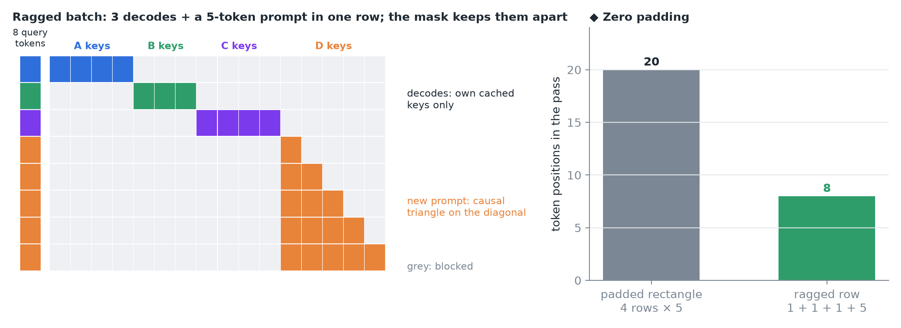
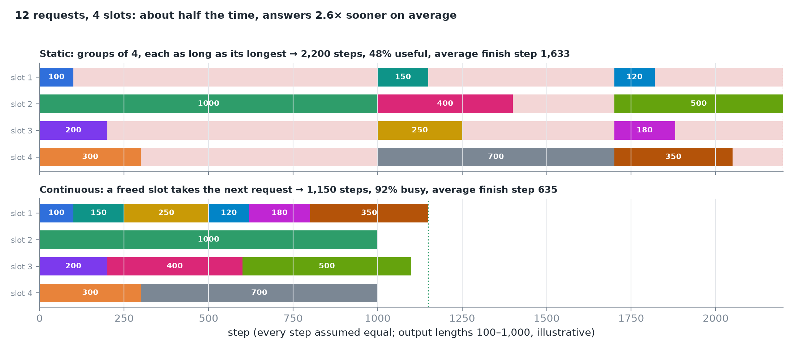
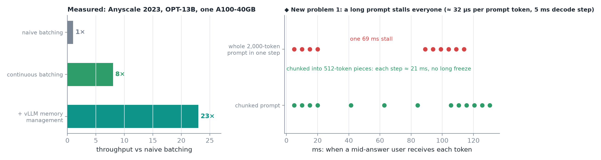
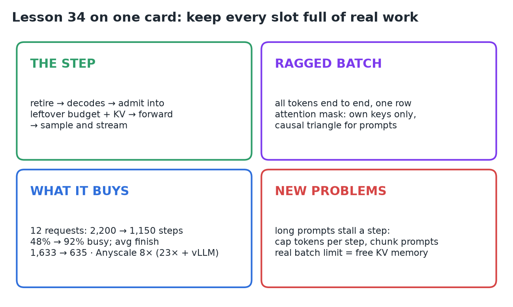

# 34 · Continuous Batching

**Source:** [fanout.sh / inference-eng / 07-03](https://fanout.sh/inference-eng/curriculum/07-03) · ~5.5 min

> [!NOTE]
> Continuous batching uses per-step scheduling for one goal: **keep every slot full of real work, all the time**. It's the default everywhere: vLLM, SGLang and TGI call it continuous batching, TensorRT-LLM calls it **in-flight batching**. Each step **retires** finished requests, schedules **every running decode first**, **admits** new prompts into leftover token budget and KV memory, runs **one forward pass** over a **ragged batch** (no padding; the attention mask keeps requests apart), then samples and streams. On 12 uneven requests it halves the total time (2,200 → 1,150 steps) and delivers answers ~2.6× sooner; Anyscale measured **8×** over naive batching, **23×** with vLLM's memory management. Two new problems follow: **long prompts stall a step**, and **KV memory**, not slot count, is the real batch limit.

## 1. The step recipe

The engine keeps two lists: a **waiting queue** of requests that haven't started and a **running set** that's already generating.

*Retire, schedule decodes, admit, forward, sample and stream; then back to the top.*

> [!IMPORTANT]
> **Running requests go first**, so users already mid-answer keep moving; new work fills whatever is left.

## 2. What the GPU actually receives: a ragged batch

Three requests are decoding (one token each) and a new five-token prompt is joining. Instead of a padded rectangle, all **eight tokens lie end to end in one row**.

*The only thing keeping requests apart is the attention mask: each decode token sees its own request's cached keys; the new prompt's tokens see only earlier tokens of the same prompt (a causal triangle on the diagonal); everything else is blocked.*

So requests of any length, in any phase, ride in the same pass with **zero padding**.

## 3. What it buys

Twelve queued requests with output lengths from 100 to 1,000 tokens, four slots, every step taking the same time (illustrative).

*Static batching takes them four at a time, each group as long as its longest member; continuous batching hands a freed slot to the next request in the queue.*

| | Static | Continuous |
|---|---|---|
| Total steps | 1,000 + 700 + 500 = **2,200** | **1,150** |
| Useful slot time | 4,250 ÷ (4 × 2,200) = **48%** | 4,250 ÷ (4 × 1,150) = **92%** |
| Average finish | **1,633** steps | **635** steps |

Same GPU, same model, same requests: roughly **half the time**, and answers arrive about **2.5× sooner** on average (1,633 ÷ 635 ≈ 2.6).

Real measurements tell the same story: on a 13B model, **Anyscale** found continuous batching alone gave about **8×** the throughput of naive batching, and about **23×** with vLLM's memory management on top.

## 4. Two new problems

*Left: Anyscale 2023, OPT-13B on one A100-40GB. Right: ◆ illustrative timing for a mid-answer user when a 2,000-token prompt joins, whole vs chunked.*

1. **Prompts.** When a new request joins, its **whole prompt runs inside that step**. A 2,000-token prompt makes that step much longer than a normal decode step, so every user mid-answer sees a **stall**. That's why engines **cap the tokens per step** and **cut long prompts into chunks**.
2. **Memory.** Every running request holds a **growing KV cache**, so the real limit on the batch isn't the slot count, it's **how much KV memory is free**, and how that memory is laid out decides how many requests fit.

## 5. Recap

