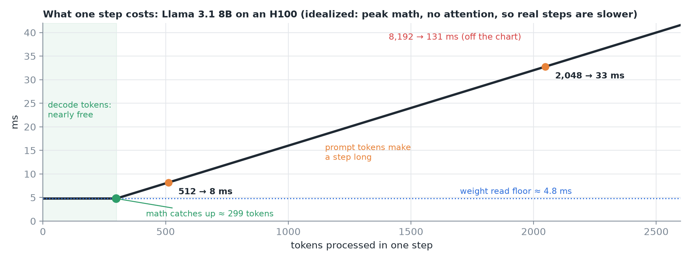
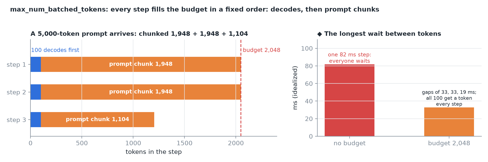
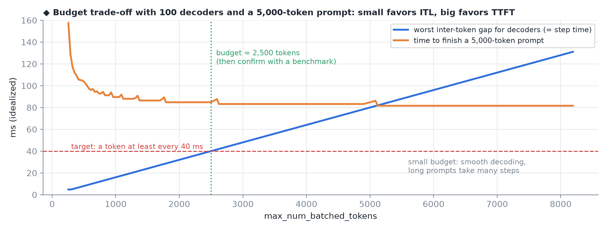
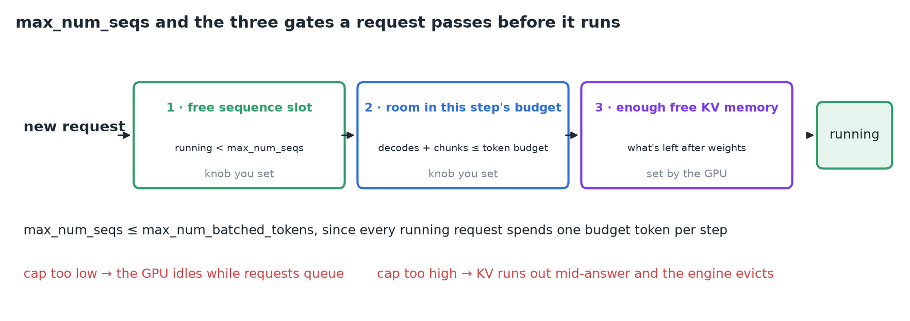
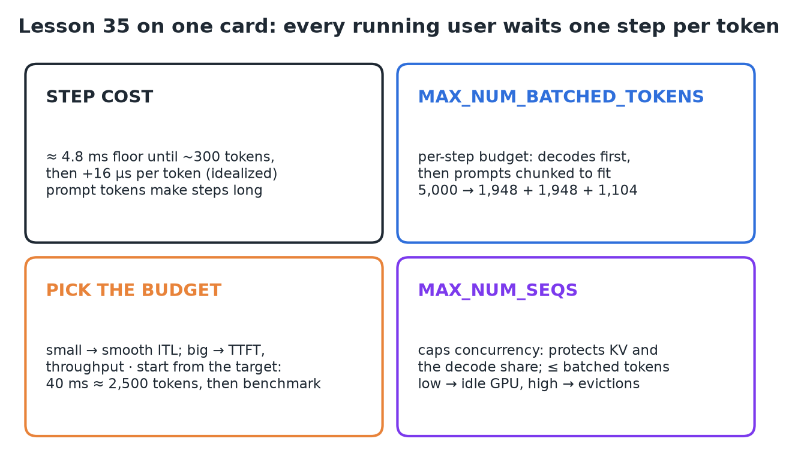

# 35 · Token Budgets, Max Sequences & Max Batched Tokens

**Source:** [fanout.sh / inference-eng / 07-04](https://fanout.sh/inference-eng/curriculum/07-04) · ~5.5 min

> [!NOTE]
> Every user mid-answer gets **one token per step**, so if one step runs long, all of them wait. A step's length is set by the **tokens it processes**: flat at the ~4.8 ms weight read until ~300 tokens, then rising (idealized: 512 → 8 ms, 2,048 → 33 ms, 8,192 → ~130 ms). Decode tokens are nearly free; **prompt tokens make steps long**. **`max_num_batched_tokens`** caps each step: decodes first, then prompts **chunked** to fit. Small budgets favor smooth decoding (ITL); big budgets favor TTFT and throughput. **`max_num_seqs`** caps concurrency, protecting KV memory and the decode share of the budget. A request runs only after passing three gates: a free sequence slot, room in the budget, and free KV memory.

## 1. What one step costs

Llama 3.1 8B on an H100: every step reads all 16 GB of weights once (~4.8 ms), and every token adds ~16 GFLOP of math.

$$t_{\mathrm{step}} \approx \max(4.8\ \mathrm{ms},\ N \times 16\ \mu\mathrm{s}): \quad 512 \Rightarrow 8\ \mathrm{ms} \qquad 2048 \Rightarrow 33\ \mathrm{ms} \qquad 8192 \Rightarrow 131\ \mathrm{ms}$$

*With a few tokens the math hides inside the weight read, so the step is flat; it catches up at ~300 tokens and every token after that adds time. Idealized (peak math, no attention), so real steps are slower; the shape is the point.*

## 2. `max_num_batched_tokens`: a budget filled in a fixed order

Budget 2,048, 100 requests decoding: they go first (one token each, 100 used), leaving **1,948** for prompts. A 5,000-token prompt doesn't fit, so it's **chunked**:

$$5000 = 1948 + 1948 + 1104$$

*Meanwhile all 100 decoders got a token on every one of those steps. ◆ Right: idealized longest gap between tokens with and without the budget.*

## 3. How big should the budget be?

| | Small budget | Big budget |
|---|---|---|
| Each step | Short | Long when it carries a big prompt chunk |
| Decoding users | Steady stream: **low inter-token latency** | Wait longer on prompt-heavy steps |
| Long prompts | Spread over many steps: **later first token** | Finish in fewer steps: **better TTFT and throughput** |

vLLM's tuning guide says the same: smaller values like **2,048** give better inter-token latency, larger values better time to first token.

**Start from your latency target.** If you want a token at least every **40 ms**, find the step size that lands under 40 ms on your hardware: 40 ms ÷ 16 µs ≈ **2,500 tokens** in the idealized model. That's roughly your budget; confirm it with a benchmark.

*◆ Idealized sweep. In this model the prompt's total math is the same however it's split, so TTFT drops steeply up to ~1,000 tokens and then flattens; real steps add per-step overhead and attention re-reads earlier chunks, which is why bigger budgets keep helping TTFT in practice.*

## 4. `max_num_seqs`: cap on running requests

- Every running request holds a **KV cache that grows** with each token; too many at once and memory runs out mid-answer, so the engine has to **evict** someone.
- Every running request also spends **one token of the budget each step**, so **`max_num_seqs` ≤ `max_num_batched_tokens`**, or decodes alone could overflow it.

*A new request needs a free sequence slot, room in this step's token budget, and enough free KV memory. The first two are knobs you set; the third comes from what GPU memory is left after the weights.*

> [!WARNING]
> Cap too low → the GPU idles while requests queue. Cap too high → you run out of KV memory and start evicting.

## 5. Recap

