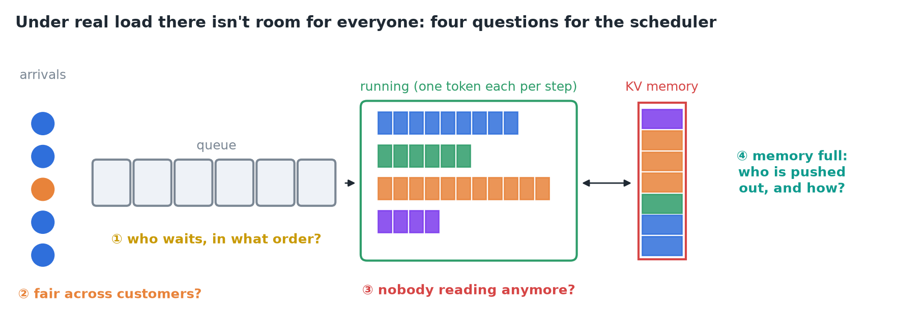
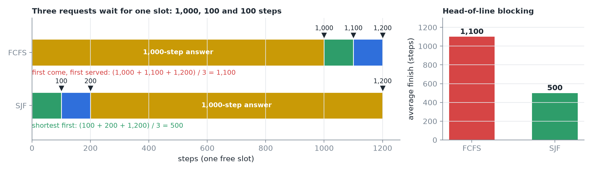
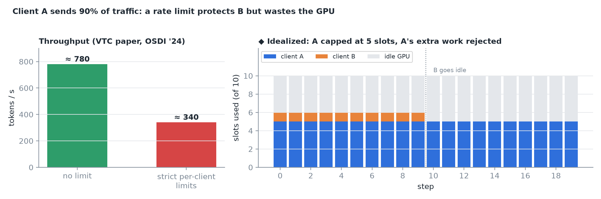
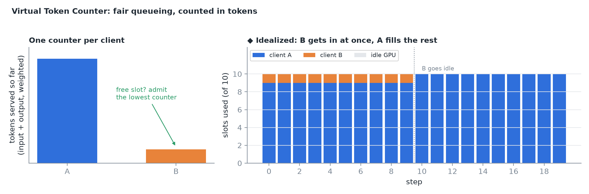
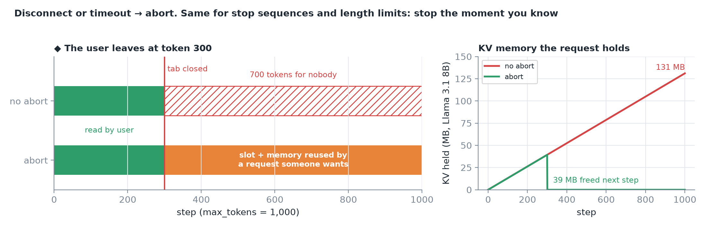
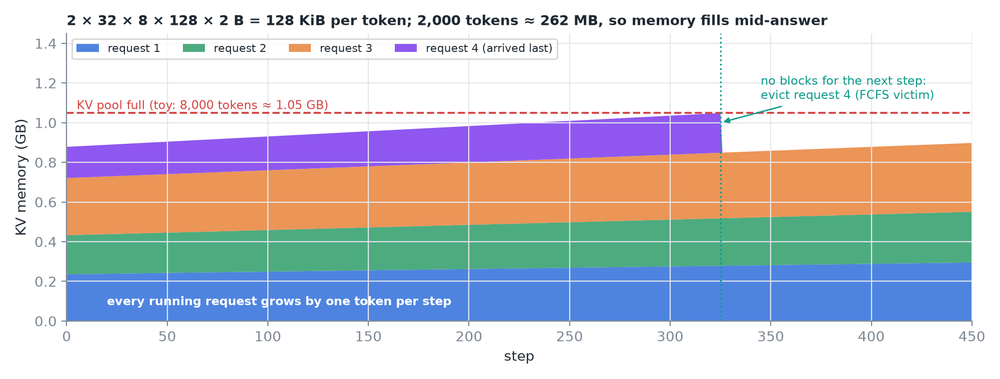
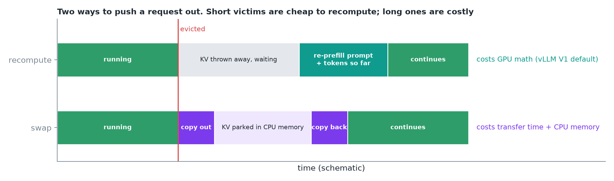
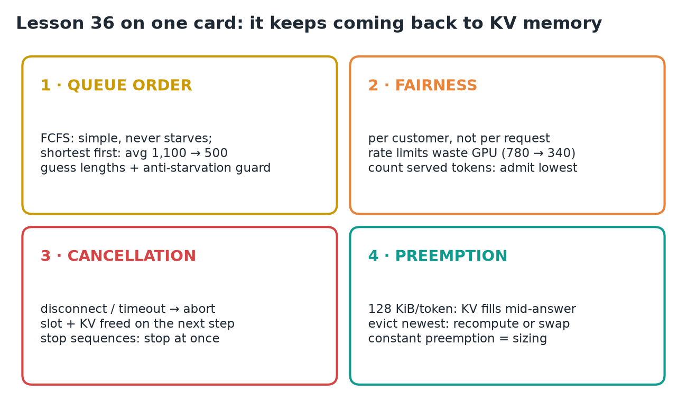

# 36 · Queueing, Fairness, Cancellation & Preemption

**Source:** [fanout.sh / inference-eng / 07-05](https://fanout.sh/inference-eng/curriculum/07-05) · ~6 min

> [!NOTE]
> Under real load there isn't room for everyone, so the scheduler answers four questions. **Queue order** sets average latency: FCFS never starves anyone, but **shortest first** cuts the example's average finish from **1,100 to 500** steps, if you can guess lengths and guard long requests. **Fairness** is per customer: counting each client's **served tokens** (Virtual Token Counter) beats blunt rate limits, which dropped throughput from **~780 to ~340 tokens/s**. **Cancelled** work should be aborted at once to free its slot and KV. When **KV memory** runs out (**128 KiB per token** on Llama 3.1 8B), the engine **preempts** a request by **recomputing** or **swapping** it.

*Requests queue, customers compete, users leave, and running requests outgrow memory.*

## 1. The queue: who waits, and in what order?

- Most engines, **vLLM included, default to first come, first served (FCFS)**: simple, and no request ever starves.
- With a long request at the front, everyone behind it waits: **head-of-line blocking**. **Shortest job first (SJF)** is the classic cure.

$$\mathrm{FCFS:}\ \frac{1000 + 1100 + 1200}{3} = 1100 \qquad \mathrm{SJF:}\ \frac{100 + 200 + 1200}{3} = 500$$

*One free slot, three waiting requests. The long one finishes at 1,200 either way; running the short ones first more than halves the average.*

> [!CAUTION]
> Nobody knows an answer's length before it's generated. Research schedulers **predict lengths, or just which request is shorter** (a learning-to-rank scheduler reported **2.8× lower chatbot latency**, 2024). They also need a **guard so long requests never wait forever**.

- ◆ vLLM also has `--scheduling-policy priority`, which orders the queue by a per-request `priority` field instead of arrival time.

## 2. Fairness: per customer, not per request

Client A sends **90%** of the traffic, client B a trickle. Under FCFS, B's few requests sit behind a wall of A's.

*The blunt fix is a per-client rate limit (N requests/min). It rejects A's work even when the GPU has spare room: in the VTC paper (OSDI '24), strict limits cut throughput from ~780 to ~340 tokens/s.*

**Virtual Token Counter (VTC)** borrows from network fair queueing:

1. Keep a **counter per client** of the tokens it has been served, **input and output weighted** separately.
2. Whenever there's room, **admit the next request from the client with the lowest counter**.

*B's counter stays low, so B gets in right away; when B is idle, A can use the whole GPU. Nothing is left idle while someone has work.*

- ◆ In the paper, a client returning from idle has its counter **lifted to the lowest active counter**, so idle time can't be banked as credit to starve others later.

## 3. Cancellation: stop work nobody is reading

- A user closes the tab halfway through the answer. If the engine doesn't notice, it **keeps generating for nobody**: real GPU time, and the request **keeps holding its KV cache**.
- A good server **watches the connection**. On **disconnect or timeout it aborts** the request, and on the **very next step** its slot and memory go to requests still wanted.
- Same for **stop sequences and length limits**: stop the moment you know, not at the end.

*◆ Example numbers: a 1,000-token answer abandoned at token 300. Without an abort, 700 tokens are wasted and KV grows to 131 MB; with one, 39 MB is freed on the next step.*

## 4. Preemption: memory runs out mid-answer

Running requests keep growing. Llama 3.1 8B (K and V × 32 layers × 8 KV heads × 128 dims × 2 bytes):

$$2 \times 32 \times 8 \times 128 \times 2\ \mathrm{B} = 131072\ \mathrm{B} = 128\ \mathrm{KiB/token} \quad \Rightarrow \quad 2000 \times 128\ \mathrm{KiB} \approx 262\ \mathrm{MB}$$

*Toy pool. Memory fills while everyone is mid-answer; when the next step can't get blocks for everyone, the scheduler pushes someone out. Under FCFS the victim is usually the request that arrived last.*

*Recompute throws the KV away and later re-runs prompt + generated tokens as a fresh prefill. Swap copies the KV to CPU memory and back when there's room.*

| | Recompute | Swap |
|---|---|---|
| Costs | **GPU math** | **Transfer time + CPU memory** |

- **vLLM's current engine (V1) defaults to recompute.**
- One study found **recomputing short requests can even pay off**, while **evicting long ones costs a lot**.
- ◆ Idealized costs for a 2,000-token victim: recompute ≈ 2,000 × 16 µs ≈ **32 ms** of GPU math (the extra attention work makes it worse as requests get longer); swap moves **262 MB each way**, ≈ 5 ms at ~50 GB/s PCIe, and parks 262 MB in CPU RAM. Real swaps copy many small blocks, so they run below peak bandwidth.
- ◆ With prefix caching, a recomputed request's freed blocks stay cached until reused, so part of its re-prefill can be a cache hit.

> [!WARNING]
> **Preemptions all the time are a sizing problem.** Give the KV cache more memory, or admit fewer requests at once (lower `max_num_seqs`).

## 5. Recap

