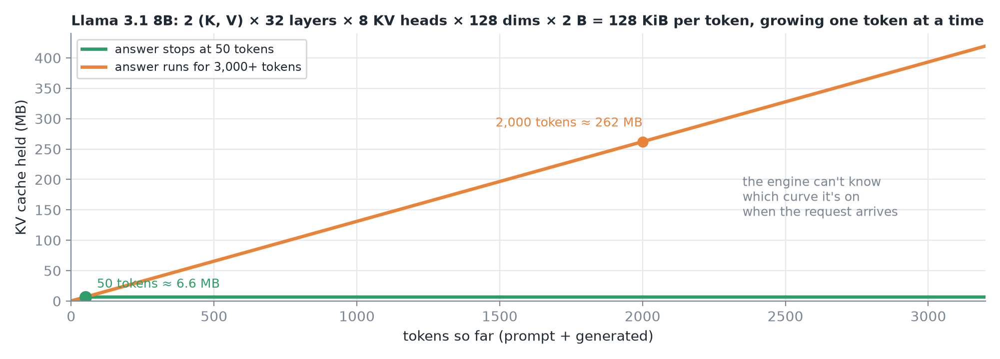
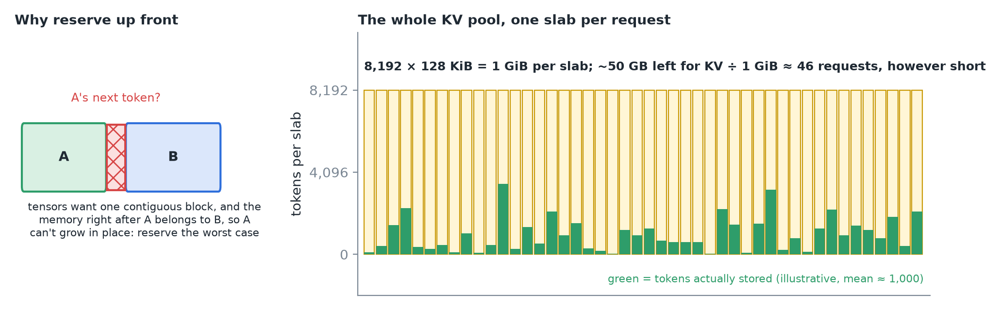
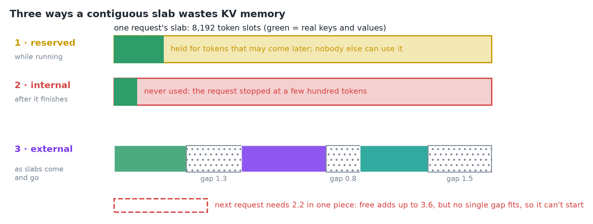
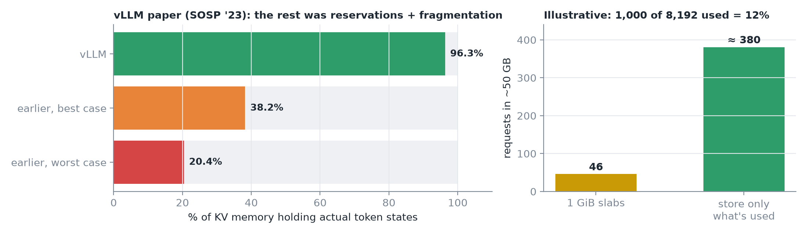
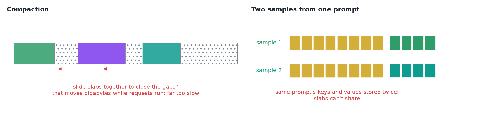
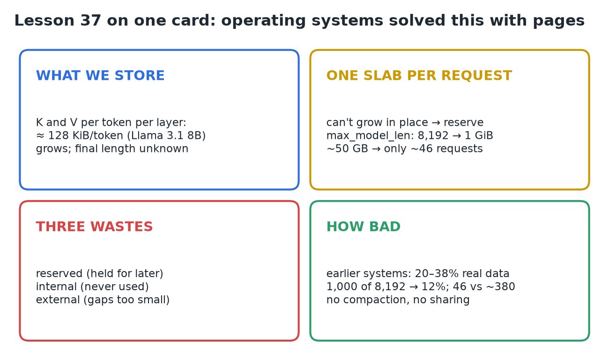

# 37 · Why Contiguous KV Allocation Breaks

**Source:** [fanout.sh / inference-eng / 08-01](https://fanout.sh/inference-eng/curriculum/08-01) · ~5 min

> [!NOTE]
> How many requests run at once depends on how much KV cache fits on the GPU, and that depends on **how the memory is laid out**. The obvious layout, **one contiguous slab per request**, has to reserve for the **worst case** because a slab can't grow in place: 8,192 tokens × 128 KiB = **1 GiB per request**, so ~50 GB fits only **~46 requests**, however short they turn out. It wastes memory three ways: **reserved**, **internal** and **external fragmentation**. The vLLM authors measured earlier systems using only **20–38%** of KV memory for real data; storing only what's used would fit **~380** requests instead of 46.

## 1. What we're storing

For every token, every layer keeps a **key** and a **value** vector:

$$2 \times 32\ \mathrm{layers} \times 8\ \mathrm{KV\ heads} \times 128 \times 2\ \mathrm{B} = 131072\ \mathrm{B} = 128\ \mathrm{KiB\ per\ token}$$

*It grows one token at a time while the request runs, and nobody knows the final length: one answer stops after 50 tokens, another runs for thousands.*

## 2. One slab per request

- Most deep learning code wants each tensor in **one contiguous block**, so the natural design gives each request **one slab** and keeps its KV in order inside it.
- A slab **can't grow in place**: the memory right after it might belong to someone else. So you **reserve for the worst case**, the model's maximum length.

$$8192 \times 128\ \mathrm{KiB} = 1\ \mathrm{GiB\ per\ request} \qquad \frac{50\ \mathrm{GB}}{1\ \mathrm{GiB}} \approx 46\ \mathrm{requests}$$

*~50 GB left for KV after the weights (illustrative) holds only ~46 slabs, no matter how short the requests turn out. Green: what's actually stored.*

## 3. Three kinds of waste

*Green = real keys and values. Row 3's gaps add up to 3.6, yet none fits a request needing 2.2.*

| Waste | When | What happens |
|---|---|---|
| **Reserved** | While the request runs | Space ahead of the real tokens is held "for later"; nobody else can touch it |
| **Internal fragmentation** | After it finishes early | The request stopped at a few hundred tokens; the rest of the slab was **never used** |
| **External fragmentation** | As slabs of different sizes come and go | Free space adds up to **3.6**, the next request needs **2.2**, but no single gap is big enough, so it **can't start** |

External fragmentation appears when slabs have **different sizes**, e.g. each sized to its own prompt plus its own output limit.

## 4. How bad in practice?

*Left: vLLM paper (SOSP '23) measuring earlier systems: only 20.4–38.2% of KV memory held token states; vLLM reached 96.3%. Right: the lesson's illustrative numbers.*

$$\frac{1000}{8192} \approx 12\%\ \mathrm{used} \qquad \frac{50\ \mathrm{GB}}{1000 \times 128\ \mathrm{KiB}} = \frac{50\ \mathrm{GB}}{131\ \mathrm{MB}} \approx 380\ \mathrm{requests}$$

If requests really average **1,000 tokens**, only **12%** of each slab holds data. Store only what's used and the same 50 GB holds **~380** requests instead of **46**.

*Compaction would mean moving gigabytes while requests run, far too slow. And two samples from the same prompt each store their own copy of its keys and values, because slabs can't share.*

> [!IMPORTANT]
> The problem isn't the amount of memory, it's the **contiguous, worst-case layout**. Operating systems solved the same problem decades ago with **pages**.

## 5. Recap

