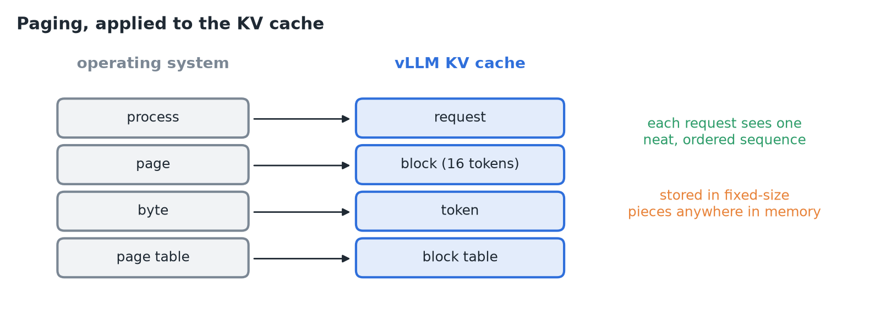
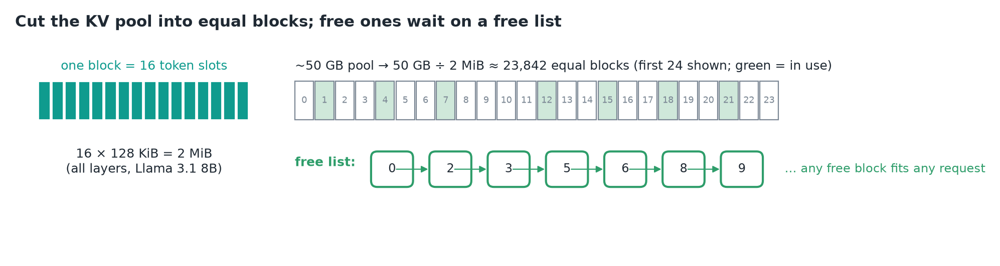
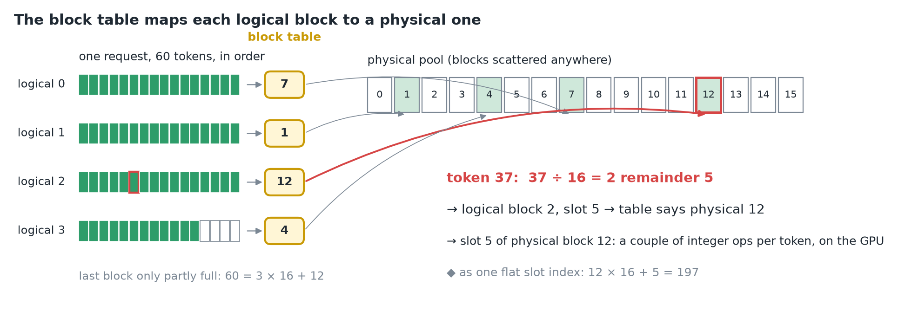
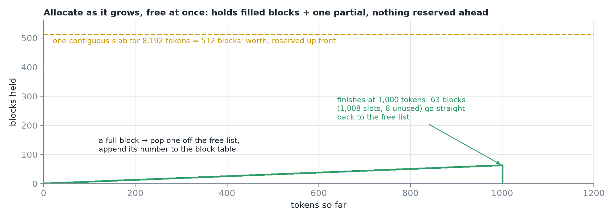
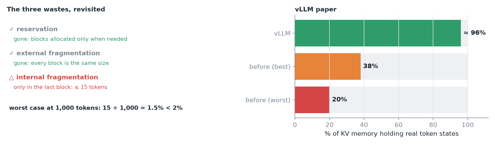
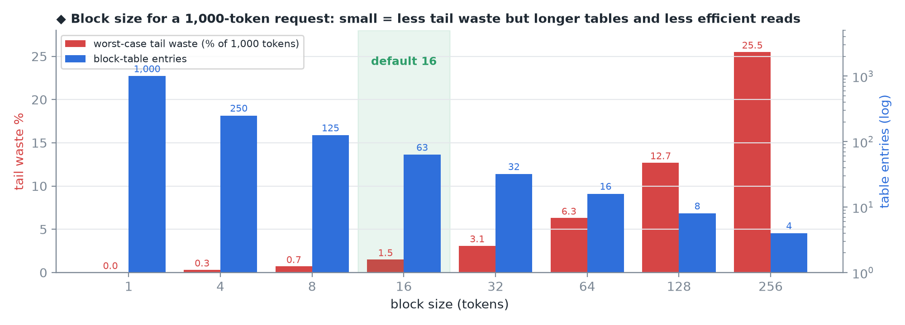
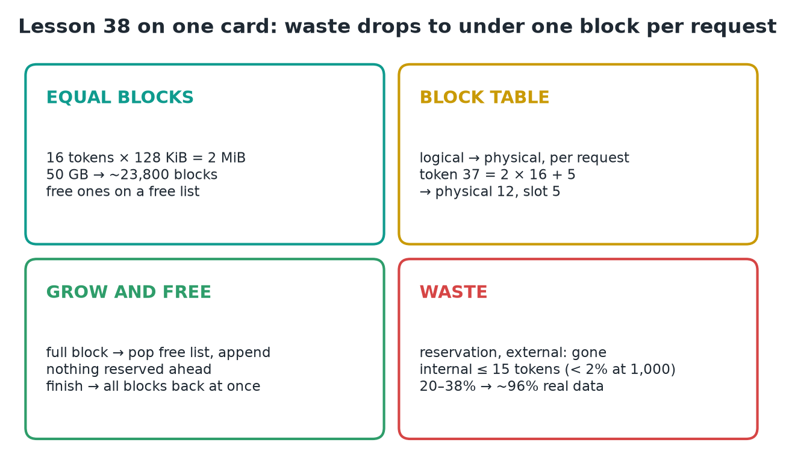

# 38 · KV Blocks, Fragmentation & Block Tables

**Source:** [fanout.sh / inference-eng / 08-02](https://fanout.sh/inference-eng/curriculum/08-02) · ~5 min

> [!NOTE]
> vLLM fixes contiguous slabs the way operating systems fixed memory decades ago: **paging**. Cut the KV pool into **equal blocks of 16 tokens** (**2 MiB** each on Llama 3.1 8B, so 50 GB ≈ **23,800 blocks**), hand them out from a **free list**, and give each request a **block table** mapping its logical blocks to physical ones anywhere in the pool. Finding a token is one division: **37 = 2 × 16 + 5** → logical block 2, slot 5. Blocks are allocated **as the request grows** and returned **the moment it finishes**. Reservation and external fragmentation disappear; internal waste is **at most 15 tokens** per request, and the vLLM paper measured **~96%** of KV memory holding real data, up from 20–38%.

## 1. Paging, applied to the KV cache

Give every program the illusion of one neat, contiguous address space, but store it in **small fixed-size pages** scattered anywhere in physical memory.

*A request is like a process, a block like a page, a token like a byte.*

## 2. Equal blocks and a free list

$$16 \times 128\ \mathrm{KiB} = 2\ \mathrm{MiB\ per\ block} \qquad \frac{50\ \mathrm{GB}}{2\ \mathrm{MiB}} \approx 23800\ \mathrm{blocks}$$

*vLLM's default block holds 16 tokens' keys and values across all layers. Every block is the same size, and every free one sits on a free list, ready to hand out.*

## 3. The block table

A request with **60 tokens** sees them in order in **logical blocks 0–3** (16 each, the last only 12 full). Physically they live in blocks **7, 1, 12 and 4**; that small list is the request's **block table**.

$$37 = 2 \times 16 + 5 \quad \Rightarrow \quad \mathrm{logical\ block\ 2,\ slot\ 5} \quad \Rightarrow \quad \mathrm{physical\ block\ 12,\ slot\ 5}$$

*To find any token, divide its position by 16: the quotient picks the logical block, the table gives the physical one, the remainder is the slot. A couple of integer operations, done for every token on the GPU.*

## 4. Grow and free

- Each new token goes into the **next slot of the last block**. When that block fills, the manager **pops one block off the free list** and **appends its number** to the block table.
- **Nothing is reserved ahead**: a request holds only its filled blocks plus one partly full.
- When it finishes, **all its blocks go straight back** to the free list; the next request can use them even though they're scattered.

*◆ One request growing to 1,000 tokens holds at most 63 blocks (1,008 slots, 8 unused), versus 512 blocks' worth for an 8,192-token slab reserved up front.*

## 5. The three wastes, revisited

*Reservation is gone (blocks allocated only when needed); external fragmentation is gone (any free block fits any request); internal fragmentation shrinks to the last block's unused slots.*

$$\mathrm{tail\ waste} \leq 15\ \mathrm{tokens}: \quad \frac{15}{1000} = 1.5\% < 2\%$$

> [!IMPORTANT]
> The vLLM paper measured **~96%** of KV memory holding real token states, up from **20–38%** with contiguous slabs.

## 6. Block size is a trade-off

| | Small blocks | Large blocks |
|---|---|---|
| Tail waste | **Less** | More at the end of each request |
| Block table | Longer | Shorter |
| Memory reads | Less efficient | **More efficient** |

**16 tokens** has held up well as a default.

*◆ Worst-case tail waste is (block − 1) ÷ length, and the table needs length ÷ block entries (rounded up). At 16, a 1,000-token request wastes ≤ 1.5% with 63 entries.*

## 7. Recap

