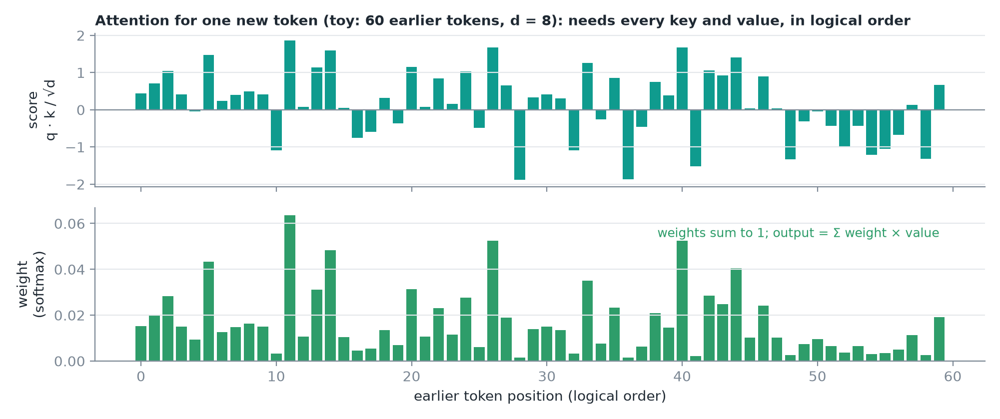
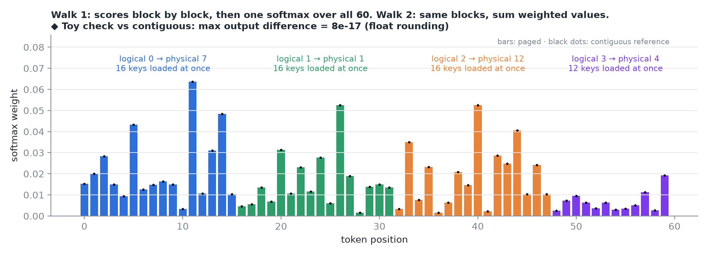
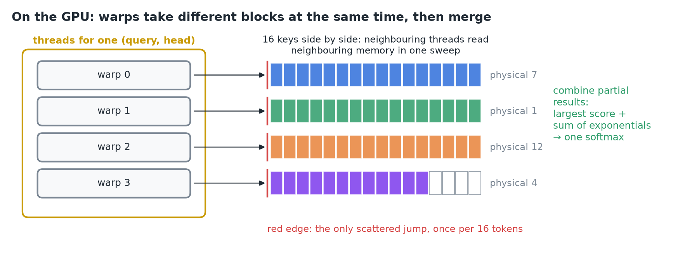
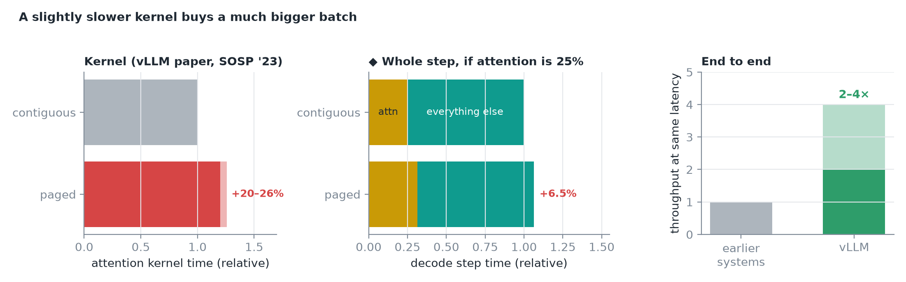
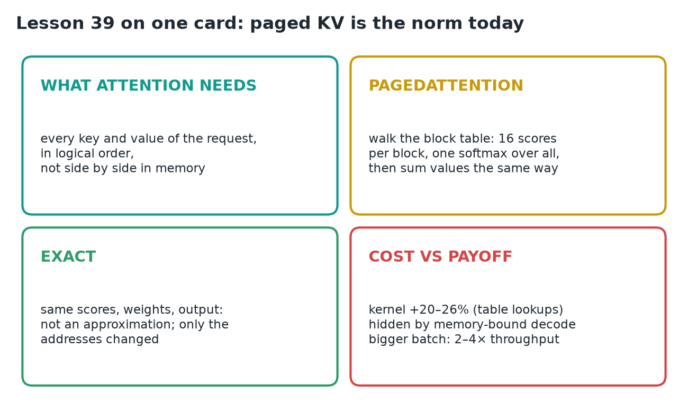

# 39 · PagedAttention

**Source:** [fanout.sh / inference-eng / 08-03](https://fanout.sh/inference-eng/curriculum/08-03) · ~4.5 min

> [!NOTE]
> Attention is the one layer that reads the KV cache, and classic kernels expect a request's keys and values to sit side by side. But attention only needs them **in logical order**, never physically adjacent. **PagedAttention** reads them **straight through the block table**: score each block of 16 keys, apply **one softmax over all scores**, then sum the values block by block. The result is **exactly ordinary attention**, not an approximation. The kernel runs **~20–26% slower** than a contiguous one, but decode is memory-bound and attention is only part of a step, while near-zero waste fits far more requests: **2–4× throughput** at the same latency. Today **FlashAttention** and **FlashInfer** accept block tables directly.

## 1. What attention needs

For one new decode token: its **query** is compared with the **key** of every earlier token (dot product → one score each), a **softmax** turns scores into weights that sum to 1, and the output is the **weighted sum of all value vectors**.

*It needs every key and value of this request, token by token in logical order. It never needs them physically next to each other.*

## 2. The paged version

For the 60-token request with block table **7, 1, 12, 4**:

1. Walk the logical blocks in order. Logical 0 → physical 7: load those **16 keys in one go**, compute **16 scores**. Then physical 1 (16 more), 12, and 4 (the **last 12 tokens**).
2. With all **60 scores**, apply **one softmax** across all of them.
3. Walk the blocks again the same way to **add up the weighted values**.

*Same scores, same weights, same output: only the addresses it reads from changed. ◆ The toy check computes both versions in numpy; they agree to float rounding.*

> [!IMPORTANT]
> PagedAttention is **not an approximation**. It's ordinary attention with an extra indirection through the block table.

## 3. On the GPU

- Each **(query, head)** gets its own group of threads; inside it, **different warps take different blocks** at the same time.
- Within a block the 16 keys sit next to each other, so **neighbouring threads read neighbouring memory** in one sweep. The scattered jump happens **only at block boundaries**, 16 tokens at a time.
- The warps then combine their partial results, **the largest score and the sum of exponentials**, into one softmax.

*Coalesced reads inside each block; one indirection per block.*

◆ Merging two partials (max score m and sum of exponentials l from each warp):

$$m = \mathrm{max}(m_1, m_2) \qquad l = l_1\, e^{m_1 - m} + l_2\, e^{m_2 - m}$$

## 4. Is it free? No, but it pays

*Left: every block needs a table lookup and some bookkeeping, so the kernel ran ~20–26% slower in the original paper. Middle: ◆ if attention were a quarter of a decode step, that's ~6.5% on the step. Right: end-to-end, vLLM served 2–4× the throughput of earlier systems at the same latency.*

- Attention is **only part of a step**, and decode is limited by **memory traffic**, which hides much of the extra work at large batches.
- Near-zero waste lets **far more requests fit** in memory at once: a slightly slower kernel in exchange for a **much bigger batch**.
- Paged KV is now the norm: **FlashAttention** and **FlashInfer** both accept **block tables** directly.

## 5. Recap

