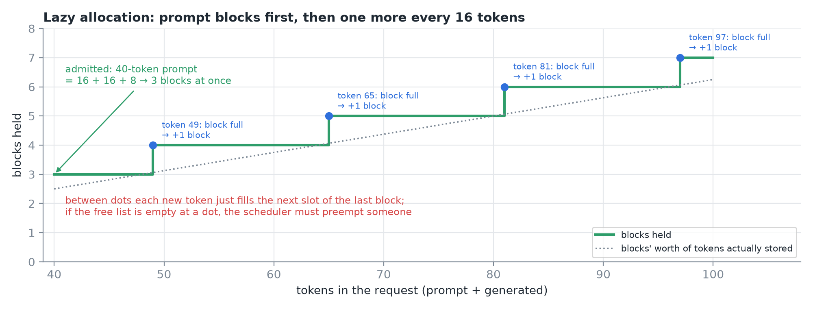
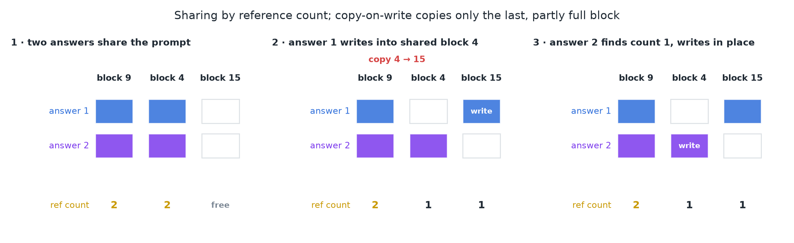
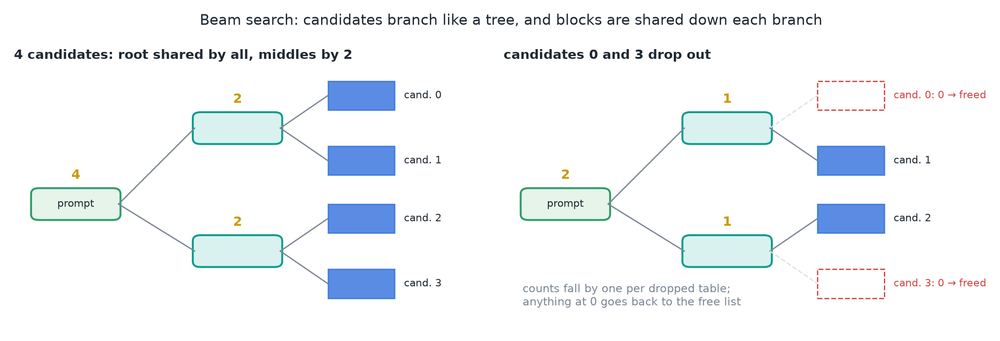
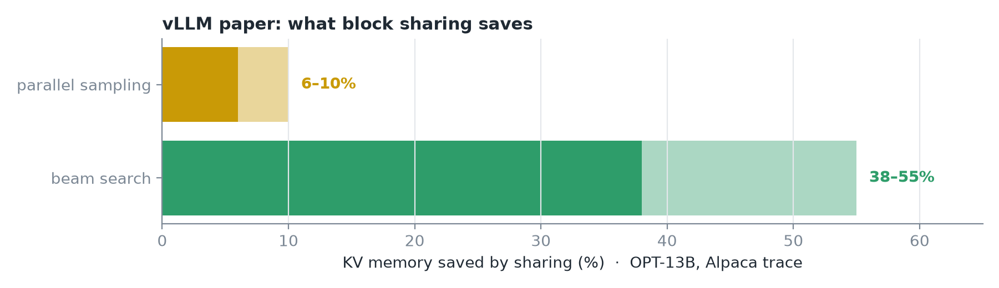
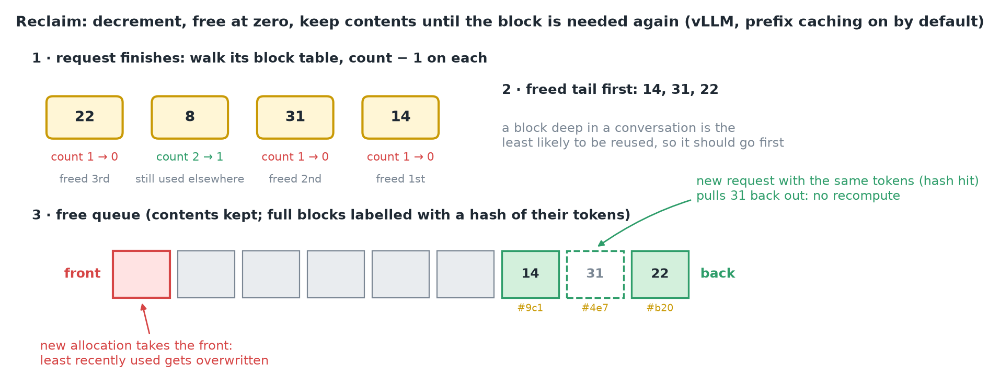
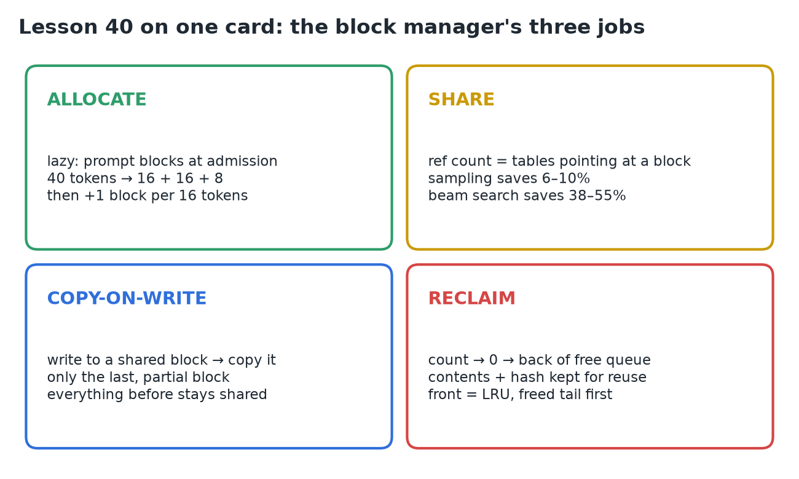

# 40 · Allocate, Share & Reclaim KV Blocks

**Source:** [fanout.sh / inference-eng / 08-04](https://fanout.sh/inference-eng/curriculum/08-04) · ~5 min

> [!NOTE]
> Blocks and block tables give the engine a small **block manager** that owns every KV block on the GPU and does three jobs. It **allocates lazily**: enough blocks for the prompt, then one more every 16 tokens. It **shares** blocks through **reference counts**, copying a shared block only when someone writes to it (**copy-on-write**); sharing saved **6–10%** of KV memory for parallel sampling and **38–55%** for beam search in the vLLM paper. It **reclaims** blocks whose count reaches zero into a free queue, and in vLLM it **keeps their contents** so a later request with the same tokens can reuse them.

## 1. Allocate: lazily

*A 40-token prompt gets 3 blocks at admission; after that a block is added only when the last one fills.*

- At admission: just enough blocks for the prompt. **40 tokens = 16 + 16 + 8 → 3 blocks**.
- Then each new token fills the **next slot of the last block**; only a full block triggers a new one.
- So a request asks for a block **once every 16 tokens**, not once per token, and **never for tokens it hasn't produced**.
- If no free block is left at that moment, the **scheduler has to preempt** someone.

◆ For 40 prompt tokens plus 1,000 generated:

$$\frac{1040}{16} = 65\ \mathrm{blocks} = 3\ \mathrm{at\ admission} + 62\ \mathrm{lazy\ allocations}$$

## 2. Share: reference counts and copy-on-write

Two different answers to the **same prompt** (parallel sampling) have **identical KV for the prompt**. Instead of storing it twice, both block tables point at the **same physical blocks**, and each block keeps a **reference count**: how many tables point at it.

*Both answers start on blocks 9 and 4 (count 2 each). Answer 1's first write into the partly full block 4 triggers a copy to block 15; answer 2 then writes into block 4 directly.*

- Answer 1 wants to write its first new token into the **last prompt block, which isn't full**. But it's shared, and answer 2 still needs the original.
- So the manager **copies that one block** to a fresh block, points answer 1 at the copy, and **drops the old block's count to 1**.
- Answer 2 now sees **count 1** and writes straight in. This is **copy-on-write**, the same trick an operating system uses when a process **forks**.
- **Only the last, partly full block** ever gets copied; everything before it stays shared for the rest of the request.

◆ One copy for Llama 3.1 8B is a single block, 16 × 128 KiB = **2 MiB**, however long the shared prompt is.

### Beam search

*Blocks near the root are shared by every candidate, deeper ones only by the candidates that went that way. When a candidate drops out, every block on its path loses one count.*

- Beam search keeps several candidate answers alive, branching off each other like a **tree**.
- When a candidate drops out of the beam, its blocks' counts go down, and **any block that reaches zero is freed**.

> [!WARNING]
> The video's frame keeps the root block at **4** after candidates 0 and 3 drop out. With only two block tables left pointing at it, its count should read **2**, as drawn here.

*KV memory saved by sharing in the vLLM paper (OPT-13B, Alpaca trace). ◆ Beam search saves more because its candidates share whole branches, not just the prompt.*

- The same mechanism lets **completely different requests** share a common prefix, like a long **system prompt**. That's **prefix caching**.

## 3. Reclaim: free at zero, but keep the contents

*A finished request with table 22, 8, 31, 14. Block 8 is still used elsewhere; the other three go to the back of the free queue. Hash labels are illustrative.*

- When a request finishes, the manager **walks its block table and decrements each count**. Blocks that reach **zero go back to the free queue**.
- In vLLM, with **prefix caching on (the default)**, a freed block **isn't wiped**. It joins the **back** of the free queue still holding its keys and values, and a **full block is labelled with a hash** of its tokens.
- A new request with the **same tokens** can pull that block right back out and **skip recomputing it**.
- New allocations take blocks from the **front**, so the **least recently used** ones get overwritten first.
- A request's blocks are **freed tail first**, because a block deep in a conversation is the **least likely to be reused**.

> [!IMPORTANT]
> A freed block is only a **candidate** for overwriting. Until something takes it from the front of the queue, it's a free cache hit.

## 4. Recap

