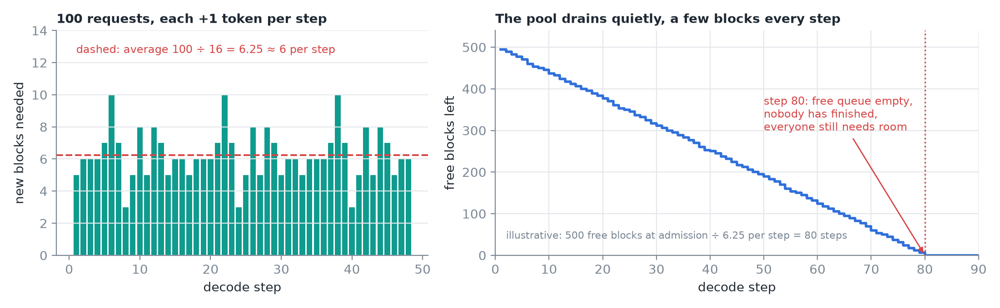
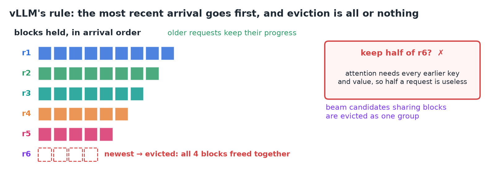
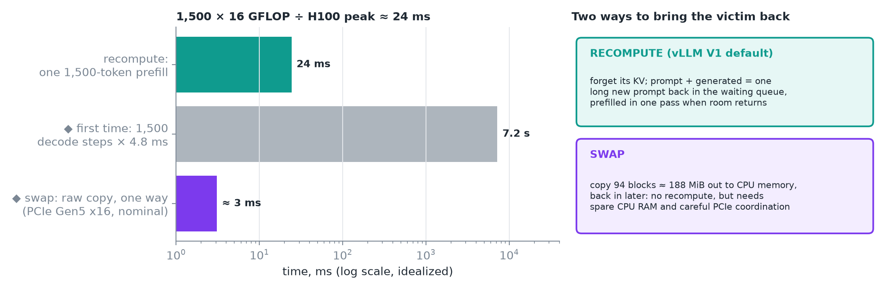
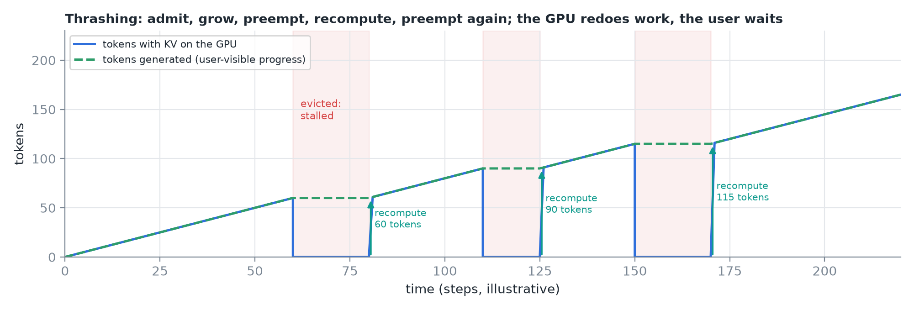
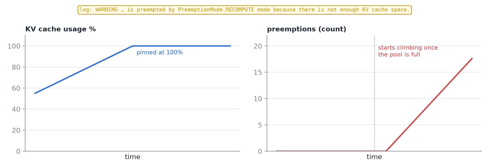
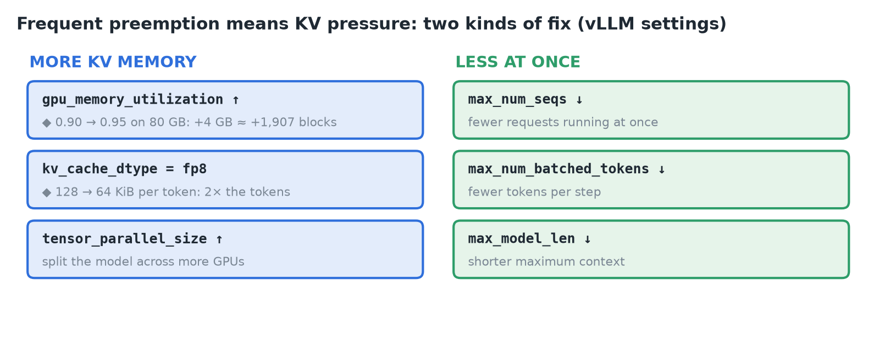
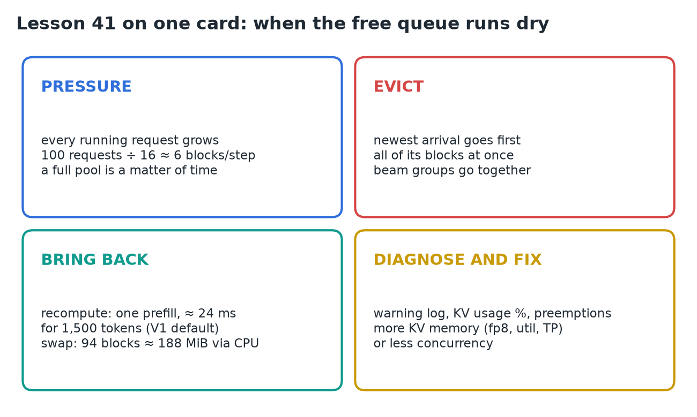

# 41 · Preemption, Recomputation & KV Pressure

**Source:** [fanout.sh / inference-eng / 08-05](https://fanout.sh/inference-eng/curriculum/08-05) · ~5 min

> [!NOTE]
> Paged blocks make KV memory efficient, but it's still finite. Every running request grows, so under load the free queue eventually **runs dry while nobody has finished**. vLLM then **evicts the most recent arrival, all of its blocks at once**, and later brings it back by **recomputing** its tokens in one prefill (the V1 default, ≈ **24 ms** for 1,500 tokens on Llama 3.1 8B) or by **swapping** its blocks through CPU memory. Frequent preemption means **KV pressure**: watch the warning log and the KV usage and preemption metrics, then give the cache **more memory** or ask for **less at once**.

## 1. Pressure builds quietly

*Left: with requests at different points in their blocks, new-block demand jitters around 6.25 per step. Right: the pool drains at that rate until a step asks for a block and none is left.*

- Every running request adds **one token per step**; with 16-token blocks each needs a new block about **once every 16 steps**.
- With **100 requests** decoding: 100 ÷ 16 ≈ **6 new blocks every step**.
- The scheduler admitted each request on the room it needed **at that moment**; it couldn't know how long each answer would grow.
- The scariest moment: the free queue is empty, **nobody has finished, so nothing will be freed**, and everyone needs room for their next token.

## 2. Push someone out

*The newest request is evicted whole; the older ones keep their progress.*

- vLLM's rule follows **arrival order**: the request that **arrived most recently goes first**, so older requests keep their progress.
- Eviction is **all or nothing**. Attention needs every earlier key and value, so keeping half a request's blocks would be useless.
- Beam candidates that share blocks are **evicted as a group**.

## 3. Bring the victim back: recompute or swap

*Recompute redoes the KV in one parallel pass; swap parks it in CPU memory. ◆ The grey and purple bars are my estimates.*

**Recompute** forgets the victim's KV. It goes back to the waiting queue with **prompt + everything generated so far treated as one long new prompt**, which is prefilled in **one parallel pass** when there's room; decoding then picks up where it left off.

$$1500 \times 16\ \mathrm{GFLOP} = 24\ \mathrm{TFLOP} \quad \Rightarrow \quad \frac{24\ \mathrm{TFLOP}}{989\ \mathrm{TFLOP/s}} \approx 24\ \mathrm{ms}$$

- That's Llama 3.1 8B at **H100 peak** (idealized), far faster than generating those tokens one by one the first time. ◆ At an idealized 4.8 ms per decode step, 1,500 steps take about **7.2 s**.

**Swap** copies the victim's blocks out to CPU memory and back later:

$$\frac{1500}{16} = 93.75 \Rightarrow 94\ \mathrm{blocks} \times 2\ \mathrm{MiB} = 188\ \mathrm{MiB}$$

- It avoids recomputing, but needs **spare CPU memory** and **careful coordination** while data moves over **PCIe**.
- **vLLM's current engine (V1) uses recompute by default.**

> [!TIP]
> ◆ The raw copy is not the bottleneck: 188 MiB over PCIe Gen5 x16 (~64 GB/s nominal) is about 3 ms each way. What swap really costs is the spare CPU memory and the coordination.

## 4. Thrashing

*One request caught in the loop (illustrative timings): each eviction stalls it, and each return re-prefills everything it had.*

- **One preemption is fine; a steady stream is a problem.** The engine admits a request, everyone grows, someone is preempted, recomputed, then preempted again.
- That's **thrashing**: GPU time goes into **redoing work**, and users see their answers **stall**.

## 5. Spot it and fix it

*vLLM logs a warning per preemption and exports metrics for KV cache usage and preemption count; preemptions climb once usage pins at 100%.*

*Two kinds of fix. ◆ The two estimates assume an 80 GB GPU and Llama 3.1 8B's 128 KiB per token.*

> [!IMPORTANT]
> Frequent preemption is a **sizing problem**: either give the KV cache **more memory**, or ask for **less concurrency**.

## 6. Recap

