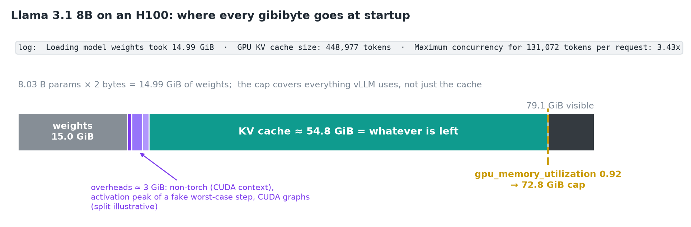
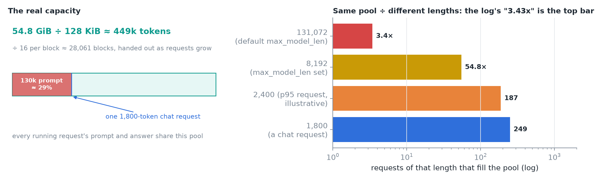
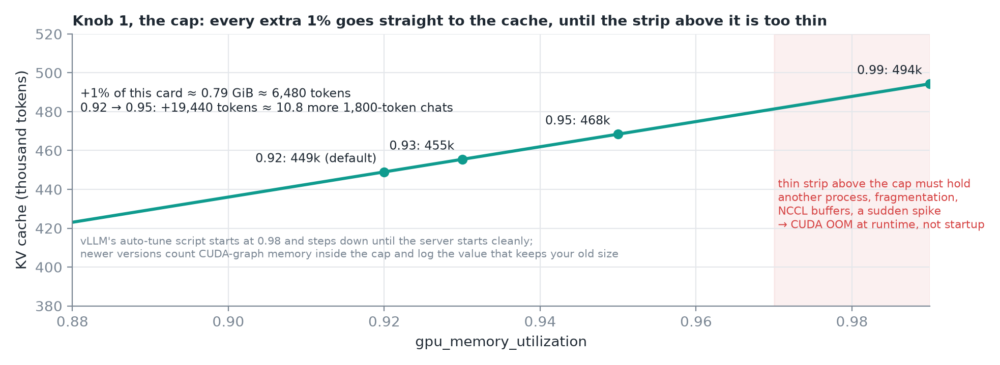
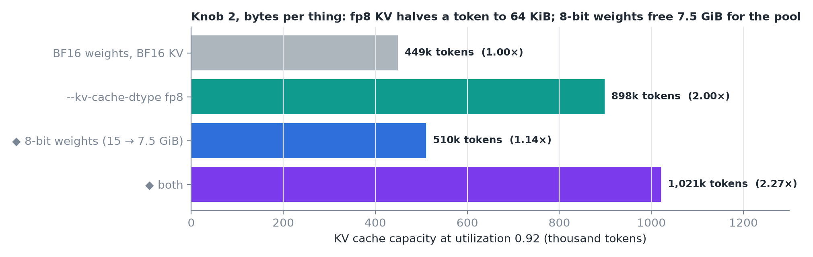
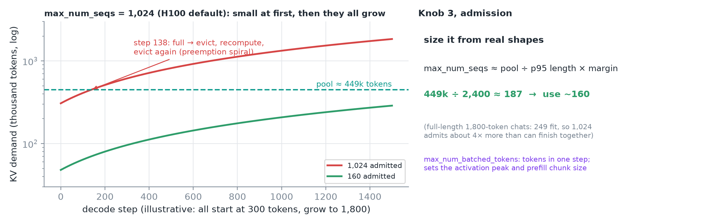
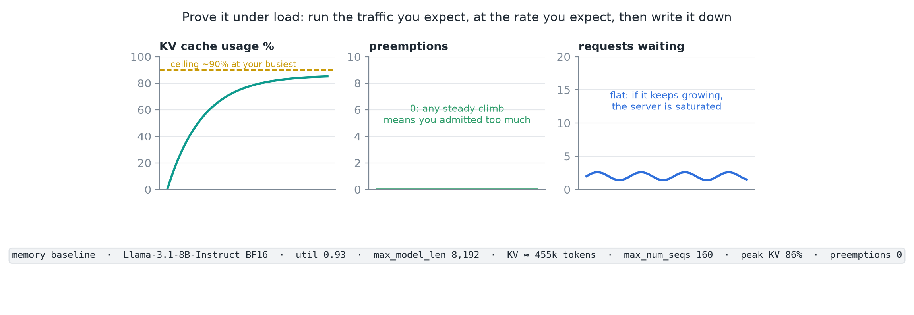
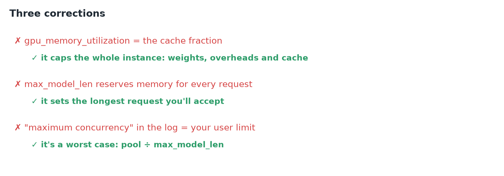
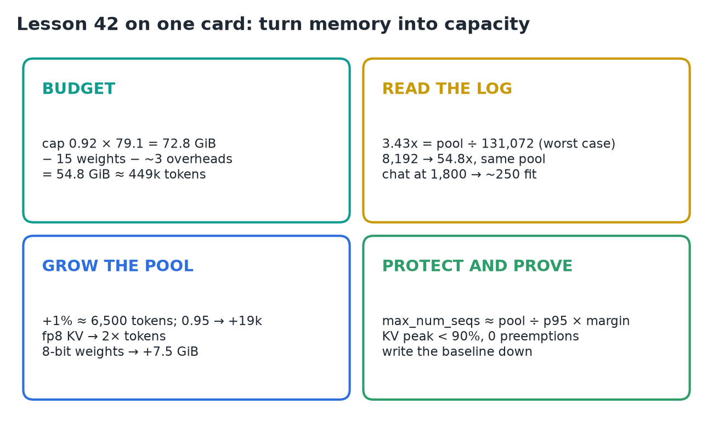

# 42 · Tune GPU Memory & KV Capacity

**Source:** [fanout.sh / inference-eng / 09-02](https://fanout.sh/inference-eng/curriculum/09-02) · ~9.5 min

> [!NOTE]
> vLLM gives the KV cache **whatever is left under the `gpu_memory_utilization` cap** after weights, overheads and CUDA graphs: for Llama 3.1 8B on an H100 that's **54.8 GiB ≈ 449k tokens**. The log's "**maximum concurrency 3.43x**" is just that pool ÷ `max_model_len` (131,072), a worst case, not a user limit: a 1,800-token chat only takes 1,800 tokens, so ~250 fit. **Grow** the pool with a careful cap (+1% ≈ 6,500 tokens) and fewer bytes (fp8 KV doubles it); **protect** it with a sensible `max_model_len` and a `max_num_seqs` sized from real shapes; then **prove** it under load: KV peak below ~90% and zero preemptions.

## 1. Where every gibibyte goes

*The cap covers the whole instance. The cache is the remainder, not a fraction you set.*

- vLLM sees **79.1 GiB** on this card. `gpu_memory_utilization` defaults to **0.92**, so the instance allows itself **72.8 GiB**.
- **Weights:** 8.03 B params × 2 bytes ≈ **15 GiB**.
- **Overheads ≈ 3 GiB:** memory outside PyTorch (the CUDA context), the **activation peak** from a fake worst-case step (the biggest batch it may schedule), and **CUDA graphs**, the pre-recorded kernel launches that make decode fast.
- **KV cache** = what's left: 72.8 − 15 − 3 ≈ **54.8 GiB**.

## 2. From gibibytes to tokens, and what "3.43x" means

$$2 \times 32\ \mathrm{layers} \times 8\ \mathrm{KV\ heads} \times 128\ \mathrm{dims} \times 2\ \mathrm{bytes} = 128\ \mathrm{KiB\ per\ token}$$

$$\frac{54.8\ \mathrm{GiB}}{128\ \mathrm{KiB}} \approx 449{,}000\ \mathrm{tokens} \approx 28{,}000\ \mathrm{blocks\ of\ 16}$$

*The pool is the real capacity; "maximum concurrency" divides it by the longest request you said you'd accept.*

- **3.43x = 449k ÷ 131,072**, Llama 3.1's default `max_model_len`: three max-length requests would fill the cache. It says **nothing about your actual users**; blocks are handed out as requests grow, so an 1,800-token chat takes 1,800 tokens.

Why set `max_model_len` at all? Two reasons:

- **Startup check:** at least one request of that length must fit, or vLLM refuses to start and tells you the longest length that would.
- **A promise to accept giant requests:** one 130k-token prompt would take **~29%** of the whole pool by itself.
- If the product never needs more than 8k tokens, set **`--max-model-len 8192`**: the log now says **54.8x**. The pool didn't change; your **worst case** did.

## 3. Knob 1: the utilization cap

*Points at 0.92, 0.93 and 0.95 match the lesson. The video's 0.99 frame shows ≈ 491k; the same budget gives ≈ 494k.*

- Every **1%** of this card ≈ **0.79 GiB ≈ 6,500 tokens**. Raising **0.92 → 0.95** gains **~19,000 tokens**, roughly **10 more chat requests**.
- The catch is the **strip above the cap**: vLLM only controls what it allocates itself. Another process, fragmentation, NCCL communication buffers or a sudden spike must all fit there. If they don't: **CUDA out of memory at runtime, not at startup**, which is much worse.
- vLLM's **auto-tuning script** starts at **0.98** and steps down until the server starts cleanly.
- Newer versions **count CUDA-graph memory inside the budget**, and the log tells you which utilization value gives the same cache size as before.

## 4. Knob 2: fewer bytes per thing

*◆ The 8-bit-weights and combined bars are my arithmetic: freed weight memory goes straight to the pool.*

- **`--kv-cache-dtype fp8`:** each token takes **64 KiB** instead of 128, so the same 54.8 GiB holds **~900k tokens**: twice the capacity from one flag.
- **8-bit weights:** 15 → **7.5 GiB**, and the freed space goes straight into the pool.

> [!CAUTION]
> Neither is free: both change the numbers the model computes with, so **measure quality before you ship them**.

## 5. Knob 3: how many requests you let in

*Left (illustrative shapes): 1,024 requests fit while they're small, then all grow by a token per step until the pool runs out.*

- **`max_num_seqs`** is the most requests the scheduler runs at once; the H100 server default is **1,024**.
- The pool holds **~250** chat requests at full length, so the default admits **4×** more than can ever finish together → the pool fills, requests get evicted and recomputed: a **preemption spiral**.
- Size it from **real shapes**: pool ÷ a **high-percentile** request length (not the average) × a margin. Example: 449k ÷ 2,400 (p95) ≈ **187 → use ~160**.
- **`max_num_batched_tokens`** is the other admission knob: it caps the tokens in one step, which sets the **activation peak** measured at startup and the **prefill chunk** size.

## 6. Prove it under load

*Run the traffic you expect, at the rate you expect, and record the result as your memory baseline.*

| Watch | Healthy | If not |
|---|---|---|
| KV cache usage | Peaks **comfortably below full**, ~**90%** at your busiest | Little headroom for spikes |
| Preemptions | **0** at planned load | A steady climb: you admitted more than fits |
| Requests waiting | Flat | Keeps growing: the server is saturated, memory isn't the only problem |

- Preempting? Give the cache **more memory** (utilization, fp8, more GPUs) or **admit fewer** requests at once.
- Write down the settings and the capacity: that's the **memory baseline** for everything that follows.

## 7. Recap

