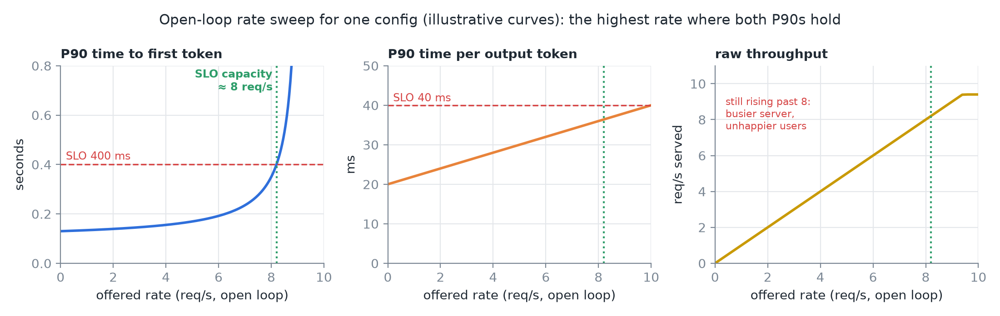
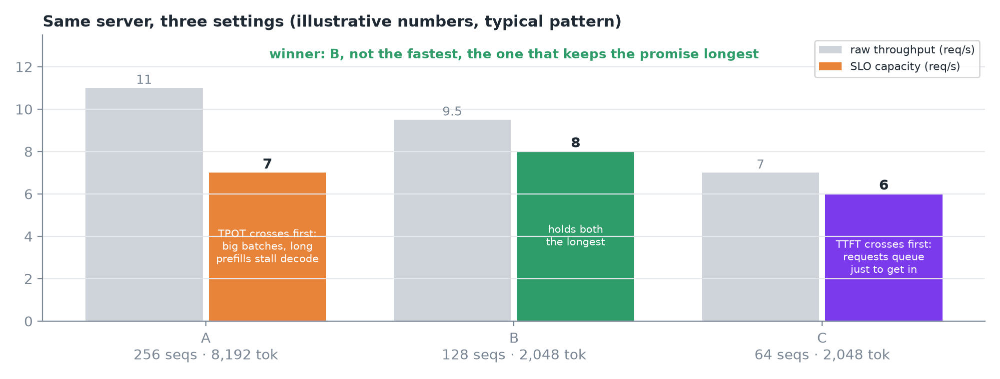
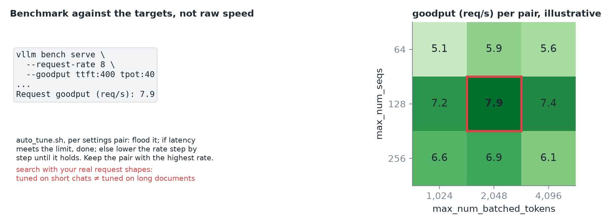
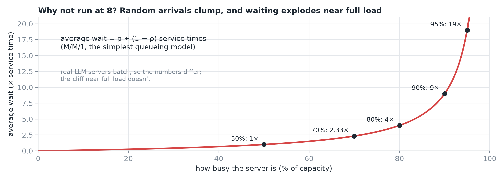
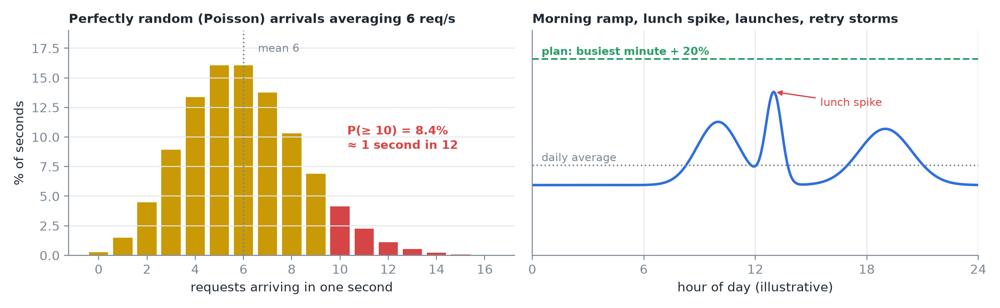
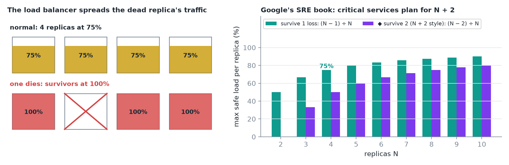
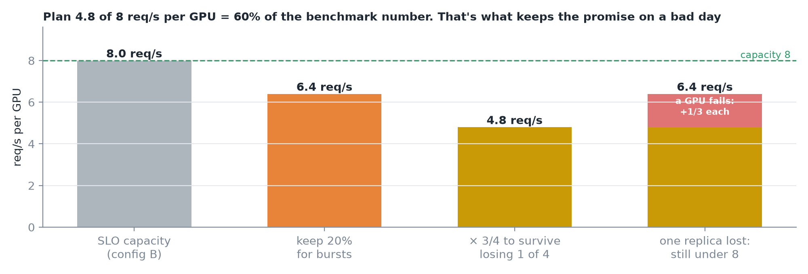
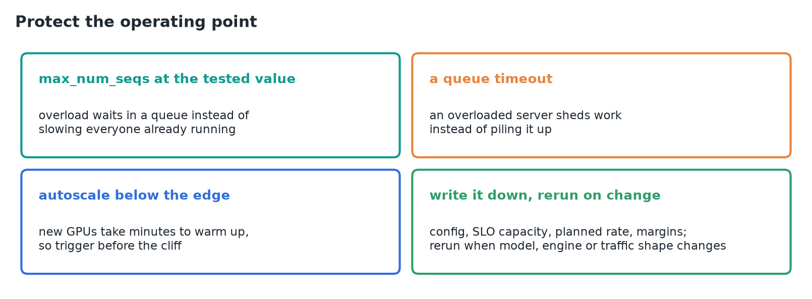
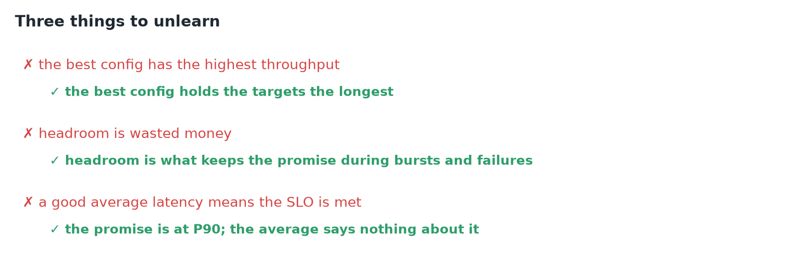
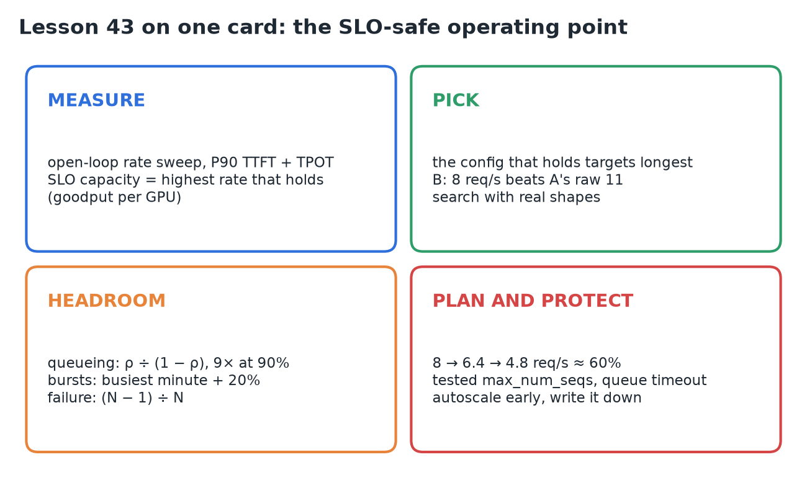

# 43 · Find the SLO-Safe Configuration & Headroom

**Source:** [fanout.sh / inference-eng / 09-05](https://fanout.sh/inference-eng/curriculum/09-05) · ~8.5 min

> [!NOTE]
> A raw-throughput benchmark answers the wrong question. Measure **SLO capacity** instead: the highest request rate where **P90 TTFT ≤ 400 ms and P90 TPOT ≤ 40 ms** both hold, found with an **open-loop rate sweep** (DistServe calls it **goodput per GPU**). Pick the config that holds the targets **longest**, not the fastest one. Then plan well below it: queueing explodes near full load (**9× the service time at 90% busy**), bursts need a **20%** margin, and surviving one lost replica of four means running each at **75%**. For config B that's **8 → 6.4 → 4.8 req/s per GPU, about 60%** of the benchmark number.

## 1. The promise and the wrong number

- The chat service promises: **90% of users see the first token within 400 ms**, then a token at least **every 40 ms**.
- A benchmark says one H100 pushes **9 req/s**, so the team plans for 9. On launch day the tail blows through the target; then one GPU fails and every other GPU falls over with it.
- The benchmark wasn't wrong. It measured **how fast**, not **how much load while keeping the promise**.

## 2. Measure SLO capacity with an open-loop sweep

*Curve shapes are illustrative; the crossing at ≈ 8 req/s matches the lesson's config B.*

- **Open loop:** send requests at a **fixed rate**, the way real users arrive, whether or not the server has caught up. Sweep 2, 4, 6, 8 req/s.
- At each rate record **P90 TTFT** and **P90 TPOT**. As the rate climbs, queues form, so TTFT bends up; each decode step carries a bigger batch, so TPOT creeps up too.
- **SLO capacity** = the highest rate where **both** still meet their targets. One number per configuration.
- Raw throughput **keeps rising past it**: the server gets busier while users get unhappier.

## 3. Pick the config that holds the promise longest

*The lesson's numbers are illustrative, but the pattern is the one you'll see.*

| Config | `max_num_seqs` · tokens per step | Raw | SLO capacity | What breaks first |
|---|---|---|---|---|
| A | 256 · 8,192 | **11** | 7 | TPOT: big batches slow every step, long prefills stall everyone |
| B | 128 · 2,048 | 9.5 | **8** | Holds both the longest |
| C | 64 · 2,048 | 7 | 6 | TTFT: requests wait in line just to get in |

- The winner is **B**: not the fastest, the one that stays inside the promise the longest.

*Grid values are illustrative; the best pair (128, 2,048) is config B.*

- **`vllm bench serve --goodput ttft:400 tpot:40`** takes your targets directly and reports **goodput**, the requests per second that met them.
- vLLM's **auto-tune script** runs the whole search: for each settings pair, start the server, flood it, and if latency misses the limit, step the rate down until it holds. Keep the pair with the highest rate.

> [!WARNING]
> Run the search with your **real request shapes**. A config tuned for short chats can lose on long documents.

## 4. Why not run at 8? Queueing

*All five points check out against ρ ÷ (1 − ρ).*

$$\mathrm{average\ wait} = \frac{\rho}{1 - \rho}\ \mathrm{service\ times}$$

- Requests **clump**: sometimes three land at once, sometimes none for a while. The fuller the server, the longer the unlucky ones wait.
- In the simplest model (M/M/1), the wait is the **load ÷ spare capacity**: **1×** at 50% busy, **2.3×** at 70%, **4×** at 80%, **9×** at 90%, **19×** at 95%.
- Real LLM servers batch, so the exact numbers differ. The **cliff** near full load doesn't. Running at capacity balances your tail latency on its edge.

## 5. Bursts

*Left is the exact Poisson distribution for a mean of 6; right is an illustrative daily shape.*

- Even **perfectly random** arrivals averaging **6 req/s** bring **10 or more** in about **1 second in 12** (P = 8.4%).
- Real traffic isn't flat either: a morning ramp, a lunch spike, a launch, a retry storm.
- Plan for your **busiest minute**, not the daily average, and keep a margin on top. Here: **20%**.

## 6. Failure

*◆ The (N − 2) ÷ N bars are my arithmetic for the N + 2 rule.*

- Four replicas at **75%** each. One dies; its traffic doesn't disappear. The load balancer spreads it over the other three, which jump to **100%**: right at the cliff, on a day you're already having trouble.
- To survive losing one of **N** replicas, each can only run at **(N − 1) ÷ N** of its capacity: **75%** for four.
- Google's **SRE book** describes teams planning for **N + 2**, surviving two losses at once. The more critical the service, the bigger the margin.

## 7. The budget for config B

*The capacity is illustrative; the arithmetic is the method.*

$$8 \times 0.8 = 6.4 \qquad 6.4 \times \frac{3}{4} = 4.8 \qquad \frac{4.8}{8} = 60\%$$

- **SLO capacity 8 req/s**, keep **20%** for bursts → **6.4**.
- Four replicas that must survive losing one → each normally runs at **¾ of 6.4 = 4.8 req/s per GPU**.
- A GPU fails → survivors rise to **6.4**: still under capacity.
- Plan for **about 60%** of what the benchmark says. That isn't waste; it's what keeps the promise on a bad day.

> [!TIP]
> ◆ During a failure the survivors sit at 6.4, so the 20% burst margin is now what absorbs the extra load. A burst *during* a failure has no cover left, which is why critical services go to N + 2.

## 8. Protect the operating point

- **`max_num_seqs` at the tested value**, so overload waits in a queue instead of slowing everyone already running.
- **A queue timeout**, so an overloaded server sheds work instead of piling it up.
- **Autoscale below the edge**, not at it: new GPUs take minutes to warm up.
- **Write it down**: the config, the SLO capacity, the planned rate and the margins. Rerun whenever the model, the engine or the traffic shape changes.

## 9. Recap

