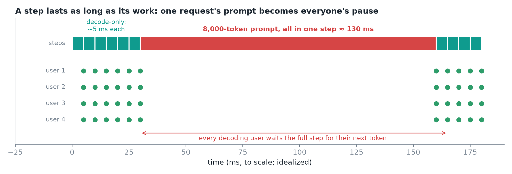
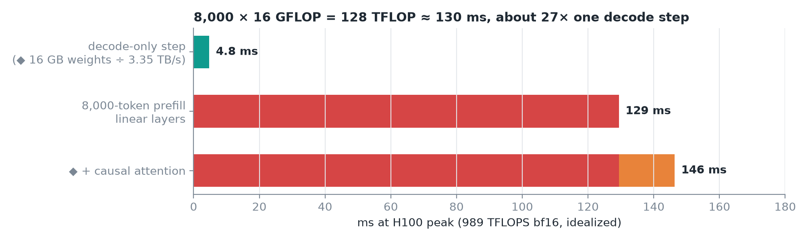
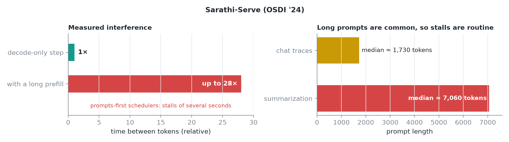
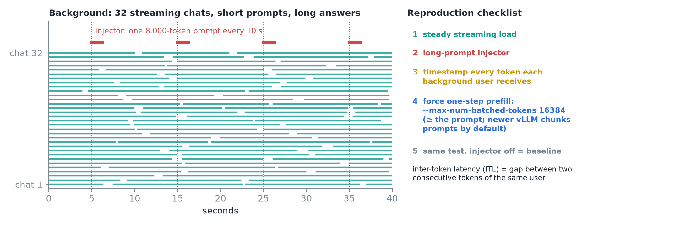
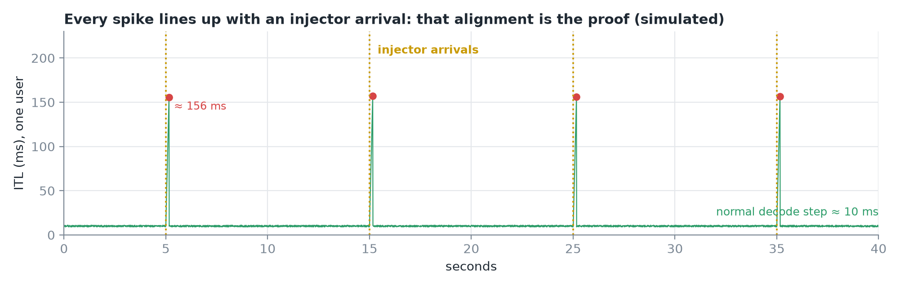
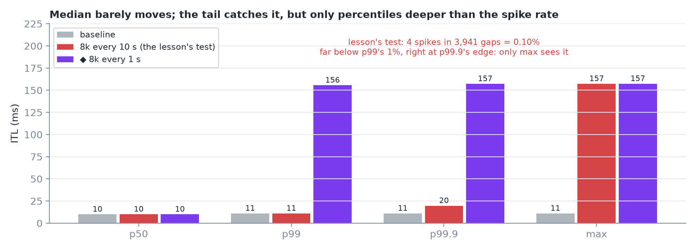
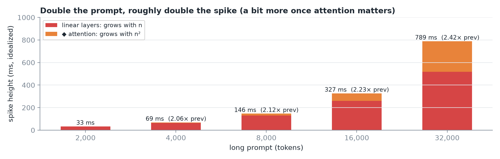
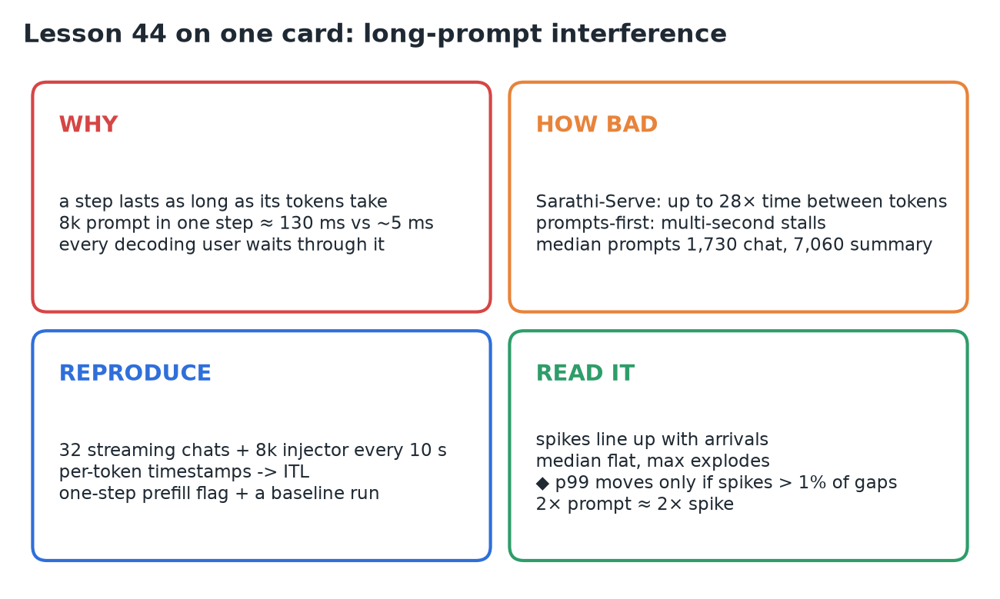

# 44 · Reproduce the Long-Prompt Interference Problem

**Source:** [fanout.sh / inference-eng / 10-01](https://fanout.sh/inference-eng/curriculum/10-01) · ~4.5 min

> [!NOTE]
> Every running request gets one token per step, and a step lasts as long as its work takes. A decode-only step is a few milliseconds, but an **8,000-token prompt processed in one step** is ≈ **8,000 × 16 GFLOP ≈ 130 ms**, and every user mid-answer waits through it. **Sarathi-Serve** measured time between tokens up to **28×** a decode-only step. Reproduce it with **32 streaming chats**, an **injector** sending one 8k prompt every 10 s, **per-token timestamps**, a one-step-prefill setting and a baseline run. The spikes line up with arrivals; the median stays flat while the tail explodes.

## 1. Why one prompt pauses everyone

*Drawn to scale: six 5 ms decode steps, then one 130 ms step that carries the whole prompt.*

- Thirty users are streaming smoothly. One pastes a long document and asks for a summary. **Every other stream freezes**, though nobody else did anything different. That's **long-prompt interference**.
- A step gives **every running request one token**, and it lasts **as long as its work takes**.
- Decode-only steps are short: a few milliseconds for Llama 3.1 8B.
- An **8,000-token prompt** gets processed **all in one step**, and every user mid-answer is stuck in that same step: **one request's prompt became everyone's pause**.

*◆ The decode bar (weights ÷ bandwidth) and the attention segment are my arithmetic, not the lesson's.*

$$8{,}000\ \mathrm{tokens} \times 16\ \mathrm{GFLOP} = 128\ \mathrm{TFLOP} \quad \Rightarrow \quad \frac{128\ \mathrm{TFLOP}}{989\ \mathrm{TFLOPS}} \approx 130\ \mathrm{ms}$$

- That's at **peak math, before attention** (idealized). ◆ Causal attention over 8k tokens adds ≈ 17 ms, so ≈ **146 ms**: about the ≈ 150 ms spikes the lesson's trace shows.

> [!TIP]
> ◆ 130 ms ÷ 4.8 ms ≈ **27×** a decode step, which is right in line with Sarathi-Serve's measured 28×.

## 2. How bad it gets in real systems

*Numbers from the Sarathi-Serve paper (OSDI '24).*

- Mixing a long prefill into a decode batch made the **time between tokens up to 28×** a decode-only step.
- Schedulers that ran **every waiting prompt first** stalled ongoing answers for **several seconds**.
- Long prompts aren't rare: median prompt ≈ **1,730 tokens** in chat traces, ≈ **7,060** for summarization. With real traffic these stalls are a **regular event**.

## 3. Reproduce it on your own server

*The background lanes are illustrative; the injector fires at 5, 15, 25 and 35 s.*

- **Background load:** 32 streaming chats, **short prompts, long answers**.
- **Injector:** one **8,000-token** prompt every **10 s**.
- **Token logger:** timestamp every token each background user receives. The gap between two consecutive tokens is the **inter-token latency (ITL)**.
- **Force one-step prefill:** newer vLLM **chunks prompts by default**, so set `--max-num-batched-tokens` at least as large as the long prompt (the lesson uses **16384**).
- **Baseline:** the same test with the injector **off**.

## 4. Read the results

*Simulated with ~10 ms decode steps and the ≈ 146 ms prefill from section 1.*

- Most gaps sit at the normal decode step. Every 10 s there's a **tall spike, lined up exactly with an injector arrival**. That alignment is the **proof** the long prompts cause the stalls.

*Percentiles from the same simulation. ◆ The "every 1 s" run is mine.*

- The **median barely moves** versus baseline: most steps are still normal.
- The tail and the **maximum** shoot up. That's the signature: **averages look fine, the tail is terrible**.

> [!WARNING]
> The lesson says **p99** shoots up, but its own test doesn't produce that. With ~10 ms steps over 40 s, each user sees about **3,940 gaps** and only **4** are spikes: **0.1%**, far below the 1% that p99 looks at. So p99 stays at baseline and **only the max** (and p99.9, just barely) shows it. To make p99 move, the spikes must be **more than 1% of gaps**, for example an injector every 1 s. When you reproduce this, report **max and p99.9**, or the stall **count**.

*◆ Idealized FLOP model: linear layers plus causal attention at H100 peak.*

- **Double the prompt, and the spikes roughly double too.** ◆ Slightly more than 2× once attention's n² term grows: 2.12× from 4k to 8k, 2.23× from 8k to 16k.

## 5. Recap

