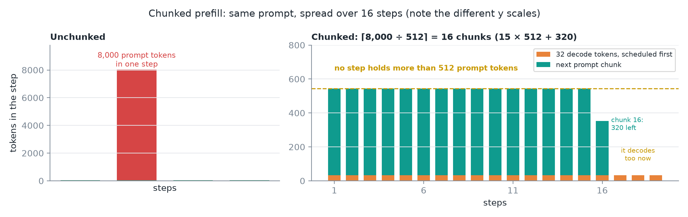
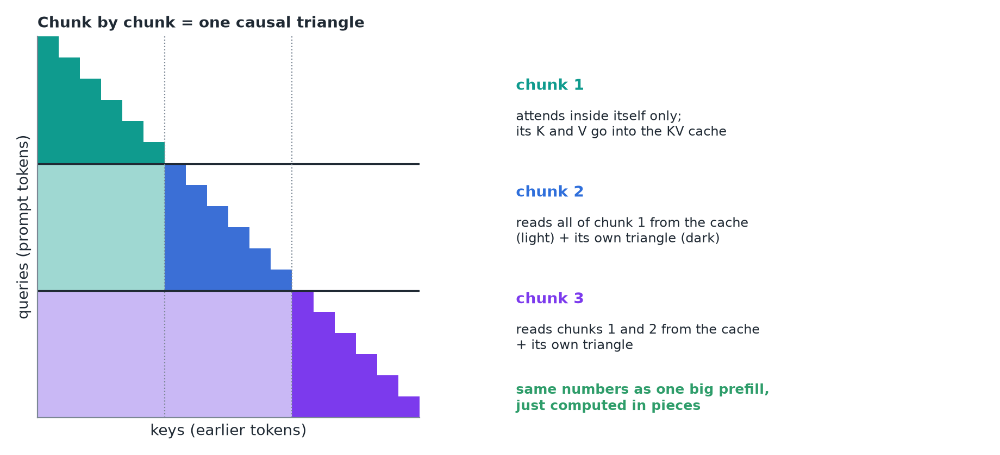
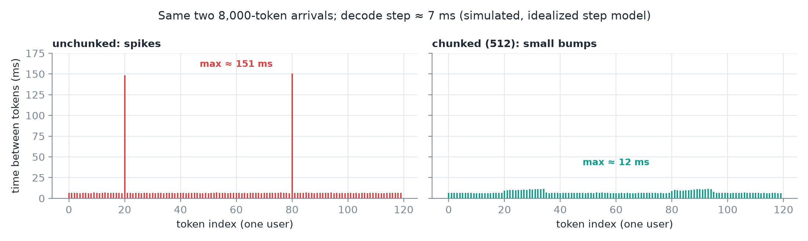
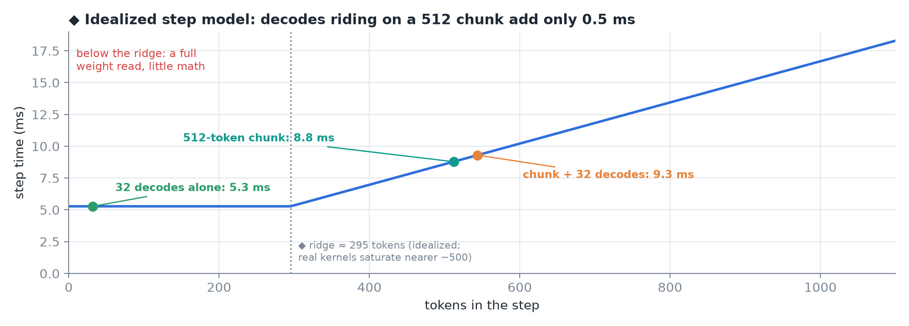
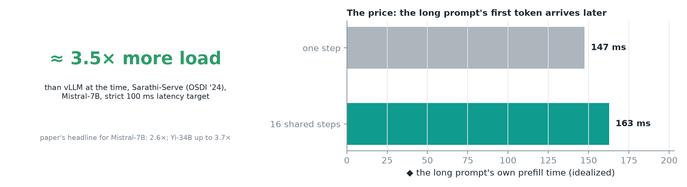
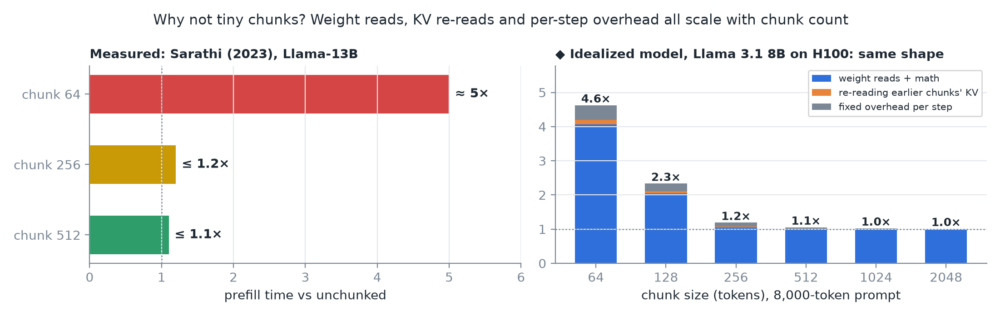
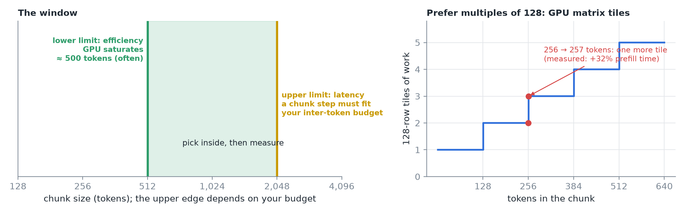
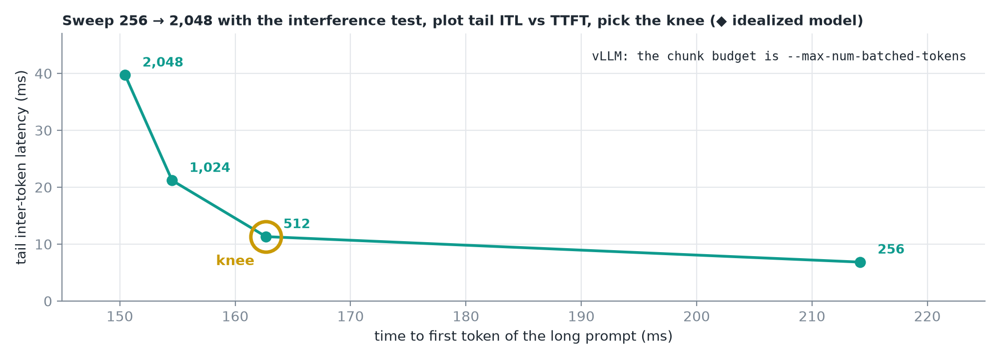
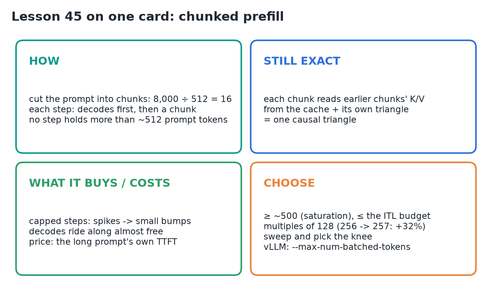

# 45 · Chunked Prefill & Choosing the Chunk Size

**Source:** [fanout.sh / inference-eng / 10-02](https://fanout.sh/inference-eng/curriculum/10-02) · ~5.5 min

> [!NOTE]
> Don't process a long prompt in one step: **cut it into chunks** and spread them over several steps, with every running request's **decode token scheduled first**. An 8,000-token prompt in chunks of 512 takes **16 steps**, and no step holds more than ~512 prompt tokens. The chunked attention mask makes it **exactly equivalent** to one big prefill. Steps are capped, so ITL spikes collapse to small bumps, and decodes **ride along almost free**; the price is the long prompt's own TTFT. Chunks that are too small waste the GPU (64 tokens ≈ **5×** slower prefill), and chunks that are too big bring the spikes back: stay **≥ ~500**, under your ITL budget, in **multiples of 128**, then sweep and pick the knee.

## 1. How it works

*Tokens per step. The last chunk holds the remaining 320 tokens; then the prompt starts decoding like everyone else.*

$$\frac{8{,}000}{512} = 15.6 \quad \Rightarrow \quad 16\ \mathrm{chunks} = 15 \times 512 + 320$$

- Build every step the same way: **first, every running request gets its one decode token**; then **top the step up** with the next chunk of the long prompt.
- Sixteen steps later the prompt is fully processed. **No step is ever long**.

## 2. Why it stays exactly right

*Three chunks of six tokens. Light cells are keys read back from the KV cache.*

- Chunk 1's tokens attend to earlier tokens **inside chunk 1**; its K and V are then **saved in the KV cache**.
- Chunk 2 attends to **all of chunk 1** (read from the cache) plus earlier tokens in chunk 2. Chunk 3 sees chunks 1 and 2, and so on.
- Put together, that's the **same causal triangle** as processing the prompt all at once: **same numbers, computed in pieces**.

## 3. What it buys, and what it costs

*◆ Simulated with an idealized step model (Llama 3.1 8B on H100, 32 decodes): spikes of ~150 ms become bumps of ~12 ms.*

- Each step is **capped**, so the huge ITL spikes **collapse to small bumps**.

*◆ The same idealized model: step time is the slower of reading the weights or doing the math.*

- **Bonus:** a ~500-token chunk already **keeps the math units busy**, so the decode tokens riding along cost almost nothing extra. They **piggyback** on work the GPU was doing anyway.

*◆ The prefill times are from the idealized model; the lesson only says "a bit later".*

- **Sarathi-Serve**, which popularized this approach, served **≈ 3.5× more load** than vLLM did at the time (Mistral-7B, strict **100 ms** latency target). The paper's abstract gives **2.6×** for Mistral-7B and up to **3.7×** for Yi-34B; 3.5× is probably one workload's bar.
- **The price** is paid by the **long prompt itself**: its prefill is spread over 16 steps it shares with others, so **its own first token arrives a bit later**.

## 4. Why not tiny chunks?

*Left: Sarathi (2023), Llama-13B. ◆ Right: my idealized model gives the same shape, 4.6× at 64 tokens; for an 8k prompt the weight re-reads dominate.*

Three reasons:

- **Small chunks leave the GPU idle.** Below a few hundred tokens a step is **limited by reading the weights**: you pay for a full read and get little work done.
- **Every chunk re-reads the K/V of all chunks before it.** Chunk 2 reads chunk 1, chunk 3 reads 1 and 2, and it keeps growing: **more chunks, more re-reading**.
- **Fixed overhead every step:** scheduling and kernel launches.

In the original Sarathi experiments, chunks of **64** made prefill about **5× slower**; **256** and **512** stayed within about **20%** and **10%**.

## 5. Choosing the chunk size

*The 2,048 upper edge is illustrative; yours comes from your ITL budget.*

- **Upper limit, from latency:** the step carrying a chunk must still finish **within your inter-token budget**.
- **Lower limit, from efficiency:** stay at or above where the GPU **saturates**, often **around 500 tokens**.
- **Prefer multiples of 128**: GPU matrix tiles come in that size. One study found **256 → 257 tokens made prefill 32% slower**.

*◆ Points come from the idealized model; on real hardware, measure.*

- **Then measure:** rerun the long-prompt interference test at chunk sizes from **256 to 2,048**, plot **tail ITL vs TTFT**, and **pick the knee**.
- In vLLM the chunk budget is **`--max-num-batched-tokens`**.

## 6. Recap

