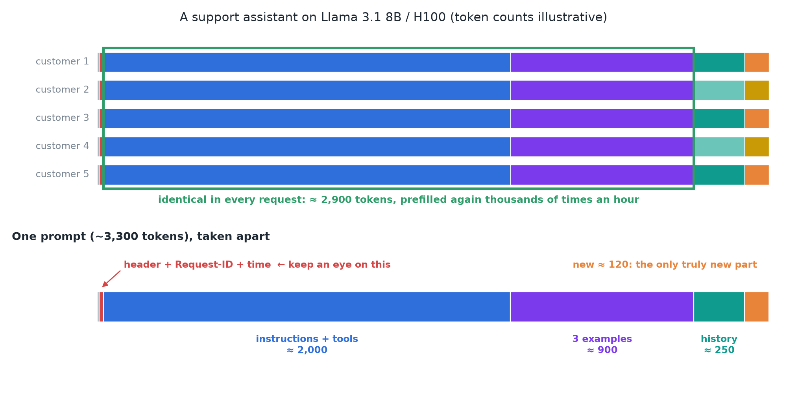
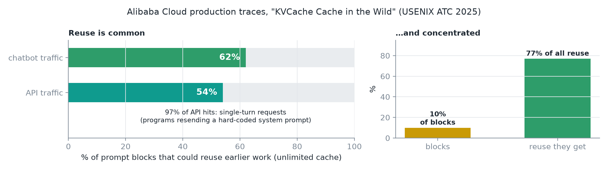
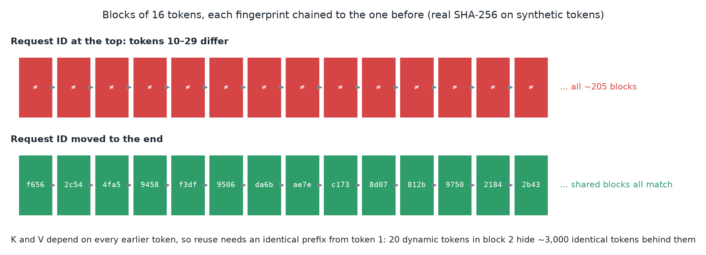
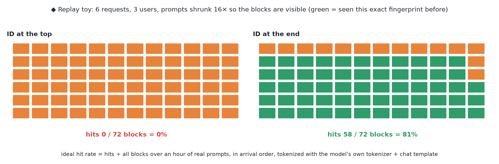
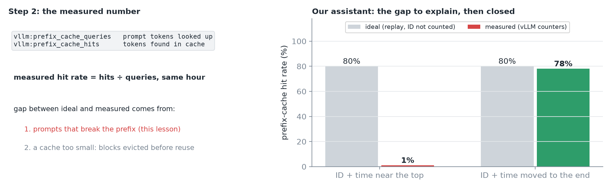
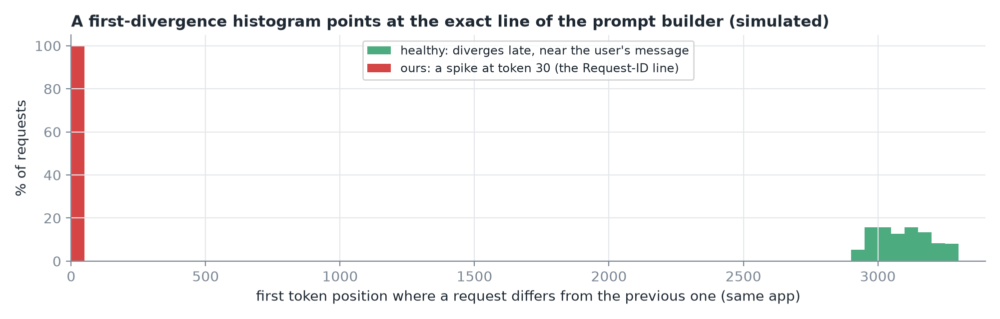
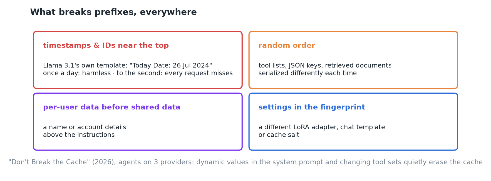
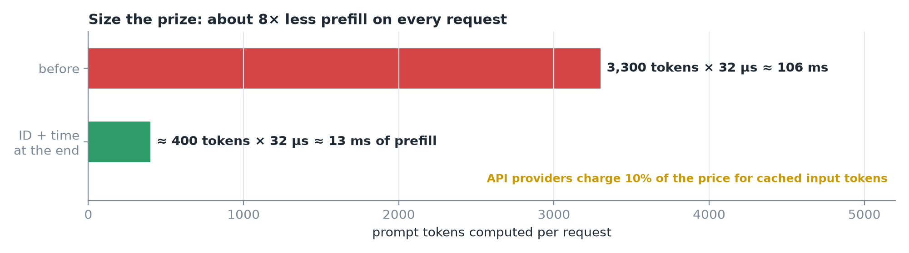
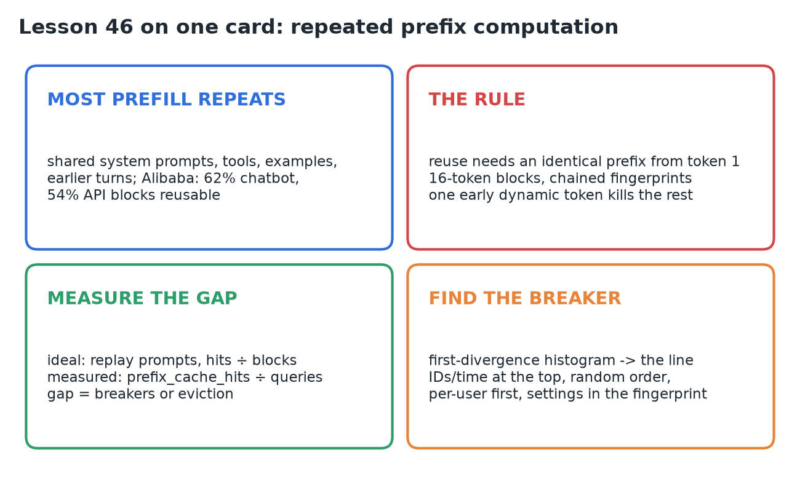

# 46 · Find Repeated Prefix Computation

**Source:** [fanout.sh / inference-eng / 10-04](https://fanout.sh/inference-eng/curriculum/10-04) · ~7 min

> [!NOTE]
> Most prefill in real traffic is **repeated work**: shared system prompts, tool definitions, examples and earlier turns (Alibaba's traces: **62%** of chatbot blocks, **54%** of API blocks reusable). But cached K/V can only be reused for an **identical prefix from the very first token**, checked in **16-token blocks with chained fingerprints**, so 20 dynamic tokens near the top make 3,000 identical tokens behind them unreusable. Replay your prompts for the **ideal** hit rate, read the **measured** rate from vLLM's `prefix_cache_hits ÷ prefix_cache_queries`, and explain the gap; a **first-divergence histogram** points at the exact line that breaks the prefix. Our assistant: **1% → 78%** by moving one line, cutting prefill **105 → 13 ms** per request.

## 1. The same prefill, thousands of times an hour

*Five customers' prompts share ≈ 2,900 tokens; only the last ~120 are truly new.*

- A support assistant on an H100: every request sends **~3,300 prompt tokens**, and the GPU prefills all of them.
- Taken apart: the chat template's **header**, **instructions + tool schemas ≈ 2,000**, **three worked examples ≈ 900**, the **conversation so far ≈ 250**, then the **new question ≈ 120**.
- Everything above the new question has been sent before, by this user or by everyone.
- One more line near the very top: a **request ID and the current time**.

## 2. Real traffic looks like this too

*"KVCache Cache in the Wild", USENIX ATC 2025: production traces from Alibaba Cloud's LLM service.*

- With unlimited memory, **62%** of prompt blocks in chatbot traffic could reuse earlier work; **54%** in API traffic.
- In API traffic, **97% of hits came from single-turn requests**: programs sending the same hard-coded system prompt, often many times a second.
- Reuse is **concentrated**: **10% of blocks** account for **77% of all reuse**.

## 3. The strict rule: identical prefix, from token 1

*◆ Real chained hashes on synthetic tokens; vLLM uses the same chaining idea.*

- A token's K and V **depend on every token before it**, so cached work is only valid for an **identical prefix from the very first token**.
- vLLM checks this in **blocks of 16 tokens**, each block's **fingerprint chained to the one before**.
- The request ID differs every time, so **block 2 differs**, which makes block 3 differ, and every block after it. **20 dynamic tokens in the wrong place** and ~3,000 identical tokens become impossible to reuse.

## 4. Measure what you're leaving on the table

*◆ My toy replay: the same counting procedure on shrunken prompts.*

**Step 1, the ideal hit rate:**

- Take **an hour of real prompts in arrival order**, tokenized with the **model's own tokenizer and chat template**.
- Cut each into 16-token blocks and fingerprint them **the way the server does**, chained.
- For each block, ask "**have I seen this exact fingerprint before?**" Ideal hit rate = **hits ÷ all blocks**: what an **unlimited** cache would get on your traffic.
- Our assistant, if the request ID weren't there: about **80%**.

*Lesson's numbers: 80% ideal vs 1% measured before the fix, 80% vs 78% after.*

**Step 2, the measured hit rate:** vLLM exports **`vllm:prefix_cache_queries`** (prompt tokens looked up) and **`vllm:prefix_cache_hits`** (tokens found). Divide hits by queries over the same hour. Our assistant gets about **1%**.

The gap has two sources: **prompts that break the prefix** (this lesson), or a cache **too small**, evicting blocks before they're reused.

> [!WARNING]
> ◆ The 80% is only "ideal" if you replay with the request ID **left out**. Replay the prompts exactly as sent, fingerprinted like the server, and the ID breaks them in the replay too: you'd get ≈ 1%, the same as measured. So read the two numbers this way:
>
> - **Ideal low** (on prompts as sent): the prompts break the prefix. Find the line with the histogram below.
> - **Ideal high but measured low:** eviction, or a setting the replay didn't copy.

## 5. Find where prompts break

*Simulated distributions; the lesson's is illustrative too.*

- Compare each request with **the previous one from the same app** and record the **first token position where they differ**. Plot the histogram.
- **Healthy** traffic diverges **late**, near the user's message, a few thousand tokens in.
- Our assistant has a **tall spike at position 30**: the request ID. The spike tells you **which line of your prompt builder** to look at.

*The same handful of things break prefixes everywhere.*

- Even **Llama 3.1's own chat template** puts today's date in its header: harmless once a day, disastrous with seconds.
- A study of prompt caching in agents ("Don't Break the Cache", 2026) found the same: **dynamic values in the system prompt** and **changing tool sets** quietly erase the cache.

## 6. Size the prize

*Move the request ID and time to the end of the prompt; ideal and measured come together (80% and 78%).*

$$3{,}300 \times 32\ \mathrm{\mu s} \approx 105\ \mathrm{ms} \quad \Rightarrow \quad 400 \times 32\ \mathrm{\mu s} \approx 13\ \mathrm{ms}$$

- Each request now computes about **400 new tokens instead of 3,300**: ≈ **105 → 13 ms** of prefill, on every request.
- API providers charge **a tenth of the price** for cached input tokens. That's how real the saving is.

> [!TIP]
> ◆ 32 µs per prompt token is about 2× the 16 µs that 16 GFLOP takes at H100 peak, which means roughly 50% of peak FLOPs in practice.

## 7. Recap

