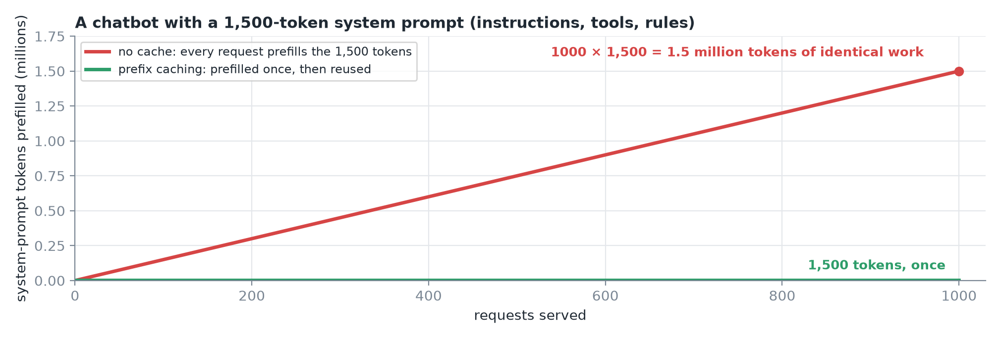
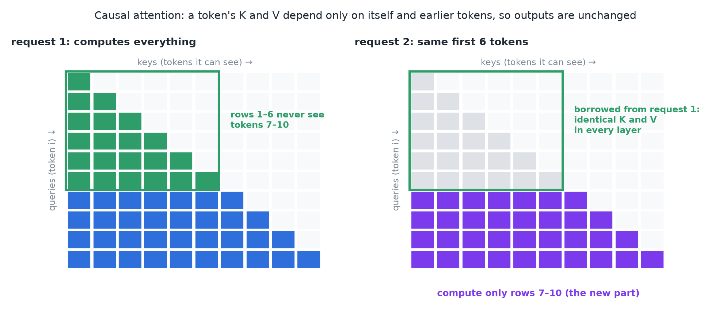
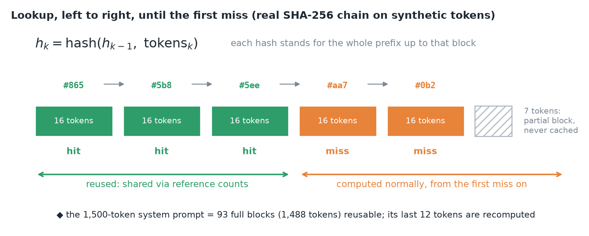
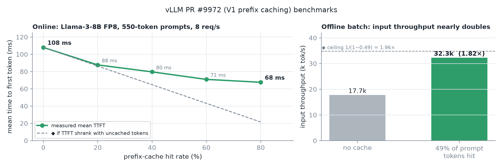
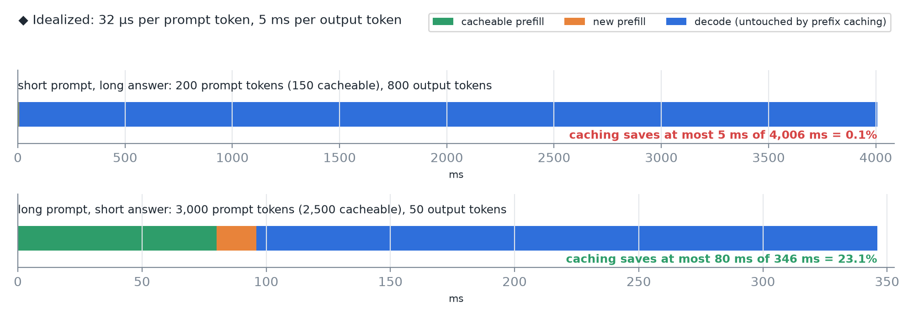
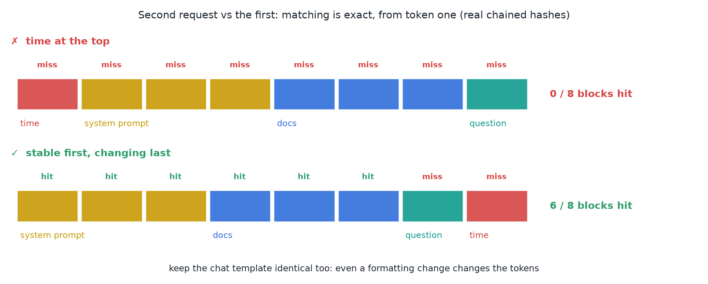
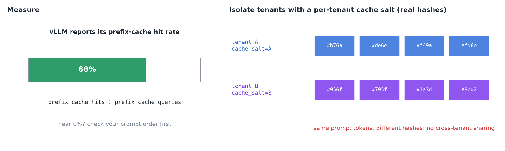
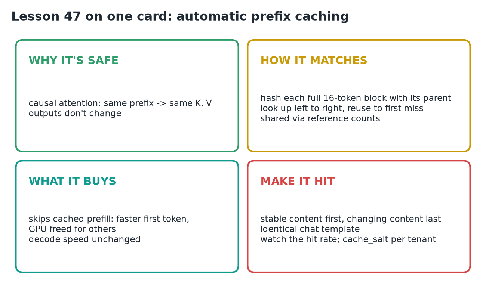

# 47 · Automatic Prefix Caching

**Source:** [fanout.sh / inference-eng / 10-05](https://fanout.sh/inference-eng/curriculum/10-05) · ~5 min

> [!NOTE]
> Causal attention means an **identical prefix produces an identical KV cache**, so a request can borrow another's K and V for the shared start and compute only what's new, with unchanged output. vLLM finds matches by **hashing each full 16-token block together with its parent's hash** and reusing blocks **up to the first miss**. Hits skip prefill: in vLLM's benchmark, mean TTFT fell **108 → 68 ms at 80% hits**, but **decode speed is unchanged**. Matching is exact from token one, so put **stable content first, changing content last**, and watch the hit rate.

## 1. Identical work, every request

*Without caching, the shared system prompt is prefilled from scratch on every request.*

- A chatbot's **1,500-token system prompt** (instructions, tools, rules) starts every request.

$$1000\ \mathrm{requests} \times 1{,}500\ \mathrm{tokens} = 1.5\ \mathrm{million\ tokens\ of\ identical\ work}$$

- **Automatic prefix caching** does that work once and reuses it.

## 2. Why reuse is safe: causal attention

*Rows are query tokens, columns the tokens each can attend to; the shared prefix rows never see the suffix.*

- A token's keys and values depend **only on that token and the tokens before it**, never on what comes after.
- Two prompts with the same exact start therefore have **identical K and V** for that start, in every layer.
- Request 2 **borrows** request 1's cache for the shared part and computes only the new part. **The model's output doesn't change at all.**

## 3. Finding a shared prefix fast

*Hash chain over 16-token blocks; reuse stops at the first miss.*

- vLLM works **one KV block at a time, 16 tokens each**, and fingerprints every **full** block:

$$h_k = \mathrm{hash}(h_{k-1},\ \mathrm{tokens}_k)$$

- Because each hash includes its parent's, **one hash stands for the entire prefix** up to that block, not just its 16 tokens.
- On arrival, the engine hashes the prompt block by block and looks each hash up **left to right**: hit, hit, hit, **first miss**. Everything before the miss is reused; everything from the miss on is computed normally.
- **Only full blocks are cached**, so reuse comes in **steps of 16 tokens**; a trailing partial block is never cached.
- Matched blocks are shared through **reference counts**, the same sharing mechanism as copy-on-write blocks.

## 4. What it buys, and what it doesn't

*vLLM PR #9972: the lesson cites the 0% and 80% points; ◆ the middle points and the dashed lines are from the same PR table or my own arithmetic.*

- Prefill for the cached part is **skipped**: the first token arrives sooner and the GPU has **more time for everyone else**.
- **Online** (Llama-3-8B FP8, **550-token prompts, 8 req/s**): mean TTFT **≈ 108 ms at 0% hits → ≈ 68 ms at 80% hits**.
- **Offline**, with about **half** the prompt tokens hitting: input throughput **nearly doubled** (17.7k → 32.3k tok/s, **1.82×**).

> [!TIP]
> ◆ TTFT fell 37%, not 80%. Some of the time to first token doesn't shrink with fewer prompt tokens: scheduling, the uncached tail, and sampling the first token. The offline gain sits close to its ceiling of 1/(1 − 0.49) ≈ 1.96×, because a batch job is almost all prefill. The same PR also shows mean time per output token dropping from 29 to 25 ms at 80% hits. Decode itself isn't faster; there's simply less prefill competing with it.

*◆ Idealized per-request time for two workload shapes.*

- Prefix caching **doesn't make decoding faster**. For **short prompts with long answers**, it barely helps.

## 5. The catch: matching is exact, from token one

*Same second request, two orderings: a dynamic block at the front makes every later hash differ.*

> [!WARNING]
> Change **one token near the start** and every hash after it changes, because each hash includes the one before. A **timestamp or a user name at the top** silently breaks caching for everything below it.

The rule:

- **Stable first:** system prompt, tool definitions, long documents.
- **Changing last:** the user's question, the current time.
- Keep the **chat template identical** across requests; even formatting changes the tokens.

## 6. Measure, and isolate tenants

*The 68% is illustrative. Salted hashes: the same tokens give different fingerprints per tenant.*

- vLLM reports its **prefix cache hit rate**, so you can check caching is really happening.
- If customers must **never share cache**, give each tenant a **`cache_salt`**: it's mixed into the hashes, so identical prompts from different tenants never match.

## 7. Recap

