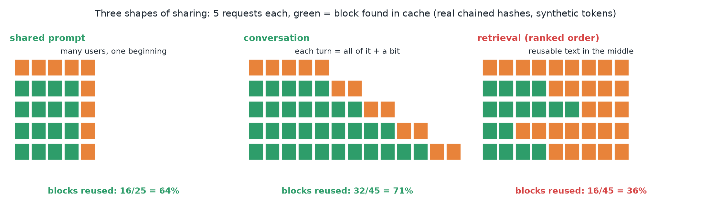
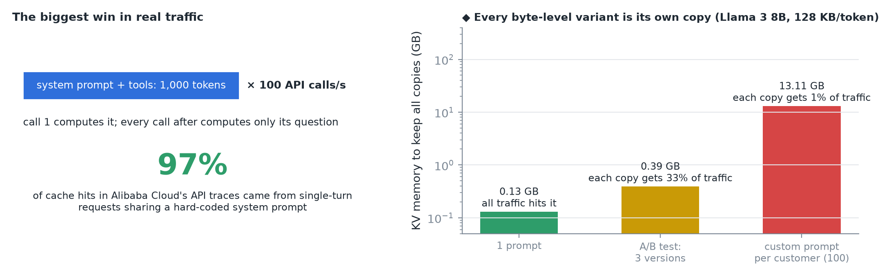
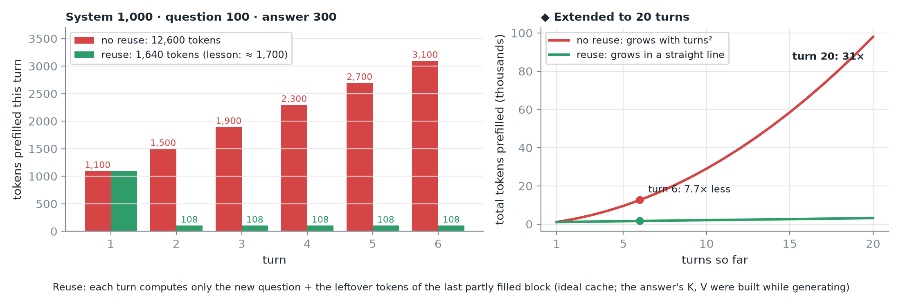
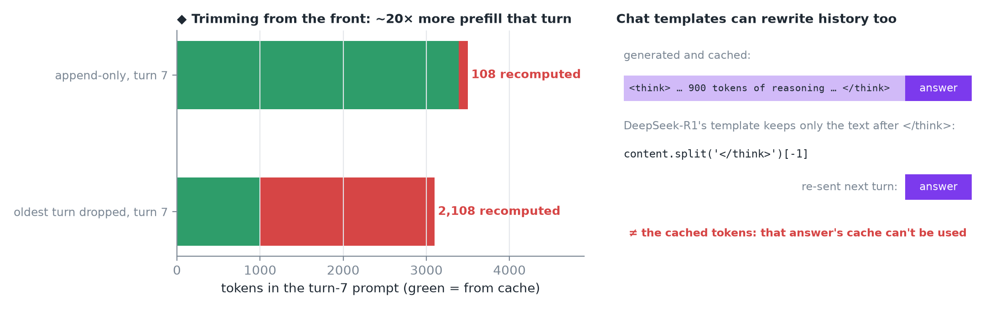
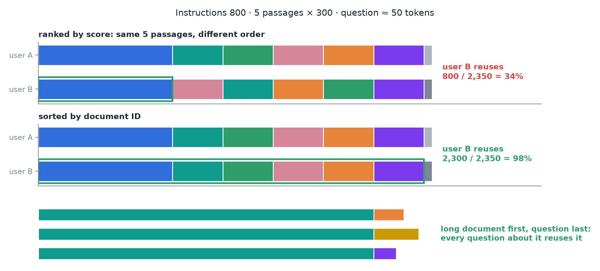
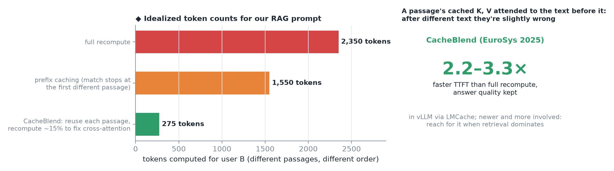
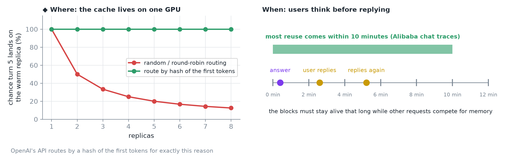
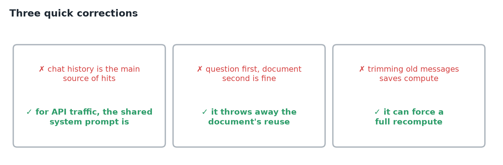
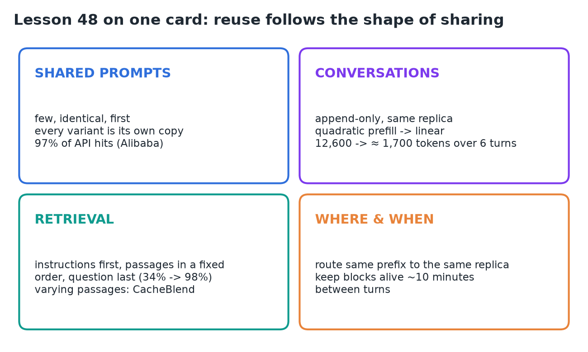

# 48 · Shared Prompts, RAG Context & Multi-Turn Reuse

**Source:** [fanout.sh / inference-eng / 10-06](https://fanout.sh/inference-eng/curriculum/10-06) · ~8 min

> [!NOTE]
> Prefix-cache reuse follows the **shape of how requests share text**. **Shared prompts** (many users, one beginning) are the biggest win: **97%** of hits in Alibaba's API traces, as long as the prompt stays byte-identical. **Conversations** re-send everything each turn; reuse turns **quadratic prefill into linear** (12,600 → ≈ 1,700 tokens over 6 turns) if history stays **append-only** on the **same replica**. **Retrieval** fights prefix caching because the reusable passages sit in the middle: sort them into a **fixed order** (34% → 98% reused), and when they vary, blend caches with **CacheBlend**.

## 1. Three shapes of sharing

*◆ Toy replay of each shape; the lesson's point is the verdict, not the exact percentages.*

- **Shared prompt:** many different users, one identical beginning.
- **Conversation:** each turn repeats the whole conversation so far and adds a little on the end.
- **Retrieval:** the reusable text (documents) sits **in the middle** and changes from query to query.
- The first two fit prefix caching naturally. **The third fights it.**

## 2. Shape 1: the shared prompt

*Left: the lesson's example. Right ◆: KV memory per copy, at 32 layers × 8 KV heads × 128 dims × 2 (K, V) × 2 bytes = 128 KB per token.*

- A **1,000-token** system prompt with tools, called **100 times a second**: the first call computes it, every later call computes only its own question.
- It's the **biggest win in real traffic**: in Alibaba Cloud's API traces, **97% of all cache hits** came from single-turn requests sharing a hard-coded system prompt.
- The prompt must be **identical, byte for byte**. An A/B test with **3 versions** keeps **3 copies, each with a third of the traffic**. A custom prompt per customer splits the tree into **one branch per customer**.

> [!IMPORTANT]
> Keep shared prompts **few, stable, and at the very front**.

## 3. Shape 2: the conversation

*Ideal cache. ◆ My block arithmetic gives 1,640 tokens; the lesson rounds to ≈ 1,700.*

Every turn re-sends the system prompt, every question, every answer, and the new message. With a system prompt of 1,000 tokens, questions of 100 and answers of 300:

$$\mathrm{turn}\ n = 1{,}000 + 100n + 300(n-1) \quad \Rightarrow \quad 1{,}100,\ 1{,}500,\ \ldots,\ 3{,}100$$

$$\mathrm{no\ reuse:}\ 1{,}100 + 1{,}500 + 1{,}900 + 2{,}300 + 2{,}700 + 3{,}100 = 12{,}600\ \mathrm{tokens}$$

- Without reuse, prefill **grows with the square of the number of turns**.
- With reuse, turn 2 finds all of turn 1 cached, **including the answer the model just wrote**: its K and V were computed while generating.
- Each new turn computes only the **new message plus a few leftover tokens** from the last partly filled block: **≈ 1,700 tokens total, ≈ 7× less**, growing in a straight line.

> [!TIP]
> ◆ Where the leftover comes from: after turn n the conversation is 1,000 + 400n tokens long, which always leaves 8 tokens in a partial block. So each turn costs 100 + 8 = 108 tokens, and six turns cost 1,100 + 5 × 108 = 1,640. By turn 20, the gap is 31×.

## 4. How conversations break the cache

*Left ◆: the lesson's conversation at turn 7, with the system prompt's 62 full blocks still cached after the trim.*

- **Trimming from the front** is the worst: dropping the oldest message changes the first tokens after the system prompt, so **the whole conversation is recomputed**.
- **Summarizing or editing** earlier turns does the same, from the edit onward.
- **Chat templates** can do it too: **DeepSeek-R1's** template strips the thinking from earlier answers when it rebuilds the history, so the re-sent text no longer matches what the model generated, and **that answer's cache can't be used**. Fine if you expect it; a surprise if you don't.

> [!TIP]
> ◆ The R1 template only costs the latest answer, not the whole history. Older answers were already sent in stripped form last turn, so they're cached that way. Each turn recomputes the latest answer's visible text plus the new question.

> [!IMPORTANT]
> Keep history **append-only** as long as you can. When you must shorten it, cut in a way that **keeps the start intact**. ◆ For example, trim a big chunk rarely instead of one message every turn, so you pay the recompute once.

## 5. Shape 3: retrieval, the hard case

*Question ≈ 50 tokens is implied by the lesson's 34%.*

- Prompt: **800 tokens of instructions, 5 passages × 300, then the question**.
- Two users get the **same five passages in a different rank order**. Matching runs from the start: instructions match, then passage 1 vs passage 3, and it stops. **Only ≈ 34% is reused**.
- **Sort passages into a fixed order** (by document ID, not score) and almost the whole prompt lines up: **≈ 98% reused**.
- Same idea for long-document Q&A: **document first, question last**, and every question about that document reuses it.

## 6. Beyond the prefix: CacheBlend

*◆ Token counts are my idealization of the lesson's RAG prompt; 15% is LMCache's example setting.*

- Usually two queries retrieve **different sets** of passages. A passage that appears after different text **can't be reused by prefix caching at all**.
- Why: a passage's cached K and V were computed **while attending to the text before it**. After different text, they're **slightly wrong**.
- **CacheBlend** (EuroSys 2025) reuses each passage's cache anyway and **recomputes a small share of tokens** (≈ 15% in LMCache's example) to fix the cross-attention: **TTFT 2.2–3.3× faster** than full recompute, without losing answer quality.
- Available in vLLM through **LMCache**. Newer and more involved than prefix caching: reach for it **when retrieval dominates** your prompts.

## 7. Where, and when

*Left ◆: with random routing, turn 5 finds its cache with probability 1/N.*

- **Where:** the cache lives **on one GPU**. If turn 5 lands on a different replica, it starts cold. **Route requests that share a prefix to the same place**; OpenAI's API routes by a **hash of the first tokens** for exactly this reason.
- **When:** users think before replying. In Alibaba's chat traffic, **most reuse came within 10 minutes**, so the cache must keep those blocks alive that long while other requests compete for memory.

*The lesson's three corrections.*

## 8. Recap

