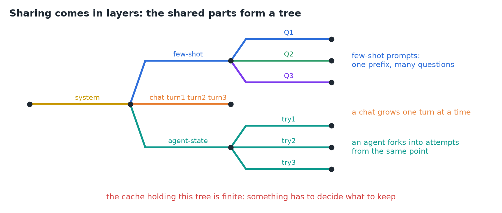
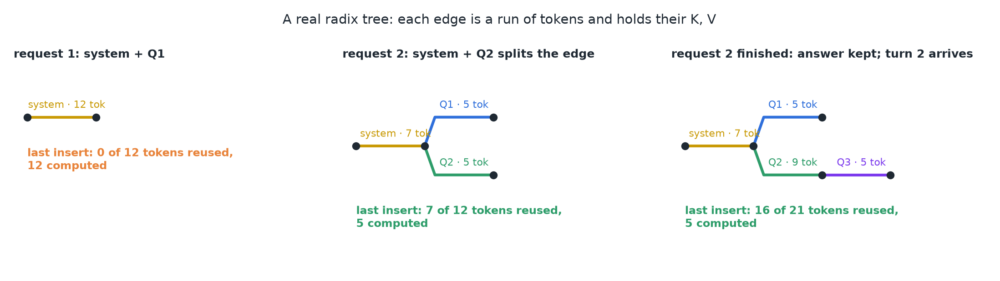
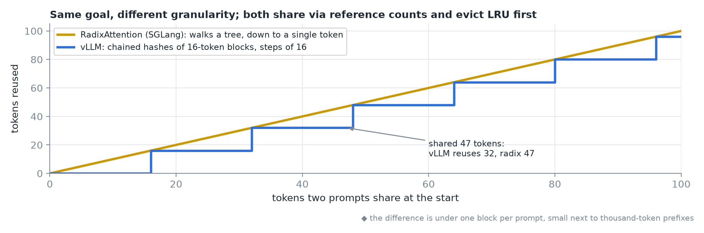
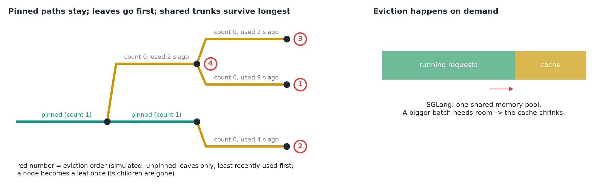
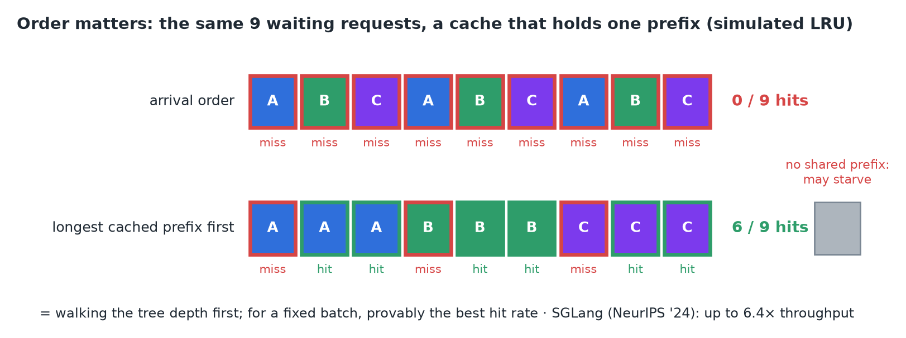
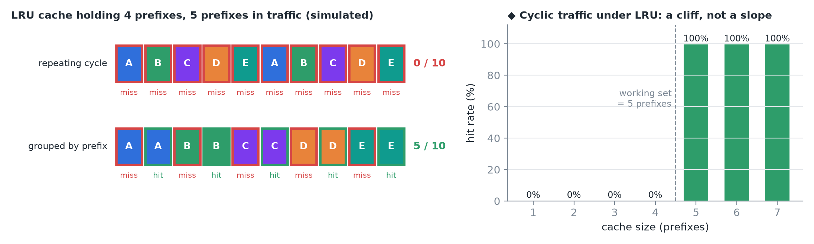
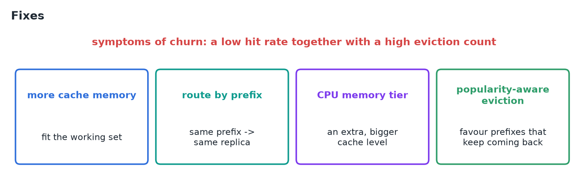
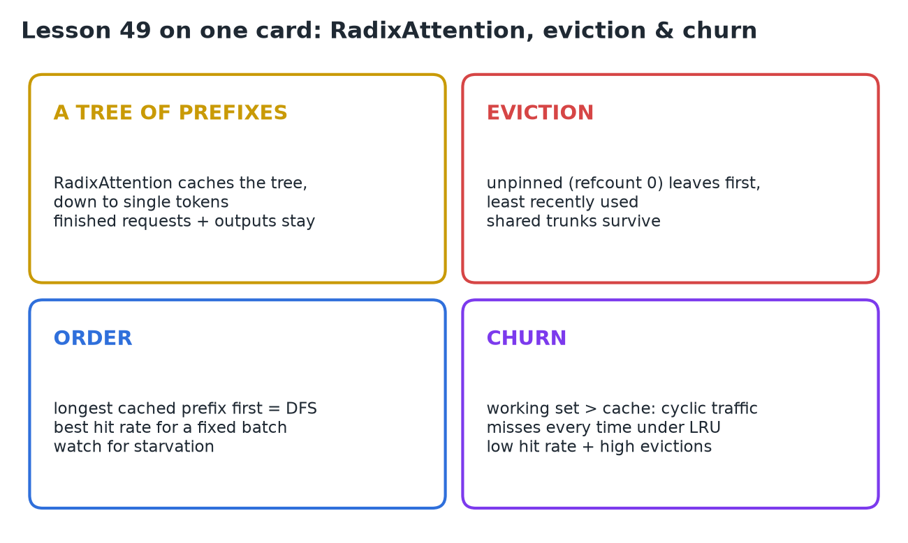

# 49 · RadixAttention, Eviction & Cache Churn

**Source:** [fanout.sh / inference-eng / 10-07](https://fanout.sh/inference-eng/curriculum/10-07) · ~6 min

> [!NOTE]
> Real prompts share **in layers**, so the shared parts form a **tree**. **RadixAttention** (SGLang) caches that tree in a radix tree whose edges hold token runs and their K, V, matching **down to a single token**; finished requests, outputs included, stay for the next turn. The cache is finite: SGLang evicts **unpinned, least recently used leaves first**, so shared trunks survive longest, and serving the **longest cached prefix first** walks the tree depth-first for the best hit rate (up to **6.4×** throughput reported). When the working set outgrows the cache, LRU can **churn**: 5 prefixes cycling through room for 4 gives **0 hits in 10**.

## 1. Sharing comes in layers

*One radix tree holding all three patterns; the chat's turns compress into a single edge until something branches off it.*

- A system prompt, then a few examples, then different questions.
- A chat that grows one turn at a time.
- An agent that forks into several attempts from the same point.
- The shared parts form a **tree**, and the cache holding it is **finite**: something has to decide what to keep.

## 2. RadixAttention: caching the tree

*◆ Built by a ~30-line radix tree on word tokens; the counts are its real output.*

- From the **SGLang** project. Cached K and V live in a **radix tree**: each **edge is a run of tokens** and holds those tokens' KV cache.
- Request 1 (system prompt + Q1) becomes **a single path** from the root.
- Request 2 shares the system prompt but asks Q2. The lookup walks down **token by token until the tokens differ**; there the edge **splits** into a shared part and two branches. The shared part is reused; only Q2 is computed.
- When a request finishes, its **whole path, including the generated answer**, stays in the tree, so the next turn finds its entire history cached.

## 3. vs vLLM's prefix caching

*Tokens reused as a function of shared prefix length.*

| | vLLM | SGLang RadixAttention |
|---|---|---|
| Structure | chained hashes of blocks | radix tree |
| Match granularity | steps of **16 tokens** | down to **a single token** |
| Sharing | reference counts | reference counts |
| Eviction | least recently used first | least recently used first |

- Same goal: **reuse any shared prefix, automatically**.

## 4. Eviction

*◆ The order numbers come from simulating the rules below on this tree.*

- In SGLang, the cache and the running requests share **one memory pool**. When a bigger batch needs room, **the cache shrinks**.
- Some nodes can never be evicted: every running request **pins its path with a reference count**. Only nodes with **count 0** are candidates.
- **Only leaves go first**, and among them the **least recently used** leaf is evicted.
- When all of a node's children are gone, it becomes a leaf and can be evicted later. So **shared trunks survive the longest**, which is exactly what you want.

## 5. Order matters

*◆ Simulated LRU cache that holds one prefix, same 9 requests in two orders.*

- Waiting requests often fall into groups sharing different prefixes. Served in **arrival order**, the cache keeps switching between groups.
- SGLang can serve the **longest cached prefix first**. That walks the tree **depth-first**, finishing one branch before the next.
- For a **fixed batch**, the paper proves this order gives the **best possible hit rate**. ◆ The theorem assumes the cache can hold at least the longest request.
- The risk is **starvation**: a request with no shared prefix can keep getting pushed back.
- SGLang (NeurIPS '24) reported **up to 6.4× the throughput** of other systems of the time, on workloads full of shared structure.

## 6. Cache churn

*Left: the lesson's example, re-simulated. Right ◆: the same cycle repeated 200 times at different cache sizes.*

- Cache with room for **4 prefixes**; **5 prefixes** arrive in a repeating cycle: A, B, C, D, E.
- E doesn't fit, so LRU evicts A. Then A returns and evicts B; B returns and evicts C… **0 hits in 10 requests**, even though every prefix repeats.
- Group the same traffic by prefix (A, A, B, B, …) and **half of them hit (5/10)**.

> [!WARNING]
> ◆ Under cyclic access, LRU always evicts exactly the prefix that's needed next. So the hit rate stays at 0% until the cache holds the whole working set, then jumps to 100%. One prefix too few costs everything.

*Symptoms and fixes, as listed in the lesson.*

## 7. Recap

