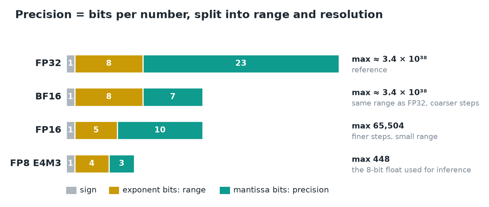
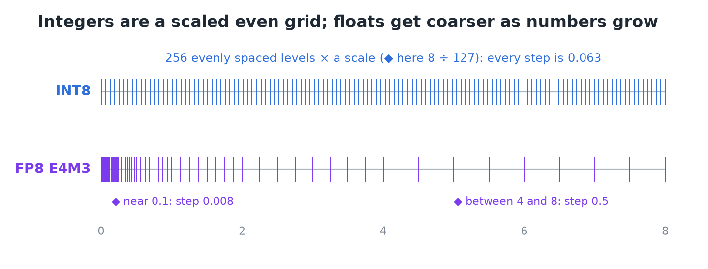
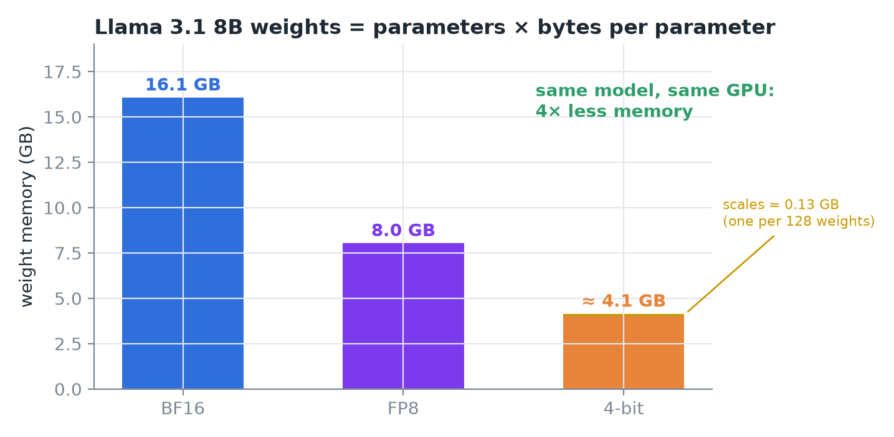
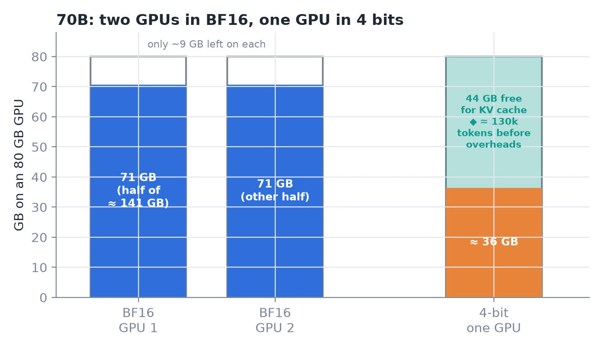
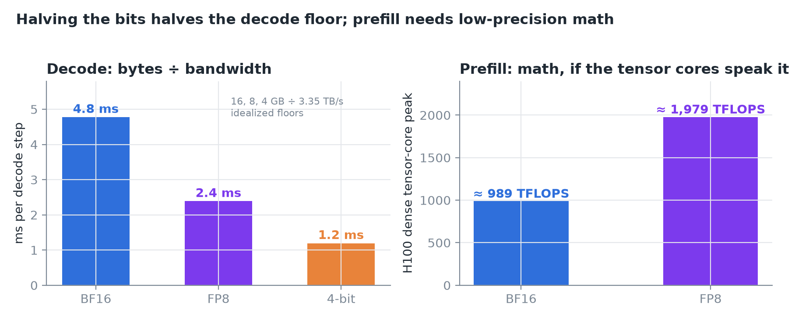
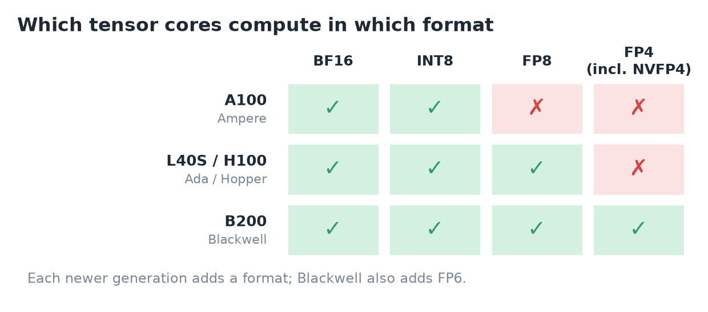
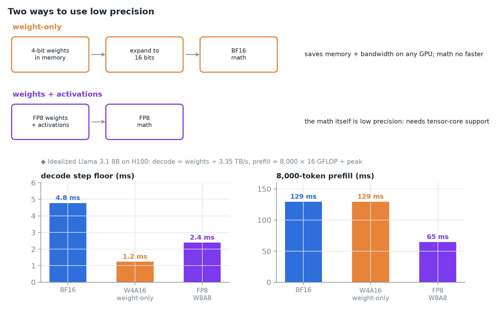
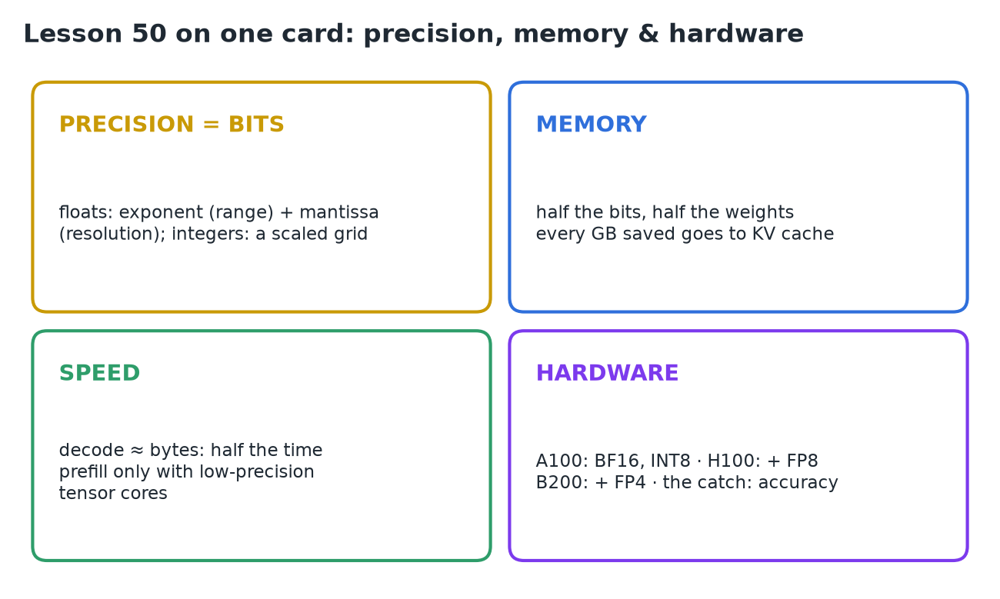

# 50 · Precision, Memory & Hardware Support

**Source:** [fanout.sh / inference-eng / 11-01](https://fanout.sh/inference-eng/curriculum/11-01) · ~5 min

> [!NOTE]
> Precision is **bits per number**: floats split them into **exponent (range)** and **mantissa (resolution)**; integers are an **even grid times a scale**. Weight memory is **parameters × bytes**, so Llama 3.1 8B goes **16 → 8 → ~4 GB** and a 70B model drops from **two GPUs to one**. Decode streams the weights, so its floor halves with the bits (**4.8 → 2.4 → 1.2 ms**); prefill is math, and only speeds up when the **tensor cores compute in that format**, which depends on the **GPU generation**. The catch is accuracy.

## 1. What precision is

*Same 1-bit sign; the formats differ in how they split the rest.*

- **Exponent bits** set how big or small a number can get: its **range**. **Mantissa bits** set how finely it's resolved: its **precision**.
- **BF16 (8 + 7):** the **same range as FP32**, just coarser steps.
- **FP16 (5 + 10):** finer, but tops out at **65,504**.
- **FP8 E4M3 (4 + 3):** the 8-bit float used for inference; largest value **448**.

*◆ Real E4M3 values between 0 and 8, against INT8 scaled so its largest level is 8.*

- **INT8** is just **256 evenly spaced levels**, plus a **scale factor** that stretches them over the numbers you actually have.
- ◆ Floats are the opposite shape: fine near zero and coarse for big values (E4M3's step is 0.008 near 0.1, but 0.5 between 4 and 8).

## 2. Memory

*◆ The scale overhead assumes one 16-bit scale per 128 weights.*

$$\mathrm{weights} = \mathrm{parameters} \times \mathrm{bytes\ per\ parameter} = 8.03 \times 10^{9} \times 2 \approx 16.1\ \mathrm{GB}$$

- Llama 3.1 8B: **16.1 GB** in BF16, **8.0 GB** in FP8, **≈ 4.1 GB** at 4 bits once you include the **scale factors**.

*◆ The even split and the token count are my arithmetic, at 320 KiB of KV per token for Llama 3 70B.*

- The effect is bigger on large models: 70B needs **≈ 141 GB** in BF16, so **two 80 GB GPUs**. At 4 bits it's **≈ 36 GB** and fits on **one**, with room left for KV cache.
- **Every gigabyte saved on weights goes to KV cache**, which means more requests running at once.

## 3. Speed

*Decode floors from bytes ÷ bandwidth; prefill from the H100's dense tensor-core peaks.*

$$t_{\mathrm{decode}} \approx \frac{\mathrm{weight\ bytes}}{\mathrm{bandwidth}} = \frac{16\ \mathrm{GB}}{3.35\ \mathrm{TB/s}} \approx 4.8\ \mathrm{ms} \quad \Rightarrow \quad 2.4 \quad \Rightarrow \quad 1.2\ \mathrm{ms}$$

- **Decode** is limited by **memory bandwidth**: each step streams all the weights, so step time roughly **follows the bytes**. Idealized floors, but the direction is real.
- **Prefill** is limited by **math**. Smaller weights alone don't make the math faster: prefill only speeds up if the **tensor cores multiply in the lower precision**.
- On an H100, FP8 math runs at about **2×** BF16: **≈ 1,979 vs 989 TFLOPS** dense.

## 4. Which GPUs compute which formats

*Tensor-core support by generation, as listed in the lesson.*

- **A100 (Ampere):** BF16 and INT8, **no FP8**.
- **L40S (Ada) and H100 (Hopper):** add **FP8**.
- **B200 (Blackwell):** adds **6-bit and 4-bit floats**, including NVIDIA's **NVFP4**.

## 5. Two ways to use low precision

*◆ The bars are an idealized model; real weight-only kernels also pay to expand the weights.*

| | Weight-only | Weights + activations |
|---|---|---|
| What happens | stored small, **expanded to 16 bits** right before the math | the **math itself** runs in low precision |
| Saves | memory and bandwidth | memory, bandwidth **and math** |
| Runs on | **any GPU** | only where the **tensor cores support the format** |
| Speeds up | decode | decode **and prefill** |

> [!TIP]
> ◆ Weight-only helps most while decode is limited by reading the weights. At large batches, decode gets closer to being limited by math, and expanding the weights adds work, so weight-only gains shrink.

## 6. Recap

