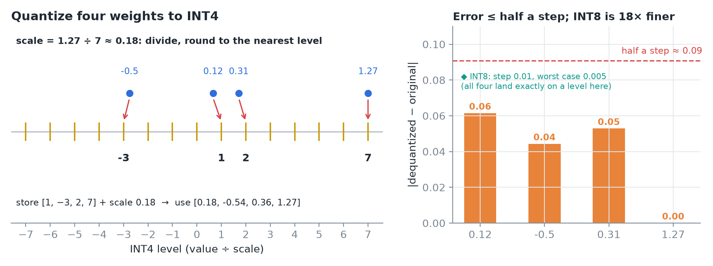
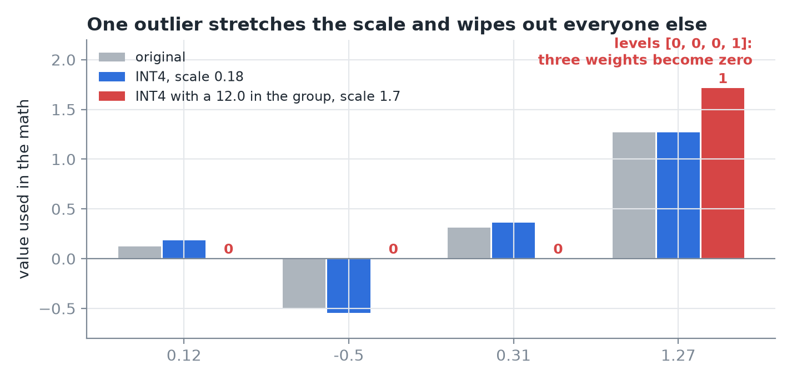
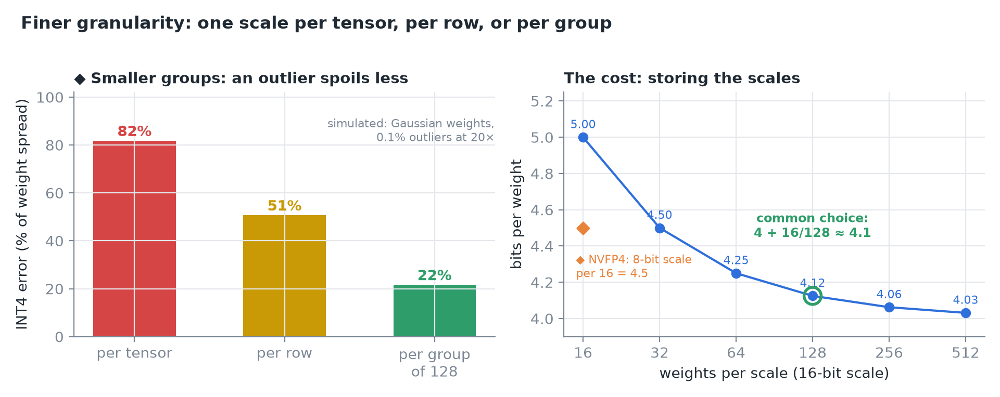
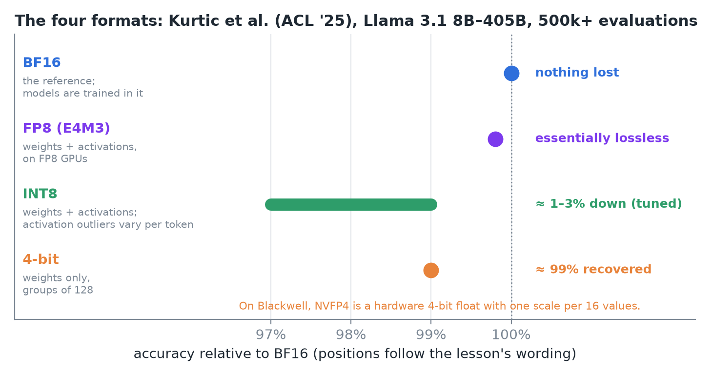
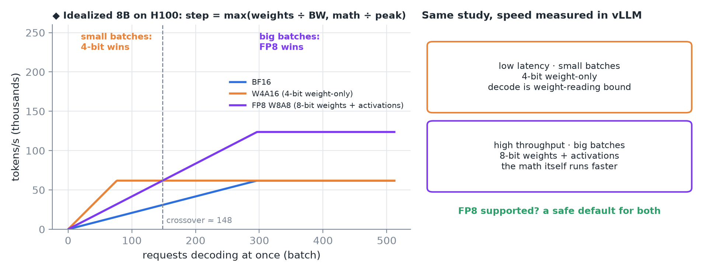
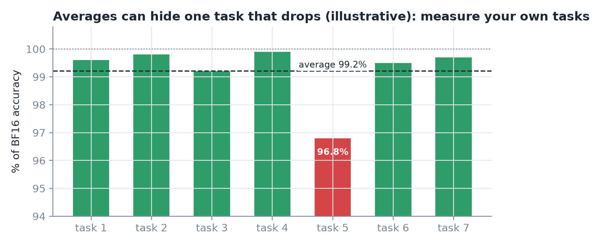
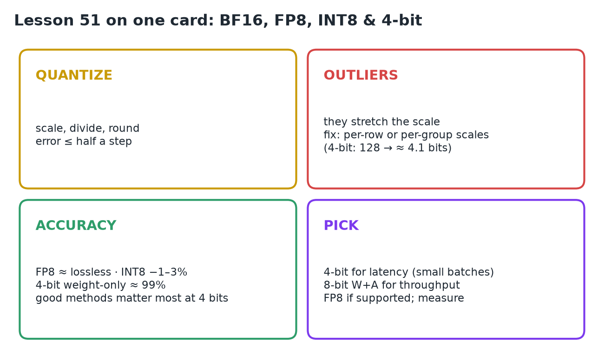

# 51 · BF16, FP8, INT8 & 4-Bit Inference

**Source:** [fanout.sh / inference-eng / 11-02](https://fanout.sh/inference-eng/curriculum/11-02) · ~5.5 min

> [!NOTE]
> Quantizing is **a scale, a divide and a round**, with error of **at most half a step**. One **outlier** stretches the scale and wipes out everyone else, so use **per-row or per-group scales** (4-bit: one per **128** weights, ≈ **4.1 bits** per weight). On Llama 3.1, **FP8 weights + activations are essentially lossless**, **INT8 W+A loses ~1–3%**, and **4-bit weight-only recovers ~99%** with a good method. **4-bit suits latency** (small batches), **8-bit W+A suits throughput** (big batches), and FP8 is the safe default where supported. Measure on your own tasks.

## 1. What quantizing a number involves

*Four weights onto the signed INT4 grid, and how far each one moves.*

$$\mathrm{scale} = \frac{\max |w|}{7} = \frac{1.27}{7} \approx 0.18 \qquad q = \mathrm{round}\left(\frac{w}{\mathrm{scale}}\right) \qquad \hat{w} = q \times \mathrm{scale}$$

- Signed **INT4** here uses levels **−7 to 7**. Pick the scale so the **largest value lands on the top level**.
- Divide and round: **[1, −3, 2, 7]**. That's what you store: four small integers **plus one scale**.
- To use them, multiply back: **[0.18, −0.54, 0.36, 1.27]**. Every value moves, but **never by more than half a step (≈ 0.09)**.
- **INT8** has **127 levels on each side**, so its steps are **18× finer**.

## 2. Outliers, and finer granularity

*The same four weights, quantized alone and with a 12.0 in their group.*

- Add one big value, **12.0**, to the group: the scale stretches to 12 ÷ 7 ≈ **1.7**, and the four normal weights round to **[0, 0, 0, 1]**.
- LLMs **do have outliers**, in both **weights and activations**.

*◆ Left is my simulation; right is the scale overhead at different group sizes.*

- The fix is **finer granularity**: instead of **one scale per tensor**, use **one per row** or **one per small group**. The outlier then only spoils **its own group**.
- A common choice for 4-bit weights: **one scale per 128**.

$$4 + \frac{16}{128} \approx 4.1\ \mathrm{bits\ per\ weight}$$

## 3. The four formats

*Accuracy from Kurtic et al., "Give Me BF16 or Give Me Death?" (2024, ACL '25): Llama 3.1 8B–405B, 500k+ evaluations.*

- **BF16** is the reference: most modern models are **trained in it**, so serving in it loses nothing.
- **FP8 (E4M3)** is a float grid, **dense near zero and sparse far out**, which suits **bell-shaped weights**. With a scale, on GPUs that support it, both **weights and activations** go to FP8: **essentially lossless**.
- **INT8 weights + activations** lost about **1–3%** when carefully tuned. Weights are easy; **activations have outliers that change with every token**.
- **4-bit** is mostly **weight-only**, with activations kept in 16 bits. With a good algorithm and groups of 128 it recovered **~99%** of the original accuracy.
- On **Blackwell**, **NVFP4** is a hardware 4-bit float with **one scale per 16 values**.

## 4. Which one to pick

*◆ The left panel is an idealized model, not the study's measurements; it shows why the two regimes differ.*

| Serving | Winner in the study (vLLM) | Why |
|---|---|---|
| **Low latency, small batches** | **4-bit weight-only** | decode is limited by **reading weights** |
| **High throughput, big batches** | **8-bit weights + activations** | the **math itself** runs faster |
| GPU supports FP8 | **FP8** | a **safe default for both** |

> [!TIP]
> ◆ In the idealized model, 4-bit weight-only wins until about 148 requests per step. Beyond that, decoding is limited by math, and FP8's 2× faster math pulls ahead.

*Whatever you pick, look at every task, not just the average.*

## 5. Recap

