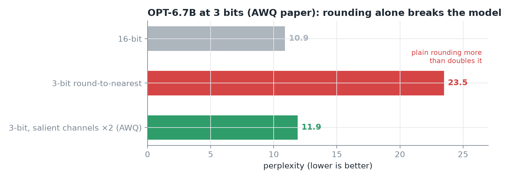
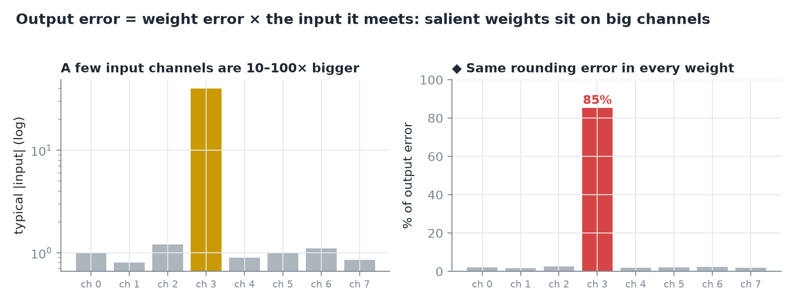
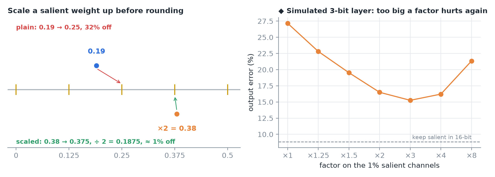
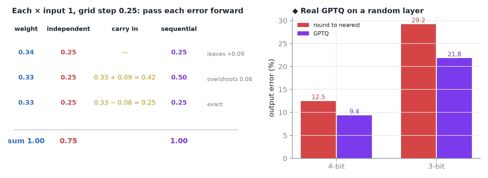
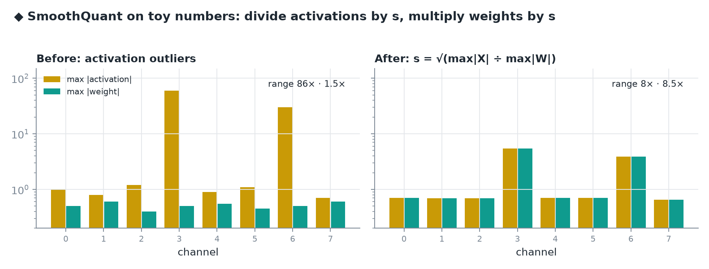
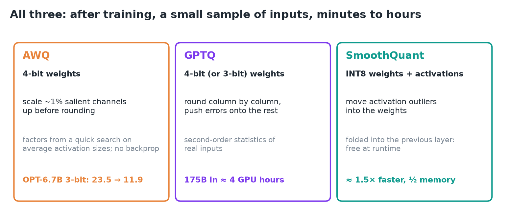
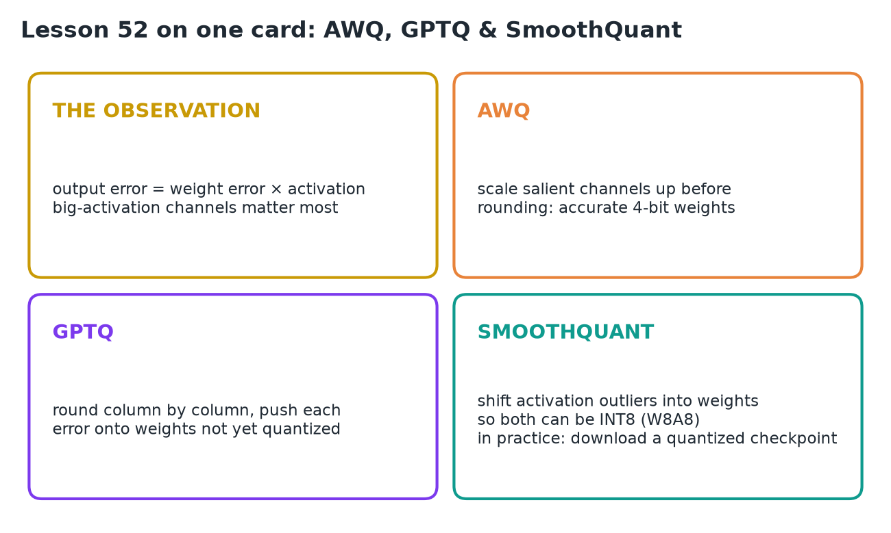

# 52 · AWQ, GPTQ & SmoothQuant

**Source:** [fanout.sh / inference-eng / 11-03](https://fanout.sh/inference-eng/curriculum/11-03) · ~6 min

> [!NOTE]
> Plain rounding can break a model: at 3 bits it **more than doubled** OPT-6.7B's perplexity (10.9 → 23.5). What matters is the **error in the layer's output**, and a weight's error gets **multiplied by the input it meets**, so weights on the few **big activation channels** matter most. **AWQ** scales those salient channels up before rounding (23.5 → **11.9**); **GPTQ** rounds column by column and **pushes each error onto the weights not yet quantized** (175B in **≈ 4 GPU hours**); **SmoothQuant** moves activation outliers into the weights so **both can be INT8** (up to **≈ 1.5× faster, half the memory**). All three run after training on a small calibration sample, in minutes to hours.

## 1. Why plain rounding isn't enough

*Perplexity from the AWQ paper; the third bar comes up again in section 3.*

- Rounding every weight to the nearest 4-bit level can **badly damage** a model. At **3 bits**, plain rounding took a 6.7B model from **10.9 to 23.5** perplexity.
- The standard fixes: **AWQ, GPTQ and SmoothQuant**. All three work **after training**, need only a **small set of sample inputs**, and take **minutes to hours**, not a retraining run.

## 2. The shared observation

*◆ Right: if every weight had the same rounding error, the one big channel would cause 85% of the output error.*

- We don't care about the error in **each weight**; we care about the error in the **layer's output**.
- Output = weights × inputs, so a weight's rounding error gets **multiplied by its input**.
- Most input channels are small, but **a few carry values 10–100× bigger**. Errors in the weights that meet them are **amplified by the same factor**.
- Those are the **salient weights**, and you find them by looking at the **activations**, not at the weights.

## 3. AWQ: protect the salient weights

*Left: the lesson's example on an illustrative grid with steps of 0.125. Right ◆: my simulation of a 3-bit layer with groups of 128.*

- **Activation-aware weight quantization.** Only **~1%** of weight channels are salient. Keeping them in 16 bits would help, but **mixing precisions inside one matrix is awkward for GPU kernels**.
- Instead: **multiply each salient weight channel by a factor (say 2) and divide its input by the same factor**. The math is unchanged (2 × ½ = 1), but the salient weights are now **bigger relative to the rounding step**, so their relative error shrinks.
- Example: 0.19 rounds to 0.25, **32% off**. Doubled, 0.38 rounds to 0.375, and halved back that's 0.1875, **≈ 1% off**.
- In the paper, scaling the top 1% by 2 cut perplexity from **≈ 23.5 to ≈ 11.9**.
- The factors come from a **quick search using average activation sizes**. **No backpropagation**, so it tends **not to overfit** its sample data.

> [!TIP]
> ◆ Why the factor can't just grow: once the salient weights are big enough to set their group's maximum, the step grows for every other weight in that group. In my simulation, error falls until about ×3, then rises again.

## 4. GPTQ: fix mistakes as you go

*Left: the lesson's three weights. Right ◆: real GPTQ (per-row scales, correlated random inputs) vs plain rounding.*

- Three weights, **0.34, 0.33, 0.33**, each times an input of 1: true output **1.00**.
- Round each **independently** to steps of 0.25: all become 0.25, output **0.75**, a quarter too low.
- Round **one at a time and pass each error forward**: 0.34 → 0.25 leaves **+0.09**; the next becomes 0.42 → **0.50**, overshooting by **0.08**; the last becomes 0.25 → 0.25. Total: **exactly 1.00**.
- GPTQ does this **column by column across whole matrices**, using **second-order statistics of real inputs** to decide how to spread each error.
- Fast enough to quantize a **175B model in about 4 GPU hours**.

## 5. SmoothQuant: 8-bit weights and activations

*◆ Toy maxima with two outlier channels; s balances each channel exactly.*

$$XW = \left(X\ \mathrm{diag}(s)^{-1}\right)\left(\mathrm{diag}(s)\ W\right) \qquad s_j = \sqrt{\frac{\mathrm{max}|X_j|}{\mathrm{max}|W_j|}}$$

- A different problem: quantize **activations as well as weights**, so the **math itself runs in INT8**.
- **Weights are easy**: their values are fairly even across channels. **Activations are hard**: a few channels have **huge outliers**, so one shared scale crushes everyone else.
- **Move some of the difficulty into the weights**: divide each activation channel by a factor and multiply the matching row of weights by the same factor. The product doesn't change.
- Pick the factor to **balance the two**, typically the **square root of their ratio**. Both end up with moderate ranges, so **both can be INT8**.
- The scaling is **folded into the previous layer ahead of time**, so it **costs nothing at runtime**.
- The paper reported **up to ≈ 1.5× faster inference and half the memory**, with negligible accuracy loss.

## 6. Side by side

- In practice you'll usually **download a checkpoint already quantized** with one of these, and **vLLM loads it directly**.

## 7. Recap

