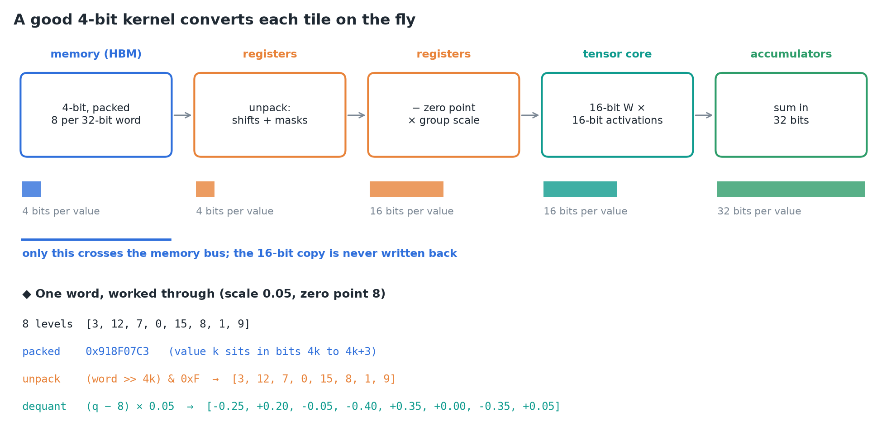
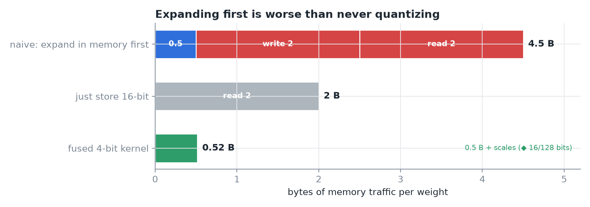
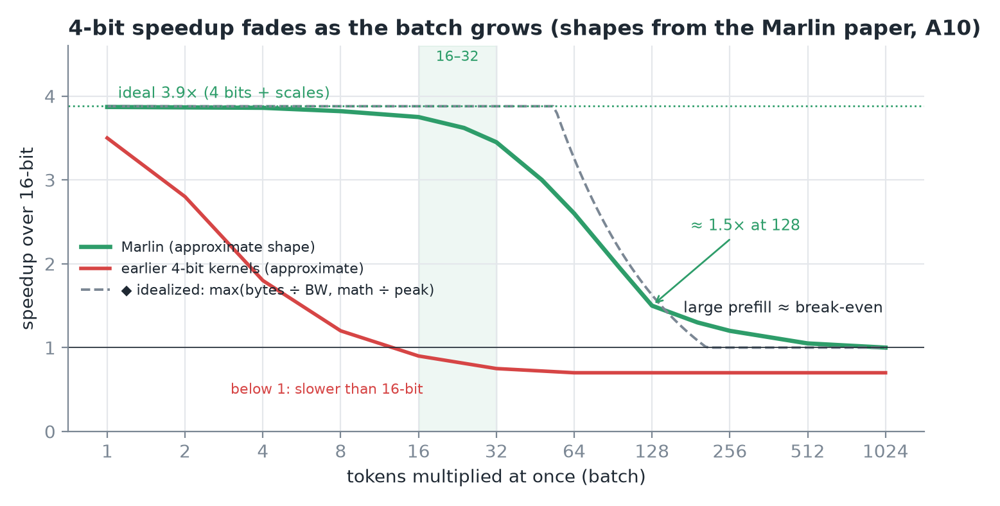
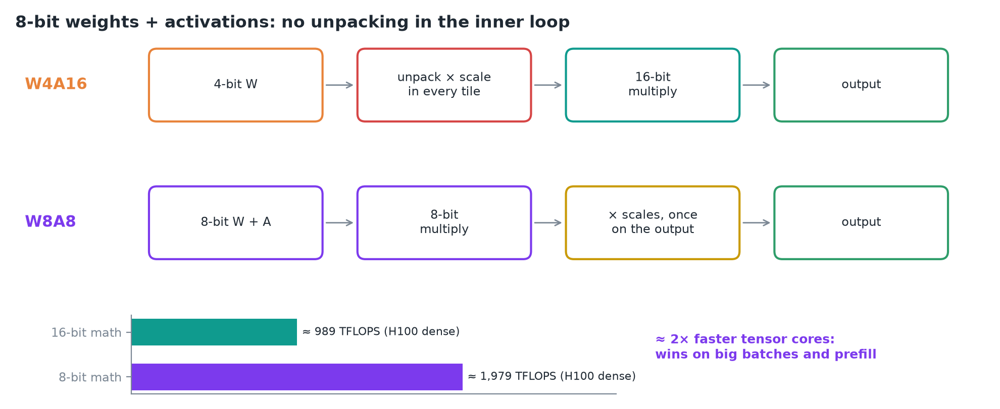
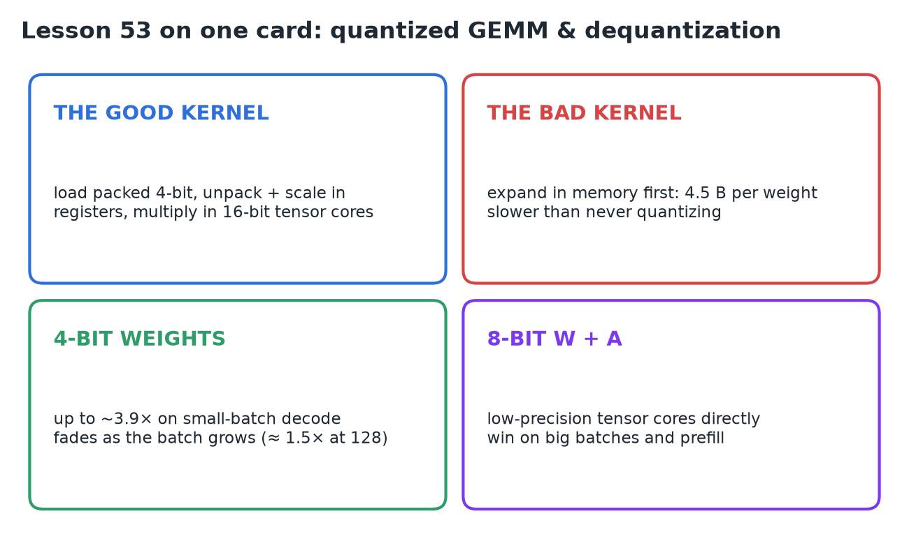

# 53 · Quantized GEMM & Dequantization Overhead

**Source:** [fanout.sh / inference-eng / 11-04](https://fanout.sh/inference-eng/curriculum/11-04) · ~5 min

> [!NOTE]
> A 4-bit model is 4× smaller, but its matrix multiplies are only **sometimes** 4× faster: it depends on what the GPU does with the 4-bit numbers and **how many tokens you multiply at once**. Most GPUs can't multiply 4-bit weights by 16-bit activations directly, so a good kernel **unpacks and scales each tile in registers** and feeds 16-bit tensor cores; the weights cross the memory bus at **half a byte**. Expanding them in memory first costs **4.5 bytes per weight**, worse than plain 16-bit. Good kernels (**Marlin**) hold near the ideal **≈ 3.9×** up to batches of **16–32**, fall to **≈ 1.5× at 128** and break even on large prefills. **W8A8** skips the unpacking and uses 8-bit tensor cores (≈ 2× math), so it wins on big batches and prefill.

## 1. Inside a good 4-bit kernel

*The bars show bits per value at each stage. ◆ The worked word is my example.*

- Most GPUs have **no tensor-core instruction for 4-bit × 16-bit**, so the kernel **converts the weights on the fly**, one tile at a time:
  1. Load a tile of **packed weights**: **eight 4-bit values per 32-bit word**.
  2. In registers, **unpack** them with a few **shifts and masks**.
  3. **Subtract the zero point and multiply by the group's scale**: 16-bit weights.
  4. Feed them to the **tensor cores** with the 16-bit activations.
  5. Add the products up in **32-bit accumulators**.
- The key point: weights **cross the memory bus at 4 bits** and are **never written back in 16 bits**.

## 2. The naive alternative

*Memory traffic per weight for each approach.*

$$0.5 + 2 + 2 = 4.5\ \mathrm{bytes\ per\ weight} \quad > \quad 2\ \mathrm{bytes\ (plain\ BF16)}$$

- Expanding the whole matrix to 16 bits **in memory first** reads half a byte, **writes two bytes**, and **reads those two bytes again**.

## 3. How much faster: it depends on the batch

*Curve shapes approximate the Marlin paper (A10, large layer). ◆ The dashed line is a roofline with no unpacking cost (A10: 125 TFLOPS, 600 GB/s).*

$$\mathrm{ideal\ speedup} = \frac{16}{4 + 16/128} \approx 3.9\times$$

- **Batch of 1:** limited by **reading weights**, so 4× fewer bytes gives almost **4×**; with scale factors, **≈ 3.9×** ideal.
- As the batch grows, **each weight is used for more multiplications**. A modern GPU can do **100–200 operations per byte** it reads, so there's room to **hide the unpacking** and a few dozen multiplications behind each weight load.
- **Marlin** stays close to the ideal up to batches of **16–32 tokens**.
- Beyond that **the math is the limit**: weights still need unpacking and scaling, and the tensor cores **still multiply in 16 bits**. By a batch of **128** the gain is **≈ 1.5×**; for **large prefills**, roughly **break-even**.
- Before Marlin, most 4-bit kernels **lost their speedup beyond a batch of 1 or 2**. In vLLM, Marlin delivered **up to ≈ 2.8× faster end-to-end**.

> [!TIP]
> ◆ 100–200 operations per byte fits A10/A100-class GPUs (A10 ≈ 208 FLOPs per byte, A100 ≈ 156). An H100 is ≈ 295 (989 TFLOPS ÷ 3.35 TB/s). The roofline puts the 4-bit gain at 1.6× by 128, close to Marlin's 1.5×. The gap at 32–64 is the unpacking and other overhead the roofline ignores.

## 4. Eight-bit weights and activations work differently

*W4A16 converts in every tile; W8A8 scales once, at the end.*

- On GPUs with **FP8 or INT8 tensor cores**, both inputs go **straight into the tensor cores in 8 bits**: **no unpacking in the inner loop**.
- The **scales are applied once, to the finished output**.
- The tensor cores run about **2× faster** in 8 bits than in 16.
- So **W8A8 speeds up the compute-bound work**, large batches and prefill, exactly where 4-bit weight-only runs out of steam.

> [!IMPORTANT]
> **4-bit weight-only** for small batches and low latency; **8-bit weights + activations** for high throughput. The reason is the kernel: 4-bit saves bytes, 8-bit W+A saves math.

## 5. Recap

