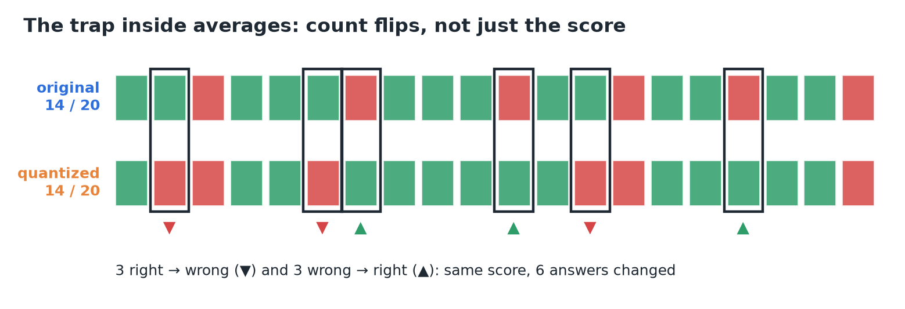
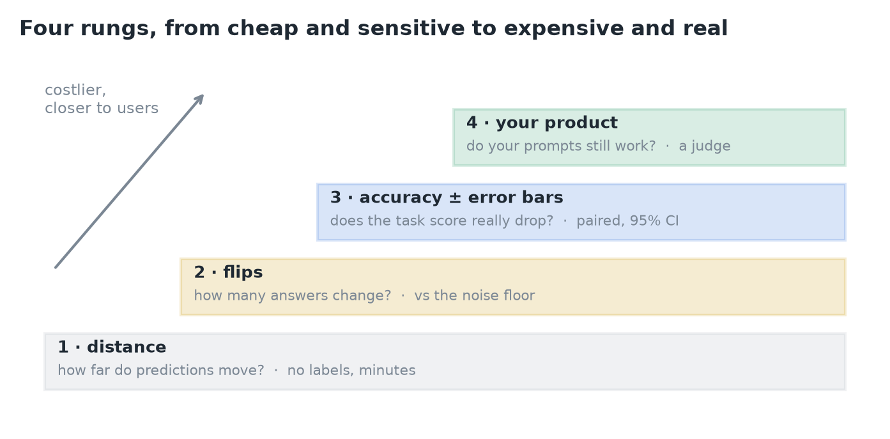
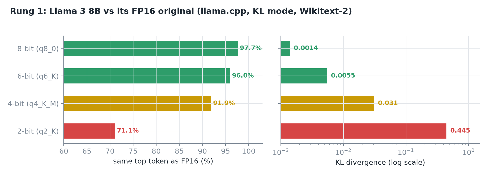
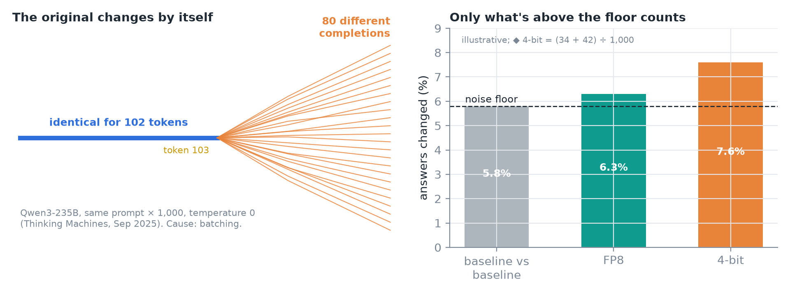
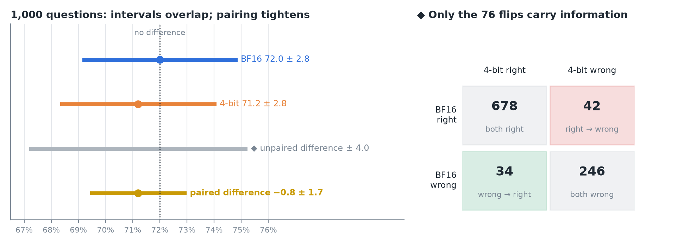
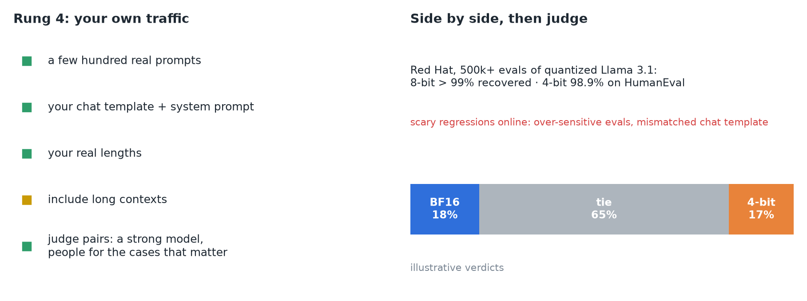
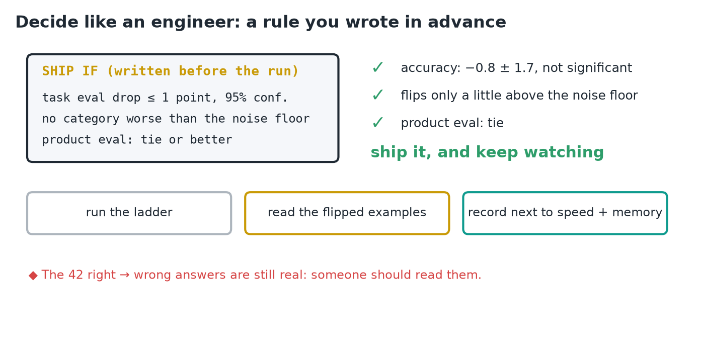
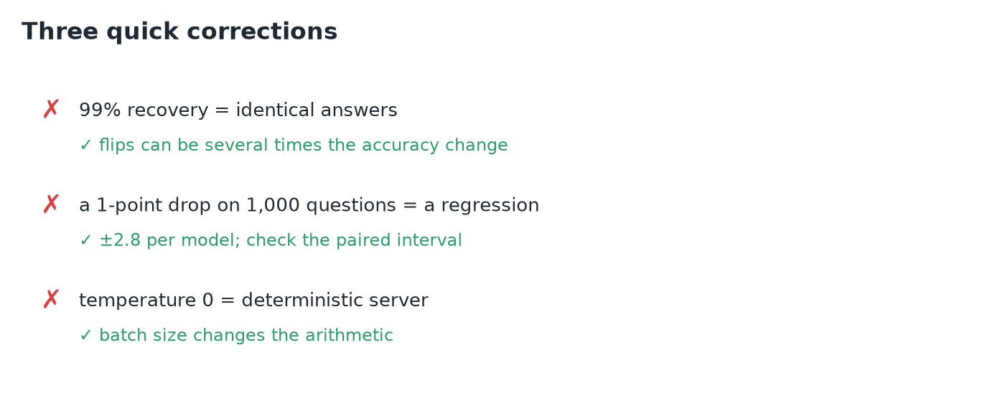
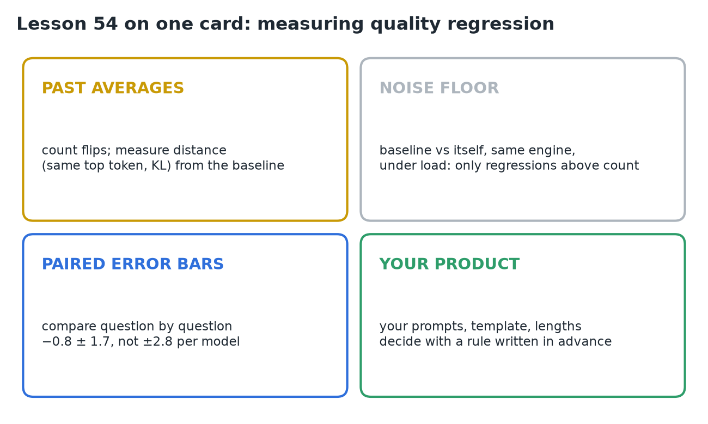

# 54 · Measure Quality Regression

**Source:** [fanout.sh / inference-eng / 11-07](https://fanout.sh/inference-eng/curriculum/11-07) · ~7 min

> [!NOTE]
> A 4-bit model can be **≈ 2.5× faster** for one user with weights under **⅓ of the memory**, while its benchmark score drops only **72.0% → 71.2%**. The score alone can't tell you whether it got worse: averages hide **flips** (answers that changed), and the original model is **noisy by itself**. Climb a ladder of four checks: **distance** from the original, **flips** against the noise floor, **paired accuracy with error bars**, and **your own product prompts**. Then decide with a **rule written before the run**.

## 1. The trap inside averages

*Twenty questions, my own arrangement of the lesson's counts.*

- Both models score **14 / 20**, yet **3 answers went right → wrong** and **3 went wrong → right**: **6 of 20 changed**.
- **Dutta et al., Microsoft Research (NeurIPS 2024):** across quantized models, **accuracy changed by ≤ 2%** while **flips reached 13.6%**.
- Models with **more flips were judged worse in open-ended conversation**, even when their benchmark scores matched.

## 2. The ladder

*Each rung costs more and sits closer to real users.*

1. **Distance:** how far do the predictions move from the original?
2. **Flips:** how many answers change, compared with the noise floor?
3. **Accuracy with error bars:** does the task score really drop?
4. **Your product:** do your own prompts still work?

## 3. Rung 1: distance

*llama.cpp KL-divergence mode, Llama 3 8B against FP16 on Wikitext-2.*

- Run the original and the quantized model on the same text and compare, token by token:
  - how often they pick the **same top token**;
  - the **KL divergence** between their probability distributions.
- It needs **no labels** and runs **in minutes**, so it's great for **catching bugs** (a broken conversion shows up as a huge KL).
- 4-bit (q4_K_M) keeps the same top token **91.9%** of the time; 2-bit falls to **71.1%**, with a KL **≈ 14×** larger.
- The limit: it measures **distance, not harm**. A changed token can be an equally good answer.

## 4. The noise floor

*Right panel: illustrative flip rates. ◆ I set the 4-bit bar to 7.6% so it matches the paired example below.*

- First ask how much the **original changes by itself**:
  - **BF16 vs FP16**, same weights, disagree on the top token **≈ 0.26%** of the time.
  - **Thinking Machines (Sep 2025):** Qwen3-235B, the same prompt **1,000 times at temperature 0**, gave **80 different completions**. All were identical for **102 tokens**, then split at token 103.
- The cause is **batching**: a different batch size means **slightly different arithmetic**, so the results can differ.
- So measure the floor by running **the baseline against itself**, in the **same engine, under load**. Only flips **above the floor** count against the quantized model.

## 5. Rung 3: accuracy with error bars

*Scores are the lesson's illustrative numbers; the arithmetic is real. ◆ The 2×2 table and the unpaired-difference bar are mine.*

$$\pm 1.96 \sqrt{\frac{0.72 \times 0.28}{1000}} \approx \pm 2.8\ \mathrm{points}$$

- On **1,000 questions** at ≈ 70%, each score has a 95% interval of about **±2.8 points**. The two intervals **overlap almost completely**, which says little.
- Both models answered **the same 1,000 questions**, so compare them **question by question**:
  - **34** went wrong → right, **42** went right → wrong.
  - Paired difference: **−0.8 ± 1.7 points**. The interval **includes zero**, so there's **no significant drop**.
- **No significant drop doesn't mean no change:** someone still needs to **read the 42 regressions**.

$$\mathrm{paired\ CI} = \pm 1.96 \sqrt{\frac{(34 + 42)/1000 - 0.008^2}{1000}} \approx \pm 1.7$$

> [!TIP]
> ◆ Pairing helps because the **924 questions both models agree on** cancel out. Treated as two separate samples, the difference would carry **±4.0 points**, more than twice the paired ±1.7. The same counts give a **McNemar test**: (42 − 34)² ÷ 76 ≈ 0.84, **p ≈ 0.36**. And the flip rate is (34 + 42) ÷ 1,000 = **7.6%**, nearly ten times the 0.8-point score change.

## 6. Rung 4: your product

*Judge verdicts are illustrative.*

- Use **a few hundred real prompts**, with **your chat template, your system prompt and your real lengths**. **Include long contexts**.
- Put the original's answer and the quantized model's answer **side by side** and have a **judge** pick: a strong model, plus **people for the cases that matter**.
- A result like **18% / 65% tie / 17%** is a tie.
- **Red Hat, 500,000+ evaluations** of quantized Llama 3.1 (8B, 70B, 405B): **8-bit recovers > 99%**; **4-bit 98.9% on coding** (HumanEval).
- Many scary regressions posted online came from **over-sensitive evals** or a **mismatched chat template**, not from quantization.

## 7. Decide

*Results are the lesson's illustrative ones.*

- Write the rule **before the run**, for example:
  - task eval drop **≤ 1 point at 95% confidence**;
  - **no category** worse than the noise floor;
  - product eval: **tie or better**.
- Then **run the ladder**, **read the flipped examples**, and **record the result next to the speed and memory gains**.
- Here: accuracy **−0.8 ± 1.7**, not significant; flips **only a little above the floor**; product eval a **tie**. **Ship it, and keep watching.**

> [!IMPORTANT]
> A quality claim needs three things: the **noise floor**, a **paired comparison with error bars**, and a **check on your own prompts**. A single averaged score proves nothing either way.

## 8. Three quick corrections

- **99% recovery doesn't mean identical answers:** flips can be many times the accuracy change.
- **A 1-point drop on 1,000 questions isn't a regression by itself:** check the paired interval.
- **Temperature 0 doesn't make a server deterministic:** batching changes the arithmetic.

## 9. Recap

