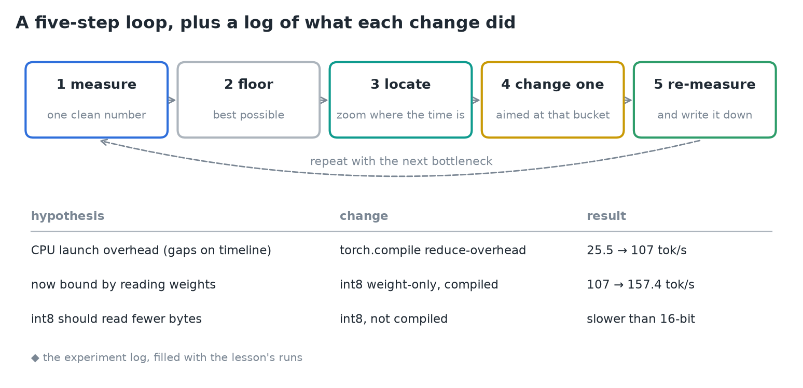
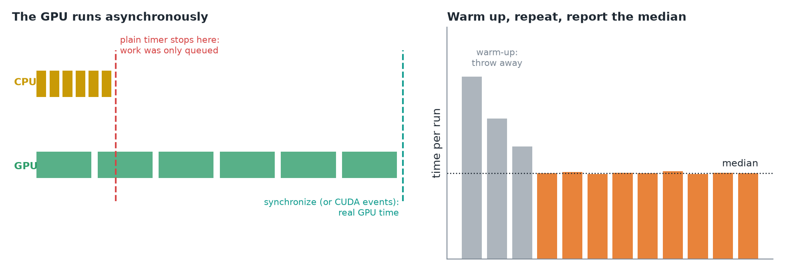
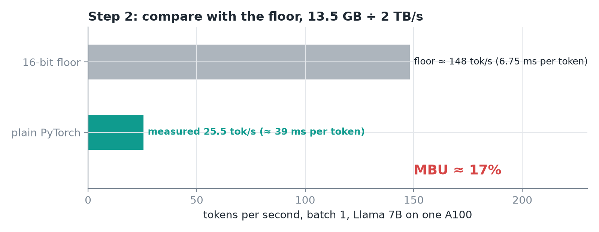
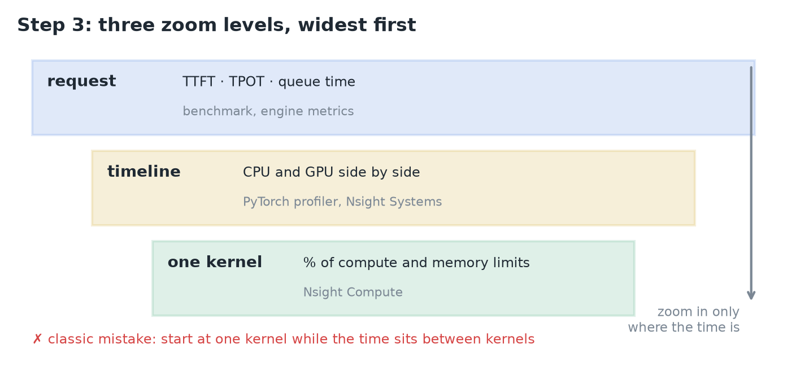
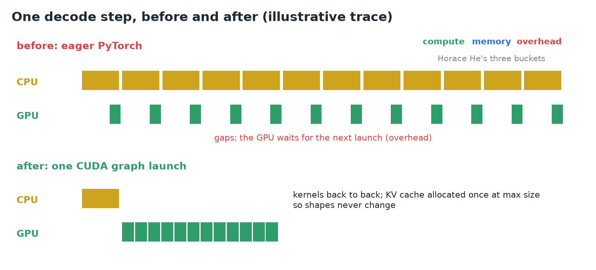
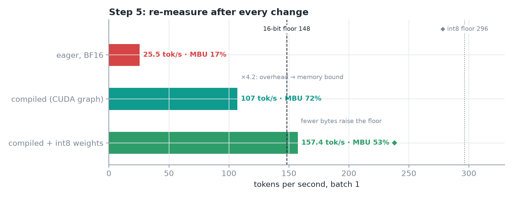
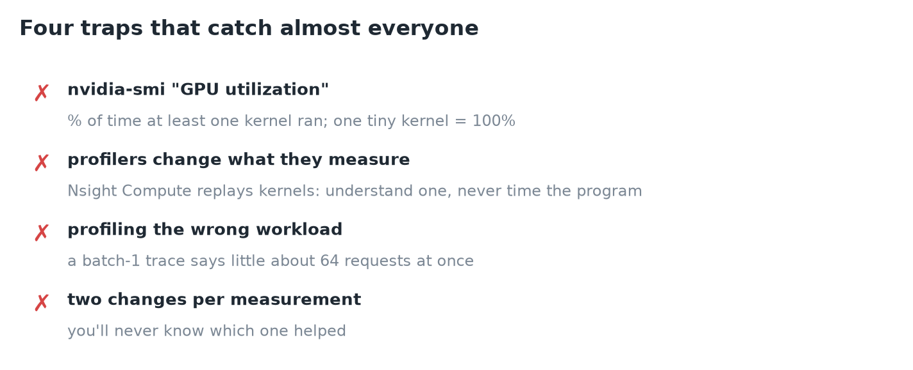
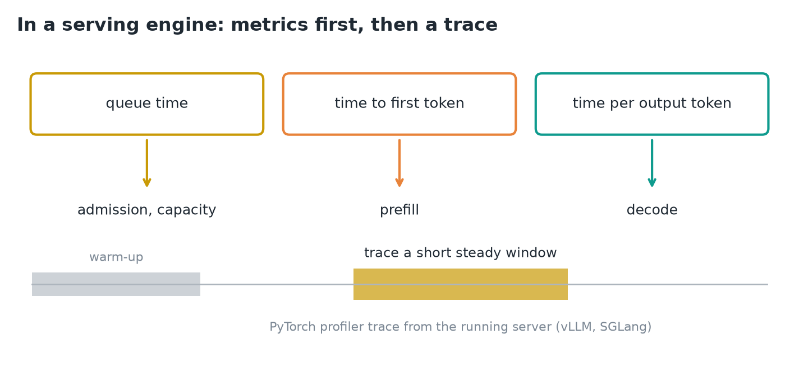
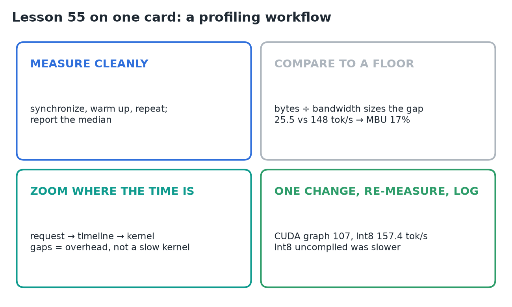

# 55 · Stop Guessing: Build a Profiling Workflow

**Source:** [fanout.sh / inference-eng / 12-01](https://fanout.sh/inference-eng/curriculum/12-01) · ~9 min

> [!NOTE]
> A 7B Llama in plain PyTorch on one A100 generates **25.5 tokens/s** (≈ 39 ms per token). Whether that's slow can't be guessed; it has to be measured against what the hardware could do. A five-step loop does it: **measure** one clean number, compare it with a **floor**, **locate** the gap by zooming in only where the time is, **change one thing**, then **re-measure** and write it down. Run on this Llama, the loop found CPU launch overhead, not a slow kernel, and took it from **25.5 to 157.4 tokens/s** without a single guess.

## 1. The loop

*The five steps, and a log of what each change did.*

- Common guesses ("the attention kernel must be slow", "we need a bigger GPU", "rewrite it in C++") each **cost a day and mostly miss**.
- The last step, **writing it down**, is what stops you fooling yourself: a short log of **hypothesis, change and result** is worth more than any single profiler screenshot.

## 2. Step 1: measure one clean number

*Left: a plain timer stops when the CPU has queued the work. Right: discard warm-up runs and take the median (illustrative).*

- The GPU runs **asynchronously**: a kernel call only puts work in a queue and returns at once. A plain timer measures how fast the CPU queued the work, not how long the GPU took.
- PyTorch's docs: "time measurements without synchronization are not accurate." **Synchronize** before stopping the clock, or use **CUDA events**.
- **Warm up**: the first calls pay for memory allocation, kernel selection and sometimes compilation. Throw them away.
- **Repeat** with the same prompt and output length, and report the **median**.

## 3. Step 2: compare with a floor

*At batch 1, every token must read all the weights once.*

$$t_{\mathrm{floor}} = \frac{7 \times 10^{9} \times 2\ \mathrm{bytes}}{2\ \mathrm{TB/s}} = \frac{13.5\ \mathrm{GB}}{2\ \mathrm{TB/s}} \approx 6.7\ \mathrm{ms} \quad \Rightarrow \quad \approx 148\ \mathrm{tokens/s}$$

- **Model bandwidth utilization (MBU)** = achieved bandwidth ÷ peak bandwidth. Here 25.5 ÷ 148 ≈ **17%**.
- So **more than 80%** of each token's time is spent on something other than the one job this workload must do: reading the weights. That gap is what we hunt.

## 4. Step 3: locate the gap

*Three zoom levels. Only zoom in where the time is.*

| Level | Shows | Tool |
|---|---|---|
| Request | TTFT, TPOT, queue time | your benchmark, the engine's metrics |
| Timeline | CPU thread and GPU kernels side by side over time | **PyTorch profiler**, **Nsight Systems** |
| One kernel | how close it gets to the chip's compute and memory limits | **Nsight Compute** |

- The classic mistake is **starting at the narrow end**: polishing one kernel while the real problem sits **between** the kernels.

*Illustrative trace of one decode step before and after a CUDA graph.*

- The timeline of one decode step shows **tiny kernels with empty space between them**, while the Python thread is busy the whole time launching one small operation after another.
- **Horace He's three buckets**: **compute** (doing math), **memory** (moving bytes) and **overhead** (everything else). The gaps are overhead: the GPU finishes each kernel before the CPU can hand it the next.
- The PyTorch team's verdict: "heavily CPU overhead bound." **No attention-kernel rewrite would have fixed it.**

## 5. Steps 4 and 5: change one thing, re-measure

*Each run against the 16-bit floor. ◆ The int8 floor and its MBU are my arithmetic.*

- **The change:** `torch.compile` in **reduce-overhead** mode records the whole decode step as a **CUDA graph** and replays it with **one launch**. To allow that, the **KV cache is allocated once at its maximum size**, so shapes never change.
- **Re-measure:** **107 tokens/s**, ×4.2. MBU rises to **≈ 72%**: the gaps are gone and the bottleneck moved from **overhead to memory**.
- The next hypothesis writes itself, **read fewer bytes**: int8 weight-only quantization reached **157.4 tokens/s**, above the 16-bit floor, because fewer bytes raise the floor.
- Without compilation, the **int8 model was slower** than the 16-bit one: the dequantize step **wasn't fused** into the matrix multiply. Same idea, opposite result; **only the re-measurement told them which**.

> [!TIP]
> ◆ int8 halves the bytes, so its floor is ≈ 296 tokens/s, and 157.4 × 6.75 GB ≈ 1.06 TB/s is an MBU of ≈ 53%. There's room left, so the loop would continue.

## 6. Four traps

- **GPU utilization in nvidia-smi** is the percent of time **at least one kernel** was running. One tiny kernel that barely touches the chip counts as **100% busy**.
- **Profilers change what they measure.** Nsight Compute **replays each kernel several times** to collect counters: use it to understand a kernel, never to time the program.
- **Profile the workload you serve.** A batch-1 trace says little about a server running 64 requests at once.
- **One change per measurement.** Change two things and you'll never know which helped.

## 7. In a real serving engine

*Start from the engine's metrics; trace only a steady window.*

- **vLLM and SGLang already use CUDA graphs** for decode, so the gaps fixed above are usually gone. The loop stays the same, but the starting point shifts.
- Begin with the **engine's own metrics**: is the time going into the **queue** (admission, capacity), the **first token** (prefill) or **every token after it** (decode)? Each points at a different part of the system.
- Only then capture a trace, over a **short window of steady traffic after warm-up**. Both engines can record a PyTorch profiler trace from a running server.

> [!IMPORTANT]
> Measure cleanly, size the gap against a floor, zoom in only where the time is, and change one thing at a time. The bottleneck moves after every fix, so re-measure every time.

## 8. Recap

