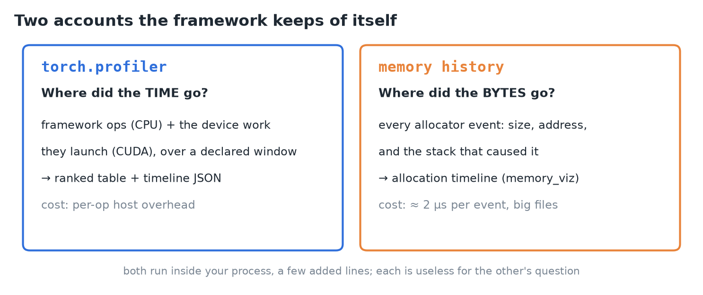
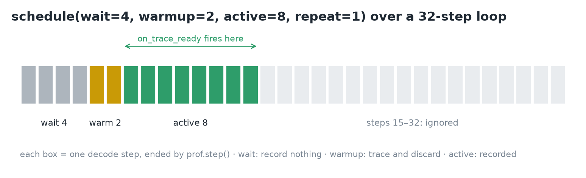
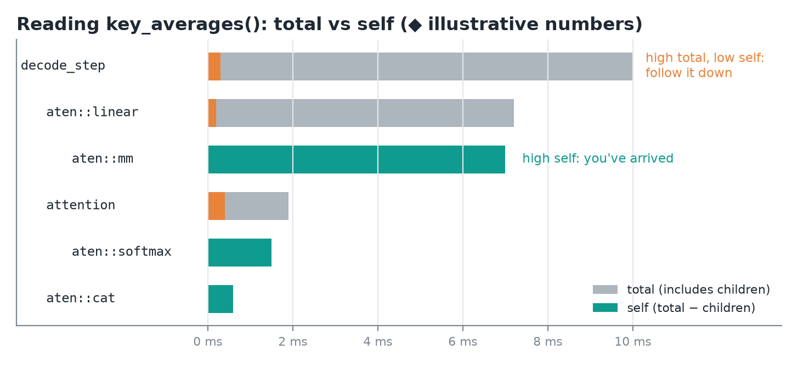
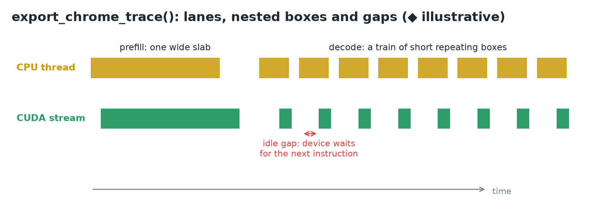
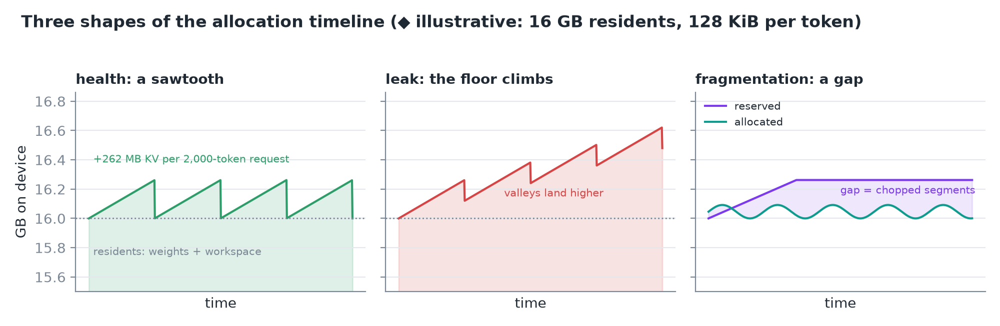
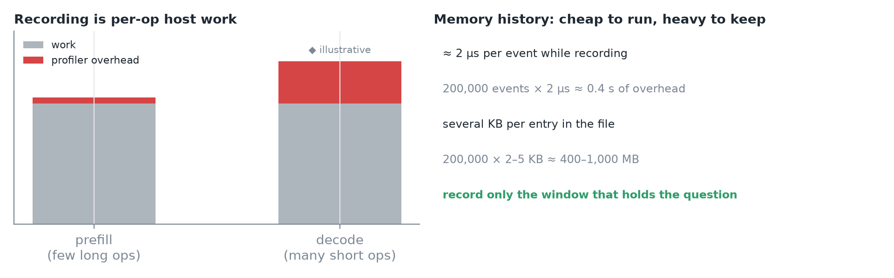
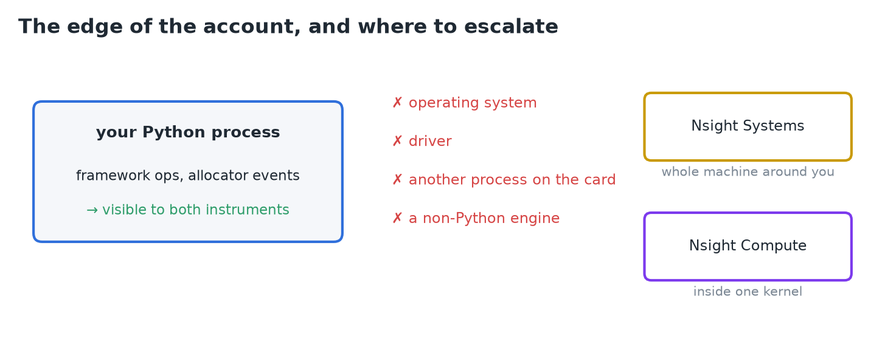
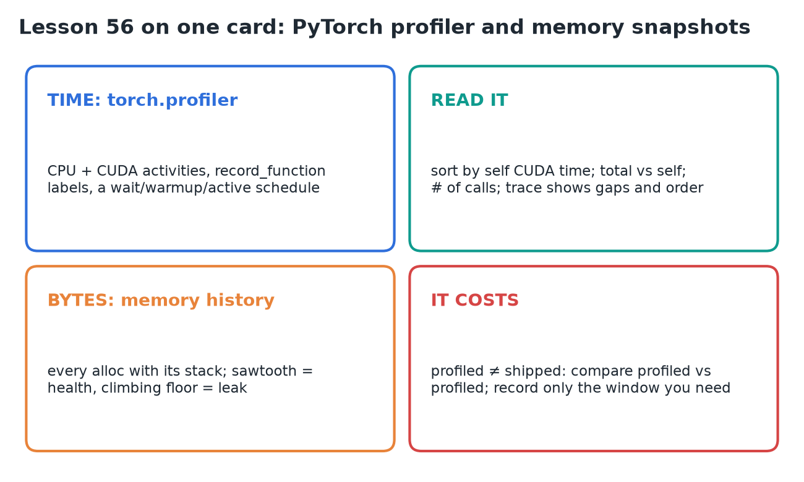

# 56 · PyTorch Profiler & Memory Snapshots

**Source:** [fanout.sh / inference-eng / 12-02](https://fanout.sh/inference-eng/curriculum/12-02) · ~7 min (text lesson)

> [!NOTE]
> Every operation the model performs passes through the framework, so the framework can keep an account of its own work. That makes it the **cheapest profiler to reach for first**. PyTorch keeps two accounts: **`torch.profiler`** records where the **time** went, operation by operation; the **memory history** records where the **bytes** went, allocation by allocation, each with the stack that caused it. Both run inside your own process with a few added lines, both distort what they measure, and neither sees anything outside the process.

## 1. Two instruments, two questions


*Each answers one question and is useless for the other's.*

| Question | Instrument | Records | Hands you |
|---|---|---|---|
| Where did the time go? | `torch.profiler` | framework ops and the device work they launch, over a window you declare | a ranked table and a timeline file |
| Where did the bytes go? | `torch.cuda.memory` history | every allocator event, with its stack | an allocation timeline you scrub in a browser |

## 2. What the profiler records

- A **context manager** around code you already have. Choose activities: **`ProfilerActivity.CPU`** (the framework's own operations) and **`ProfilerActivity.CUDA`** (the device work they launch).
- Each operation is recorded with its **duration** and its place in the **call tree**.
- **`record_shapes=True`** saves input shapes, so the same matmul at two sizes shows as two rows. **`with_stack=True`** saves the file and line that issued it. Both **add overhead**.
- **`record_function("decode_step")`** names your own region: it becomes a row, with everything inside it accounted under it.

## 3. The recording window


*The schedule builds the warm-up discipline into the profiler.*

- The first iterations are **cold**, and a window chosen after seeing the numbers is a window fitted to them. So declare it up front with a **schedule**.
- **`schedule(wait=4, warmup=2, active=8, repeat=1)`**: skip 4 steps, trace 2 and discard them, record 8, stop.
- **`prof.step()`** at the bottom of the loop marks each step boundary. When the active phase ends, the profiler calls **`on_trace_ready`** with the results.

```python
def on_ready(prof):
    print(prof.key_averages().table(
        sort_by="self_cuda_time_total", row_limit=12))
    prof.export_chrome_trace("decode-steady.json")

with profile(
    activities=[ProfilerActivity.CPU, ProfilerActivity.CUDA],
    schedule=schedule(wait=4, warmup=2, active=8, repeat=1),
    on_trace_ready=on_ready,
) as prof:
    for _ in range(32):
        with record_function("decode_step"):
            with torch.inference_mode():
                logits = model(input_ids=seq).logits
            next_id = logits[0, -1].argmax()
            seq = torch.cat([seq, next_id.view(1, 1)], dim=1)
        prof.step()
```

- The decode loop has **no early stop on end-of-sequence**: a schedule promises step counts, and a break at step 9 would leave the window unfilled.
- Of 32 steps, 6 get past the cold start, 8 are recorded, the rest are ignored: a **steady-state window by construction**, not by later exclusion.

## 4. Reading the table


*◆ Made-up numbers to show how total and self time read in a call tree.*

- **`key_averages()`** groups operations by name and averages them; **`table()`** ranks them by the column you sort on.
- **Total** time includes everything an operation called; **self** time is total minus its children.
  - **High total, low self**: the cost is below. Follow it down the tree.
  - **High self**: you've arrived.
- **Self CPU** prices the framework's own work in an op; **Self CUDA** prices the device work recorded under it. Sorting by **`self_cuda_time_total`** is usually the right first question for inference.
- **`# of Calls`** is its own diagnosis: a cheap op called thousands of times is a different problem from an expensive op called once.
- This is where an optimization becomes checkable: the operator a change targeted has a row, and the row either got cheaper or it didn't.

## 5. The timeline


*◆ Illustrative trace: a prefill slab, then a train of decode steps with idle gaps.*

- The table averages away **order**. **`export_chrome_trace()`** writes the same window as JSON for **`chrome://tracing`**.
- Time runs left to right; each **lane** is a thread or a device stream; a **box** is one operation, and boxes **nest** (your `decode_step` label encloses the model's ops).
- What matters is the relation **between lanes**: a CPU op and the device work it produced are separate boxes at separate times.
- Lanes alternating between work and empty space mean the **device sat idle waiting** for the next instruction.
- At the coarsest grain, a generation trace is **one wide prefill slab** followed by a **train of short, repeating decode boxes**.

## 6. Memory snapshots

- **`torch.cuda.memory._record_memory_history()`** turns on the allocator's event log: every allocation and free with its **size, address and stack**. **`_dump_snapshot()`** writes it to a file.
- The leading underscore means the interface isn't promised to be stable, but it's the **documented tool**.

```python
torch.cuda.memory._record_memory_history(max_entries=200_000)
model.generate(input_ids, max_new_tokens=64)
model.generate(input_ids, max_new_tokens=64)
torch.cuda.memory._dump_snapshot("decode.pickle")
torch.cuda.memory._record_memory_history(enabled=None)
```

- Open the file at **pytorch.org/memory_viz** (drag and drop, nothing to install).
  - **Active memory timeline**: every live allocation is a colored band, time to the right, height in bytes. **Hover a band to see the stack** that allocated it.
  - **Allocator state**: each segment requested from the device and how it's split into blocks.
- The log is a **ring buffer** of `max_entries` events; the oldest are overwritten first.

## 7. Reading the allocation curve


*Same timeline, three diagnoses. ◆ Numbers are illustrative: 16 GB of residents, 2,000-token requests.*

- **Health is a sawtooth.** The floor is the **residents** (weights and workspace that never free). Each request climbs as its KV cache grows, at **131,072 bytes per token**, and falls back when it finishes.
- **A leak is a climbing floor.** Something in each cycle never frees, so every valley lands higher. The persisting band's **stack trace names the line holding the reference**.
- **Fragmentation is a gap.** The allocator reserves segments and reuses blocks inside them, so **allocated** (your tensors) and **reserved** (held by the allocator) differ. Many small allocations of varying lifetimes chop the segments: reserved stays high while allocated drops, and a large request can **fail against scattered free blocks**. The segments view shows the chopping.
- An **out-of-memory event is in the log** too, with the size requested and how much the device still reported free.

> [!TIP]
> ◆ At 131,072 bytes per token, one 2,000-token request adds ≈ 262 MB to the curve: that's the height of each sawtooth tooth.

## 8. What the instruments cost


*Left: illustrative overhead shares. Right: the memory history's costs.*

- Shape recording and stack tracing **add overhead**, and holding shape records can **keep tensors alive longer** than the untraced program would.
- The distortion is **uneven**: recording is per-operation host work, so **decode (many short ops) inflates more than prefill (a few long ops)**. The first use of CUDA profiling also carries a one-time cost, which warm-up absorbs.
- The memory history is cheap while running, **≈ 2 µs per event**, but files are **several KB per entry**: a full 200,000-entry buffer lands in the **hundreds of megabytes**. Record the window that holds the question, not the whole process.

> [!WARNING]
> A profiled run is a different program from the one you ship. Compare **profiled against profiled**, never profiled against an unprofiled baseline.

## 9. The edge of the account


*Both instruments only see what one framework in one process wrote down.*

- Invisible to both: the **operating system**, the **driver**, **another process** sharing the card, and an **engine that isn't this Python program**.
- For what the whole machine was doing around your process, escalate to **Nsight Systems**. For what happens inside one expensive kernel, use **Nsight Compute**.
- Until then, spend these first: a time question gets a ranked table and a timeline for **about six lines**; a byte question gets every allocation with its stack for **two calls**.

> [!IMPORTANT]
> Profiler for time, memory history for bytes. Declare the window, read self versus total, and treat every profiled number as a measurement of the profiled run.

## 10. Recap


