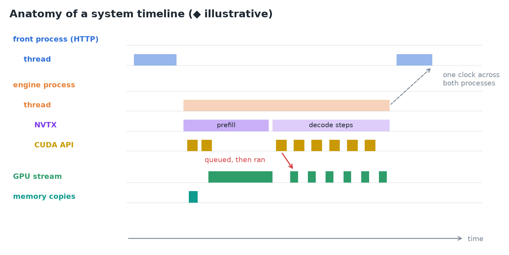
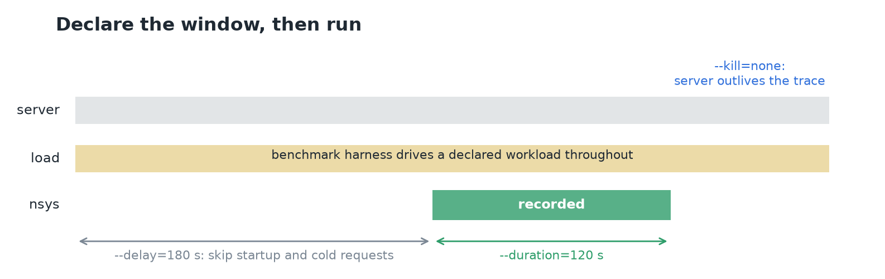
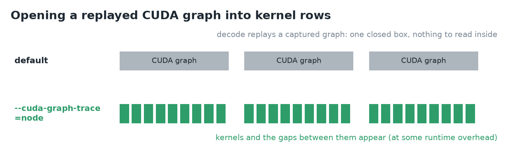
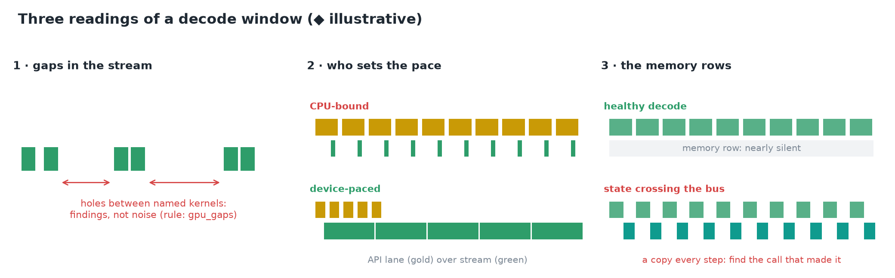
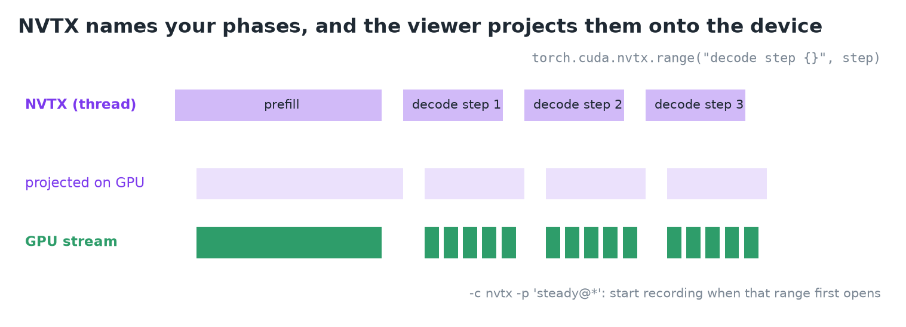
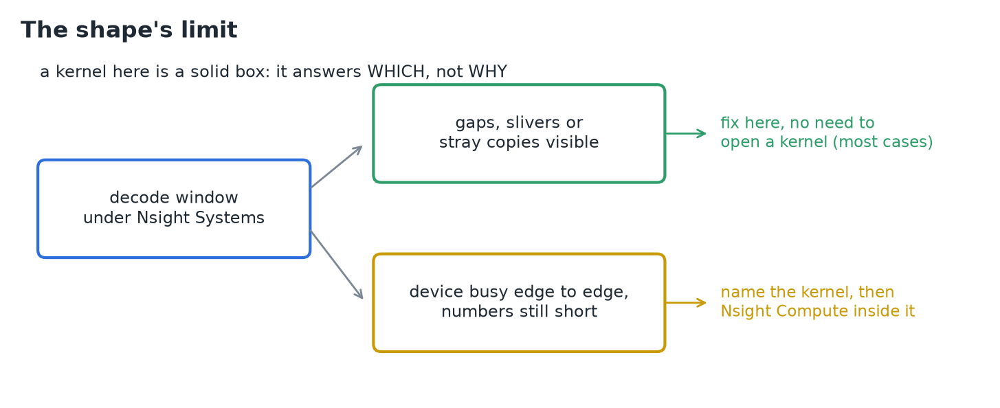
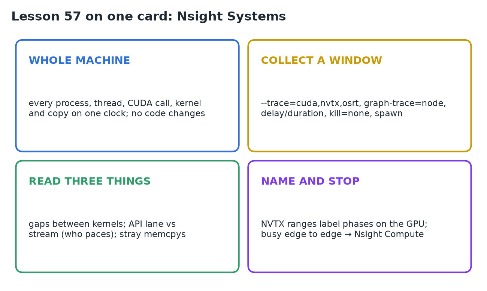

# 57 · Nsight Systems

**Source:** [fanout.sh / inference-eng / 12-03](https://fanout.sh/inference-eng/curriculum/12-03) · ~7 min (text lesson)

> [!NOTE]
> In-process tools can't say what the **whole machine** was doing around your process. **Nsight Systems**, NVIDIA's system-wide profiler, records a window of the machine's life as **one timeline on one clock**: every process, every thread, each thread's CUDA calls, the kernels and copies on the device, and the stretches where a thread blocked in the OS. It **needs no code changes**, so it works for any process, language or framework, including a serving stack split across processes. It answers **which** kernel or gap the time went to; it can't say what happened **inside** a kernel.

## 1. One timeline for the whole machine


*◆ An illustrative timeline: threads and their calls above, the device's own order below.*

- A serving stack isn't one process. vLLM, for example, has a **front process** that speaks HTTP and an **engine core** that steps the model. An in-process account ends at that seam; under Nsight Systems **both halves land on one timeline**, with everything else the box was doing.
- The rows follow the machine's hierarchy:
  - each **process** is a block, each **thread** a row inside it;
  - a thread that uses CUDA has a **CUDA API row** (boxes like `cudaLaunchKernel`, `cudaMemcpyAsync`, spanning the wall time of each call);
  - at the bottom, the **GPU**: each CUDA context and its **streams**, where every box is a kernel or a memory operation, in the order the device ran them.
- **A kernel appears twice**: once as the API call that **queued** it, on the host thread, and once as the **execution**, on a stream, later. The device runs behind the host by design, and the timeline shows by how much.

## 2. Collecting a window on a serving process

```bash
nsys profile --trace=cuda,nvtx,osrt \
    --cuda-graph-trace=node \
    --delay=180 --duration=120 --kill=none \
    -e VLLM_WORKER_MULTIPROC_METHOD=spawn \
    -o decode-window \
    vllm serve NousResearch/Meta-Llama-3.1-8B \
      --max-model-len 2048
```

*Representative command, not a capture.*

| Flag | Why |
|---|---|
| `--trace=cuda,nvtx,osrt` | CUDA API calls and device work; NVTX named ranges; OS runtime calls where threads block |
| `--cuda-graph-trace=node` | opens replayed CUDA graphs into kernel rows (see below) |
| `--delay=180 --duration=120` | the declared window: skip startup and cold requests, record steady state |
| `--kill=none` | by default the tool kills the process it launched when collection ends; a server should outlive its trace |
| `-e VLLM_WORKER_MULTIPROC_METHOD=spawn` | vLLM starts its second process with **fork** by default, which an injection-based tool can't follow safely; **spawn** is safe |

- By default the tool also **samples where every thread was executing**. Worth keeping on a first pass; `--sample=none --cpuctxsw=none` is the lighter form once you know what you're after.


*The window only shows something if a declared workload is running through it; an idle server gives a timeline of nothing.*


*Without node tracing, a replayed decode graph is one closed box.*

- vLLM **replays decode as a captured CUDA graph**. At the default granularity a graph draws as **one item** with nothing to read inside.
- **`--cuda-graph-trace=node`** opens it into kernel rows, at what the guide warns may be **significant runtime overhead**. Without it, decode's kernels and the gaps between them never appear.

**Reading the output:**

- `decode-window.nsys-rep` opens in the GUI, **`nsys-ui`**.
- Over SSH, **`nsys stats decode-window.nsys-rep`** prints ranked summaries. The three to read first are in the default set:
  - **`cuda_gpu_kern_sum`**: kernels by device time;
  - **`cuda_api_sum`**: API calls by wall time;
  - **`nvtx_sum`**: your named ranges.
- To bracket a window by hand instead: **`nsys launch`** starts the target under the tool, then **`nsys start`** / **`nsys stop`** open and close collection.

## 3. Three readings of a decode window


*◆ Illustrative shapes for each reading.*

1. **Gaps in the stream.** No zoom needed: the stream rows are either dense or full of holes. A mostly idle device while callers wait is **not a kernel problem**. Each hole sits between two named kernels, under an API lane that was either **quiet** (nothing was asked) or **busy** (asked, but the work didn't arrive). Gaps are **findings, not noise**; the CLI has an expert rule, **`gpu_gaps`**, for this sweep.
2. **Who sets the pace.** Decode is many short kernels in a row.
   - **CPU-bound**: an API lane packed with launch calls above a stream of **slivers separated by air**. The host sets the pace, one launch at a time.
   - **Device-paced**: a stream running **shoulder to shoulder**, its boxes wider than the calls that queued them. The host is comfortably ahead.
3. **The memory rows.** Steady decode should keep them **nearly silent**: the KV cache keeps state on the device, and a step only needs to move tokens, which are tiny. **Wide or rhythmically repeating host↔device copies** mean state crosses the bus every step, and the timeline shows which call on which thread made each one.

## 4. Naming your phases with NVTX


*Ranges pushed on the thread are projected onto the GPU rows.*

- Kernel names are the device's vocabulary; your **phases** (this request's prefill, that one's decode steps) don't exist on the trace until you name them.
- **NVTX** (NVIDIA Tools Extension): push a named range when a phase begins, pop it when it ends. PyTorch exposes it as a context manager:

```python
with torch.inference_mode():
    if past is None:
        with torch.cuda.nvtx.range("prefill"):
            out = model(input_ids=seq, use_cache=True)
    else:
        with torch.cuda.nvtx.range("decode step {}", step):
            out = model(input_ids=seq[:, -1:],
                        past_key_values=past, use_cache=True)
```

- Extra arguments fill the label through `msg.format()`, so **each decode step gets its own name**.
- The viewer **projects each range onto the device rows**: kernels and copies launched inside a range sit under that name on the GPU side, so per-phase questions are answered by reading.
- A range can **arm the collection**: `-c nvtx -p 'steady@*'` holds recording until a range with that message first opens.
- **`torch.autograd.profiler.emit_nvtx`** stamps a range on every autograd op. It's built for matching training's backward to its forward; for a generation loop, a handful of hand-placed ranges says more.

## 5. The shape's limit


*Most serving diagnoses end at this altitude.*

- Everything here is **a named box with a width on a lane**. That's exactly enough to answer **which**: which kernel owns the device time, which gap the missing milliseconds fell into, which lane set the pace.
- It's also the limit: a kernel is a **solid rectangle**, and nothing about it says what the silicon spent its width on. That's **Nsight Compute**'s job, aimed after Nsight Systems has named the target.
- **Gaps never need that descent.** An idle stretch, a launch-paced train of slivers, a copy that shouldn't exist: each is visible and fixable without opening a kernel.
- A window where the device is **busy edge to edge** but the numbers still come up short is what earns the kernel-level tool.

> [!IMPORTANT]
> Nsight Systems shows the whole machine on one clock, without touching the code. Declare a steady window under real load, read the gaps, the pacing and the copies, and only go inside a kernel once the device is busy edge to edge.

## 6. Recap


